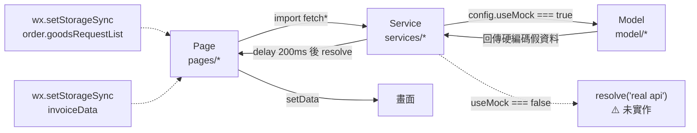

# 00 - 現狀分析

> 產出階段：第一階段（現狀分析）
> 分析對象：`C:\Users\Designer\WeChatProjects\miniprogram-repair`
> 分析日期：2026-10-15
> 本文件只描述「現在是什麼」，不含改造方案。方案見 `01-目標架構.md`、`02-實施計畫.md`。
> 所有無法從程式碼證實的推論，一律標記 **【待確認】**，未經證實者不寫成結論。

---

## 1. 摘要（先講最重要的四件事）

### 1.1 這個專案不是維修平台，是未經改造的 TDesign 零售電商模版

三個獨立來源互相印證：

| 證據 | 內容 |
|---|---|
| `README.md:36` | 「TDesign 零售行业模版示例小程序」 |
| `package.json:2` | `"name": "@tencent/tdesign-miniprogram-starter-retail"` |
| `project.config.json:56` | `"projectname": "tdesign-miniprogram-starter-retail"` |

上游為 <https://github.com/Tencent/tdesign-miniprogram-starter-retail>。

全庫檢索 `維修 / 维修 / 師傅 / 师傅 / technician / repair` → **0 筆業務命中**（唯一「客服」字樣出現在電商「聯繫客服」按鈕，`pages/order/components/customer-service/index.wxml:2`）。

### 1.2 這個專案目前沒有任何後端

全庫檢索 `wx.cloud`、`cloudfunctions`、`callFunction`、`cloudbase`、`wx.request(`、`wx.login(`、`openid` → **0 筆命中**（唯一命中處是本文件自身）。

**沒有雲函數、沒有雲開發環境、沒有資料庫、沒有任何 HTTP 請求。** 所有資料來自本地 mock，見 §7。

### 1.3 沒有版本控制、沒有測試、沒有 `node_modules`

| 項目 | 實測結果 |
|---|---|
| `git status` | `fatal: not a git repository` |
| `package.json` scripts.test | `echo "Error: no test specified" && exit 1` |
| `node_modules/` | 不存在（需先 `npm install`；`miniprogram_npm/` 為既有的建置產物） |

### 1.4 付費流程是假的，退款流程不碰錢

- `pages/order/order-confirm/pay.js:100`：`wx.requestPayment({...})` **整段被註解**，`wechatPayOrder()` 直接呼叫 `paySuccess()` 彈出「支付成功」。
- `services/order/applyService.js`：售後／退款 API 僅回傳 `delay()`，**不動任何金額**。

---

## 2. 分析方法與範圍

| 項目 | 內容 |
|---|---|
| 分析方式 | 全目錄靜態閱讀 + 關鍵字全庫檢索 + 逐檔行數統計 |
| 掃描範圍 | 專案根目錄全部檔案 |
| 排除範圍 | `miniprogram_npm/`（TDesign 建置產物，非本專案原始碼） |
| 未執行 | 未執行 `npm install`、未在微信開發者工具中編譯、未執行任何測試（專案無測試） |
| 行數統計工具 | `find` + `cat` + `wc -l`，涵蓋 `js/wxml/wxss/json/wxs` |

### 2.1 程式碼規模（已排除 `miniprogram_npm/`）

| 區域 | 行數 | 性質 |
|---|---:|---|
| `pages/` | 20,830 | 業務邏輯與 UI 主體（JS 約 10,037 行） |
| `config/` | 20,525 | **約 20,400 行為 `areaData` 省市區靜態資料**，非邏輯 |
| `model/` | 5,794 | **全部是 mock 資料產生器** |
| `components/` | 1,857 | 公共元件 |
| `style/` | 1,557 | 全域樣式與 iconfont |
| `services/` | 869 | 請求層（實為 mock 轉接殼） |
| `utils/` | 254 | 工具函式 |
| `custom-tab-bar/` | 85 | 自訂 tabBar |
| `common/` | 29 | 更新管理器 |
| **合計** | **~51,800** | |

**扣除靜態資料與 mock 後，真正的業務邏輯 JS 約 12,000 行**（`pages` 10,037 + `components` + `utils`）。這是後續評估改造工作量的基準。

---

## 3. 技術棧與運行環境

| 項目 | 現況 | 證據 |
|---|---|---|
| 框架 | 微信原生小程序（無跨端框架） | `app.js`、`app.json` |
| 語言 | JavaScript，**無 TypeScript**（全庫無 `.ts`） | 全庫檢索 |
| UI 庫 | `tdesign-miniprogram` `1.9.5`（精確鎖版） | `package.json:28` |
| 其他依賴 | `dayjs ^1.9.3`、`tslib ^1.11.1` | `package.json:27,29` |
| 建置 | 無自訂建置流程，僅開發者工具「建構 npm」 | `project.config.json` |
| 基礎庫 | `project.config.json:54` 宣告 `3.13.0`；`project.private.config.json:2` 宣告 `3.17.4` → **兩處不一致** | 兩檔對照 |
| Lint / 提交規範 | ESLint 6 + Prettier 2 + husky 8 + commitlint | `package.json`、`commitlint.config.js` |
| 測試框架 | **無** | `package.json` scripts |
| `node_modules` | **不存在** | 目錄檢查 |
| AppID | `wx7f95f4a510129abe` | `project.config.json:55` |
| 雲開發環境 ID | **無** | 全庫檢索 |
| 伺服器域名設定 | **無**（`project.config.json` 無 `requestDomain` 等） | `project.config.json` |

### 3.1 分頁結構（`app.json`）

主包 4 頁 + 5 個分包，共 **29 個頁面**（`README.md` 自稱 28 頁）：

| 分包 | 頁面 |
|---|---|
| 主包 | `pages/home/home`、`pages/category/index`、`pages/cart/index`、`pages/usercenter/index` |
| `pages/user` | `person-info`、`address/list`、`address/edit`、`name-edit` |
| `pages/goods` | `list`、`details`、`search`、`result`、`comments`、`comments/create` |
| `pages/order` | `order-confirm`、`receipt`、`pay-result`、`order-list`、`order-detail`、`apply-service`、`after-service-list`、`after-service-detail`、`fill-tracking-no`、`delivery-detail`、`invoice` |
| `pages/coupon` | `coupon-list`、`coupon-detail`、`coupon-activity-goods` |
| `pages/promotion` | `promotion-detail` |

**tabBar 為自訂**（`app.json:50` `"custom": true`），項目寫死於 `custom-tab-bar/data.js:1-22`：

```
首頁 / 分類 / 購物車 / 個人中心
```

靜態陣列，**無任何依角色動態變化的機制**。

### 3.2 頁面清單（依 JS 行數排序，前 25 名）

| 行數 | 頁面 | 行數 | 頁面 |
|---:|---|---:|---|
| 533 | `order/order-confirm` | 178 | `order/order-list` |
| 441 | `order/apply-service` | 162 | `cart/components/cart-group` |
| 420 | `goods/details` | 132 | `order/components/specs-goods-card` |
| 356 | `user/address/edit` | 131 | `home` |
| 339 | `goods/details/components/goods-specs-popup` | 124 | `user/components/t-location` |
| 294 | `cart` | 122 | `user/person-info` |
| 283 | `order/order-detail` | 119 | `goods/search` |
| 264 | `order/components/goods-card` | 117 | `order/components/reason-sheet` |
| 262 | `goods/result` | 100 | `category/.../c-sidebar` |
| 243 | `cart/components/goods-card` | 95 | `order/components/after-service-button-bar` |
| 233 | `usercenter` | 90 | `order/components/order-card` |
| 227 | `goods/comments` | 87 | `coupon/coupon-list` |
| 226 | `goods/list` | 86 | `goods/comments/create` |
| 215 | `order/after-service-detail` | 78 | `coupon/coupon-activity-goods` |
| 214 | `order/after-service-list` | 73 | `usercenter/components/ui-select-picker` |
| 210 | `order/components/order-button-bar` | 72 | `cart/components/specs-popup` |
| 191 | `user/address/list` | … | （其餘 30 餘個頁面／頁內元件 < 70 行） |
| 190 | `order/fill-tracking-no` | | |
| 182 | `order/receipt` | | |

> 行數最高者集中在 **結算（order-confirm）、售後申請（apply-service）、商品詳情**——這三塊正是改造成維修業務時必須重寫的核心。

### 3.3 組件清單

**全域公共元件**（`components/`，10 個）：

| 目錄 | 用途 | 對維修平台的可能價值 |
|---|---|---|
| `goods-card` | 商品卡片 | 服務／材料商品卡片 |
| `goods-list` | 商品列表 | 服務列表 |
| `filter` / `filter-popup` | 篩選 | 通用 |
| `price` | 價格顯示（分→元） | **可重用** |
| `promotion` / `promotion/ui-coupon-card` | 行銷券 | 可選保留 |
| `swipeout` | 側滑操作 | 通用 |
| `webp-image` | 圖片 | 通用 |
| `load-more` / `loading-content` | 載入狀態 | **可重用** |

**頁內元件**（`pages/**/components/`，約 30 個）：`cart-bar`、`cart-empty`、`cart-group`、`specs-popup`、`goods-category`（含 `c-sidebar`／`c-tabbar`）、`coupon-card`、`floating-button`、`comments-card`、`images-videos`、`my-video`、`buy-bar`、`goods-specs-popup`、`promotion-popup`、`address-card`、`order-card`、`order-button-bar`、`order-goods-card`、`goods-card`、`specs-goods-card`、`reason-sheet`、`selectCoupons`、`after-service-button-bar`、`customer-service`、`noGoods`、`t-location`、`ui-address-item`、`order-group`、`ui-select-picker`、`user-center-card`。

**其他**：`custom-tab-bar`（自訂 tabBar）。

### 3.4 雲函數清單

> **⚠️ 本專案沒有任何雲函數。下表為你要求的格式，內容為空。**

| 雲函數名稱 | 輸入 | 輸出 | 依賴集合 | 支付調用 |
|---|---|---|---|---|
| — | — | — | — | — |

- `cloudfunctions/` 目錄：**不存在**
- `cloudbaserc.json` / `wx.cloud.init()` / `wx.cloud.callFunction`：**不存在**
- 雲開發環境（envId）：**不存在**
- 因此：**「每個雲函數的輸入、輸出、依賴集合、支付調用」這一節無標的物可填。**

### 3.5 請求層清單（`services/`，28 檔）

| 模組 | 檔案 |
|---|---|
| `_utils` | `delay.js`、`timeout.js` |
| `activity` | `fetchActivity.js`、`fetchActivityList.js` |
| `address` | `edit.js`、`fetchAddress.js`、`list.js` |
| `cart` | `cart.js` |
| `comments` | `fetchComments.js`、`fetchCommentsCount.js` |
| `coupon` | `index.js` |
| `good` | `fetchCategoryList.js`、`fetchGood.js`、`fetchGoods.js`、`fetchGoodsDetailsComments.js`、`fetchGoodsList.js`、`fetchSearchHistory.js`、`fetchSearchResult.js`、`comments/fetchCommentDetail.js` |
| `home` | `home.js` |
| `order` | `applyService.js`、`orderConfirm.js`、`orderDetail.js`、`orderList.js`、`orderSubmitComment.js` |
| `promotion` | `detail.js` |
| `usercenter` | `fetchPerson.js`、`fetchUsercenter.js` |

**這 28 個檔案中，沒有一個發出真實網路請求。**

---

## 4. 目前的分層現況

`mock.md` 描述了三層（`model` → `services` → `pages`），實際依賴關係：

```
pages/*            ← 業務邏輯與狀態全在這裡（~10,037 行）
   ↓ import
services/*         ← 「判斷 useMock 後轉呼叫 model」的薄殼
   ↓ require
model/*            ← 產生假資料（5,794 行）
```

### 4.1 `services/` 的真實樣貌

表面上是最終要接 API 的請求層，實際上非 mock 分支**沒有實作**。典型樣式（`services/order/orderConfirm.js`）：

```js
export function fetchSettleDetail(params) {
  if (config.useMock) {
    return mockFetchSettleDetail(params);
  }
  return new Promise((resolve) => {
    resolve('real api');   // ← 佔位字串，非實作
  });
}
```

全庫檢索字串 `'real api'` → 貫穿所有 service 檔案的 else 分支。

**結論：接真實後端這條路目前是空的，不是「已有雛形待啟用」。**

### 4.2 假延遲

`services/_utils/delay.js`：所有「非同步」都是 `setTimeout`。全流程無網路 I/O。

### 4.3 全域開關

`config/index.js:1-4`：

```js
export const config = {
  /** 是否使用mock代替api返回 */
  useMock: true,
};
```

`config/index.js` 全長 455 KB，其中 `areaData`（省市區三級靜態資料）佔約 20,400 行，其餘為 `cdnBase` 與此開關。

---

## 5. 目前資料流（實際行為）



**全流程無網路、無伺服器、無持久化資料庫。** 唯一的跨頁狀態是兩處本地 Storage：

- `pages/cart/index.js` → `order.goodsRequestList`
- `pages/order/receipt/index.js` → `invoiceData`

### 5.1 支付流程現況：假的

`pages/order/order-confirm/pay.js:93-115`：

```js
export const wechatPayOrder = (payOrderInfo) => {
  // const payInfo = JSON.parse(payOrderInfo.payInfo);
  // const { timeStamp, nonceStr, signType, paySign } = payInfo;
  return new Promise((resolve) => {
    // demo 中直接走支付成功
    paySuccess(payOrderInfo);
    resolve();
    /* wx.requestPayment({ ... }); */   // ← 整段被註解
  });
};
```

- 點「付款」→ 直接彈「支付成功」Toast → `wx.redirectTo` 到支付結果頁。
- `payFail()` 仍保留 `'requestPayment:fail cancel'` 分支（`pay.js:57`），是**死代碼**（永遠不會被觸發）。
- `services/order/orderConfirm.js` 的 mock 回傳硬編碼假交易號 `tradeNo: '350930961469409099'`。
- 另有一處硬編碼文案：`pages/order/order-confirm/index.js:420`「支付失败，微信支付商户号设置有误…」——**只是提示文字，不含真實商戶號**。

### 5.2 售後／退款流程現況：純 UI，不碰錢

`pages/order/apply-service/`、`after-service-list/`、`after-service-detail/` 構成電商退貨退款流程，狀態定義於 `pages/order/config.js`。

但 `services/order/applyService.js` 的 `dispatchApplyService`／`dispatchConfirmReceived` **只回傳 `delay()`**，不執行任何退款動作，也完全沒有分帳概念。

> ⚠️ **重要區別**：現有「售後」是**買家寄回商品**的物流流程（含運單號、收貨異常），與你要的「退服務費／退材料費／全額，原路返回 + 分帳回退」是**兩件不同的事**。後者在目前程式碼中完全不存在，不能沿用。

### 5.3 權限流程現況

**完全不存在。**

- 無 `wx.login`、無 `openid`、無 session、無 token。
- 無角色概念。
- 前端無任何權限判斷（因為沒有登入態可判斷）。
- 唯一的「敏感資訊處理」是工具函式 `utils/util.js` 的 `phoneEncryption()`（手機號遮罩），**但沒有任何地方強制呼叫它**。

### 5.4 ⚠️ 與你的禁令直接衝突的既有代碼

`pages/order/components/customer-service/index.js`：

```js
onCall() {
  const { phoneNumber } = this.properties;
  wx.makePhoneCall({ phoneNumber });      // ← 直接撥號
}
```

WXML 中提供「呼叫 {{phoneNumber}}」與「在線客服」兩個按鈕。

**這正是你明令禁止的「師傅端直接撥打客戶電話」的既有實作。** 目前它出現在客戶端的訂單頁（呼叫的是商家客服電話，非客戶號碼），但這是一個**現成的、可直接把客戶號碼餵進去的元件**。改造時必須明確處置，見 `02-實施計畫.md` 的風險項。

---

## 6. 現有業務能力盤點

### 6.1 可重用

| 能力 | 位置 | 對維修平台的價值 |
|---|---|---|
| 商品列表／詳情／規格選擇 | `pages/goods/`、`specs-popup`、`goods-specs-popup` | 對應「服務項目／材料商品」瀏覽 |
| 購物車與結算頁骨架 | `pages/cart/`、`order-confirm/` | 結構可參考，**金額組成必須重做** |
| 訂單列表／詳情 | `order-list/`、`order-detail/` | UI 骨架可重用，**狀態機必須換掉** |
| 收貨地址管理 | `pages/user/address/`、`usercenter/address/` | **可直接重用**為「服務地址」 |
| 優惠券 | `pages/coupon/` | 可保留為行銷能力 |
| 評價 | `pages/goods/comments/` | 可重用為「服務評價」 |
| 自訂 tabBar | `custom-tab-bar/` | 骨架可重用，**需支援角色** |
| 公共元件 | `components/` | 可重用 |
| `priceFormat`（分↔元） | `utils/util.js:11-29` | **可重用**，金額處理的正確起點 |
| `phoneEncryption`（手機號遮罩） | `utils/util.js:106-108` | **可重用**於師傅端脫敏 |

### 6.2 必須廢棄或重寫

| 項目 | 原因 |
|---|---|
| 訂單狀態機 `pages/order/config.js:1-10` | 5/10/40/50/80 表達不了派單、接單、到府、施工、驗收 |
| 售後狀態機（同上，另 3 組列舉） | 退貨物流語意，非維修退款語意 |
| `wechatPayOrder` 假支付 | 必須接真實 `wx.requestPayment` |
| 全部 `services/*` 非 mock 分支 | 是 `resolve('real api')` 佔位，等於沒有實作 |
| `model/*`（5,794 行 mock） | 接真實後端後角色改變，需全面重寫 |
| `pages/order/components/customer-service/` 的撥號能力 | 與「禁止師傅直撥客戶」禁令衝突（見 §5.4） |

### 6.3 完全沒有的

- ❌ 使用者身分（無 `wx.login`、無 openid、無會員表）
- ❌ 角色系統（客戶／客服／師傅／管理員）
- ❌ 權限隔離（前端或後端皆無）
- ❌ 師傅檔案、技能標籤、接單狀態、分帳開通狀態
- ❌ 派單／接單機制
- ❌ 服務項目 vs 材料商品的區分
- ❌ 真實金流（下單支付）
- ❌ 分帳（服務商分帳）
- ❌ 退款（部分退款、服務費／材料費拆分、原路返回）
- ❌ 分帳回退
- ❌ 工單／客服中轉溝通
- ❌ 稽核日誌
- ❌ 後台管理介面
- ❌ 統計看板
- ❌ 任何持久化資料庫
- ❌ 任何雲函數

---

## 7. 現有「資料庫集合」與欄位

### 7.1 結論：沒有任何資料庫集合

無雲開發環境、無 `cloud.database()`、無集合定義檔、無 schema。你在第三階段要求的「舊集合如何兼容」**目前無標的物**。

### 7.2 但 mock 中的實體結構有參考價值

`model/` 產生的假資料結構，是唯一可觀察到的「既有資料模型」，改造時可作為欄位對照：

| 實體 | 來源檔案 | 觀察到的關鍵欄位 |
|---|---|---|
| 訂單（列表／詳情） | `model/order/orderList.js`、`orderDetail.js` | `orderNo`、`orderId`、`uid`、`orderStatus`、`totalAmount`、`goodsAmount`、`paymentAmount`、`freightFee`、`packageFee`、`discountAmount`、`createTime`、`orderItemVOs[]`、`logisticsVO{}`、`paymentVO{}` |
| 訂單項 | 同上 `orderItemVOs[]` | `spuId`、`skuId`、`goodsName`、`specifications[]`、`goodsPictureUrl`、`actualPrice`、`buyQuantity`、`itemTotalAmount`、`itemDiscountAmount` |
| 地址 | `model/address.js` | `addressId`、`phone`、`name`、`provinceName`、`cityName`、`districtName`、`detailAddress`、`isDefault`、`latitude`、`longitude` |
| 結算 | `model/order/orderConfirm.js` | 結算明細、發票、配送方式 |
| 售後 | `model/order/applyService.js` | 售後類型、原因、運單號 |
| 商品／評論／優惠券 | `model/good.js`、`comments.js`、`coupon.js` | 商品 SPU/SKU、評論、券 |

**觀察到的幾個問題（改造時必須避免沿用）：**

| # | 問題 | 證據 |
|---|---|---|
| D1 | 金額欄位語意未定義 | 同時存在 `totalAmount`／`goodsAmount`／`paymentAmount`／`discountAmount`／`freightFee`，**無法直接對應「服務費 + 材料費」** |
| D2 | 金額型別是「字串」而非整數 | `totalAmount: '10010'`（單位為分，但用字串表示） |
| D3 | `model/order/orderDetail.js` 出現重複鍵 | `receiverAddress`、`receiverPhone`、`receiverName` 各出現兩次（後者覆蓋前者） |
| D4 | 電話明文 | `receiverPhone: '17612345678'`（`model/order/orderList.js`） |

### 7.3 支付、分帳、退款相關集合

**全部不存在。** 你的草案中的 `payment_records`、`profit_sharing_records`、`refund_records`、`users`、`technicians` 等，目前皆為零。

---

## 8. 既有技術債與改造風險

### 8.1 阻斷級（動工前必須解決）

| # | 風險 | 說明 |
|---|---|---|
| R1 | **無 git 版本控制** | 無法 diff、無法回滾、無法分支。你的「每階段回滾方案」在此前提下無法成立 |
| R2 | **無任何測試** | 你的禁令要求「不可跳過支付、退款、分帳測試」，但目前連測試框架都不存在 |
| R3 | **密鑰無處可放** | 無後端、無環境變數機制。API v3 key、商戶號、憑證目前**沒有安全的存放位置** |
| R4 | **支付／分帳權限未知** | 分帳（profit_sharing）需服務商模式 + 產品開通。目前無法從程式碼得知你的商戶狀態 |

### 8.2 結構級

| # | 風險 | 說明 |
|---|---|---|
| R5 | 業務邏輯全部塞在 `pages/`（~10,037 行） | 六角形架構要求 domain 獨立，現況是 domain 與 UI 完全纏繞 |
| R6 | `services/` 是空殼 | 接後端時這層要重寫，不是「啟用開關」 |
| R7 | `config/index.js` 455 KB，99% 是靜態 `areaData` | 不影響邏輯，但干擾閱讀、搜尋與工具索引 |
| R8 | 基礎庫版本兩處不一致（3.13.0 vs 3.17.4） | 團隊成員行為可能不一致 |
| R9 | 依賴 `tdesign-miniprogram@1.9.5` 精確鎖版 | 升級需一併驗證，不宜在改造期間升級 |

### 8.3 設計級

| # | 風險 | 說明 |
|---|---|---|
| R10 | `OrderStatus` 四個語意共用數值 `80` | `pages/order/config.js:6-9`：`PAYMENT_TIMEOUT`、`CANCELED_NOT_PAYMENT`、`CANCELED_PAYMENT`、`CANCELED_REJECTION` 全等於 `80`，無法區分取消原因。**新狀態機不可沿用此寫法** |
| R11 | 金額以「分」為單位但型別是字串 | `utils/util.js:11` 註解明示「以分為單位」，mock 內多為 `'10010'` 字串。真實金流必須統一為整數分 |
| R12 | `priceFormat` 使用 `Math.ceil`（向上取整） | 用於顯示尚可，**若被誤用於金額計算會產生誤差** |
| R13 | `custom-tab-bar/data.js` 寫死 4 項 | 不支援角色差異 |
| R14 | 無 TypeScript | 六角形架構的 port 介面沒有型別強制，需靠 lint 與 code review 補足 |
| R15 | ESLint 6（2019 年版本） | 偏舊，且無法支援現代 TS/ESLint 生態 |

### 8.4 資安級（與你的禁令直接相關）

| # | 風險 | 說明 |
|---|---|---|
| S1 | **現成的撥號元件** | `pages/order/components/customer-service/index.js` 的 `wx.makePhoneCall`，見 §5.4。改造時若被複用到師傅端，即直接違反禁令 |
| S2 | 客戶手機號明文散落於 mock | `model/order/orderList.js`、`model/address.js` 皆為明文；`phoneEncryption` 存在但**非強制、無呼叫點** |
| S3 | 無 `wx.login` | 沒有可信身分來源，所有權限判斷無從附著 |
| S4 | 前端無角色，但改造時極易誤加 | 禁令「不要在前端判斷角色權限」目前是空的；一旦加入頁面級角色邏輯，就會落入「前端判斷權限」的陷阱 |
| S5 | 無稽核日誌機制 | 你的草案 `audit_logs` 為零，且目前無任何寫入日誌的基礎設施 |

---

## 9. 目標 vs 現況對照

| 你的驗收標準 | 現況 | 差距 |
|---|---|---|
| 四種角色權限正確隔離 | 無角色概念 | **從零建立** |
| 客戶下單付款全流程可測試 | 假支付 | **從零建立** |
| 客服派單 | 無 | **從零建立** |
| 師傅接單 | 無 | **從零建立** |
| 分帳 | 無 | **從零建立** |
| 退款（服務費／材料費／全額，原路返回） | 僅電商退貨 UI | **從零建立** |
| 分帳回退 | 無 | **從零建立** |
| 後台可改商品與服務，歷史訂單價格不變 | 無後台；金額為 mock 字串 | **從零建立**（需快照設計） |
| 師傅只看自己的訂單報酬，看不到客戶完整敏感資料 | 無 | **從零建立** |
| 後台統計看板與管理功能 | 無 | **從零建立** |
| 六角形架構，domain 不依賴微信雲 API | 無分層，邏輯散在 `pages/` | **需結構性重構** |

### 9.1 對後續階段前提的修正

你的第三階段指令假設存在「舊集合」，並要求「新舊集合如何兼容」。**經查證，目前沒有任何資料庫、集合、雲開發環境或後端程式碼。**

因此：

- 「資料庫遷移」實際上不是 **migration**，而是 **greenfield 全新設計**。
- 「不刪除現有集合」這條禁令目前無標的物。
- 「舊集合兼容」若確實有需求，來源必然是**這個 repo 之外的既有系統**。
- 同理，「重構後端為六角形架構」實為「**新建**六角形架構後端」——沒有舊後端可重構。

👉 這是待確認問題 **Q2**。

---

## 10. 待確認問題（需要你回覆）

以下問題會直接改變第二、三階段的設計。**在取得回覆前，我不會開始改任何程式碼。**

### 🔴 阻斷級（必須先答）

**Q1. 版本控制**
專案未初始化 git。我是否可以在第二階段開始前，先執行 `git init` + 建立 `.gitignore` + 一次初始 commit（作為回滾基準點）？
（若你已有其他 repo／備份機制，請告知。）

**Q2. 「舊集合」與「舊後端」在哪裡？**
目前 repo 內確認**零後端、零資料庫**。你提到的「舊集合如何兼容」是指：
- (a) 其實沒有舊系統，全新設計即可 → 我把「資料庫遷移」改為「資料庫建立」
- (b) 有另一個既有後端／資料庫在這個 repo 之外 → 請提供位置或結構
- (c) 有舊版小程序的線上資料 → 請說明資料量與來源

**Q3. AppID 與雲開發環境**
`project.config.json:55` 的 `appid: wx7f95f4a510129abe` 是你自己的 AppID，還是模版預設值？
該 AppID 是否已開通：微信雲開發（CloudBase）？微信支付（商戶號）？

**Q4. 後端形態**
你要的「雲函數」具體是哪一種？
- (a) **微信雲開發雲函數**（CloudBase，`wx.cloud.callFunction`，含雲支付 `cloudPay`）
- (b) 自建 Node 後端 + 微信支付 APIv3
- (c) 其他（騰訊雲函數 SCF／自架伺服器）

> 這題牽動「雲函數拆分方案」與「共享代碼方案」的全部設計。你的禁令提到「API v3 key」，暗示可能是 (b)，但又說「雲函數」——兩者可並存（雲函數內呼叫 APIv3），需你明確。
> 補充：若選 (a)，微信雲開發另有「雲支付」與「雲開發 CMS」，與 APIv3 直連是兩條不同的技術路線。

**Q5. 微信支付商戶模式與分帳能力（本案最大外部風險）**
分帳（profit_sharing）有嚴格前提：
- 商戶號是**普通商戶**還是**服務商（合作夥伴）**？
- 是否已開通 **profit_sharing** 產品權限？
- **師傅**以什麼身分收款？特約商戶？個人 openid（需實名）？或不走微信分帳、改平台代收後另行結算？
- 分帳比例是固定（如平台 20%／師傅 80%）還是逐單可調？
- 師傅是否已開啟「同意分帳回退」（你的規則 6 要求退款前先分帳回退，**微信要求接收方開啟此權限**）？

> 這題若答不出來，分帳與分帳回退無法設計。

**Q6. 後台形態**
- (a) 小程序內的管理員頁面（同一支小程序，角色切換）
- (b) 獨立 Web 後台（雲開發靜態託管）
- (c) 雲開發 CMS 低代碼後台
- (d) 其他

> 工作量差異極大，必須先定。

**Q7. 客服端形態**
- (a) 同一支小程序內的角色
- (b) 獨立的小程序／Web 工作台

### 🟡 業務規則級（可後補，但影響資料模型）

**Q8. 角色取得方式**
四種角色如何認定？管理員後台指派？申請審核制？一人可否多角色？

**Q9. 訂單狀態機**
我的理解是：
`待付款 → 已付款待派單 → 已派單待接單 → 已接單待上門 → 服務中 → 待驗收 → 已完成 →（售後）`
請確認或修正，特別是：客戶能否取消？師傅能否拒單／轉單？逾時未接單如何處理？

**Q10. 服務費 vs 材料費**
- 材料是平台統一定價，還是師傅現場報價？
- 兩者分開支付還是合併支付？
- 分帳時師傅的分潤基數是「服務費」還是「服務費＋材料費」？
- 「自訂部分退款」你的規則 5 標了「若可行」——**微信支付單筆訂單最多 50 次部分退款**，且每次需不同商戶退款單號；若你要的是「按明細項退」而非「按金額退」，需要在設計階段明確定義。

**Q11. 歷史訂單價格不變**
我的理解是下單時**快照**商品名稱、規格、單價到 `order_items`。
請確認：**分潤比例是否也一併快照**？（若後台改了比例，舊訂單是否仍用舊比例？）

**Q12. 師傅端資料可見範圍**
「看不到客戶完整敏感資料」的具體界線？你提到「姓名只顯示姓氏、手機 138****1234、地址只顯示區域」，請確認：
- 服務當天是否揭露完整地址（否則師傅無法到府）？
- 是否需要平台虛擬號（`wx.makePhoneCall` 的隱私號方案）？
- 你已明令「師傅端不提供直接撥打客戶電話」——那師傅到府前如何聯繫客戶？**這是一個必須先解的業務閉環。**

**Q13. 現有電商功能保留範圍**
購物車、優惠券、拼團、積分、發票、物流這些零售功能：保留？改造？下線？

> 你的禁令說「不要刪除現有功能」，我預設全部保留，但這會讓首頁／tabBar 改造變複雜。請確認優先順序。

**Q14. 是否同意移除撥號元件（§5.4）**
`pages/order/components/customer-service/` 的 `wx.makePhoneCall` 是現成的直撥能力。我建議在師傅端**完全不出現**此元件。是否需要我先做這項隔離？

---

## 11. 結論

1. **這是一個乾淨的官方模版，不是半成品維修專案。** 好處：沒有歷史包袱、沒有需要兼容的舊程式碼；壞處：每一項核心能力都要從零建立。

2. **「分析 → 架構 → 資料庫 → 後端 → 支付 → 前端 → 後台 → 測試 → 上線」中，除了前端骨架可部分重用，其餘每一項都是新建。** 原估工作量需上修。

3. **最大不確定性不在程式碼，在外部依賴**：微信支付商戶模式與分帳權限（Q5）、雲開發環境（Q3）、後端形態（Q4）、後台形態（Q6）。這些未定案前，架構設計會反覆。

4. **動工前必須先建立安全網**：git 版本控制（Q1）與測試框架（R2）。你的禁令明確要求「不可跳過支付、退款、分帳測試」——但金流與分帳**無法在沒有後端與商戶號的情況下測試**，這點必須誠實排入實施計畫的前置條件。

5. **兩個與禁令直接相關的既有事實必須先處理**：撥號元件（§5.4 / Q14）、手機號明文散落（S2）。

---

**⏸ 第一階段結束。等待你回覆第 10 節的問題後，才進入第二階段（目標架構設計）。**
