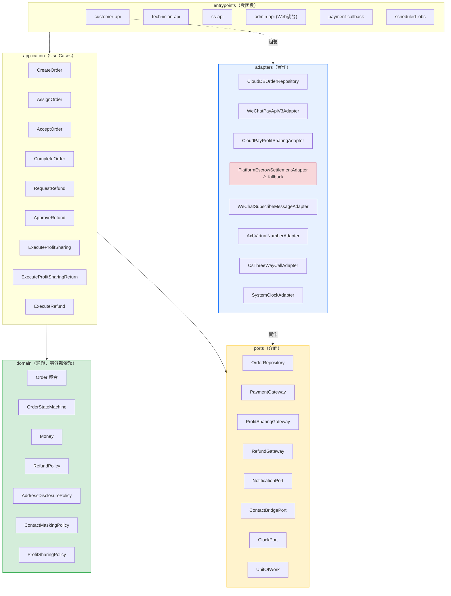
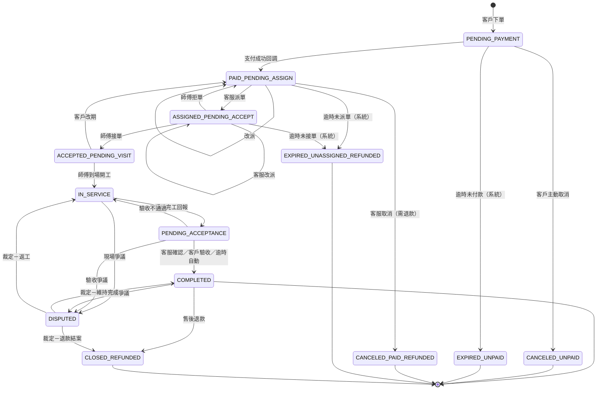
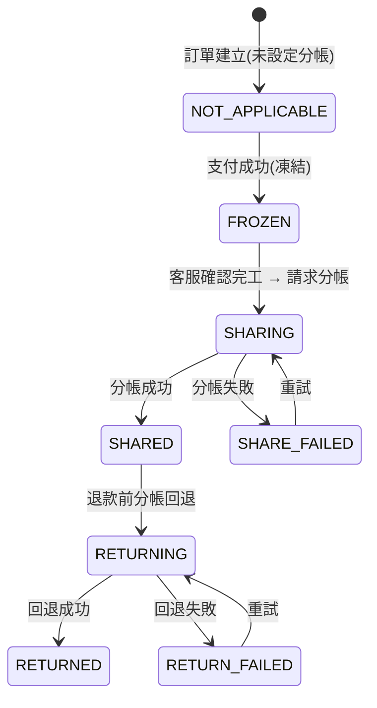
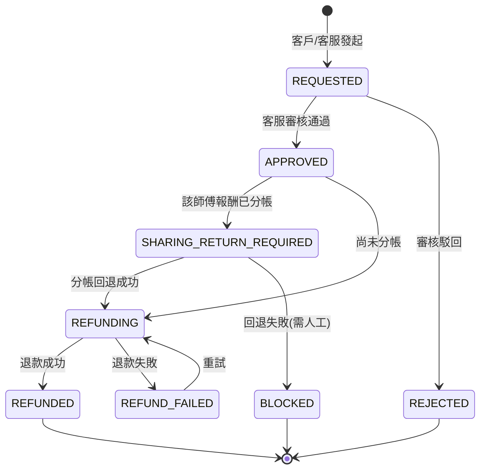

# 01 - 目標架構

> 產出階段：第二階段（目標架構設計）
> 前置文件：`docs/00-現狀分析.md`
> 產出日期：2026-10-15
> 分支：`refactor/hexagonal`（baseline：`main` @ `1f38b93`）
> **本文件只做設計，不含實作。尚未修改任何業務代碼、未建立雲函數、未動資料庫。**

---

## 0. 已確認的前提（來自你的回覆）

| # | 決策 | 對架構的影響 |
|---|---|---|
| Q1 | ✅ git 已建立，baseline 已提交 | 具備回滾能力 |
| Q2 | **Greenfield**，無舊後端／無舊資料 | 「遷移」改為「新建」；無兼容層 |
| Q3 | AppID `wx7f95f4a510129abe`；雲開發環境 ID 待補 | 部署細節待定，不阻擋設計 |
| Q4 | **微信雲開發雲函數 + `wx-server-sdk`**；支付／分帳／退款全部封裝於 adapter | 共享代碼方案成為核心議題（§5） |
| Q5 | 按**服務商分帳模式**設計，但 adapter 需預留 **平台代收 + 企業付款** fallback | 需獨立風險章節（§9） |
| Q6 | 客服端、師傅端＝**同一支小程序內的角色入口** | 三個角色共用客戶端代碼，靠路由與元件隔離 |
| Q7 | 管理端＝**獨立 Web 後台**（微搭／React Admin，我不做前端） | `admin-api` 需提供純 JSON API |
| Q12 | 地址分階段揭露；聯繫走 AXB 虛擬號或三方通話；**師傅端絕不顯示真實手機號** | domain 需 `AddressDisclosurePolicy`、`ContactMaskingPolicy` |
| Q13 | 保留：商品／訂單／地址／訂單詳情／支付骨架。下線：購物車／優惠券／拼團／發票／物流。tabBar 改為「首頁／服務／訂單／我的」 | 前端改造範圍明確 |

---

## 1. 設計原則

1. **domain 純淨**：`domain/` 不得 import `wx-server-sdk`、`wx.cloud`、任何 HTTP client、任何時間來源（`Date.now()` 需經 `ClockPort`）。這是可測試性與可替換性的唯一保證。
2. **依賴單向向內**：`entrypoints → application → domain`；`adapters → ports ← application`。domain 不知道外界的任何事。
3. **金額一律整數「分」**：`Money` 值物件，禁止浮點、禁止字串金額（修正現狀 D2）。
4. **所有權限判斷在後端**：前端只負責「顯示或不顯示」，不負責「能不能做」。路由／按鈕的角色邏輯只是 UX，不是安全邊界。
5. **失敗可補償**：支付、分帳、退款皆為跨系統非同步操作，一律採 **狀態機 + 冪等 + 補償（Saga）**，不依賴單次呼叫成功。
6. **每次外部呼叫都留痕**：`audit_logs` 與各 `*_records` 為唯一事實來源，debug 靠資料庫不靠日誌。

### 1.6 依賴方向與 CI 檢查（P1 驗收依據）

> 這一節把前面所有「應該」變成**可機械驗證的規則**。規則若無法被腳本檢查，就只是願望。

#### 1.6.0 本次稽核發現並修正的設計缺陷

依你的要求「若目前設計有任何一處不符合檢查點，直接修正，不要粉飾」，我重新檢視了本文件，發現**三處真實缺陷**：

| # | 缺陷 | 為什麼是問題 | 修正 |
|---|---|---|---|
| **F1** | `packages/` 位於專案根目錄，而小程序根目錄**也是**專案根目錄 | 微信開發者工具會把 `packages/`、`scripts/`、`tests/`、`docs/` 一併打包進**小程序**程式碼包，撐大體積、且讓 domain 原始碼進入前端包 | `project.config.json` 的 `packOptions.ignore` 必須排除這些目錄（**P0 執行**） |
| **F2** | 前文只說「Use Case 回傳 DTO」，但沒有明文禁止回傳實體 | 只要有一個 Use Case 回傳 `Order` 實體，§3.4 的 `AddressView`／`MaskedPhone` 型別保證**全部失效** | §1.6.3 明文列為硬規則 + CI 檢查 |
| **F3** | composition root 的位置在 §2.1 提過，但未定義「唯一性」 | 若 `index.js` 與 `bootstrap.js` 都能 `new Adapter`，測試就無法替換 | §1.6.4 + §1.6.6 明文化：**只有 `bootstrap.js` 可 new adapter** |

> F1 是三者中唯一會**實際影響交付物**的（前端包被污染）。其餘兩者是紀律漏洞。

#### 1.6.1 domain 層禁止 import 清單

**可 grep 的具體字串**（`packages/domain/**` 不得出現）：

| 禁止字串 / 正則 | 原因 |
|---|---|
| `wx-server-sdk` | 微信雲 SDK |
| `wx.cloud` | 小程序雲 API 全域物件 |
| `DYNAMIC_CURRENT_ENV` | 雲開發環境常數 |
| `cloud.database` / `cloud.callFunction` / `cloud.getWXContext` | 雲開發 API |
| `getWXContext` | 微信上下文 |
| `.collection(` / `db.collection` | 直接存取資料庫 |
| `Date.now(` | 非確定性時間 → 必須用 `ClockPort` |
| `new Date()` | 同上 |
| `Math.random(` | 非確定性隨機 → 必須用 `IdGeneratorPort` |
| `process.env` | 環境變數只允許 adapter 讀 |
| `console.log` / `console.error` / `console.warn` | 必須用 `LoggerPort` |
| 任何 `require()`/`import` **非相對路徑**且非 `@repair/shared-kernel` 者 | domain 只允許依賴自己與 shared-kernel |

**唯一允許的外部依賴**：`@repair/shared-kernel`（且 shared-kernel 本身亦須零依賴）。

#### 1.6.2 ports 層禁止出現的型別清單

**`packages/ports/**` 不得出現**：

| 禁止字串 | 原因 |
|---|---|
| `wx-server-sdk` | SDK 型別不得滲入介面 |
| `cloud.` / `DYNAMIC_CURRENT_ENV` | 雲開發型別 |
| `Database` / `Collection` / `DocumentReference` / `ServerDate` / `Command` | 雲資料庫型別 |
| `WeChatPay*` / `WxPay*` | 支付 SDK 型別 |
| `axios` / `node-fetch` / `require('http')` | HTTP client 型別 |
| `new ` （任何實例化） | ports 只能是介面，不得有實作 |
| `function` 帶**方法體**的 `class` | 同上 |

**允許的依賴**：僅 `@repair/shared-kernel` 與 `@repair/domain`（**只取型別**）。

#### 1.6.3 Use Case 依賴注入 — 完整骨架

**硬規則**：
1. 所有依賴一律 **constructor injection**。
2. Use Case 內**不得出現 `new`**（除了 `Result`／值物件等無依賴物件）。
3. **不得回傳實體**（F2）—— 只能回傳 DTO 或值物件。

```js
// packages/application/order/AssignOrderUseCase.js
'use strict';

const { OrderStatus } = require('@repair/domain/order/OrderStatus');
const { Result } = require('@repair/shared-kernel/Result');
const { toTechnicianOrderDTO } = require('../dto/orderDTO');

class AssignOrderUseCase {
  /**
   * ✅ 所有依賴由建構子注入。
   * ❌ 不得寫成：const repo = new CloudDBOrderRepository() —— adapter 只能由 bootstrap 建立。
   */
  constructor({ orderRepository, technicianRepository, unitOfWork, auditLog, notification, clock, idGenerator }) {
    this.orderRepository = orderRepository;
    this.technicianRepository = technicianRepository;
    this.unitOfWork = unitOfWork;
    this.auditLog = auditLog;
    this.notification = notification;
    this.clock = clock;
    this.idGenerator = idGenerator;
  }

  /** 第 2 層校驗：角色 */
  static get allowedRoles() {
    return ['cs_agent', 'admin'];
  }

  async execute({ actor, orderId, technicianId, remark }) {
    // ── 第 3 層校驗：資源歸屬（必須在 Use Case 內，不在入口）──
    if (actor.role === 'cs_agent' && !actor.assignedRegions.includes('*')) {
      const tech = await this.technicianRepository.findById(technicianId);
      if (!tech || !actor.assignedRegions.includes(tech.regionCode)) {
        return Result.forbidden('該師傅不在你負責的區域內');
      }
    }

    return this.unitOfWork.run(async (tx) => {
      const order = await this.orderRepository.findById(orderId, { tx });
      if (!order) return Result.notFound('訂單不存在');

      // 前置條件由 domain 判斷，Use Case 只負責編排
      const transition = order.stateMachine().canAssign(actor);
      if (!transition.ok) return transition.toResult();

      const technician = await this.technicianRepository.findById(technicianId, { tx });
      if (!technician || !technician.canAcceptOrders()) {
        return Result.conflict('該師傅目前無法接單');
      }

      const before = order.toSnapshot();
      order.assignTo(technician.id, { at: this.clock.now(), by: actor.id, remark });
      await this.orderRepository.save(order, { tx });
      await this.auditLog.append({ actor, action: 'AssignOrder', target: orderId, before, after: order.toSnapshot() }, { tx });

      tx.onCommit(() => this.notification.notifyTechnicianAssigned(technician.userId, order.id));

      // ✅ 回傳 DTO，不回傳 order 實體（F2）
      return Result.ok(toTechnicianOrderDTO(order));
    });
  }
}

module.exports = { AssignOrderUseCase };
```

> **注意 `idGenerator` 的用途**：若 Use Case 需要產生單號，**必須經 `IdGeneratorPort`**，不可用 `Math.random()`／`Date.now()`——否則測試無法重現。

> **⚠️ 一個容易踩的循環依賴（設計時發現並已修正）**：`ClockPort` 若放進 `shared-kernel`，會迫使 `domain` 依賴它；但 `ClockPort` 是 Port，而 Port 依賴 domain → **循環**。
> 解法：**`ClockPort`／`IdGeneratorPort`／`LoggerPort` 一律放 `packages/ports`**，而 domain 的純函式**以參數接收 `now`／`id`**（例如 `AddressDisclosurePolicy.discloseFor({ ..., now })`）。domain 因此完全不需要任何 Port，只依賴 `shared-kernel`。

#### 1.6.4 雲函數入口職責邊界 — 完整骨架

**入口只做四件事**：① 參數校驗 ② 身分驗證 ③ 呼叫 use case ④ 回傳結果。**不得有任何 if/else 業務規則。**

```js
// cloudfunctions/cs-api/index.js
'use strict';
const cloud = require('wx-server-sdk');
cloud.init({ env: cloud.DYNAMIC_CURRENT_ENV });          // 唯一允許 init 的地方

const { buildContainer } = require('./bootstrap');         // 唯一的組裝點
const { authenticate } = require('./middleware/authenticate');
const { validate } = require('./middleware/validate');
const { toResponse } = require('./middleware/toResponse');
const { AssignOrderUseCase } = require('@repair/application/order/AssignOrderUseCase');

const container = buildContainer();                        // 模組載入時組裝一次

// ① 參數校驗：這裡只描述「形狀」，不含業務規則
const SCHEMA = {
  orderId: { type: 'string', required: true, maxLength: 64 },
  technicianId: { type: 'string', required: true, maxLength: 64 },
  remark: { type: 'string', required: false, maxLength: 200 },
};

exports.main = async (event) => {
  try {
    const input = validate(event, SCHEMA);                 // ① 參數校驗
    const actor = await authenticate(cloud.getWXContext(), container); // ② 身分驗證
    // ②' 角色校驗：只比對宣告，不含規則
    if (!AssignOrderUseCase.allowedRoles.includes(actor.role)) {
      return toResponse.forbidden();
    }
    const useCase = new AssignOrderUseCase(container);     // ③ 呼叫 use case
    const result = await useCase.execute({ actor, ...input });
    return toResponse(result);                             // ④ 回傳結果
  } catch (err) {
    return toResponse.error(err);                          // 統一的錯誤轉譯
  }
};
```

**禁止出現在 `index.js` 的東西**：`if` 判斷訂單狀態、金額加減、`for` 迴圈處理業務資料、任何 `db.collection(...)`。

#### 1.6.5 adapters 層職責邊界 — 完整骨架

**adapter 只做「翻譯」**：把外部世界的形狀 ↔ domain 的形狀。**零業務規則。**

```js
// packages/adapters/clouddb/CloudDBOrderRepository.js
'use strict';

const { Order } = require('@repair/domain/order/Order');
const { OrderStatus } = require('@repair/domain/order/OrderStatus');
const { Money } = require('@repair/shared-kernel/Money');

class CloudDBOrderRepository {
  /** db 由外部注入 —— adapter 不自己 cloud.init() */
  constructor({ db, collectionName = 'orders' }) {
    this.db = db;
    this.collectionName = collectionName;
  }

  async findById(orderId, { tx } = {}) {
    const col = (tx ? tx.db : this.db).collection(this.collectionName);
    const res = await col.where({ order_id: orderId }).limit(1).get();
    return res.data.length ? this.#toDomain(res.data[0]) : null;
  }

  async save(order, { tx } = {}) {
    const col = (tx ? tx.db : this.db).collection(this.collectionName);
    const row = this.#toRow(order);
    await col.doc(order.persistenceId).set({ data: row });   // 樂觀鎖：比對 order.version
  }

  // ── 以下是純翻譯，不含任何判斷 ──

  #toDomain(row) {
    return Order.rehydrate({
      id: row.order_id,
      status: OrderStatus.fromValue(row.status),      // 列舉轉換
      amounts: {
        serviceFee: Money.fromCents(row.service_fee_cents),
        materialFee: Money.fromCents(row.material_fee_cents),
      },
      items: row.items.map((i) => ({ /* 欄位對欄位 */ })),
      version: row.version,
    });
  }

  #toRow(order) {
    return {
      order_id: order.id,
      status: order.status.value,
      service_fee_cents: order.amounts.serviceFee.cents,
      material_fee_cents: order.amounts.materialFee.cents,
      items: order.items.map((i) => ({ /* 欄位對欄位 */ })),
      version: order.version,
    };
  }
}

module.exports = { CloudDBOrderRepository };
```

**adapter 絕對禁止出現**（紅旗範例）：

```js
// ❌❌❌ 這是 adapter 裡最危險的寫法
#toRow(order) {
  const commission = order.total.cents * 0.8;              // ❌ 金額計算
  const status = order.paid ? OrderStatus.ASSIGNED : order.status;  // ❌ 狀態流轉
  if (commission > 10000) { /* ... */ }                    // ❌ 業務規則
}
```

> **判準**：若把 adapter 換成 in-memory fake，**業務行為必須完全不變**。若會變，就代表業務邏輯漏在 adapter 裡了。

#### 1.6.6 CI 可執行的 grep 腳本

零依賴 Node 腳本，`scripts/check-layering.js`：

```js
#!/usr/bin/env node
'use strict';
// 六角形依賴方向檢查器。用法：node scripts/check-layering.js  （違規則 exit 1）
const fs = require('fs');
const path = require('path');

const ROOT = path.resolve(__dirname, '..');

/** 每個層允許 require 的套件（相對路徑一律允許） */
const ALLOWED_DEPS = {
  'packages/shared-kernel': [],
  'packages/domain': ['@repair/shared-kernel'],
  'packages/ports': ['@repair/shared-kernel', '@repair/domain'],
  'packages/application': ['@repair/shared-kernel', '@repair/domain', '@repair/ports'],
  'packages/adapters': null, // null = 不限制（這是邊界層，負責碰外部世界）
};

/** domain 層禁止出現的字串 */
const DOMAIN_FORBIDDEN = [
  [/wx-server-sdk/, '微信雲 SDK'],
  [/\bwx\.cloud\b/, 'wx.cloud'],
  [/DYNAMIC_CURRENT_ENV/, '雲開發環境常數'],
  [/cloud\.(database|callFunction|getWXContext)/, '雲開發 API'],
  [/getWXContext/, '微信上下文'],
  [/\.collection\s*\(/, '直接存取資料庫'],
  [/Date\.now\s*\(/, '非確定性時間 → 用 ClockPort'],
  [/new\s+Date\s*\(\s*\)/, '非確定性時間 → 用 ClockPort'],
  [/Math\.random\s*\(/, '非確定性隨機 → 用 IdGeneratorPort'],
  [/process\.env/, '環境變數只能由 adapter 讀'],
  [/console\.(log|error|warn)\s*\(/, '須用 LoggerPort'],
];

/** ports 層禁止出現的字串 */
const PORTS_FORBIDDEN = [
  [/wx-server-sdk/, 'SDK 型別不得滲入介面'],
  [/cloud\.|DYNAMIC_CURRENT_ENV/, '雲開發型別'],
  [/\b(Database|Collection|DocumentReference|ServerDate|Command)\b/, '雲資料庫型別'],
  [/(WeChatPay|WxPay)/, '支付 SDK 型別'],
  [/(axios|node-fetch|require\(['"]https?['"]\))/, 'HTTP client 型別'],
  [/\bnew\s+\w+\s*\(/, 'ports 只能是介面，不得實例化'],
];

const violations = [];

function walk(dir, out = []) {
  if (!fs.existsSync(dir)) return out;
  for (const e of fs.readdirSync(dir, { withFileTypes: true })) {
    const p = path.join(dir, e.name);
    if (e.isDirectory()) { if (e.name !== 'node_modules') walk(p, out); }
    else if (e.name.endsWith('.js')) out.push(p);
  }
  return out;
}

const rel = (p) => path.relative(ROOT, p).replace(/\\/g, '/');
const isTest = (r) => /(^tests\/|\.test\.js$|\.spec\.js$)/.test(r);

function scan(dirRel, forbidden, label) {
  for (const file of walk(path.join(ROOT, dirRel))) {
    const r = rel(file);
    if (isTest(r)) continue;
    const src = fs.readFileSync(file, 'utf8');
    src.split('\n').forEach((line, i) => {
      if (/^\s*(\/\/|\*|\/\*)/.test(line)) return;         // 略過註解
      for (const [re, why] of forbidden) {
        if (re.test(line)) violations.push({ file: r, line: i + 1, why: `${label}：${why}`, text: line.trim().slice(0, 80) });
      }
    });
  }
}

function checkDeps(dirRel) {
  const allowed = ALLOWED_DEPS[dirRel];
  if (allowed === null) return;
  for (const file of walk(path.join(ROOT, dirRel))) {
    const r = rel(file);
    if (isTest(r)) continue;
    const src = fs.readFileSync(file, 'utf8');
    const re = /(?:require\s*\(\s*|from\s+)['"]([^'"]+)['"]/g;
    let m;
    while ((m = re.exec(src))) {
      const dep = m[1];
      if (dep.startsWith('.')) continue;                    // 相對路徑一律允許
      if (!dep.startsWith('@repair/')) {
        violations.push({ file: r, why: `依賴方向：不得 require 外部套件 "${dep}"`, text: m[0] });
      } else if (!allowed.includes(dep)) {
        violations.push({ file: r, why: `依賴方向：${dirRel} 不得依賴 "${dep}"`, text: m[0] });
      }
    }
  }
}

/** 只有 bootstrap.js 可以 new adapter */
function checkAdapterInstantiation() {
  for (const dirRel of ['cloudfunctions', 'packages']) {
    for (const file of walk(path.join(ROOT, dirRel))) {
      const r = rel(file);
      if (isTest(r) || /bootstrap\.js$/.test(r)) continue;
      const src = fs.readFileSync(file, 'utf8');
      src.split('\n').forEach((line, i) => {
        if (/^\s*(\/\/|\*|\/\*)/.test(line)) return;
        const m = line.match(/new\s+\w*Adapter\s*\(/);
        if (m) violations.push({ file: r, line: i + 1, why: '組裝點唯一性：只有 bootstrap.js 可 new adapter', text: line.trim().slice(0, 80) });
      });
    }
  }
}

// ── 執行 ──
scan('packages/domain', DOMAIN_FORBIDDEN, 'domain');
scan('packages/ports', PORTS_FORBIDDEN, 'ports');
for (const d of Object.keys(ALLOWED_DEPS)) checkDeps(d);
checkAdapterInstantiation();

if (violations.length === 0) {
  console.log('✓ 依賴方向檢查通過');
  process.exit(0);
}
console.error(`✗ 發現 ${violations.length} 處違規：\n`);
for (const v of violations) {
  console.error(`  ${v.file}${v.line ? ':' + v.line : ''}  [${v.why}]`);
  if (v.text) console.error(`      ${v.text}`);
}
process.exit(1);
```

**掛載點**：

```json
{ "scripts": { "check:layering": "node scripts/check-layering.js",
               "lint:arch": "npm run check:layering" } }
```

`.husky/pre-commit` 加入 `npm run check:layering && npm run sync:check`。

> **這支腳本就是 §1.6 全節的可執行版本。** 它同時涵蓋你要求的五個檢查點中的 1、2、3（部分），以及檢查點 6 的靜態面。

### 1.7 P1 解耦驗收清單

> 以下是你會在 P1 完成後逐項檢查的清單。**每一項都附上「你怎麼自己驗證」，而不是要你相信我的說法。**

| # | 檢查項 | 合格標準 | 你的驗證方式 | 自動化 |
|---|---|---|---|---|
| 1 | **domain 可在不啟動微信雲環境下跑單元測試** | 測試在**離線、無雲環境、無網路**的機器上通過；執行時間 < 1 秒 | `npm run test:domain`，並確認測試檔中**沒有任何** `wx-server-sdk` | ✅ `check:layering` + 測試 |
| 2 | **ports 全部是 interface，無具體實現** | 每個 port 檔案只有 JSDoc typedef 與匯出標記；無方法體、無 `new`、無 SDK 型別 | `node scripts/check-layering.js` 對 `packages/ports` 零違規；人工翻閱任一個 port 檔 | ✅ 部分（靜態檢查） |
| 3 | **use case 全部 constructor injection** | `packages/application` 內**零個 `new`**（`Result` 等無依賴物件除外） | `grep -rn "new " packages/application/` 檢視每一筆 | ⚠️ 需人工判讀最後幾筆 |
| 4 | **雲函數入口零業務邏輯** | 每個 `index.js` 只含：validate / authenticate / `useCase.execute` / toResponse；且 < 60 行 | `node scripts/check-layering.js` + `wc -l cloudfunctions/*/index.js` | ✅ 行數可自動；語意需人工 |
| 5 | **adapters 零業務邏輯** | adapters 內無 `Money` 運算、無 `OrderStatus` 比較、無比例計算 | `grep -rnE "\*|/|\+|-" packages/adapters/ \| grep -i "cents\|amount\|rate"` 應為零 | ⚠️ 需人工判讀 |
| 6 | **有 in-memory adapter 可替換真 adapter 跑測試** | 整合測試全程使用 in-memory；能跑完整訂單流程；切換只改 bootstrap 一行 | `npm run test:integration`；且 `git diff` 顯示切換僅動 bootstrap | ✅ 測試 |

**補充硬規則（來自 F2，必須一併檢查）**：

| # | 檢查項 | 合格標準 | 驗證方式 |
|---|---|---|---|
| 7 | **Use Case 不回傳實體** | 所有 `packages/application/**` 的 `return` 皆為 `Result` 包 DTO | 「師傅端 DTO 掃描測試」斷言無 `/\d{11}/` 與 `detailAddress` |
| 8 | **師傅端不可能取得完整敏感資料** | 遍歷所有師傅端 Use Case × 所有訂單狀態，回傳 JSON 不含完整手機號、完整地址、抽成 | 同上，此測試**必須存在且通過** |

**驗收的執行方式**：P1 完成後，我會執行上述全部指令並附上**原始輸出**（非摘要），你可自行複跑核對。若有任何一項未達標，我會直接說明，不以「大致符合」帶過。

---

## 2. 六角形分層與模組劃分

### 2.1 分層職責

| 層 | 職責 | 允許依賴 | 禁止 |
|---|---|---|---|
| `domain` | 實體、值物件、狀態機、領域策略、金額計算 | 僅標準 JS | 微信 API、DB、HTTP、`Date.now()`、`Math.random()` |
| `application` | Use Case 編排、權限規則、交易邊界、Saga 補償 | `domain`、`ports` | 任何具體 SDK |
| `ports` | 介面定義（TypeScript 風格 JSDoc 或 .d.ts） | `domain`（僅型別） | 任何實作 |
| `adapters` | Port 的具體實作 | `ports`、`domain`、SDK | 被 domain 直接引用 |
| `entrypoints` | 雲函數入口：參數驗證、身分驗證、呼叫 use case、組裝回應 | `application`、`adapters`（僅在 composition root 組裝） | 業務規則 |

> **組裝點（Composition Root）**：只有 `entrypoints/*/bootstrap.js` 知道「哪個 Port 用哪個 Adapter」。這是唯一允許 `new CloudDBOrderRepository()` 的地方。Use Case 一律以建構子注入依賴。

### 2.2 模組劃分（Bounded Context）

| Context | 聚合根 | 說明 |
|---|---|---|
| **Identity** | `User` | 身分、角色、狀態 |
| **Catalog** | `Service` / `Product` | 服務項目與材料商品（後台下架即停售，不刪） |
| **Ordering** | `Order` | 訂單聚合（含 `OrderItem` 實體、狀態機） |
| **Dispatch** | `Assignment` | 派單／改派／接單（可由客服或系統自動） |
| **Settlement** | `PaymentRecord` / `ProfitSharingRecord` / `RefundRecord` | 金流三兄弟，各為獨立聚合 |
| **AfterSales** | `RefundRequest` | 退款申請與審核（與 Settlement 協作） |
| **Support** | `WorkOrderTicket` / `WorkOrderMessage` | 客服工單，客戶↔客服↔師傅的唯一溝通管道 |
| **Audit** | `AuditLog` | 唯讀，所有寫操作留痕 |

### 2.3 架構圖



---

## 3. 領域模型（domain）

### 3.1 值物件

| 值物件 | 職責 | 不變式 |
|---|---|---|
| `Money` | 金額，**整數分** | 禁止負數（除退款差額）、禁止浮點運算、四則運算需同幣別 |
| `OrderNo` / `OutTradeNo` / `OutRefundNo` | 對外單號 | 格式固定、可反解業務類型 |
| `OrderStatus` | 訂單狀態列舉 | **每個語意獨立數值**（修正現狀 R10 的 80 碰撞問題） |
| `FeeType` | `SERVICE_FEE` / `MATERIAL_FEE` | 決定退款歸屬 |
| `CommissionRate` | 分潤比例（basis point 整數） | 0 ≤ rate ≤ 10000 |
| `Address` | 結構化地址 | 支援**分級揭露**（見 3.4） |
| `MaskedPhone` | 脫敏手機號 | **型別上就不可能持有完整號碼** |
| `RefundScope` | 退款範圍 | `SERVICE_ONLY` / `MATERIAL_ONLY` / `FULL` / `CUSTOM` |

> `MaskedPhone` 的設計要點：讓「師傅端拿到完整手機號」在**型別層級就不可能**，而不是靠程式碼記得遮罩。

### 3.2 訂單聚合

```js
Order {
  orderId, orderNo, customerId, csAgentId?, technicianId?,
  status: OrderStatus,
  items: OrderItem[],            // 聚合內實體
  amounts: {
    serviceFee: Money,           // Σ items where feeType=SERVICE_FEE
    materialFee: Money,          // Σ items where feeType=MATERIAL_FEE
    discount: Money,
    total: Money
  },
  address: Address,
  appointmentAt: Timestamp,      // 預約服務時間（新增）
  snapshot: { commissionRate, pricingVersion },  // 下單當下快照
  timeline: OrderStatusLog[],
  version: number                // 樂觀鎖
}

OrderItem {
  itemType: 'service' | 'product',
  itemRefId,                     // 指向 services / products
  nameSnapshot, specSnapshot,    // ← 快照，歷史訂單不受改價影響
  unitPriceSnapshot: Money,      // ← 快照
  quantity, feeType,
  commissionRateSnapshot         // ← 快照（Q11 確認項，見 §11）
}
```

**快照規則（對應你的業務規則 4）**：`order_items` 寫入當下複製 `name / spec / unitPrice / commissionRate`。後台改價或改比例**永不影響歷史訂單**。`itemRefId` 僅作溯源，不可用於回查價格。

### 3.3 狀態機

#### 訂單狀態（狀態與原因分離，修正現狀 R10）



| 狀態 | 值 | 語意 | 誰可觸發轉移 |
|---|---:|---|---|
| `PENDING_PAYMENT` | 10 | 待付款 | 客戶（取消）／系統（逾時） |
| `PAID_PENDING_ASSIGN` | 20 | 已付款待派單 | 客服（派單）／系統（逾時） |
| `ASSIGNED_PENDING_ACCEPT` | 30 | 已派單待接單 | 師傅（接單／拒單）／客服（改派）／系統（逾時） |
| `ACCEPTED_PENDING_VISIT` | 40 | 已接單待上門 | 師傅（到場）／客戶（改期） |
| `IN_SERVICE` | 50 | 服務中 | 師傅（完工）／客戶或師傅（爭議） |
| `PENDING_ACCEPTANCE` | 60 | 待驗收 | 客服／客戶（驗收）／系統（逾時自動）／任一方（爭議） |
| **`DISPUTED`** | **65** | **爭議中** | **客服／管理員（裁定）** |
| `COMPLETED` | 70 | 已完成 | 客服／客戶（售後） |
| `CANCELED_UNPAID` | 81 | 已取消－客戶主動（未付款） | 客戶 |
| `CANCELED_PAID_REFUNDED` | 82 | 已取消－客服取消（已付款並退款） | 客服 |
| **`EXPIRED_UNPAID`** | **83** | **已逾時－未付款** | **系統** |
| **`EXPIRED_UNASSIGNED_REFUNDED`** | **84** | **已逾時－未派單／未接單（已退款）** | **系統** |
| `CLOSED_REFUNDED` | 91 | 已結案－退款完成 | 系統（退款成功後） |

#### 「爭議中」（`DISPUTED`，值 65）— 新增

**這是本專案最需要小心的一個狀態，因為它必須阻斷金流。**

| 面向 | 規則 |
|---|---|
| 進入條件 | 客戶或師傅任一方提出爭議；可自 `IN_SERVICE`／`PENDING_ACCEPTANCE`／`COMPLETED` 進入 |
| **金流影響** | **立即凍結結算**：`ExecuteProfitSharing` 遇 `DISPUTED` **必須拒絕執行**；已分帳者標記待回退 |
| 誰能裁定 | 客服初判，管理員可覆核；裁定一律寫 `audit_logs` |
| 退出 | `COMPLETED`（維持）／`CLOSED_REFUNDED`（退款結案）／`IN_SERVICE`（返工） |
| 工單 | 自動升級工單優先級，並通知客服 |
| 逾時 | 超過 N 天未裁定 → 告警管理員（N 可配置） |

#### 「已逾時」（`EXPIRED_*`，值 83／84）— 新增

**與「取消」分離的理由**：逾時是**系統**造成、取消是**人**造成。兩者若共用數值（如 baseline 中四個語意共用 `80`），統計看板的「逾時率」與「取消率」就永遠算不出來。

| 狀態 | 觸發 | 逾時閾值（`system_configs`） | 金流動作 |
|---|---|---|---|
| `EXPIRED_UNPAID` (83) | 下單後未付款 | `order.payment_timeout_minutes` | 無（未收款） |
| `EXPIRED_UNASSIGNED_REFUNDED` (84) | 已付款但逾時未派單，或已派單但逾時未接單 | `order.assign_timeout_minutes`／`order.accept_timeout_minutes` | **自動全額退款**（原路返回） |

> `EXPIRED_UNASSIGNED_REFUNDED` 是**唯一由系統自動觸發退款的狀態**，也是定時任務 `AutoExpireUnassignedOrders` 的職責。退款仍走完整 `RequestRefund → ApproveRefund → 分帳回退 → ExecuteRefund` 流程（此時通常尚未分帳，回退步驟為空操作）。
>
> **逾時閾值一律從 `system_configs` 讀取，不硬編碼**（見 §3.3 尾註與 A9）。

> **取消／逾時原因不再共用同一數值**，所有狀態轉移皆以 `cancel_reason` / `expire_reason` 欄位另存文字原因。

#### 分帳狀態



#### 退款狀態



### 3.4 兩個安全策略（你指定）

#### `AddressDisclosurePolicy`

| 階段 | 揭露層級 | 範例 |
|---|---|---|
| `ASSIGNED_PENDING_ACCEPT`（已派單待接單） | `DISTRICT` | 深圳市寶安區沙井街道 |
| `ACCEPTED_PENDING_VISIT`（已接單） | `DISTRICT` | 同上 |
| 服務當日 **08:00 起** | `FULL` | 深圳市寶安區沙井街道中心路28號麗沙花都3棟5B |
| `COMPLETED` 後 N 天 | `DISTRICT` | 自動降級（可設定） |
| 非指派師傅 | 一律 `DISTRICT` | |

介面：`AddressDisclosurePolicy.discloseFor(viewer, order, now) → AddressView`

**關鍵設計**：回傳的是 `AddressView`（**新的值物件**），不是 `Address`。師傅端在型別上就拿不到完整地址。

#### `ContactMaskingPolicy`

| 對象 | 可見 |
|---|---|
| 客服／管理員 | 完整手機號 |
| 客戶 | 完整自己資料 |
| **師傅** | **一律 `MaskedPhone`（`138****1234`）**，永不解鎖 |

聯繫通道（`ContactBridgePort`）二選一，按成本決定：

| 方案 | 說明 | 前提 |
|---|---|---|
| A. AXB 虛擬號 | 平台提供中間號，通話雙方互不見號碼 | 需開通隱私號服務（**需人工核對**，含計費） |
| B. 客服三方通話 | 師傅點「聯繫客戶」→ 客服介入撥號 | 零額外成本，但依賴客服在線 |

> ⚠️ **此為業務閉環的關鍵缺口**：若 A、B 皆不可行，師傅將無法聯繫客戶。此題必須在實作前定案。

### 3.5 領域服務與策略

| 名稱 | 職責 |
|---|---|
| `OrderStateMachine` | 唯一定義「什麼狀態可以轉到什麼狀態、誰能轉」 |
| `PricingService` | 由 `items` 計算 `serviceFee`/`materialFee`/`total` |
| `RefundPolicy` | 依 `RefundScope` 計算可退金額；校驗不可超過已付、不可超過 50 次上限 |
| `ProfitSharingPolicy` | 計算師傅報酬（基數與比例待 Q10 確認） |
| `SettlementOrchestrator` | 領域層的 Saga 規則：退款前必須先完成分帳回退（你的業務規則 6） |

### 3.6 分潤模型（你的 A3 / A4 決策）

**A3：分潤基數＝服務費（不含材料費）。A4：比例逐單快照。**

```js
// packages/domain/value-objects/ProfitSharingTerms.js
// 於下單當下凍結，寫入 orders.snapshot；之後唯讀，後台改配置不影響
ProfitSharingTerms {
  base: 'SERVICE_FEE',            // ← 參數化（'SERVICE_FEE' | 'SERVICE_FEE_PLUS_MATERIAL'）
  technicianRateBp: 8000,         // 80.00%，basis point 整數
  platformRateBp: 2000,
  roundingMode: 'FLOOR_TO_CENT',  // 取整規則必須明文，不可留給 JS 預設
  termsVersion: 'v1'
}
```

```js
// packages/domain/policies/ProfitSharingPolicy.js —— 純函式，無外部依賴
function calculateTechnicianShare({ order, terms }) {
  const base = terms.base === 'SERVICE_FEE_PLUS_MATERIAL'
    ? order.amounts.serviceFee.add(order.amounts.materialFee)  // 參數切換即可改決策
    : order.amounts.serviceFee;                                 // ← 現行決策
  return base.applyRate(terms.technicianRateBp, terms.roundingMode);
}
```

| 項目 | 決策 | 說明 |
|---|---|---|
| 分潤基數 | **服務費** | 材料費不進分潤 |
| 基數參數化 | `terms.base` | 改決策＝改設定 + 改測試，**不動 Use Case** |
| 比例來源 | **逐單快照** | `orders.snapshot.profitSharingTerms` + `order_items.commission_rate_bp_snapshot` |
| 後台改比例 | 只影響**新訂單** | 歷史訂單讀快照，永不回查當前配置 |
| 取整 | `FLOOR_TO_CENT` | 差額歸平台；**若改為歸師傅需明示**，否則對帳會對不上 |
| 時機 | 客服確認完工（`COMPLETED`）且**非 `DISPUTED`** | 見 §3.3「爭議中」的金流凍結規則 |

#### 材料費：平台統一定價、隨訂單收款（A12 已定案）

**A12 決策＝模式 (a)。** 材料費由平台統一定價、隨訂單一起收款；師傅**不代購、不墊付**。

| 面向 | 決策 |
|---|---|
| 收款 | 材料費與服務費一併進入平台／特約商戶帳戶 |
| 分潤 | 材料費**不參與分潤**（基數＝服務費，見上表） |
| 退款 | 可獨立退（`RefundScope.MATERIAL_ONLY`），見 §3.3 退款狀態機 |
| 師傅代購 | **不支援**。無墊付、無報銷、無 `material_advance_records` |

> **前一版的「師傅墊付 → 平台審核 → 報銷」流程已整段刪除**（依你的 A12 決策：初期訂單量不足以支撐，日後若有需求另開階段做 B）。
>
> 這個刪除有一個**附帶好處**：它移除了設計中唯一一筆「平台主動付款給個人」的金流，**連帶縮小了 §9.3 的二清合規暴露面**。現在整個系統只有兩個資金出口：分帳（給師傅的報酬）與退款（還給客戶），兩者都依附在訂單款上。

---

## 4. Use Case 清單

> 格式：**職責 / 權限 / 前置條件 / 主要副作用**。所有 Use Case 皆透過 `UnitOfWork` 保證聚合一致性。

### 4.1 客戶端（`customer-api`）

| Use Case | 職責 | 權限 | 前置條件 | 副作用 |
|---|---|---|---|---|
| `CreateOrder` | 建立訂單、價格快照、計算金額 | `customer` | 地址有效、服務/商品上架中、預約時間合法 | 寫 `orders`+`order_items`、狀態 `PENDING_PAYMENT`、寫 audit |
| `PrepayOrder` | 向支付網關取得預支付參數 | 訂單本人 | 狀態 `PENDING_PAYMENT`、未逾時 | 寫 `payment_records(prepay)` |
| `QueryMyOrders` | 查自己的訂單列表（**含脫敏**） | 訂單本人 | — | 無 |
| `ViewOrderDetail` | 查單筆詳情（含狀態歷程） | 訂單本人 | — | 無 |
| `CancelOrder` | 未付款取消 | 訂單本人 | 狀態 `PENDING_PAYMENT` | 狀態 → `CANCELED_UNPAID` |
| `RequestRefund` | 發起退款申請（選 scope） | 訂單本人 | 狀態 ∈ {`COMPLETED`, 已付款系列} | 建 `refund_records(REQUESTED)` |
| `ConfirmAcceptance` | 客戶驗收通過 | 訂單本人 | 狀態 `PENDING_ACCEPTANCE` | 狀態 → `COMPLETED`（觸發分帳，見 4.5） |
| `SendWorkOrderMessage` | 對客服留言 | 訂單本人 | 工單存在 | 寫 `work_order_messages` |
| `RequestReschedule` | 申請改期 | 訂單本人 | 狀態 ∈ 付款後未完工 | 回 `PAID_PENDING_ASSIGN` 待客服處理 |

### 4.2 客服端（`cs-api`）

| Use Case | 職責 | 權限 | 前置條件 | 副作用 |
|---|---|---|---|---|
| `AssignOrder` | 指派師傅 | `cs_agent` | 狀態 `PAID_PENDING_ASSIGN`、師傅可接單 | 寫 `technician_id`、指派紀錄、通知師傅 |
| `ReassignOrder` | 改派 | `cs_agent` | 狀態 `PAID_PENDING_ASSIGN`/`ASSIGNED_PENDING_ACCEPT` | 同上 + 通知原師傅 |
| `ConfirmCompletion` | 客服確認完工 | `cs_agent` | 狀態 `PENDING_ACCEPTANCE` | 狀態 → `COMPLETED` |
| `RequestRefundOnBehalf` | **代客戶發起**退款申請（指定退款範圍） | `cs_agent` | 訂單已付款 | 建 `refund_records(REQUESTED)` |
| `ViewRefundProgress` | 查看退款進度（唯讀） | `cs_agent` | — | 無 |
| `ReplyWorkOrder` | 客服回覆工單 | `cs_agent` | 工單存在 | 寫訊息、通知雙方 |
| `BridgeContact` | 代師傅聯繫客戶（三方通話方案 B） | `cs_agent` | — | 寫 audit |
| `QueryOrders` | 查全部訂單（完整資料） | `cs_agent` | — | 無 |

### 4.3 師傅端（`technician-api`）

| Use Case | 職責 | 權限 | 前置條件 | 副作用 |
|---|---|---|---|---|
| `AcceptOrder` | 接單 | **被指派本人** | 狀態 `ASSIGNED_PENDING_ACCEPT`、本人可接單 | 狀態 → `ACCEPTED_PENDING_VISIT`、通知客服 |
| `RejectOrder` | 拒單（附原因） | 被指派本人 | 同上 | 狀態 → `PAID_PENDING_ASSIGN`、通知客服 |
| `ReportArrival` | 到場打卡 | 被指派本人 | 狀態 `ACCEPTED_PENDING_VISIT` | 狀態 → `IN_SERVICE`、記錄時間 |
| `CompleteService` | 完工回報（可傳圖） | 被指派本人 | 狀態 `IN_SERVICE` | 狀態 → `PENDING_ACCEPTANCE` |
| `QueryMyOrders` | 查自己的訂單（**區域級地址 + 脫敏電話**） | 本人 | — | 無 |
| `QueryMyEarnings` | 查報酬與分帳狀態 | 本人 | — | 無（唯讀 `profit_sharing_records`） |
| `SendWorkOrderMessage` | 對客服留言 | 本人 | 工單存在 | 寫訊息 |
| `OpenContactChannel` | 取得聯繫客戶的通道（**永遠拿到客服號或中間號，非客戶號**） | 被指派本人 | 訂單已接單 | 寫 audit；三方通話時通知客服 |

> **師傅端沒有任何 Use Case 能回傳完整手機號或完整地址。** 這是在 Use Case 層就切斷，不是靠前端。
> `OpenContactChannel` 是唯一的例外路徑，而它的回傳值由 `ContactChannelPort` 保證**不含客戶號碼**（見 §6.4）。

### 4.4 管理端（`admin-api`，供 Web 後台）

| Use Case | 職責 |
|---|---|
| `ManageService` / `ManageProduct` | 新增、修改、上下架、改價、分類（**只影響新訂單**） |
| `ManageTechnician` | 審核入駐、技能標籤、接單開關、分帳開通狀態 |
| `ApproveRefund` | **退款審批（管理員專屬）**：核准／駁回、確認退款範圍與金額。客服只能發起，不能審批（職責分離，見 §4.6 △16） |
| `QueryDashboard` | 統計：訂單量、收入、退款率、師傅績效、服務/商品排行、派單統計 |
| `QueryAuditLogs` | 稽核日誌查詢 |
| `ManageUsers` | 角色指派 |
| `RetryFailedSettlement` | 人工重試失敗的分帳/回退/退款 |

### 4.5 系統端（`payment-callback` / `scheduled-jobs`）

| Use Case | 職責 | 觸發 |
|---|---|---|
| `HandlePaymentCallback` | 支付結果 → 訂單轉 `PAID_PENDING_ASSIGN`、凍結分帳資金 | 微信回調 |
| `ExecuteProfitSharing` | 請求分帳給師傅 | 訂單 `COMPLETED` 後 |
| `QueryProfitSharingResult` | 查詢分帳結果（非同步） | 定時／回調 |
| `HandleProfitSharingCallback` | 分帳結果回調 | 微信回調 |
| `ExecuteProfitSharingReturn` | 分帳回退（**退款前必要步驟**） | 退款流程內 |
| `QueryProfitSharingReturnResult` | 查詢回退結果 | 定時／回調 |
| `ExecuteRefund` | 發起退款（原路返回） | 審核通過且回退完成 |
| `QueryRefundResult` | 查詢退款結果 | 定時／回調 |
| `RecoverStuckSettlements` | 掃描卡住的分帳/回退/退款並重試 | 定時（每 5 分鐘） |
| `AutoExpireUnpaidOrders` | 逾時未付款 → `EXPIRED_UNPAID` | 定時 |
| `AutoExpireUnassignedOrders` | 逾時未派單／未接單 → `EXPIRED_UNASSIGNED_REFUNDED` + 自動全額退款 | 定時 |
| `AutoCompleteOnTimeout` | 驗收逾時自動完成 | 定時 |
| `AlertUnassignedOrders` | 派單逾時告警 | 定時 |
| `AlertStaleDisputes` | 爭議逾時未裁定 → 告警管理員 | 定時 |

### 4.6 權限矩陣（4 角色 × 資源 × CRUD）

> **記號**：`C`=建立 `R`=讀取 `U`=更新 `D`=刪除 `—`=無權限 `△`=有條件（見表下註）
> **通則**：業務資料**一律軟刪除**（`is_active=false` / `status='deleted'`），**任何角色皆不得硬刪除**。因此下表 `D` 欄幾乎全為 `—`，這是刻意的。

| # | 資源 | 客戶 | 客服 | 師傅 | 管理員 |
|---:|---|:---:|:---:|:---:|:---:|
| 1 | `users`（本人） | R, U△1 | R, U△1 | R, U△1 | R, U |
| 2 | `users`（他人／角色指派） | — | — | — | C, R, U |
| 3 | `customers` | C, R, U（本人） | R（全部） | **—** | C, R, U |
| 4 | `cs_agents` | — | R（本人） | — | C, R, U |
| 5 | `technicians`（本人檔案） | — | — | R, U△2 | C, R, U |
| 6 | `technicians`（全部） | — | R△3 | — | C, R, U |
| 7 | `services` | R△4 | R | R△4 | C, R, U, D△5 |
| 8 | `products` | R△4 | R | R△4 | C, R, U, D△5 |
| 9 | `orders`（本人） | C, R, U△6 | — | — | — |
| 10 | `orders`（被指派給自己） | — | — | R, U△7 | — |
| 11 | `orders`（全部） | — | R, U | — | R, U |
| 12 | `order_items` | R（自己的單） | R（全部） | R△8（**隱藏抽成**） | R |
| 13 | `order_status_logs` | R（自己的單） | R（全部） | R（自己的單） | R |
| 14 | `payment_records` | R（自己的單） | R（全部） | **—** | R |
| 15 | `profit_sharing_records`（本人的） | — | — | R（唯讀） | R |
| 16 | `profit_sharing_records`（全部） | — | R | — | R, U△9 |
| 17 | `profit_sharing_return_records` | — | R | R（自己的單，唯讀） | R, U△9 |
| 18 | `refund_records`（自己的單） | C, R | C△10, R | R（自己的單，唯讀） | R |
| 19 | `refund_records`（全部） | — | C△10, R | — | R, **U△16** |
| 20 | `work_order_tickets` | C△11, R（自己的） | C, R, U | R（自己的單） | C, R, U |
| 21 | `work_order_messages` | C, R（自己的工單） | C, R | C, R（自己的單） | C, R |
| 22 | `audit_logs` | — | — | — | R（唯讀，**不可 U/D**） |
| 23 | `system_configs` | — | R△12 | — | C, R, U, D |
| 24 | 統計看板 | — | R△13 | R△14 | R（全部） |
| 25 | **客戶完整手機號** | R（自己） | R | **— 永久禁止** | R |
| 26 | **客戶完整地址** | R（自己） | R | **△15 分階段揭露** | R |
| 27 | **平台抽成／分潤比例** | — | **—**（見註 △17） | **— 永久禁止** | C, R, U |
| 28 | 師傅報酬金額 | — | R | R（只有自己） | R |

**條件註解：**

| 註 | 條件 |
|---|---|
| △1 | 只能改 `nickname` / `phone` / 頭像；**不得改自己的 `role_type` 或 `status`** |
| △2 | 只能改技能標籤申請、接單開關；**不得改審核狀態、分帳開通狀態、保證金** |
| △3 | 只能讀「可派單範圍」內的師傅（負責區域） |
| △4 | **只讀取 `is_active = true`** 的項目 |
| △5 | D 為**軟刪除**（`is_active = false`），且已被歷史訂單引用的項目只能下架不能刪 |
| △6 | 只能：取消（未付款）、申請改期、申請退款、驗收、發訊息。**不得改金額、不得改狀態** |
| △7 | 只能：接單／拒單／到場／完工／發訊息。**每次轉移皆經 `OrderStateMachine` 驗證** |
| △8 | 可讀自己的服務項目與材料明細，但**回應 DTO 不含平台抽成與分潤比例**（§8.3） |
| △9 | 僅限人工重試失敗的結算（`RetryFailedSettlement`），**不得手改金額** |
| △10 | 客服**只能代客戶發起**退款申請；**不得審批**（審批為管理員專屬，見 △16）。無論誰審批，皆**不得直接觸發退款**——須經 `ExecuteRefund` |
| △11 | 系統於建立訂單時自動建立，客戶不直接呼叫 |
| △12 | 只能讀業務參數（逾時閾值、揭露時間），**不得讀密鑰類設定** |
| △13 | 只能看派單相關統計（自己的派單量），不得看營收 |
| △14 | 只能看**自己的**訂單數、完工數、報酬、評分 |
| △15 | 見 §3.4 `AddressDisclosurePolicy`：接單前＝區域+街道；服務當日 08:00 起＝完整；完工後 N 天自動降級 |
| △16 | **管理員是退款的唯一審批者**。流程為：客服發起 → 管理員審批 → 系統執行。這是 A13「職責分離」的直接體現，不是可選項 |
| △17 | ⚠️ **本表已依 A13 移除客服對「分潤比例」的讀取權**（客服職責＝派單／溝通／查看訂單／申請退款，未含分潤）。**若客服實務上需回答客戶「師傅實拿多少」，請告知，我改回 `R`** |

**與 §8.2 三層校驗的對應：**

| 校驗層 | 對應到本表的什麼 | 實作位置 |
|---|---|---|
| 第 1 層 身分 | 第 1 列（`users` 是否存在且 `status='active'`） | entrypoint 中介層 |
| 第 2 層 角色 | 本表的**欄**（客戶／客服／師傅／管理員） | Use Case 的 `allowedRoles` |
| 第 3 層 資源歸屬 | 本表中「本人」「自己的單」「被指派給自己」等括號條件 | **Use Case 內**，必須有測試覆蓋 |

> ⚠️ 第 2 層通過**不等於**第 3 層通過。「師傅可 `U` orders」的真正意思是「**只能 U 被指派給自己的那張單**」。這是本表最容易誤讀、也最容易寫出漏洞的地方。

---

## 5. 六角形架構下的雲函數目錄與共享代碼方案

> 這一節回應你指定的補充要求。**這是整個架構最容易失敗的地方**，因為微信雲函數的部署模型對「共享代碼」並不友善。

### 5.1 微信雲函數的部署限制（約束條件）

| 限制 | 說明 | 後果 |
|---|---|---|
| **一個 `cloudfunctionRoot`** | `project.config.json` 只能指定一個雲函數根目錄 | 所有雲函數必須在同一目錄下 |
| **每個雲函數是獨立部署單元** | 各自有 `package.json`、各自上傳、各自有 `node_modules` | 無法 `require('../../shared/domain')` |
| **上傳時只帶該函數目錄** | 目錄外的檔案不會被上傳 | 相對路徑引用上級目錄**必然失敗** |
| **`node_modules` 需實體存在** | 選「雲端安裝依賴」只裝 `package.json` 宣告的套件；選「上傳所有檔案」則連本地 `node_modules` 一起上傳 | 符號連結（symlink）在打包時易斷 |
| **Windows 開發環境** | `npm link` / `file:` 依賴在 Windows 上建立 junction，打包上傳常出錯 | 本地 npm 包方案風險升高 |
| **無官方 Lambda Layer 等價物**（**需人工核對**） | 騰訊雲 SCF 有圖層，但微信開發者工具的雲函數是否暴露此能力，我無法從現有專案證實 | 不作為主方案 |

### 5.2 候選方案比較

| 方案 | 做法 | 優點 | 缺點 | 評估 |
|---|---|---|---|---|
| **A. monorepo + npm workspaces + `file:` 本地包** | 根 `package.json` 用 workspaces，雲函數 `dependencies` 寫 `"@repair/domain": "file:../../packages/domain"` | 標準、IDE 補全好、改一處全生效 | Windows 建立 symlink/junction；**雲函數上傳時 symlink 會斷**；需「雲端安裝依賴」但雲端拿不到 `../../packages` | ❌ **不適用** |
| **B. 建構腳本複製（推薦）** | `scripts/sync-shared.js` 把 `packages/*` 實體複製到 `cloudfunctions/*/node_modules/@repair/*` | 無 symlink、跨平台、離線可驗證、部署結果可預期 | 需記得執行；有「複製過期」風險 | ✅ **主方案** |
| **C. 共享碼直接放進 `cloudfunctionRoot` 子目錄** | `cloudfunctions/shared/`，各函數 `require('../shared/domain')` | 不需腳本 | 相對路徑在部署後**仍可能失效**（各函數獨立打包）；devtools 會把它當成一個雲函數列出 | ❌ 不安全 |
| **D. 每函數各自複製一份共享碼** | 手工維護 | 絕對不會錯 | 六份副本，改一處要改六處 → 必然不一致 | ❌ 反模式 |
| **E. 雲開發圖層（Layer）** | 上傳共享層，函數引用 | 最乾淨 | **微信開發者工具是否支援，需人工核對**；即使支援也可能僅限騰訊雲控制台 | ⚠️ 待確認，不作主方案 |

### 5.3 建議方案：B（建構腳本複製）+ 版本守衛

**目錄結構**（雲函數根目錄與小程序根目錄並存）：

```
miniprogram-repair/                      ← 專案根（目前即小程序根）
├── pages/ components/ services/ ...     ← 現有前端，不動位置 ✅
├── cloudfunctions/                      ← 新增，project.config.json 的 cloudfunctionRoot
│   ├── customer-api/
│   │   ├── index.js                     ← entrypoint（薄）
│   │   ├── bootstrap.js                 ← composition root（唯一 new Adapter 處）
│   │   ├── package.json
│   │   └── node_modules/@repair/…       ← ← 由腳本產生（不入版控）
│   ├── technician-api/  cs-api/  admin-api/
│   ├── payment-callback/  scheduled-jobs/
├── packages/                            ← 共享原始碼（唯一真實來源，入版控）
│   ├── domain/        (@repair/domain)
│   ├── application/   (@repair/application)
│   ├── ports/         (@repair/ports)
│   ├── adapters/      (@repair/adapters)
│   └── shared-kernel/ (@repair/shared-kernel: Money、Result、錯誤型別；零依賴)
├── scripts/
│   └── sync-shared.js                   ← 複製 packages/* → cloudfunctions/*/node_modules/@repair/*
└── docs/
```

**為什麼 `packages/` 放在 `cloudfunctions/` 之外**：避免 devtools 把共享碼目錄誤列為雲函數；且共用碼不應被當成部署單元。

**`sync-shared.js` 的職責**：
1. 讀 `packages/*/package.json` 取得套件名與版本
2. 清空目標 `cloudfunctions/*/node_modules/@repair/`
3. 實體複製（非 symlink）
4. 寫入 `SHARED_BUILD.json`（含每個套件的內容雜湊與時間戳）

### 5.3.1 `scripts/sync-shared.js` 具體實作方案

**設計要點**：雜湊不能只寫進被 gitignore 的 `node_modules`，否則「忘記同步」這件事本身無法被偵測。因此採**雙寫**：

| 寫入位置 | 內容 | 版控 | 用途 |
|---|---|---|---|
| `cloudfunctions/*/node_modules/@repair/**` | 共享碼實體副本 | ❌ ignored | 執行期實際載入 |
| `cloudfunctions/*/package.json` 的 `repairSharedHash` | 期望雜湊 | ✅ committed | **偵測「忘記同步」** |
| `cloudfunctions/*/node_modules/@repair/build-manifest/index.js` | 實際雜湊 | ❌ ignored | 執行期自我檢查 |

三者關係：**`packages/` 改了但沒跑 `npm run sync`** → 生成物與 committed hash 不符 → `sync:check` 失敗。
**跑了 sync 但部署時 node_modules 是舊的** → 執行期 manifest 與 package.json 不符 → 雲函數**拒絕服務**。

```js
// scripts/sync-shared.js
// 零依賴，Node 14+。用法：
//   node scripts/sync-shared.js          同步
//   node scripts/sync-shared.js --check  只驗證，不同步（CI / pre-commit）
const fs = require('fs');
const path = require('path');
const crypto = require('crypto');

const ROOT = path.resolve(__dirname, '..');
const PKG_DIR = path.join(ROOT, 'packages');
const FN_DIR = path.join(ROOT, 'cloudfunctions');
const SCOPE = '@repair';

// 必須依依賴順序排列（被依賴者在前），亦作為循環依賴的防線
const ORDER = ['shared-kernel', 'domain', 'ports', 'application', 'adapters'];

// 不進 bundle 的檔案（縮小雲函數程式碼包）
const EXCLUDE = [/\.test\.js$/, /\.spec\.js$/, /^__tests__\//, /\.md$/, /^docs\//];

function listFiles(dir, base = dir, out = []) {
  for (const e of fs.readdirSync(dir, { withFileTypes: true })) {
    const abs = path.join(dir, e.name);
    const rel = path.relative(base, abs).replace(/\\/g, '/');
    if (e.isDirectory()) {
      if (e.name === 'node_modules' || e.name.startsWith('.')) continue;
      if (EXCLUDE.some((re) => re.test(rel + '/'))) continue;
      listFiles(abs, base, out);
    } else if (e.isFile()) {
      if (EXCLUDE.some((re) => re.test(rel))) continue;
      out.push(rel);
    }
  }
  return out.sort();
}

/** 內容雜湊：路徑 + 正規化後的內容，順序無關（已排序） */
function hashPackage(dir) {
  const h = crypto.createHash('sha256');
  for (const rel of listFiles(dir)) {
    h.update(rel);
    h.update('\0');
    // 正規化行尾 → Windows/Linux 開發者產出一致雜湊
    h.update(fs.readFileSync(path.join(dir, rel), 'utf8').replace(/\r\n/g, '\n'));
    h.update('\0');
  }
  return h.digest('hex');
}

function buildManifest() {
  const packages = {};
  for (const name of ORDER) {
    const dir = path.join(PKG_DIR, name);
    if (!fs.existsSync(dir)) throw new Error(`缺少 packages/${name}`);
    packages[name] = hashPackage(dir);
  }
  // 總雜湊：把各套件名與雜湊串起來再雜湊，避免「兩包對調」偵測不到
  const total = crypto.createHash('sha256')
    .update(ORDER.map((n) => `${n}:${packages[n]}`).join('|'))
    .digest('hex');
  return { hash: total, packages, builtAt: new Date().toISOString() };
}

function copyPackage(name, destRoot) {
  const src = path.join(PKG_DIR, name);
  const dest = path.join(destRoot, SCOPE, name);
  fs.rmSync(dest, { recursive: true, force: true });
  for (const rel of listFiles(src)) {
    const to = path.join(dest, rel);
    fs.mkdirSync(path.dirname(to), { recursive: true });
    fs.copyFileSync(path.join(src, rel), to);   // 實體複製，非 symlink
  }
}

function manifestModule(manifest) {
  // 產生可被 require 的模組（雲函數無法直接讀 .json 以外的資源）
  return `'use strict';\n// AUTO-GENERATED by scripts/sync-shared.js — DO NOT EDIT\n` +
    `module.exports = ${JSON.stringify(manifest, null, 2)};\n`;
}

function main() {
  const checkOnly = process.argv.includes('--check');
  const manifest = buildManifest();
  const fns = fs.readdirSync(FN_DIR, { withFileTypes: true })
    .filter((e) => e.isDirectory() && fs.existsSync(path.join(FN_DIR, e.name, 'package.json')))
    .map((e) => e.name);

  let stale = 0;
  for (const fn of fns) {
    const fnDir = path.join(FN_DIR, fn);
    const pkgPath = path.join(fnDir, 'package.json');
    const pkg = JSON.parse(fs.readFileSync(pkgPath, 'utf8'));

    if (checkOnly) {
      if (pkg.repairSharedHash !== manifest.hash) {
        console.error(`✗ ${fn}: package.json 期望 ${pkg.repairSharedHash || '(無)'}，實際 ${manifest.hash}`);
        stale++;
      } else {
        console.log(`✓ ${fn}`);
      }
      continue;
    }

    const nm = path.join(fnDir, 'node_modules');
    fs.mkdirSync(nm, { recursive: true });
    for (const name of ORDER) copyPackage(name, nm);
    const mmDir = path.join(nm, SCOPE, 'build-manifest');
    fs.mkdirSync(mmDir, { recursive: true });
    fs.writeFileSync(path.join(mmDir, 'index.js'), manifestModule(manifest));
    fs.writeFileSync(path.join(mmDir, 'package.json'),
      JSON.stringify({ name: `${SCOPE}/build-manifest`, version: '0.0.0', main: 'index.js' }, null, 2));

    pkg.repairSharedHash = manifest.hash;
    pkg.dependencies = Object.assign({}, pkg.dependencies,
      Object.fromEntries(ORDER.map((n) => [`${SCOPE}/${n}`, 'file:./node_modules/' + SCOPE + '/' + n])),
      { [`${SCOPE}/build-manifest`]: 'file:./node_modules/' + SCOPE + '/build-manifest' });
    fs.writeFileSync(pkgPath, JSON.stringify(pkg, null, 2) + '\n');
    console.log(`✓ ${fn} → ${manifest.hash.slice(0, 12)}`);
  }

  if (checkOnly) {
    if (stale > 0) {
      console.error(`\n${stale} 個雲函數的共享碼不同步。請執行：npm run sync`);
      process.exit(1);
    }
    console.log('\n全部同步。');
    return;
  }
  console.log(`\n完成。總雜湊 = ${manifest.hash}`);
}

main();
```

**執行期守衛**（`cloudfunctions/*/bootstrap.js`，每個函數第一行就呼叫）：

```js
const manifest = require('@repair/build-manifest');
const pkg = require('./package.json');

function assertSharedBuild() {
  if (!pkg.repairSharedHash || manifest.hash !== pkg.repairSharedHash) {
    // 大聲失敗：寧可拒絕服務，也不要讓舊版 domain 規則悄悄處理金流
    throw new Error(
      `[FATAL] 共享碼版本不符。package.json=${pkg.repairSharedHash || '(無)'}，` +
      `實際=${manifest.hash}。請在部署前執行 npm run sync 並重新部署。`
    );
  }
}
assertSharedBuild();   // 模組載入即檢查，失敗則整個函數無法啟動
```

**`package.json` scripts**（專案根）：

```json
{
  "scripts": {
    "sync": "node scripts/sync-shared.js",
    "sync:check": "node scripts/sync-shared.js --check",
    "predeploy": "npm run sync && npm run sync:check"
  }
}
```

**三處強制點**（缺一不可）：

| 時機 | 機制 | 防的是什麼 |
|---|---|---|
| 開發者改完 `packages/` | husky `pre-commit` 跑 `npm run sync:check` | 忘記同步就 commit |
| CI（若有） | `npm run sync:check` | 同上，繞過本地 hook |
| 部署後執行期 | `assertSharedBuild()` | 部署時 node_modules 是舊的 |

**開發用連結（P0 實作時發現的必要補充）**

`sync-shared.js` 除了複製進雲函數，也必須在**專案根目錄**建立 `node_modules/@repair/*` → `packages/*` 的**目錄連結**。

為什麼：雲函數靠複製才能解析 `require('@repair/domain')`，但**本地跑測試或 IDE 分析時**根目錄沒有這個路徑，同樣的 require 會 `MODULE_NOT_FOUND` → 「domain 可離線測試」的保證會從第一天就是假的。

| 做法 | 為何選它 |
|---|---|
| 目錄連結（Windows 用 junction，免管理員權限） | 本地永遠看到 `packages/` 的最新內容，不會出現第二份副本走鐘 |
| ~~複製一份到根 node_modules~~ | 會產生兩份會不同步的副本 |

`package.json` 的 `postinstall` 會自動重建這些連結——因為 `npm install` 會清除 node_modules 中「多餘」的目錄。

**`.gitignore` 追加**（已於 P0 執行）：
```
cloudfunctions/*/node_modules/
```

> ⚠️ **需人工核對**：微信雲函數的**程式碼包大小上限**與**是否接受 `file:` 形式的 dependencies**。若雲函數選擇「雲端安裝依賴」，雲端將無法解析 `file:./node_modules/...` 這種相對路徑依賴——**這種情況下必須改用「上傳所有檔案」模式**（把本地 `node_modules` 一併上傳）。此點必須在第一次部署前實測確認，詳見 `docs/02-實施計畫.md` 的前置驗證任務。

### 5.4 雲函數拆分方案

| 雲函數 | 角色 | 為何獨立 |
|---|---|---|
| `customer-api` | 客戶端 | 攻擊面最大（匿名可達），需要最嚴格的輸入驗證與速率限制 |
| `technician-api` | 師傅端 | 敏感資料最需隔離；**此函數不得 import 任何回傳完整客戶資料的 Use Case** |
| `cs-api` | 客服端 | 可看完整客戶資料，權限層級高 |
| `admin-api` | Web 後台（JSON API） | 供非小程序來源呼叫，需獨立的 CORS/簽章策略 |
| `payment-callback` | 微信支付回調 | **不同信任模型**：無 OPENID，靠簽章驗證；必須與用戶請求隔離 |
| `scheduled-jobs` | 定時任務 | 由計時觸發器呼叫，無使用者身分 |

**替代方案（單一 `api` + 路由）**：部署較簡單、冷啟動較少，但權限邊界會退化為執行期判斷，且支付回調會與用戶請求共用執行環境。**不建議**，理由與你的禁令「雙重校驗」相衝。

> **待確認**：拆分為 6 個函數會增加部署與冷啟動成本。若你偏好少一點，`cs-api` 與 `admin-api` 可合併（兩者都是高權限內部角色），但 `payment-callback` 與 `technician-api` **必須獨立**。

---

## 6. Ports 與 Adapters 對照表

### 6.1 儲存類 Ports

| Port | 職責 | Adapter | 底層 |
|---|---|---|---|
| `OrderRepository` | 訂單聚合讀寫（含 items，樂觀鎖） | `CloudDBOrderRepository` | `orders` + `order_items` |
| `ServiceRepository` | 服務項目 CRUD | `CloudDBServiceRepository` | `services` |
| `ProductRepository` | 材料商品 CRUD | `CloudDBProductRepository` | `products` |
| `UserRepository` | 使用者與角色 | `CloudDBUserRepository` | `users` |
| `TechnicianRepository` | 師傅檔案、可接單狀態 | `CloudDBTechnicianRepository` | `technicians` |
| `PaymentRepository` | 支付紀錄 | `CloudDBPaymentRepository` | `payment_records` |
| `ProfitSharingRepository` | 分帳／回退紀錄 | `CloudDBProfitSharingRepository` | `profit_sharing_records` |
| `RefundRepository` | 退款紀錄 | `CloudDBRefundRepository` | `refund_records` |
| `WorkOrderRepository` | 工單與訊息 | `CloudDBWorkOrderRepository` | `work_order_*` |
| `AuditLogRepository` | 稽核日誌（僅 append） | `CloudDBAuditLogRepository` | `audit_logs` |
| `UnitOfWork` | 多集合交易 | `CloudDBUnitOfWork` | `db.startTransaction()`（**需人工核對限制**） |

### 6.2 外部服務類 Ports（**你的 Q4 要求：全部封裝在此，可替換**）

| Port | 職責 | 主 Adapter | Fallback Adapter |
|---|---|---|---|
| `PaymentGateway` | 預支付、查單、關單 | `WeChatPayApiV3Adapter` | — |
| `RefundGateway` | 退款、查退款 | `WeChatPayApiV3Adapter` | — |
| `ProfitSharingGateway` | 添加接收方、請求分帳、查分帳、分帳回退、查回退 | `CloudPayProfitSharingAdapter` | `NullProfitSharingAdapter` |
| `SettlementGateway` | **統一結算入口**（依能力旗標路由） | 見 §9 備案設計 | — |
| `NotificationPort` | 訂閱消息／模板消息 | `WeChatSubscribeMessageAdapter` | `LogOnlyNotificationAdapter` |
| `ContactChannelPort` | 師傅↔客戶聯繫通道（**方案 B 起步**，見 §6.4） | `CsThreeWayCallAdapter` | `AxbVirtualNumberAdapter`（方案 A，預留） |
| `CloudStoragePort` | 完工照片上傳 | `CloudStorageAdapter` | — |
| `ClockPort` | 時間（**讓 domain 可測**） | `SystemClockAdapter` | `FixedClockAdapter`（測試） |
| `IdGeneratorPort` | 單號產生 | `SnowflakeIdAdapter` | `SequenceIdAdapter`（測試） |
| `LoggerPort` | 結構化日誌 | `CloudLoggerAdapter` | `InMemoryLoggerAdapter`（測試） |

> **可替換性驗證方式**：在單元測試中，所有 Port 用 in-memory fake 實作，**domain 與 application 的測試不得啟動任何雲函數**。若做不到，代表分層已被破壞。

### 6.3 領域策略（屬 domain，不是 Port）

> **回應你的核對要求**：`audit_logs` 與 `work_order_messages` **已包含**於 §6.1（分別為 `AuditLogRepository` 與 `WorkOrderRepository`）。
> `address_disclosure_policy` **原本未列入，現補上**——但它的性質不同：**它是 domain 策略物件，不是 Port**，因為它不需要任何外部依賴，只依賴訂單狀態、檢視者角色與時間。

| 策略物件 | 層 | 輸入 | 輸出 | 是否需 Port |
|---|---|---|---|---|
| `AddressDisclosurePolicy` | **domain** | `viewer(role, technicianId)`、`order`、`now` | `AddressView`（分級後地址） | ❌ 純函式（時間經 `ClockPort` 傳入） |
| `ContactMaskingPolicy` | **domain** | `viewer`、`customer` | `MaskedPhone` | ❌ 純函式 |
| `ContactChannelPolicy` | **domain** | `viewer`、`order`、`channelCapabilities` | 允許的通道 + 降級順序 | ❌ 純函式 |
| `ProfitSharingPolicy` | **domain** | `order.items`、`ProfitSharingTerms`（快照） | `Money`（師傅報酬） | ❌ 純函式 |
| `RefundPolicy` | **domain** | `order.items`、`RefundScope`、已退紀錄 | `RefundPlan` | ❌ 純函式 |
| `OrderStateMachine` | **domain** | `currentStatus`、`command`、`actor` | 新狀態 or 拒絕 | ❌ 純函式 |

**`AddressDisclosurePolicy` 的完整契約：**

```js
// packages/domain/policies/AddressDisclosurePolicy.js
// 純函式，無外部依賴。now 由呼叫方（Use Case）經 ClockPort 取得後傳入。

const Level = { DISTRICT: 'DISTRICT', FULL: 'FULL' };

function discloseFor({ viewer, order, now, config }) {
  // 1. 客服 / 管理員 / 訂單本人 → 完整
  if (viewer.role === 'cs_agent' || viewer.role === 'admin') return full(order.address);
  if (viewer.role === 'customer' && viewer.id === order.customerId) return full(order.address);

  // 2. 師傅：必須是「被指派給自己」的訂單
  if (viewer.role !== 'technician' || order.technicianId !== viewer.technicianId) {
    return district(order.address);          // 非本人 → 只給區域
  }

  // 3. 完工後 N 天 → 自動降級
  if (order.completedAt && now - order.completedAt >
      config.addressDisclosure.revokeAfterDays * 86400_000) {
    return district(order.address);
  }

  // 4. 服務當日 08:00 起 → 完整
  const serviceDayMorning = startOfServiceDay(order.appointmentAt, config.addressDisclosure.discloseHour);
  if (now >= serviceDayMorning) return full(order.address);

  // 5. 其餘（已派單／已接單但未到服務當日）→ 區域 + 街道
  return district(order.address);
}
```

回傳的 `AddressView` **不是** `Address`——它沒有 `detailAddress` 欄位。師傅端在型別層就拿不到門牌。

**`ContactMaskingPolicy` 的契約：**

```js
function maskFor({ viewer, customer }) {
  if (viewer.role === 'cs_agent' || viewer.role === 'admin') return full(customer.phone);
  if (viewer.role === 'customer' && viewer.id === customer.userId) return full(customer.phone);
  return MaskedPhone.of(customer.phone);   // 師傅 → 138****1234，永不例外
}
```

### 6.4 `ContactChannelPort` 設計（你的 A2 決策）

**你選定：方案 B（客服三方通話）起步，預留方案 A（AXB 虛擬號）。**

```js
// packages/ports/ContactChannelPort.js
interface ContactChannelPort {
  capabilities(): {
    channel: 'CS_THREE_WAY_CALL' | 'AXB_VIRTUAL_NUMBER',
    supportsDirectCall: boolean,      // AXB: true；三方通話: false
    requiresCsOnline: boolean,        // 三方通話: true；AXB: false
    costPerCall: Money | null
  }
  /** 建立通話通道。回傳的 payload 交給前端 wx.makePhoneCall 使用 */
  openChannel({ order, technicianId, customerId }): Promise<{
    dialNumber: string,        // 三方通話 → 客服號；AXB → 中間號
    expiresAt: number | null,  // AXB 中間號有效期；三方通話為 null
    channel: string
  }>
  closeChannel(channelId): Promise<void>
}
```

| 實作 | 對應方案 | 行為 | 成本 |
|---|---|---|---|
| `CsThreeWayCallAdapter`（**預設**） | B | `openChannel` 回傳**客服的號碼** + 建立待接通記錄；前端撥給客服，客服再撥客戶 | 零額外成本；**依賴客服在線** |
| `AxbVirtualNumberAdapter`（**預留，不實作**） | A | 呼叫隱私號服務取得中間號 AXB；雙方互不見號碼 | **需人工核對**計費與開通條件 |

**降級鏈**（由 `ContactChannelPolicy` 決定，寫在 domain）：

```
AXB 可用？ → 是 → AXB_VIRTUAL_NUMBER
           → 否 → 客服在線？ → 是 → CS_THREE_WAY_CALL
                            → 否 → 拒絕並提示「客服忙線中，請稍後再試」
```

> ⚠️ **前端實作約束**：師傅端呼叫 `openChannel` 拿到的 `dialNumber` **只會是客服號或中間號，永遠不會是客戶號**。
> 這與 §5.4（現狀分析）指出的既有 `customer-service` 元件形成對比——**該元件的 `wx.makePhoneCall` 直接吃 `phoneNumber` 屬性，改造時必須確保師傅端永遠不把客戶號餵進去**。建議在 `docs/02-實施計畫.md` 中列為獨立的隔離任務。

---

## 7. 資料庫設計（Greenfield 建立，無遷移）

> 你確認 Q2 為全新設計，因此**沒有遷移腳本**。所有集合皆為新建。

### 7.1 集合清單

| 集合 | 用途 | 關鍵索引 |
|---|---|---|
| `users` | openid、role_type、nickname、phone、status | `openid`(唯一)、`role_type` |
| `customers` | 客戶檔案、常用地址 | `user_id`(唯一) |
| `cs_agents` | 客服：工號、負責區域、狀態 | `user_id`(唯一)、`employee_no` |
| `technicians` | 師傅：技能、等級、保證金、審核、接單、分帳開通 | `user_id`(唯一)、`status`、`skill_tags` |
| `services` | 服務項目 | `is_active`、`category` |
| `products` | 材料商品 | `is_active`、`category`、`stock` |
| `orders` | 訂單主檔 | `order_no`(唯一)、`customer_id`、`technician_id`、`cs_agent_id`、`status`、`created_at` |
| `order_items` | 訂單明細（**價格快照**） | `order_id`、`item_type` |
| `order_status_logs` | 狀態流轉歷程 | `order_id`、`created_at` |
| `payment_records` | 支付紀錄 | `order_id`、`out_trade_no`(唯一)、`transaction_id` |
| `profit_sharing_records` | 分帳紀錄 | `order_id`、`out_order_no`(唯一)、`sharing_status` |
| `profit_sharing_return_records` | 分帳回退紀錄 | `order_id`、`out_order_no`、`return_status` |
| `refund_records` | 退款紀錄 | `order_id`、`out_refund_no`(唯一)、`refund_status` |
| `work_order_tickets` | 客服工單（每訂單一主工單） | `order_id`(唯一)、`status` |
| `work_order_messages` | 工單訊息 | `ticket_id`、`created_at` |
| `audit_logs` | 稽核日誌 | `operator_id`、`target_type`+`target_id`、`created_at` |
| `system_configs` | 平台設定（分潤比例、揭露時間等） | `key`(唯一) |
| `id_sequences` | 單號序號器 | `key`(唯一) |

### 7.2 設計要點

1. **金額一律整數「分」**，欄位後綴 `_cents`（如 `total_cents`），避免 `Money` 語意混淆。
2. **時間一律 Unix ms 整數**（`created_at`），與現有 mock 的 `createTime: '1600350829291'` 慣例一致。
3. **`order_items` 快照欄位不可變**：`name_snapshot`、`unit_price_cents_snapshot`、`commission_rate_bp_snapshot`。
4. **狀態值語意唯一**（見 §3.3），並以 `cancel_reason` 分開存放原因。
5. **冪等鍵**：所有對外單號（`out_trade_no`、`out_order_no`、`out_refund_no`）皆加唯一索引，重複請求直接回既有結果。

### 7.3 ⚠️ 資料庫權限設定（安全關鍵）

**所有集合的雲開發資料庫權限必須設為「僅管理端可讀寫」（關閉前端直連）。**

- 前端**絕對不可** `wx.cloud.database()` 直連。
- 所有讀寫一律經雲函數。
- 這是「前端不可信」原則的物理保證，不是選項。

---

## 8. 身分與權限模型

### 8.1 角色

`customer` / `cs_agent` / `technician` / `admin`

### 8.2 雙重校驗（你的要求）

```
entrypoint（每個雲函數共用中介層）
  ├─ 第 1 層：身分校驗
  │    wxContext.OPENID → UserRepository.findByOpenid()
  │    不存在 / status !== 'active' → 401
  ├─ 第 2 層：角色校驗
  │    user.role_type ∈ useCase.allowedRoles → 否則 403
  └─ 第 3 層：資源歸屬校驗（關鍵！）
       例：師傅只能操作 technician_id === self 的訂單
           客戶只能操作 customer_id === self 的訂單
       在 Use Case 內執行，不在入口
```

> **第 3 層是最容易被遺漏、也最危險的一層。** 「師傅能呼叫 `AcceptOrder`」不等於「師傅能接任何人的單」。此校驗必須寫在 Use Case 內並有測試覆蓋。

### 8.3 回應欄位過濾（Output Filter）

Use Case 回傳的是 **DTO**，不是實體。每個角色的 DTO 不同：

| 欄位 | 客戶 | 客服 | 師傅 | 管理員 |
|---|---|---|---|---|
| 客戶姓名 | 自己全名 | 全名 | **僅姓氏** | 全名 |
| 客戶手機 | 自己完整 | 完整 | **`138****1234`** | 完整 |
| 服務地址 | 自己完整 | 完整 | **區域+街道**（服務當日 08:00 後完整） | 完整 |
| 訂單金額 | 完整 | 完整 | **僅自己的報酬** | 完整 |
| 平台抽成 | 隱藏 | 可見 | **隱藏** | 可見 |
| 其他師傅資訊 | 隱藏 | 可見 | 隱藏 | 可見 |

> 過濾在 **application 層的 DTO 組裝器**完成，不依賴前端。

---

## 9. 支付方案風險與備案

> 這一節回應你的 Q5 指定要求。**這是本案最大的外部依賴風險。**

### 9.0 ⛔ 實作邊界（A1 確認前）

**你的決策：A1（分帳前提）確認前，只實作 port 介面與 domain 邏輯，不實作任何 `SettlementGateway` adapter。**

本節界線**以檔案為單位**明確劃定：

| 檔案 | A1 確認前 | 說明 |
|---|---|---|
| `packages/ports/SettlementGateway.js` | ✅ **可實作** | 只有介面與 capability 定義 |
| `packages/ports/PaymentGateway.js` | ✅ **可實作** | 介面 |
| `packages/ports/RefundGateway.js` | ✅ **可實作** | 介面 |
| `packages/ports/ProfitSharingGateway.js` | ✅ **可實作** | 介面 |
| `packages/domain/**`（含 `ProfitSharingPolicy`、`RefundPolicy`） | ✅ **可實作** | 純邏輯，可完整單元測試 |
| `packages/application/**`（含 `ExecuteProfitSharing`、`ExecuteProfitSharingReturn`、`ExecuteRefund`） | ✅ **可實作** | 依賴注入，用 fake gateway 測試 |
| `packages/adapters/WeChatPayApiV3Adapter.js` | ⛔ **禁止** | 需真實商戶號與憑證 |
| `packages/adapters/CloudPayProfitSharingAdapter.js` | ⛔ **禁止** | 需分帳權限開通 |
| `packages/adapters/WeChatProfitSharingSettlementAdapter.js` | ⛔ **禁止** | 需 A1 全部 5 項前提 |
| `packages/adapters/PlatformEscrowSettlementAdapter.js` | ⛔ **禁止** | 需你先諮詢法律意見（二清風險） |
| `packages/adapters/**Fake**.js`（測試替身） | ✅ **必須實作** | `InMemorySettlementGateway` 等，否則 application 層無法測試 |

**這條界線的實際效果**：

1. **domain 與 application 可 100% 完成並測試** —— 因為它們只依賴介面。
2. **支付相關的 Use Case 可在無商戶號的情況下走完整流程測試**（用 fake gateway 模擬各種失敗、逾時、回退情境）。
3. **A1 一旦確認，只需新增 adapter + 改 composition root 一行**，Use Case 與 domain 零改動。
4. **不會有任何半成品的支付代碼躺在 repo 裡**，避免日後被誤用。

> **驗收方式**：A1 確認前，`git grep -l "api.mch.weixin.qq.com\|wechatpay\|mchid" packages/` 必須**零結果**。
> 這是一條可在 CI 中執行的機械化檢查，不依賴人工自律。

### 9.1 主方案：微信支付服務商分帳

**前提條件（全部必須成立，缺一不可）：**

| # | 前提 | 狀態 |
|---|---|---|
| 1 | 平台持有**服務商（合作夥伴）商戶號** | ❓ 待你確認 |
| 2 | 已開通**分帳（profit_sharing）**產品權限 | ❓ 待你確認 |
| 3 | **師傅**能以「特約商戶」或「個人接收方（需實名）」身分進件 | ❓ 待你確認 |
| 4 | 師傅已開啟**「同意分帳回退」** | ❓ 待你確認 |
| 5 | 分帳接收方需先**添加接收方**才可分帳 | 設計已知 |

**流程要點：**
- 客戶付款時訂單需帶分帳標識 → 資金進入特約商戶帳戶並**凍結**
- 訂單完成且客服確認後 → 呼叫**請求分帳**
- 分帳為**非同步** → 必須有查詢與回調（`QueryProfitSharingResult` / `HandleProfitSharingCallback`）
- 退款前若已分帳 → 必須先**分帳回退**（回退須以原分帳單為依據，回退金額不得超過原分帳給該接收方的金額）

> ⚠️ **需人工核對微信支付最新文檔**：我未查閱官方文檔，**不會**在此寫死任何 API 路徑、欄位名、簽章方式或限額數字。所有 API 細節將在實作階段查閱官方文檔後，集中封裝於 `WeChatPayApiV3Adapter` / `CloudPayProfitSharingAdapter`，不對外洩漏。

### 9.2 備案：平台代收 + 企業付款（Fallback）

**觸發條件**：9.1 任一前提不成立。

**流程**：客戶付款進平台商戶號 → 平台按週期以「企業付款」把報酬打給師傅 → `SettlementGateway` 走 `PlatformEscrowSettlementAdapter`。

**與主方案的差異：**

| 面向 | 服務商分帳 | 平台代收 + 企業付款 |
|---|---|---|
| 資金路徑 | 客戶 → 特約商戶（凍結）→ 師傅 | 客戶 → 平台 → 師傅 |
| 退款 | 先分帳回退，再退款 | 直接退款；已付款給師傅的需追回 |
| 時效 | 訂單完成即可分帳 | 週期性批次 |
| 師傅體驗 | 完工後快速到帳 | 有賬期 |
| 失敗處理 | 回退失敗需人工 | 付款失敗需重試 |

### 9.3 ⚠️ 必須正視的合規風險

**「平台代收 + 自行結算」在中國大陸可能構成「二清」（二次清算），屬於需要支付牌照的業務。**

- 若平台先收客戶的錢、再自行轉給師傅，且平台對資金有支配權，**存在合規風險**。
- 微信支付對「平台類商戶」代收代付有明確規範。
- **我無法提供法律意見。** 此風險必須由你就具體業務形態諮詢專業法務或支付機構。

> 這不是技術問題，但**會決定架構走主方案還是備案**。建議在實作支付模組前先確認。

### 9.4 Adapter 介面如何預留 fallback

設計一個 **Capability-based 統一介面**：

```js
// ports/SettlementGateway.js
interface SettlementGateway {
  capabilities(): {
    supportsFreeze: boolean,          // 分帳模式：true
    supportsSharingReturn: boolean,   // 分帳模式：true
    supportsPartialRefund: boolean,   // 兩者皆 true
    settlementMode: 'PROFIT_SHARING' | 'PLATFORM_ESCROW'
  }
  onPaymentSuccess(order, payment): Promise<void>
  settle(order): Promise<SettlementResult>
  beforeRefund(order, refundAmount): Promise<void>   // 分帳模式：先回退
  refund(order, refundRequest): Promise<RefundResult>
  querySettlement(recordId): Promise<SettlementStatus>
}
```

- `WeChatProfitSharingSettlementAdapter`：`onPaymentSuccess` 帶分帳標識、`beforeRefund` 執行回退。
- `PlatformEscrowSettlementAdapter`：`onPaymentSuccess` 空操作、`beforeRefund` 空操作、`settle` 寫入待付款佇列。
- **Use Case 完全不需改動**，只換 composition root 的一行。

> **這正是六角形架構在此專案的實際回報**：最大的外部不確定性，被壓縮成一個可替換的 adapter。

---

## 10. 前端改造範圍（僅記錄，本階段不動手）

### 10.1 tabBar

`custom-tab-bar/data.js`：`首頁 / 分類 / 購物車 / 個人中心` → **`首頁 / 服務 / 訂單 / 我的`**

需改為依 `role_type` 回傳不同項目（客服用客服版、師傅用師傅版）。**角色只影響顯示，不影響權限。**

### 10.2 功能處置

| 功能 | 處置 | 建議做法 |
|---|---|---|
| 商品、訂單、收貨地址、訂單詳情、支付骨架 | **保留** | 沿用並改造 |
| 服務詳情 | **新增** | 依 `services` 集合新建 |
| 預約時間 | **新增** | 訂單確認頁加入時段選擇 |
| 師傅端、客服端 | **新增** | 新分包 `pages/technician/`、`pages/cs/` |
| 購物車 | **下線** | 見下方 ⚠️ |
| 優惠券、拼團、發票、物流追蹤 | **下線** | 見下方 ⚠️ |

> ⚠️ **「下線」的實作方式需要你確認**（列入 §11 待確認）：
> 你的禁令是「不要刪除現有集合或現有功能，除非我明確同意」。
> 我建議 **「入口下線、代碼保留」**：從 tabBar／路由／訂單按鈕移除入口，檔案保留在 repo 中並標記 `@deprecated`。
> 這樣可回滾、可日後重啟，也不必在改造期間承擔大規模刪除的風險。
> **若你要的是物理刪除，請明確告知**——那會是另一個獨立階段。

---

## 11. 待確認事項

### 11.1 狀態總表

| # | 問題 | 狀態 | 決議 |
|---|---|---|---|
| A1 | 分帳 5 項前提是否成立？ | 🔴 **未定** | 按主方案設計 port/domain；**adapter 一律不實作**（§9.0） |
| A2 | 聯繫客戶方案？ | ✅ **已定** | 方案 B（客服三方通話）起步，預留方案 A（§6.4） |
| A3 | 分潤基數？ | ✅ **已定** | 服務費（不含材料費）；材料費走墊付報銷（§3.6） |
| A4 | 分潤比例快照？ | ✅ **已定** | 逐單快照 `ProfitSharingTerms`（§3.6） |
| A5 | 角色指派方式 | 🟡 **建議已提出，未回覆** | 見 §11.2 |
| A6 | 自訂部分退款的粒度 | 🟡 **建議已提出，未回覆** | 見 §11.2 |
| A7 | 下線功能的方式 | ✅ **已定** | 入口下線、代碼保留（§10.2） |
| A8 | 雲函數拆分數量 | 🟡 **建議已提出，未回覆** | 見 §11.2 |
| A9 | 逾時規則數值 | 🟡 **建議已提出，未回覆** | 見 §11.2 |
| A10 | 雲開發環境 ID | 🟡 **未提供**（P0-1／P0-6 需要） | 見 §11.2 |
| A11 | 地址降級天數 N | 🟢 **建議已提出，未回覆** | 見 §11.2 |
| A12 | 材料費模式 | ✅ **已定** | **模式 (a)：平台統一定價、隨訂單收款**。不代購、不墊付、無報銷（§3.6） |
| A13 | 客服／管理員權限關係 | ✅ **已定** | **職責分離，客服不給管理員權限**（§11.2） |

### 11.2 我的建議與理由（A5、A6、A8、A9、A10、A11、A12、A13）

**A5. 角色指派方式 → 建議「雙軌制」**

| 角色 | 取得方式 | 理由 |
|---|---|---|
| `technician` | **申請審核制**：師傅提交資料 → `technicians.status = PENDING` → 管理員審核 → `APPROVED` | 師傅是**外部人員且要收款**，必須實名與審核。這也是分帳進件的前置 |
| `cs_agent` / `admin` | **管理員直接指派** | 內部人員，不需要流程；多一道審核只是增加摩擦 |

理由：兩種角色的風險性質完全不同。師傅涉及資金與客戶接觸，審核是風控；內部角色是人事決定，流程化無收益。

**A6. 自訂部分退款 → 建議「按明細項勾選」，不開放任意金額**

- 客服勾選要退的 `order_items`（可含部分數量），系統算出金額。
- **理由 1**：退款金額永遠 = 被勾選明細的金額和，**不可能出現「退款 > 訂單金額」**，這類漏洞在校驗層就消失了。
- **理由 2**：可直接對應你規則 5 的「只退服務費／只退材料費／全額」——它們只是勾選組合的預設範本，不是三套不同代碼。
- **理由 3**：微信部分退款有次數限制，任意金額會誘發大量小額退款，容易觸頂。
- **理由 4**：對帳容易，每筆退款都能追溯到具體明細。
- 若日後確有協商折讓需求，再加 `CUSTOM_AMOUNT` 模式，但**強制管理員覆核**。
- 仍需在 `RefundPolicy` 強制：**累計退款 ≤ 已付金額**（以 `refund_records` 累加，非依賴單筆校驗）。

**A7 補充（已定案的實作細節）**：保留 `app.json` 中的分包註冊（避免編譯失敗與大規模刪檔），但移除**所有入口**：tabBar 項目、訂單按鈕、頁面跳轉。相關檔案加 `@deprecated` 註解。這樣代碼仍可運行、可回滾，只是使用者到不了。

**A8. 雲函數拆分 → 建議維持 6 個，但第一期只建 4 個**

- 第一期：`customer-api`、`technician-api`、`payment-callback`、`scheduled-jobs`
- 第二期（後台階段）：`cs-api`、`admin-api`
- **`technician-api` 與 `payment-callback` 永遠不合併**：前者是敏感資料隔離邊界，後者是不同信任模型（無 OPENID、靠簽章）。
- 若你堅持要減，唯一可接受的合併是 `cs-api` → `admin-api`（皆為高權限內部角色），變成 5 個。
- 理由：開發期冷啟動不是瓶頸（真機也不會），但**權限邊界一旦退化為執行期判斷，就再也回不去**。

**A9. 逾時規則 → 建議數值（全部放 `system_configs`，可調）**

| 情境 | 告警 | 自動處置 | 理由 |
|---|---|---|---|
| 未付款 | — | **15 分鐘** → `EXPIRED_UNPAID` | 縮短佔用；時間過長會讓師傅調度失準 |
| 已付款未派單 | **10 分鐘** | **2 小時** → 客服主管告警（**不自動退款**） | 已付款是承諾，自動退款會造成客戶困惑；應由人處理 |
| 已派單未接單 | **15 分鐘** | **30 分鐘** → 退回 `PAID_PENDING_ASSIGN` 待改派 | 給師傅反應時間，但不無限等待 |
| 逾時未派單且**無人可派** | — | **24 小時** → `EXPIRED_UNASSIGNED_REFUNDED` + 自動退款 | 這是承諾無法履行的情況，必須退款 |
| 待驗收 | — | **7 天** → 自動 `COMPLETED` | 電商慣例；避免訂單永遠卡住 |
| 爭議未裁定 | **3 天** | 告警管理員 | 爭議凍結金流，不能無限懸置 |

**設計原則：分「告警」與「自動處置」兩段。** 唯一自動退款的是「平台明確無法履約」的情況。其餘一律先告警、由人決定——**自動化處理金流是不可逆的，寧可慢一步**。

**A10. 雲開發環境 → 建議建立兩個環境**

- `repair-test`（開發／測試）與 `repair-prod`（生產）
- **理由**：你的驗收標準要求「付款、分帳、退款全流程可測試」。**金流測試絕不能在生產環境跑**——這不是最佳實踐問題，是會產生真實金錢流動的問題。
- 待你提供環境 ID 後，建立 `docs/04-環境設定.md` 記錄（**不含任何密鑰**，密鑰只存於雲函數環境變數）。

**A11. 地址降級天數 N → 建議 7 天**

- 理由 1：售後／爭議期通常以 7 天為界，完工後 7 天內仍可能需要回訪。
- 理由 2：符合個資最小化——師傅的履約需求在完工後即消失。
- 理由 3：與「待驗收 7 天自動完成」對齊，兩個 7 天同步，維運心智負擔低。

**A12. 材料費模式 → ✅ 已定案：模式 (a)**

平台統一定價、隨訂單收款。§3.6 的墊付報銷流程**已整段刪除，不留痕跡**（依你的指示）。
連帶效果：設計中不再存在「平台主動付款給個人」的金流，二清暴露面縮小為「分帳」與「退款」兩條依附於訂單款的通路。

**A13. 客服／管理員權限關係 → ✅ 已定案：職責分離**

| 角色 | 職責（你的定義） |
|---|---|
| **客服 `cs_agent`** | 派單、與客戶／師傅溝通、查看訂單、**申請退款** |
| **管理員 `admin`** | 改商品／服務／價格、改分潤、**審批退款**、改師傅權限 |

**這推翻了本文件前一版的建議**（我曾建議 `admin` 隱含 `cs_agent` 權限）。已依你的決策修正三處：

| 修正處 | 變更 |
|---|---|
| §4.2 | `ReviewRefund` → **`RequestRefundOnBehalf`**（客服只能發起，不能審批） |
| §4.4 | `ReviewRefund` → **`ApproveRefund`（管理員專屬）** |
| §4.6 | △10 改為「客服只能發起」；新增 △16「管理員是唯一審批者」 |

**兩者不是包含關係，是分工關係。** 這也意味著：**若某天只有客服在線、管理員不在，退款會卡住。** 這是職責分離的必然代價，需要你確認可接受（或需要設定「管理員不在時的自動升級規則」）。

---

## 12. 結論

1. **架構已可定案**：五層分層、六個雲函數、20+ Use Case、10 個外部 Port、明確的狀態機與策略物件。

2. **最大的技術風險是共享代碼方案**（§5）。微信雲函數沒有優雅的共享機制，我建議「`packages/` 為唯一真實來源 + 構建腳本實體複製 + 版本雜湊守衛」。這個方案的好處是**可在本地完整驗證**，不依賴任何雲端行為。

3. **最大的業務風險是支付分帳前提**（§9）。我已把不確定性壓縮成一個可替換的 `SettlementGateway` adapter，但不確定性本身仍在。**建議在動支付模組前先確認 A1。**

4. **`AddressDisclosurePolicy` 與 `ContactMaskingPolicy` 放在 domain 層**（你指定）。設計上讓「師傅拿到完整資料」在型別層就不可能，而非靠自覺。

5. **A1 未定不阻塞開發**：§9.0 用「以檔案為單位的禁制清單」把風險隔離，domain 與 application 可 100% 完成並測試，A1 確認後只需新增 adapter + 改 composition root 一行。

6. **A12、A13 已定案**：材料費走「平台統一定價隨單收」（墊付流程整段刪除）；客服與管理員**職責分離**（退款由客服發起、管理員審批）。

7. **§1.6／§1.7 把架構規則變成可執行的檢查**：`scripts/check-layering.js` 是這一節的執行版本，會擋下依賴方向違規與「非 bootstrap 處 new adapter」。稽核中發現並修正了三個真實缺陷（F1 打包污染、F2 實體外洩、F3 組裝點不唯一）。

8. **下一步**（第三階段）：`docs/02-實施計畫.md`，將上述設計拆為可驗收的階段任務、影響檔案、回滾方案與風險清單。

---

**⏸ 第二階段結束。**
