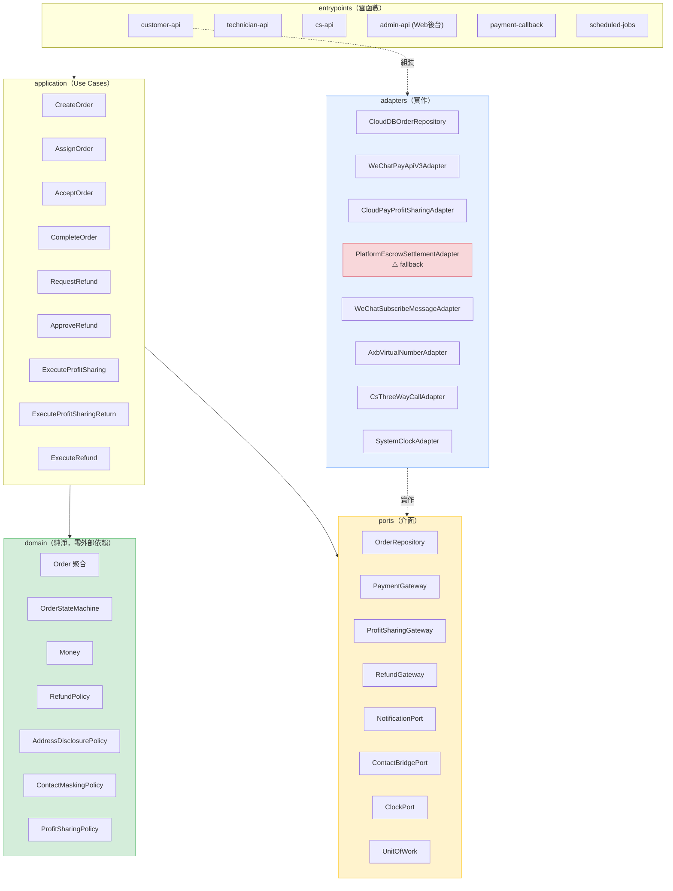
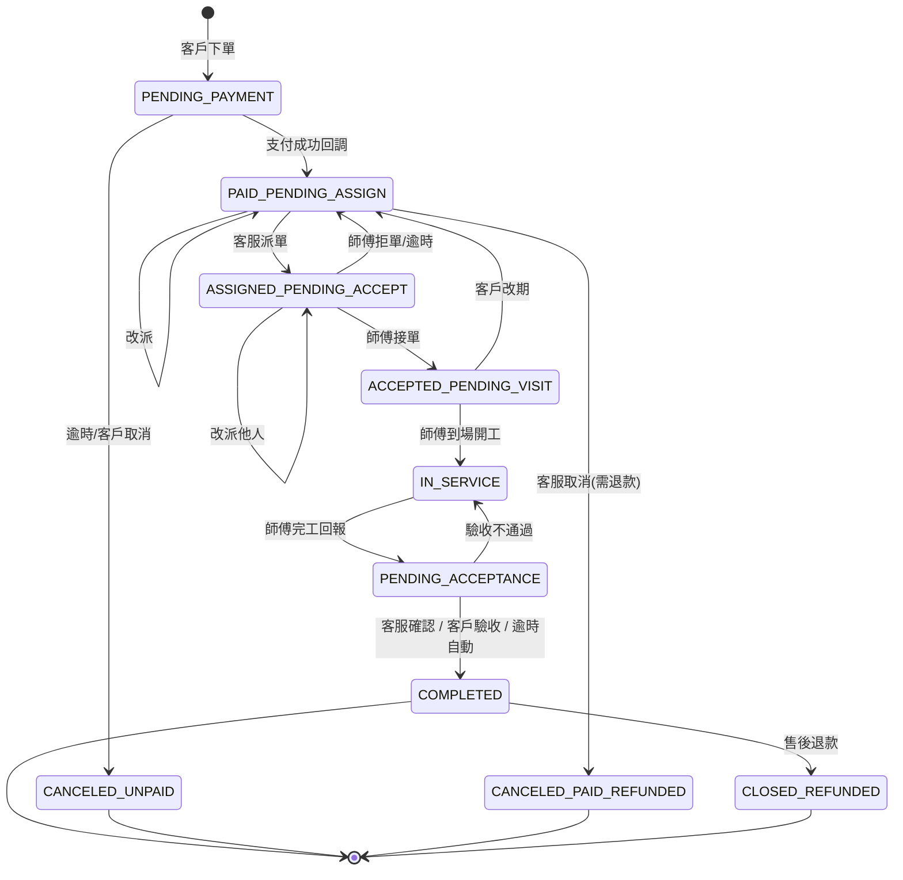
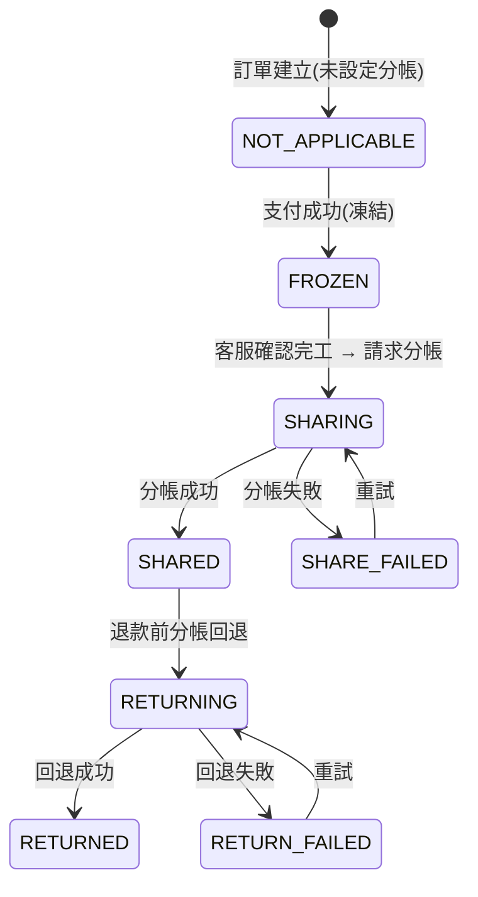
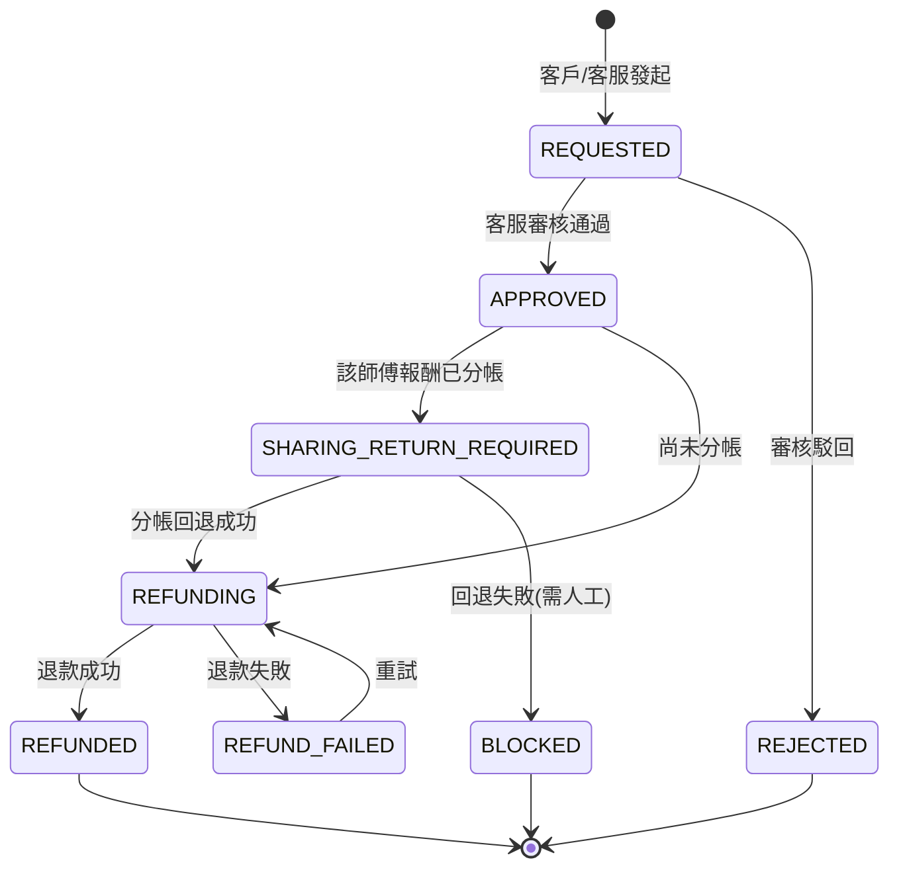

# 01 - 目標架構

> 產出階段：第二階段（目標架構設計）
> 前置文件：`docs/00-現狀分析.md`
> 產出日期：2026-10-15
> 分支：`refactor/hexagonal`（baseline：`main` @ `1f38b93`）
> **本文件只做設計，不含實作。尚未修改任何業務代碼、未建立雲函數、未動資料庫。**

---

## 0. 已確認的前提（來自你的回覆）

| # | 決策 | 對架構的影響 |
|---|---|---|
| Q1 | ✅ git 已建立，baseline 已提交 | 具備回滾能力 |
| Q2 | **Greenfield**，無舊後端／無舊資料 | 「遷移」改為「新建」；無兼容層 |
| Q3 | AppID `wx7f95f4a510129abe`；雲開發環境 ID 待補 | 部署細節待定，不阻擋設計 |
| Q4 | **微信雲開發雲函數 + `wx-server-sdk`**；支付／分帳／退款全部封裝於 adapter | 共享代碼方案成為核心議題（§5） |
| Q5 | 按**服務商分帳模式**設計，但 adapter 需預留 **平台代收 + 企業付款** fallback | 需獨立風險章節（§9） |
| Q6 | 客服端、師傅端＝**同一支小程序內的角色入口** | 三個角色共用客戶端代碼，靠路由與元件隔離 |
| Q7 | 管理端＝**獨立 Web 後台**（微搭／React Admin，我不做前端） | `admin-api` 需提供純 JSON API |
| Q12 | 地址分階段揭露；聯繫走 AXB 虛擬號或三方通話；**師傅端絕不顯示真實手機號** | domain 需 `AddressDisclosurePolicy`、`ContactMaskingPolicy` |
| Q13 | 保留：商品／訂單／地址／訂單詳情／支付骨架。下線：購物車／優惠券／拼團／發票／物流。tabBar 改為「首頁／服務／訂單／我的」 | 前端改造範圍明確 |

---

## 1. 設計原則

1. **domain 純淨**：`domain/` 不得 import `wx-server-sdk`、`wx.cloud`、任何 HTTP client、任何時間來源（`Date.now()` 需經 `ClockPort`）。這是可測試性與可替換性的唯一保證。
2. **依賴單向向內**：`entrypoints → application → domain`；`adapters → ports ← application`。domain 不知道外界的任何事。
3. **金額一律整數「分」**：`Money` 值物件，禁止浮點、禁止字串金額（修正現狀 D2）。
4. **所有權限判斷在後端**：前端只負責「顯示或不顯示」，不負責「能不能做」。路由／按鈕的角色邏輯只是 UX，不是安全邊界。
5. **失敗可補償**：支付、分帳、退款皆為跨系統非同步操作，一律採 **狀態機 + 冪等 + 補償（Saga）**，不依賴單次呼叫成功。
6. **每次外部呼叫都留痕**：`audit_logs` 與各 `*_records` 為唯一事實來源，debug 靠資料庫不靠日誌。

---

## 2. 六角形分層與模組劃分

### 2.1 分層職責

| 層 | 職責 | 允許依賴 | 禁止 |
|---|---|---|---|
| `domain` | 實體、值物件、狀態機、領域策略、金額計算 | 僅標準 JS | 微信 API、DB、HTTP、`Date.now()`、`Math.random()` |
| `application` | Use Case 編排、權限規則、交易邊界、Saga 補償 | `domain`、`ports` | 任何具體 SDK |
| `ports` | 介面定義（TypeScript 風格 JSDoc 或 .d.ts） | `domain`（僅型別） | 任何實作 |
| `adapters` | Port 的具體實作 | `ports`、`domain`、SDK | 被 domain 直接引用 |
| `entrypoints` | 雲函數入口：參數驗證、身分驗證、呼叫 use case、組裝回應 | `application`、`adapters`（僅在 composition root 組裝） | 業務規則 |

> **組裝點（Composition Root）**：只有 `entrypoints/*/bootstrap.js` 知道「哪個 Port 用哪個 Adapter」。這是唯一允許 `new CloudDBOrderRepository()` 的地方。Use Case 一律以建構子注入依賴。

### 2.2 模組劃分（Bounded Context）

| Context | 聚合根 | 說明 |
|---|---|---|
| **Identity** | `User` | 身分、角色、狀態 |
| **Catalog** | `Service` / `Product` | 服務項目與材料商品（後台下架即停售，不刪） |
| **Ordering** | `Order` | 訂單聚合（含 `OrderItem` 實體、狀態機） |
| **Dispatch** | `Assignment` | 派單／改派／接單（可由客服或系統自動） |
| **Settlement** | `PaymentRecord` / `ProfitSharingRecord` / `RefundRecord` | 金流三兄弟，各為獨立聚合 |
| **AfterSales** | `RefundRequest` | 退款申請與審核（與 Settlement 協作） |
| **Support** | `WorkOrderTicket` / `WorkOrderMessage` | 客服工單，客戶↔客服↔師傅的唯一溝通管道 |
| **Audit** | `AuditLog` | 唯讀，所有寫操作留痕 |

### 2.3 架構圖



---

## 3. 領域模型（domain）

### 3.1 值物件

| 值物件 | 職責 | 不變式 |
|---|---|---|
| `Money` | 金額，**整數分** | 禁止負數（除退款差額）、禁止浮點運算、四則運算需同幣別 |
| `OrderNo` / `OutTradeNo` / `OutRefundNo` | 對外單號 | 格式固定、可反解業務類型 |
| `OrderStatus` | 訂單狀態列舉 | **每個語意獨立數值**（修正現狀 R10 的 80 碰撞問題） |
| `FeeType` | `SERVICE_FEE` / `MATERIAL_FEE` | 決定退款歸屬 |
| `CommissionRate` | 分潤比例（basis point 整數） | 0 ≤ rate ≤ 10000 |
| `Address` | 結構化地址 | 支援**分級揭露**（見 3.4） |
| `MaskedPhone` | 脫敏手機號 | **型別上就不可能持有完整號碼** |
| `RefundScope` | 退款範圍 | `SERVICE_ONLY` / `MATERIAL_ONLY` / `FULL` / `CUSTOM` |

> `MaskedPhone` 的設計要點：讓「師傅端拿到完整手機號」在**型別層級就不可能**，而不是靠程式碼記得遮罩。

### 3.2 訂單聚合

```js
Order {
  orderId, orderNo, customerId, csAgentId?, technicianId?,
  status: OrderStatus,
  items: OrderItem[],            // 聚合內實體
  amounts: {
    serviceFee: Money,           // Σ items where feeType=SERVICE_FEE
    materialFee: Money,          // Σ items where feeType=MATERIAL_FEE
    discount: Money,
    total: Money
  },
  address: Address,
  appointmentAt: Timestamp,      // 預約服務時間（新增）
  snapshot: { commissionRate, pricingVersion },  // 下單當下快照
  timeline: OrderStatusLog[],
  version: number                // 樂觀鎖
}

OrderItem {
  itemType: 'service' | 'product',
  itemRefId,                     // 指向 services / products
  nameSnapshot, specSnapshot,    // ← 快照，歷史訂單不受改價影響
  unitPriceSnapshot: Money,      // ← 快照
  quantity, feeType,
  commissionRateSnapshot         // ← 快照（Q11 確認項，見 §11）
}
```

**快照規則（對應你的業務規則 4）**：`order_items` 寫入當下複製 `name / spec / unitPrice / commissionRate`。後台改價或改比例**永不影響歷史訂單**。`itemRefId` 僅作溯源，不可用於回查價格。

### 3.3 狀態機

#### 訂單狀態（狀態與原因分離，修正現狀 R10）



| 狀態 | 值 | 誰可觸發轉移 |
|---|---:|---|
| `PENDING_PAYMENT` | 10 | 系統（逾時）／客戶（取消） |
| `PAID_PENDING_ASSIGN` | 20 | 客服（派單）／系統（逾時告警） |
| `ASSIGNED_PENDING_ACCEPT` | 30 | 師傅（接單／拒單）／客服（改派） |
| `ACCEPTED_PENDING_VISIT` | 40 | 師傅（到場）／客戶（改期） |
| `IN_SERVICE` | 50 | 師傅（完工） |
| `PENDING_ACCEPTANCE` | 60 | 客服／客戶（驗收）／系統（逾時自動） |
| `COMPLETED` | 70 | — |
| `CANCELED_UNPAID` | 81 | 逾時或客戶 |
| `CANCELED_PAID_REFUNDED` | 82 | 客服（需先退款） |
| `CLOSED_REFUNDED` | 91 | 退款完成後 |

> **取消原因不再共用同一數值**，並以 `cancelReason` 欄位另存文字原因。

#### 分帳狀態



#### 退款狀態



### 3.4 兩個安全策略（你指定）

#### `AddressDisclosurePolicy`

| 階段 | 揭露層級 | 範例 |
|---|---|---|
| `ASSIGNED_PENDING_ACCEPT`（已派單待接單） | `DISTRICT` | 深圳市寶安區沙井街道 |
| `ACCEPTED_PENDING_VISIT`（已接單） | `DISTRICT` | 同上 |
| 服務當日 **08:00 起** | `FULL` | 深圳市寶安區沙井街道中心路28號麗沙花都3棟5B |
| `COMPLETED` 後 N 天 | `DISTRICT` | 自動降級（可設定） |
| 非指派師傅 | 一律 `DISTRICT` | |

介面：`AddressDisclosurePolicy.discloseFor(viewer, order, now) → AddressView`

**關鍵設計**：回傳的是 `AddressView`（**新的值物件**），不是 `Address`。師傅端在型別上就拿不到完整地址。

#### `ContactMaskingPolicy`

| 對象 | 可見 |
|---|---|
| 客服／管理員 | 完整手機號 |
| 客戶 | 完整自己資料 |
| **師傅** | **一律 `MaskedPhone`（`138****1234`）**，永不解鎖 |

聯繫通道（`ContactBridgePort`）二選一，按成本決定：

| 方案 | 說明 | 前提 |
|---|---|---|
| A. AXB 虛擬號 | 平台提供中間號，通話雙方互不見號碼 | 需開通隱私號服務（**需人工核對**，含計費） |
| B. 客服三方通話 | 師傅點「聯繫客戶」→ 客服介入撥號 | 零額外成本，但依賴客服在線 |

> ⚠️ **此為業務閉環的關鍵缺口**：若 A、B 皆不可行，師傅將無法聯繫客戶。此題必須在實作前定案。

### 3.5 領域服務與策略

| 名稱 | 職責 |
|---|---|
| `OrderStateMachine` | 唯一定義「什麼狀態可以轉到什麼狀態、誰能轉」 |
| `PricingService` | 由 `items` 計算 `serviceFee`/`materialFee`/`total` |
| `RefundPolicy` | 依 `RefundScope` 計算可退金額；校驗不可超過已付、不可超過 50 次上限 |
| `ProfitSharingPolicy` | 計算師傅報酬（基數與比例待 Q10 確認） |
| `SettlementOrchestrator` | 領域層的 Saga 規則：退款前必須先完成分帳回退（你的業務規則 6） |

---

## 4. Use Case 清單

> 格式：**職責 / 權限 / 前置條件 / 主要副作用**。所有 Use Case 皆透過 `UnitOfWork` 保證聚合一致性。

### 4.1 客戶端（`customer-api`）

| Use Case | 職責 | 權限 | 前置條件 | 副作用 |
|---|---|---|---|---|
| `CreateOrder` | 建立訂單、價格快照、計算金額 | `customer` | 地址有效、服務/商品上架中、預約時間合法 | 寫 `orders`+`order_items`、狀態 `PENDING_PAYMENT`、寫 audit |
| `PrepayOrder` | 向支付網關取得預支付參數 | 訂單本人 | 狀態 `PENDING_PAYMENT`、未逾時 | 寫 `payment_records(prepay)` |
| `QueryMyOrders` | 查自己的訂單列表（**含脫敏**） | 訂單本人 | — | 無 |
| `ViewOrderDetail` | 查單筆詳情（含狀態歷程） | 訂單本人 | — | 無 |
| `CancelOrder` | 未付款取消 | 訂單本人 | 狀態 `PENDING_PAYMENT` | 狀態 → `CANCELED_UNPAID` |
| `RequestRefund` | 發起退款申請（選 scope） | 訂單本人 | 狀態 ∈ {`COMPLETED`, 已付款系列} | 建 `refund_records(REQUESTED)` |
| `ConfirmAcceptance` | 客戶驗收通過 | 訂單本人 | 狀態 `PENDING_ACCEPTANCE` | 狀態 → `COMPLETED`（觸發分帳，見 4.5） |
| `SendWorkOrderMessage` | 對客服留言 | 訂單本人 | 工單存在 | 寫 `work_order_messages` |
| `RequestReschedule` | 申請改期 | 訂單本人 | 狀態 ∈ 付款後未完工 | 回 `PAID_PENDING_ASSIGN` 待客服處理 |

### 4.2 客服端（`cs-api`）

| Use Case | 職責 | 權限 | 前置條件 | 副作用 |
|---|---|---|---|---|
| `AssignOrder` | 指派師傅 | `cs_agent` | 狀態 `PAID_PENDING_ASSIGN`、師傅可接單 | 寫 `technician_id`、指派紀錄、通知師傅 |
| `ReassignOrder` | 改派 | `cs_agent` | 狀態 `PAID_PENDING_ASSIGN`/`ASSIGNED_PENDING_ACCEPT` | 同上 + 通知原師傅 |
| `ConfirmCompletion` | 客服確認完工 | `cs_agent` | 狀態 `PENDING_ACCEPTANCE` | 狀態 → `COMPLETED` |
| `ReviewRefund` | 審核退款、選退款類型 | `cs_agent` | 狀態 `REQUESTED` | 狀態 → `APPROVED`/`REJECTED` |
| `ReplyWorkOrder` | 客服回覆工單 | `cs_agent` | 工單存在 | 寫訊息、通知雙方 |
| `BridgeContact` | 代師傅聯繫客戶（三方通話方案 B） | `cs_agent` | — | 寫 audit |
| `QueryOrders` | 查全部訂單（完整資料） | `cs_agent` | — | 無 |

### 4.3 師傅端（`technician-api`）

| Use Case | 職責 | 權限 | 前置條件 | 副作用 |
|---|---|---|---|---|
| `AcceptOrder` | 接單 | **被指派本人** | 狀態 `ASSIGNED_PENDING_ACCEPT`、本人可接單 | 狀態 → `ACCEPTED_PENDING_VISIT`、通知客服 |
| `RejectOrder` | 拒單（附原因） | 被指派本人 | 同上 | 狀態 → `PAID_PENDING_ASSIGN`、通知客服 |
| `ReportArrival` | 到場打卡 | 被指派本人 | 狀態 `ACCEPTED_PENDING_VISIT` | 狀態 → `IN_SERVICE`、記錄時間 |
| `CompleteService` | 完工回報（可傳圖） | 被指派本人 | 狀態 `IN_SERVICE` | 狀態 → `PENDING_ACCEPTANCE` |
| `QueryMyOrders` | 查自己的訂單（**區域級地址 + 脫敏電話**） | 本人 | — | 無 |
| `QueryMyEarnings` | 查報酬與分帳狀態 | 本人 | — | 無（唯讀 `profit_sharing_records`） |
| `SendWorkOrderMessage` | 對客服留言 | 本人 | 工單存在 | 寫訊息 |

> **師傅端沒有任何 Use Case 能回傳完整手機號或完整地址。** 這是在 Use Case 層就切斷，不是靠前端。

### 4.4 管理端（`admin-api`，供 Web 後台）

| Use Case | 職責 |
|---|---|
| `ManageService` / `ManageProduct` | 新增、修改、上下架、改價、分類（**只影響新訂單**） |
| `ManageTechnician` | 審核入駐、技能標籤、接單開關、分帳開通狀態 |
| `ReviewRefund` | 與客服同權（管理員可覆核） |
| `QueryDashboard` | 統計：訂單量、收入、退款率、師傅績效、服務/商品排行、派單統計 |
| `QueryAuditLogs` | 稽核日誌查詢 |
| `ManageUsers` | 角色指派 |
| `RetryFailedSettlement` | 人工重試失敗的分帳/回退/退款 |

### 4.5 系統端（`payment-callback` / `scheduled-jobs`）

| Use Case | 職責 | 觸發 |
|---|---|---|
| `HandlePaymentCallback` | 支付結果 → 訂單轉 `PAID_PENDING_ASSIGN`、凍結分帳資金 | 微信回調 |
| `ExecuteProfitSharing` | 請求分帳給師傅 | 訂單 `COMPLETED` 後 |
| `QueryProfitSharingResult` | 查詢分帳結果（非同步） | 定時／回調 |
| `HandleProfitSharingCallback` | 分帳結果回調 | 微信回調 |
| `ExecuteProfitSharingReturn` | 分帳回退（**退款前必要步驟**） | 退款流程內 |
| `QueryProfitSharingReturnResult` | 查詢回退結果 | 定時／回調 |
| `ExecuteRefund` | 發起退款（原路返回） | 審核通過且回退完成 |
| `QueryRefundResult` | 查詢退款結果 | 定時／回調 |
| `RecoverStuckSettlements` | 掃描卡住的分帳/回退/退款並重試 | 定時（每 5 分鐘） |
| `AutoCancelUnpaidOrders` | 逾時未付款自動取消 | 定時 |
| `AutoCompleteOnTimeout` | 驗收逾時自動完成 | 定時 |
| `AlertUnassignedOrders` | 派單逾時告警 | 定時 |

---

## 5. 六角形架構下的雲函數目錄與共享代碼方案

> 這一節回應你指定的補充要求。**這是整個架構最容易失敗的地方**，因為微信雲函數的部署模型對「共享代碼」並不友善。

### 5.1 微信雲函數的部署限制（約束條件）

| 限制 | 說明 | 後果 |
|---|---|---|
| **一個 `cloudfunctionRoot`** | `project.config.json` 只能指定一個雲函數根目錄 | 所有雲函數必須在同一目錄下 |
| **每個雲函數是獨立部署單元** | 各自有 `package.json`、各自上傳、各自有 `node_modules` | 無法 `require('../../shared/domain')` |
| **上傳時只帶該函數目錄** | 目錄外的檔案不會被上傳 | 相對路徑引用上級目錄**必然失敗** |
| **`node_modules` 需實體存在** | 選「雲端安裝依賴」只裝 `package.json` 宣告的套件；選「上傳所有檔案」則連本地 `node_modules` 一起上傳 | 符號連結（symlink）在打包時易斷 |
| **Windows 開發環境** | `npm link` / `file:` 依賴在 Windows 上建立 junction，打包上傳常出錯 | 本地 npm 包方案風險升高 |
| **無官方 Lambda Layer 等價物**（**需人工核對**） | 騰訊雲 SCF 有圖層，但微信開發者工具的雲函數是否暴露此能力，我無法從現有專案證實 | 不作為主方案 |

### 5.2 候選方案比較

| 方案 | 做法 | 優點 | 缺點 | 評估 |
|---|---|---|---|---|
| **A. monorepo + npm workspaces + `file:` 本地包** | 根 `package.json` 用 workspaces，雲函數 `dependencies` 寫 `"@repair/domain": "file:../../packages/domain"` | 標準、IDE 補全好、改一處全生效 | Windows 建立 symlink/junction；**雲函數上傳時 symlink 會斷**；需「雲端安裝依賴」但雲端拿不到 `../../packages` | ❌ **不適用** |
| **B. 建構腳本複製（推薦）** | `scripts/sync-shared.js` 把 `packages/*` 實體複製到 `cloudfunctions/*/node_modules/@repair/*` | 無 symlink、跨平台、離線可驗證、部署結果可預期 | 需記得執行；有「複製過期」風險 | ✅ **主方案** |
| **C. 共享碼直接放進 `cloudfunctionRoot` 子目錄** | `cloudfunctions/shared/`，各函數 `require('../shared/domain')` | 不需腳本 | 相對路徑在部署後**仍可能失效**（各函數獨立打包）；devtools 會把它當成一個雲函數列出 | ❌ 不安全 |
| **D. 每函數各自複製一份共享碼** | 手工維護 | 絕對不會錯 | 六份副本，改一處要改六處 → 必然不一致 | ❌ 反模式 |
| **E. 雲開發圖層（Layer）** | 上傳共享層，函數引用 | 最乾淨 | **微信開發者工具是否支援，需人工核對**；即使支援也可能僅限騰訊雲控制台 | ⚠️ 待確認，不作主方案 |

### 5.3 建議方案：B（建構腳本複製）+ 版本守衛

**目錄結構**（雲函數根目錄與小程序根目錄並存）：

```
miniprogram-repair/                      ← 專案根（目前即小程序根）
├── pages/ components/ services/ ...     ← 現有前端，不動位置 ✅
├── cloudfunctions/                      ← 新增，project.config.json 的 cloudfunctionRoot
│   ├── customer-api/
│   │   ├── index.js                     ← entrypoint（薄）
│   │   ├── bootstrap.js                 ← composition root（唯一 new Adapter 處）
│   │   ├── package.json
│   │   └── node_modules/@repair/…       ← ← 由腳本產生（不入版控）
│   ├── technician-api/  cs-api/  admin-api/
│   ├── payment-callback/  scheduled-jobs/
├── packages/                            ← 共享原始碼（唯一真實來源，入版控）
│   ├── domain/        (@repair/domain)
│   ├── application/   (@repair/application)
│   ├── ports/         (@repair/ports)
│   ├── adapters/      (@repair/adapters)
│   └── shared-kernel/ (@repair/shared-kernel: Money, Result, Clock iface…)
├── scripts/
│   └── sync-shared.js                   ← 複製 packages/* → cloudfunctions/*/node_modules/@repair/*
└── docs/
```

**為什麼 `packages/` 放在 `cloudfunctions/` 之外**：避免 devtools 把共享碼目錄誤列為雲函數；且共用碼不應被當成部署單元。

**`sync-shared.js` 的職責**：
1. 讀 `packages/*/package.json` 取得套件名與版本
2. 清空目標 `cloudfunctions/*/node_modules/@repair/`
3. 實體複製（非 symlink）
4. 寫入 `SHARED_BUILD.json`（含每個套件的內容雜湊與時間戳）

**「複製過期」風險的守衛（必要，不是可選）**：
- 每個 entrypoint 啟動時比對 `SHARED_BUILD.json` 的雜湊與自身內嵌的期望值，不符則**拒絕服務並回報明確錯誤**。
- `package.json` 加 `"predeploy": "node scripts/sync-shared.js"`，並在 `docs/03-開發規範.md` 要求部署前必跑。
- 若雜湊不符，寧可**大聲失敗**，也不要讓舊版 domain 規則悄悄上線處理金流。

**`.gitignore` 追加**（下一階段執行）：
```
cloudfunctions/*/node_modules/@repair/
```

### 5.4 雲函數拆分方案

| 雲函數 | 角色 | 為何獨立 |
|---|---|---|
| `customer-api` | 客戶端 | 攻擊面最大（匿名可達），需要最嚴格的輸入驗證與速率限制 |
| `technician-api` | 師傅端 | 敏感資料最需隔離；**此函數不得 import 任何回傳完整客戶資料的 Use Case** |
| `cs-api` | 客服端 | 可看完整客戶資料，權限層級高 |
| `admin-api` | Web 後台（JSON API） | 供非小程序來源呼叫，需獨立的 CORS/簽章策略 |
| `payment-callback` | 微信支付回調 | **不同信任模型**：無 OPENID，靠簽章驗證；必須與用戶請求隔離 |
| `scheduled-jobs` | 定時任務 | 由計時觸發器呼叫，無使用者身分 |

**替代方案（單一 `api` + 路由）**：部署較簡單、冷啟動較少，但權限邊界會退化為執行期判斷，且支付回調會與用戶請求共用執行環境。**不建議**，理由與你的禁令「雙重校驗」相衝。

> **待確認**：拆分為 6 個函數會增加部署與冷啟動成本。若你偏好少一點，`cs-api` 與 `admin-api` 可合併（兩者都是高權限內部角色），但 `payment-callback` 與 `technician-api` **必須獨立**。

---

## 6. Ports 與 Adapters 對照表

### 6.1 儲存類 Ports

| Port | 職責 | Adapter | 底層 |
|---|---|---|---|
| `OrderRepository` | 訂單聚合讀寫（含 items，樂觀鎖） | `CloudDBOrderRepository` | `orders` + `order_items` |
| `ServiceRepository` | 服務項目 CRUD | `CloudDBServiceRepository` | `services` |
| `ProductRepository` | 材料商品 CRUD | `CloudDBProductRepository` | `products` |
| `UserRepository` | 使用者與角色 | `CloudDBUserRepository` | `users` |
| `TechnicianRepository` | 師傅檔案、可接單狀態 | `CloudDBTechnicianRepository` | `technicians` |
| `PaymentRepository` | 支付紀錄 | `CloudDBPaymentRepository` | `payment_records` |
| `ProfitSharingRepository` | 分帳／回退紀錄 | `CloudDBProfitSharingRepository` | `profit_sharing_records` |
| `RefundRepository` | 退款紀錄 | `CloudDBRefundRepository` | `refund_records` |
| `WorkOrderRepository` | 工單與訊息 | `CloudDBWorkOrderRepository` | `work_order_*` |
| `AuditLogRepository` | 稽核日誌（僅 append） | `CloudDBAuditLogRepository` | `audit_logs` |
| `UnitOfWork` | 多集合交易 | `CloudDBUnitOfWork` | `db.startTransaction()`（**需人工核對限制**） |

### 6.2 外部服務類 Ports（**你的 Q4 要求：全部封裝在此，可替換**）

| Port | 職責 | 主 Adapter | Fallback Adapter |
|---|---|---|---|
| `PaymentGateway` | 預支付、查單、關單 | `WeChatPayApiV3Adapter` | — |
| `RefundGateway` | 退款、查退款 | `WeChatPayApiV3Adapter` | — |
| `ProfitSharingGateway` | 添加接收方、請求分帳、查分帳、分帳回退、查回退 | `CloudPayProfitSharingAdapter` | `NullProfitSharingAdapter` |
| `SettlementGateway` | **統一結算入口**（依能力旗標路由） | 見 §9 備案設計 | — |
| `NotificationPort` | 訂閱消息／模板消息 | `WeChatSubscribeMessageAdapter` | `LogOnlyNotificationAdapter` |
| `ContactBridgePort` | 師傅↔客戶聯繫（AXB 或三方通話） | `AxbVirtualNumberAdapter` | `CsThreeWayCallAdapter` |
| `CloudStoragePort` | 完工照片上傳 | `CloudStorageAdapter` | — |
| `ClockPort` | 時間（**讓 domain 可測**） | `SystemClockAdapter` | `FixedClockAdapter`（測試） |
| `IdGeneratorPort` | 單號產生 | `SnowflakeIdAdapter` | `SequenceIdAdapter`（測試） |
| `LoggerPort` | 結構化日誌 | `CloudLoggerAdapter` | `InMemoryLoggerAdapter`（測試） |

> **可替換性驗證方式**：在單元測試中，所有 Port 用 in-memory fake 實作，**domain 與 application 的測試不得啟動任何雲函數**。若做不到，代表分層已被破壞。

---

## 7. 資料庫設計（Greenfield 建立，無遷移）

> 你確認 Q2 為全新設計，因此**沒有遷移腳本**。所有集合皆為新建。

### 7.1 集合清單

| 集合 | 用途 | 關鍵索引 |
|---|---|---|
| `users` | openid、role_type、nickname、phone、status | `openid`(唯一)、`role_type` |
| `customers` | 客戶檔案、常用地址 | `user_id`(唯一) |
| `cs_agents` | 客服：工號、負責區域、狀態 | `user_id`(唯一)、`employee_no` |
| `technicians` | 師傅：技能、等級、保證金、審核、接單、分帳開通 | `user_id`(唯一)、`status`、`skill_tags` |
| `services` | 服務項目 | `is_active`、`category` |
| `products` | 材料商品 | `is_active`、`category`、`stock` |
| `orders` | 訂單主檔 | `order_no`(唯一)、`customer_id`、`technician_id`、`cs_agent_id`、`status`、`created_at` |
| `order_items` | 訂單明細（**價格快照**） | `order_id`、`item_type` |
| `order_status_logs` | 狀態流轉歷程 | `order_id`、`created_at` |
| `payment_records` | 支付紀錄 | `order_id`、`out_trade_no`(唯一)、`transaction_id` |
| `profit_sharing_records` | 分帳紀錄 | `order_id`、`out_order_no`(唯一)、`sharing_status` |
| `profit_sharing_return_records` | 分帳回退紀錄 | `order_id`、`out_order_no`、`return_status` |
| `refund_records` | 退款紀錄 | `order_id`、`out_refund_no`(唯一)、`refund_status` |
| `work_order_tickets` | 客服工單（每訂單一主工單） | `order_id`(唯一)、`status` |
| `work_order_messages` | 工單訊息 | `ticket_id`、`created_at` |
| `audit_logs` | 稽核日誌 | `operator_id`、`target_type`+`target_id`、`created_at` |
| `system_configs` | 平台設定（分潤比例、揭露時間等） | `key`(唯一) |
| `id_sequences` | 單號序號器 | `key`(唯一) |

### 7.2 設計要點

1. **金額一律整數「分」**，欄位後綴 `_cents`（如 `total_cents`），避免 `Money` 語意混淆。
2. **時間一律 Unix ms 整數**（`created_at`），與現有 mock 的 `createTime: '1600350829291'` 慣例一致。
3. **`order_items` 快照欄位不可變**：`name_snapshot`、`unit_price_cents_snapshot`、`commission_rate_bp_snapshot`。
4. **狀態值語意唯一**（見 §3.3），並以 `cancel_reason` 分開存放原因。
5. **冪等鍵**：所有對外單號（`out_trade_no`、`out_order_no`、`out_refund_no`）皆加唯一索引，重複請求直接回既有結果。

### 7.3 ⚠️ 資料庫權限設定（安全關鍵）

**所有集合的雲開發資料庫權限必須設為「僅管理端可讀寫」（關閉前端直連）。**

- 前端**絕對不可** `wx.cloud.database()` 直連。
- 所有讀寫一律經雲函數。
- 這是「前端不可信」原則的物理保證，不是選項。

---

## 8. 身分與權限模型

### 8.1 角色

`customer` / `cs_agent` / `technician` / `admin`

### 8.2 雙重校驗（你的要求）

```
entrypoint（每個雲函數共用中介層）
  ├─ 第 1 層：身分校驗
  │    wxContext.OPENID → UserRepository.findByOpenid()
  │    不存在 / status !== 'active' → 401
  ├─ 第 2 層：角色校驗
  │    user.role_type ∈ useCase.allowedRoles → 否則 403
  └─ 第 3 層：資源歸屬校驗（關鍵！）
       例：師傅只能操作 technician_id === self 的訂單
           客戶只能操作 customer_id === self 的訂單
       在 Use Case 內執行，不在入口
```

> **第 3 層是最容易被遺漏、也最危險的一層。** 「師傅能呼叫 `AcceptOrder`」不等於「師傅能接任何人的單」。此校驗必須寫在 Use Case 內並有測試覆蓋。

### 8.3 回應欄位過濾（Output Filter）

Use Case 回傳的是 **DTO**，不是實體。每個角色的 DTO 不同：

| 欄位 | 客戶 | 客服 | 師傅 | 管理員 |
|---|---|---|---|---|
| 客戶姓名 | 自己全名 | 全名 | **僅姓氏** | 全名 |
| 客戶手機 | 自己完整 | 完整 | **`138****1234`** | 完整 |
| 服務地址 | 自己完整 | 完整 | **區域+街道**（服務當日 08:00 後完整） | 完整 |
| 訂單金額 | 完整 | 完整 | **僅自己的報酬** | 完整 |
| 平台抽成 | 隱藏 | 可見 | **隱藏** | 可見 |
| 其他師傅資訊 | 隱藏 | 可見 | 隱藏 | 可見 |

> 過濾在 **application 層的 DTO 組裝器**完成，不依賴前端。

---

## 9. 支付方案風險與備案

> 這一節回應你的 Q5 指定要求。**這是本案最大的外部依賴風險。**

### 9.1 主方案：微信支付服務商分帳

**前提條件（全部必須成立，缺一不可）：**

| # | 前提 | 狀態 |
|---|---|---|
| 1 | 平台持有**服務商（合作夥伴）商戶號** | ❓ 待你確認 |
| 2 | 已開通**分帳（profit_sharing）**產品權限 | ❓ 待你確認 |
| 3 | **師傅**能以「特約商戶」或「個人接收方（需實名）」身分進件 | ❓ 待你確認 |
| 4 | 師傅已開啟**「同意分帳回退」** | ❓ 待你確認 |
| 5 | 分帳接收方需先**添加接收方**才可分帳 | 設計已知 |

**流程要點：**
- 客戶付款時訂單需帶分帳標識 → 資金進入特約商戶帳戶並**凍結**
- 訂單完成且客服確認後 → 呼叫**請求分帳**
- 分帳為**非同步** → 必須有查詢與回調（`QueryProfitSharingResult` / `HandleProfitSharingCallback`）
- 退款前若已分帳 → 必須先**分帳回退**（回退須以原分帳單為依據，回退金額不得超過原分帳給該接收方的金額）

> ⚠️ **需人工核對微信支付最新文檔**：我未查閱官方文檔，**不會**在此寫死任何 API 路徑、欄位名、簽章方式或限額數字。所有 API 細節將在實作階段查閱官方文檔後，集中封裝於 `WeChatPayApiV3Adapter` / `CloudPayProfitSharingAdapter`，不對外洩漏。

### 9.2 備案：平台代收 + 企業付款（Fallback）

**觸發條件**：9.1 任一前提不成立。

**流程**：客戶付款進平台商戶號 → 平台按週期以「企業付款」把報酬打給師傅 → `SettlementGateway` 走 `PlatformEscrowSettlementAdapter`。

**與主方案的差異：**

| 面向 | 服務商分帳 | 平台代收 + 企業付款 |
|---|---|---|
| 資金路徑 | 客戶 → 特約商戶（凍結）→ 師傅 | 客戶 → 平台 → 師傅 |
| 退款 | 先分帳回退，再退款 | 直接退款；已付款給師傅的需追回 |
| 時效 | 訂單完成即可分帳 | 週期性批次 |
| 師傅體驗 | 完工後快速到帳 | 有賬期 |
| 失敗處理 | 回退失敗需人工 | 付款失敗需重試 |

### 9.3 ⚠️ 必須正視的合規風險

**「平台代收 + 自行結算」在中國大陸可能構成「二清」（二次清算），屬於需要支付牌照的業務。**

- 若平台先收客戶的錢、再自行轉給師傅，且平台對資金有支配權，**存在合規風險**。
- 微信支付對「平台類商戶」代收代付有明確規範。
- **我無法提供法律意見。** 此風險必須由你就具體業務形態諮詢專業法務或支付機構。

> 這不是技術問題，但**會決定架構走主方案還是備案**。建議在實作支付模組前先確認。

### 9.4 Adapter 介面如何預留 fallback

設計一個 **Capability-based 統一介面**：

```js
// ports/SettlementGateway.js
interface SettlementGateway {
  capabilities(): {
    supportsFreeze: boolean,          // 分帳模式：true
    supportsSharingReturn: boolean,   // 分帳模式：true
    supportsPartialRefund: boolean,   // 兩者皆 true
    settlementMode: 'PROFIT_SHARING' | 'PLATFORM_ESCROW'
  }
  onPaymentSuccess(order, payment): Promise<void>
  settle(order): Promise<SettlementResult>
  beforeRefund(order, refundAmount): Promise<void>   // 分帳模式：先回退
  refund(order, refundRequest): Promise<RefundResult>
  querySettlement(recordId): Promise<SettlementStatus>
}
```

- `WeChatProfitSharingSettlementAdapter`：`onPaymentSuccess` 帶分帳標識、`beforeRefund` 執行回退。
- `PlatformEscrowSettlementAdapter`：`onPaymentSuccess` 空操作、`beforeRefund` 空操作、`settle` 寫入待付款佇列。
- **Use Case 完全不需改動**，只換 composition root 的一行。

> **這正是六角形架構在此專案的實際回報**：最大的外部不確定性，被壓縮成一個可替換的 adapter。

---

## 10. 前端改造範圍（僅記錄，本階段不動手）

### 10.1 tabBar

`custom-tab-bar/data.js`：`首頁 / 分類 / 購物車 / 個人中心` → **`首頁 / 服務 / 訂單 / 我的`**

需改為依 `role_type` 回傳不同項目（客服用客服版、師傅用師傅版）。**角色只影響顯示，不影響權限。**

### 10.2 功能處置

| 功能 | 處置 | 建議做法 |
|---|---|---|
| 商品、訂單、收貨地址、訂單詳情、支付骨架 | **保留** | 沿用並改造 |
| 服務詳情 | **新增** | 依 `services` 集合新建 |
| 預約時間 | **新增** | 訂單確認頁加入時段選擇 |
| 師傅端、客服端 | **新增** | 新分包 `pages/technician/`、`pages/cs/` |
| 購物車 | **下線** | 見下方 ⚠️ |
| 優惠券、拼團、發票、物流追蹤 | **下線** | 見下方 ⚠️ |

> ⚠️ **「下線」的實作方式需要你確認**（列入 §11 待確認）：
> 你的禁令是「不要刪除現有集合或現有功能，除非我明確同意」。
> 我建議 **「入口下線、代碼保留」**：從 tabBar／路由／訂單按鈕移除入口，檔案保留在 repo 中並標記 `@deprecated`。
> 這樣可回滾、可日後重啟，也不必在改造期間承擔大規模刪除的風險。
> **若你要的是物理刪除，請明確告知**——那會是另一個獨立階段。

---

## 11. 待確認事項（實作前需定案）

| # | 問題 | 影響 | 阻斷級 |
|---|---|---|---|
| A1 | 分帳 5 項前提（§9.1）是否成立？ | 決定主方案或備案 | 🔴 |
| A2 | 聯繫客戶方案 A（AXB）或 B（三方通話）？成本？ | 師傅能否履約 | 🔴 |
| A3 | 分潤基數＝服務費 or 服務費+材料費？（Q10） | 金額計算核心 | 🔴 |
| A4 | 分潤比例是否逐單快照？（Q11） | `order_items` 欄位 | 🔴 |
| A5 | 角色指派方式：管理員指派 or 申請審核？（Q8） | `technicians.status` 流程 | 🟡 |
| A6 | 「自訂部分退款」是否支援？按明細項退 or 按金額退？ | `RefundPolicy` 複雜度 | 🟡 |
| A7 | 下線功能＝入口下線（建議）or 物理刪除？ | 改造範圍 | 🟡 |
| A8 | 6 個雲函數 or 合併 `cs-api`+`admin-api`？ | 部署成本 | 🟡 |
| A9 | 逾時規則：未付款／未派單／未接單／未驗收各幾分鐘？ | 定時任務 | 🟡 |
| A10 | 雲開發環境 ID | 部署 | 🟡 |
| A11 | 地址服務後降級的天數 N | `AddressDisclosurePolicy` | 🟢 |

---

## 12. 結論

1. **架構已可定案**：五層分層、六個雲函數、20+ Use Case、10 個外部 Port、明確的狀態機與策略物件。

2. **最大的技術風險是共享代碼方案**（§5）。微信雲函數沒有優雅的共享機制，我建議「`packages/` 為唯一真實來源 + 構建腳本實體複製 + 版本雜湊守衛」。這個方案的好處是**可在本地完整驗證**，不依賴任何雲端行為。

3. **最大的業務風險是支付分帳前提**（§9）。我已把不確定性壓縮成一個可替換的 `SettlementGateway` adapter，但不確定性本身仍在。**建議在動支付模組前先確認 A1。**

4. **`AddressDisclosurePolicy` 與 `ContactMaskingPolicy` 放在 domain 層**（你指定）。設計上讓「師傅拿到完整資料」在型別層就不可能，而非靠自覺。

5. **下一步**（第三階段）：`docs/02-實施計畫.md`，將上述設計拆為可驗收的階段任務、影響檔案、回滾方案與風險清單。

---

**⏸ 第二階段結束。等待你的確認與第 11 節問題的回覆後，才進入第三階段。**
