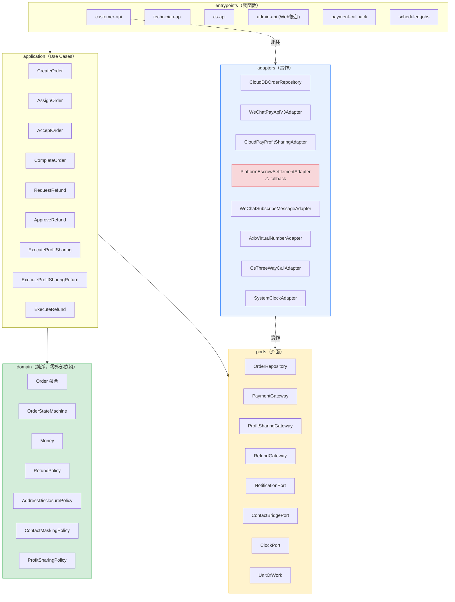
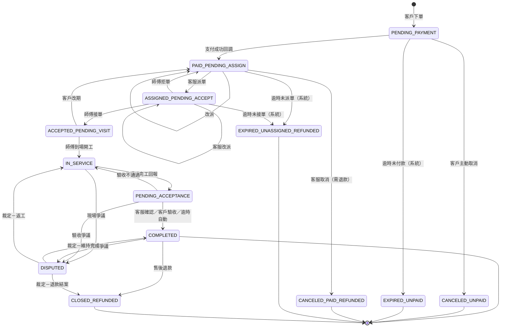
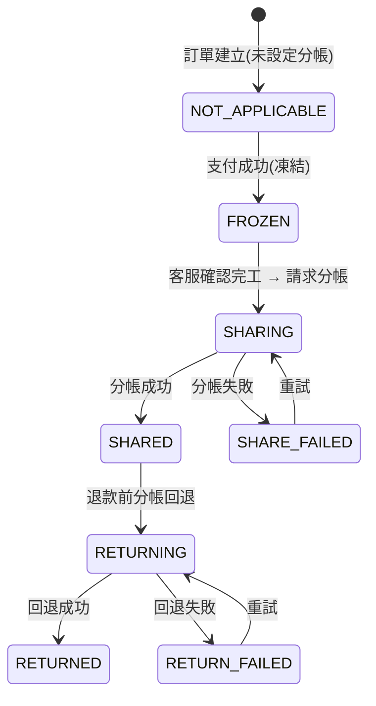
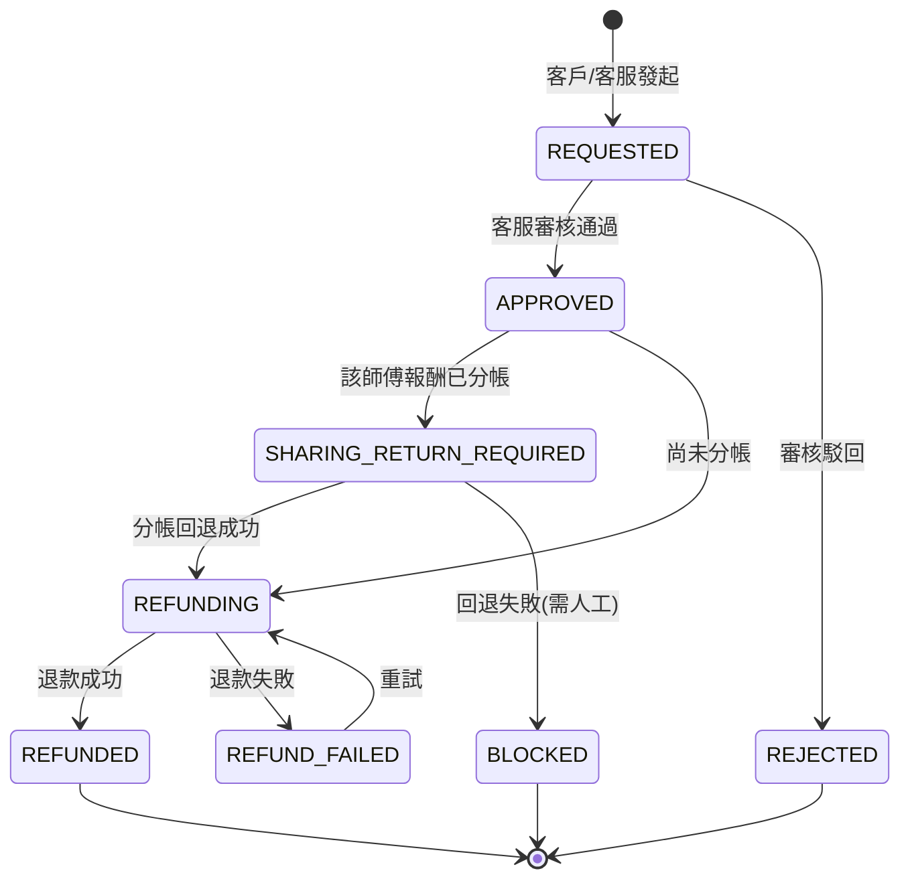
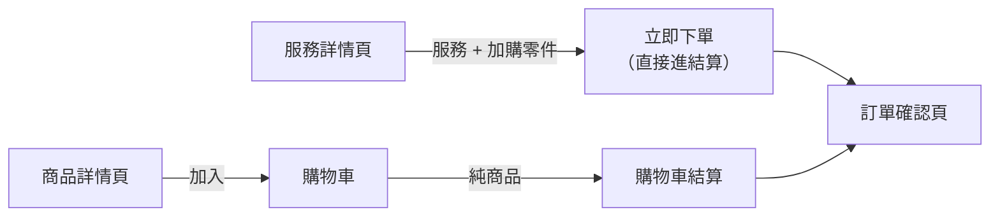
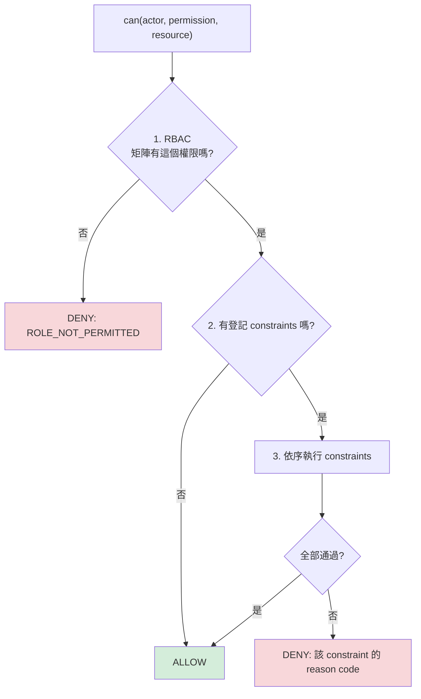
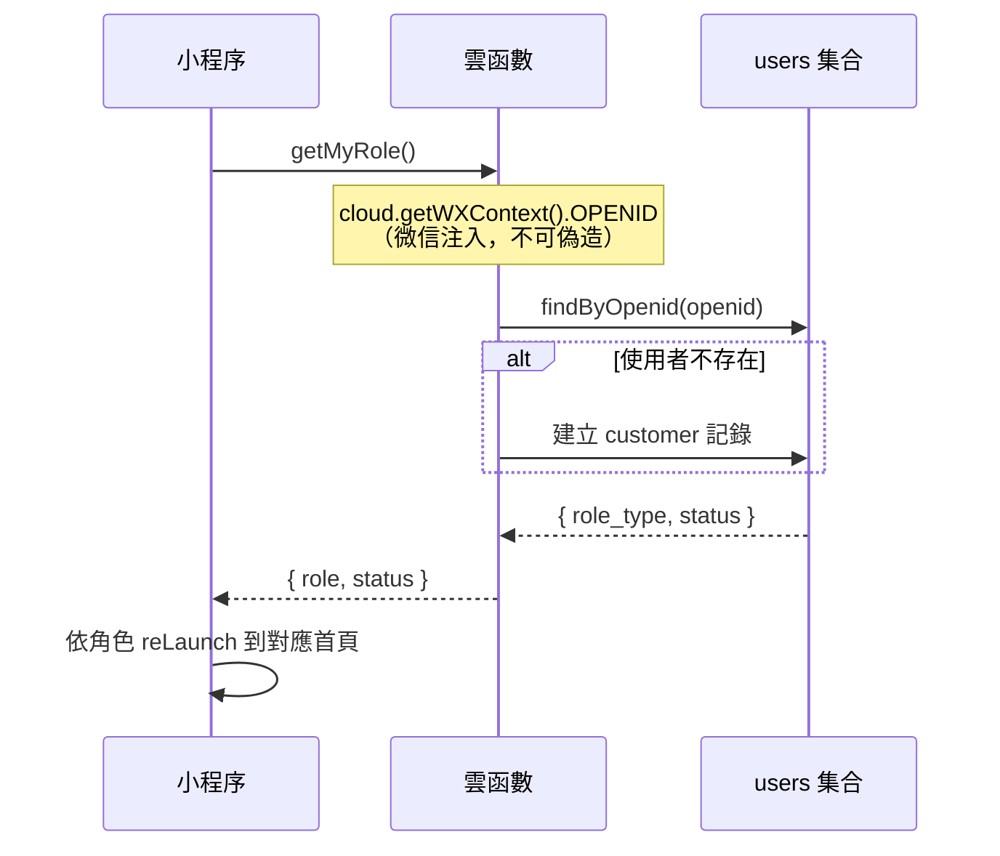
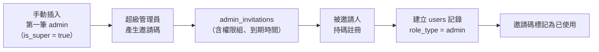
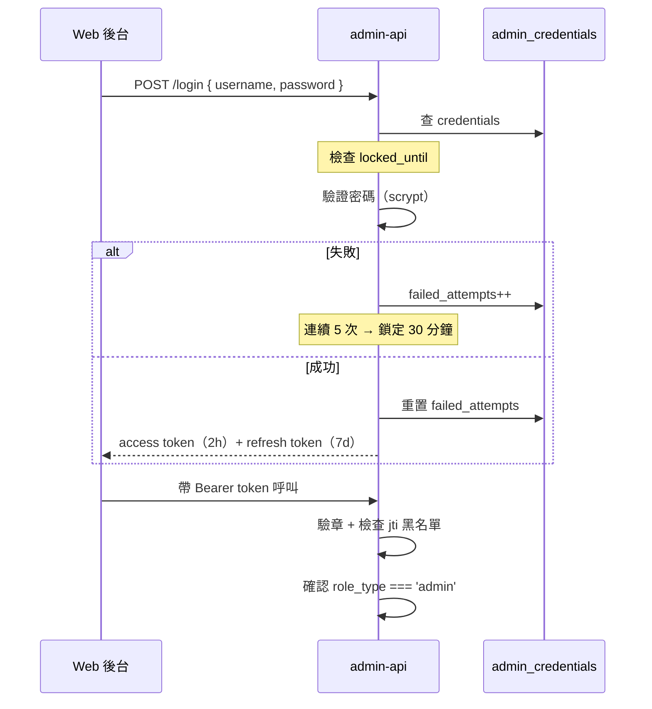

# 01 - 目標架構

> 產出階段：第二階段（目標架構設計）
> 前置文件：`docs/00-現狀分析.md`
> 產出日期：2026-10-15
> 分支：`refactor/hexagonal`（baseline：`main` @ `1f38b93`）
> **本文件只做設計，不含實作。尚未修改任何業務代碼、未建立雲函數、未動資料庫。**

---

## 0. 已確認的前提（來自你的回覆）

| # | 決策 | 對架構的影響 |
|---|---|---|
| Q1 | ✅ git 已建立，baseline 已提交 | 具備回滾能力 |
| Q2 | **Greenfield**，無舊後端／無舊資料 | 「遷移」改為「新建」；無兼容層 |
| Q3 | AppID `wx7f95f4a510129abe`；雲開發環境 ID 待補 | 部署細節待定，不阻擋設計 |
| Q4 | **微信雲開發雲函數 + `wx-server-sdk`**；支付／分帳／退款全部封裝於 adapter | 共享代碼方案成為核心議題（§5） |
| Q5 | 按**服務商分帳模式**設計，但 adapter 需預留 **平台代收 + 企業付款** fallback | 需獨立風險章節（§9） |
| Q6 | 客服端、師傅端＝**同一支小程序內的角色入口** | 三個角色共用客戶端代碼，靠路由與元件隔離 |
| Q7 | 管理端＝**獨立 Web 後台**（微搭／React Admin，我不做前端） | `admin-api` 需提供純 JSON API |
| Q12 | 地址分階段揭露；聯繫走 AXB 虛擬號或三方通話；**師傅端絕不顯示真實手機號** | domain 需 `AddressDisclosurePolicy`、`ContactMaskingPolicy` |
| Q13 | 保留：商品／訂單／地址／訂單詳情／支付骨架。下線：購物車／優惠券／拼團／發票／物流。tabBar 改為「首頁／服務／訂單／我的」 | 前端改造範圍明確 |

---

## 1. 設計原則

1. **domain 純淨**：`domain/` 不得 import `wx-server-sdk`、`wx.cloud`、任何 HTTP client、任何時間來源（`Date.now()` 需經 `ClockPort`）。這是可測試性與可替換性的唯一保證。
2. **依賴單向向內**：`entrypoints → application → domain`；`adapters → ports ← application`。domain 不知道外界的任何事。
3. **金額一律整數「分」**：`Money` 值物件，禁止浮點、禁止字串金額（修正現狀 D2）。
4. **所有權限判斷在後端**：前端只負責「顯示或不顯示」，不負責「能不能做」。路由／按鈕的角色邏輯只是 UX，不是安全邊界。
5. **失敗可補償**：支付、分帳、退款皆為跨系統非同步操作，一律採 **狀態機 + 冪等 + 補償（Saga）**，不依賴單次呼叫成功。
6. **每次外部呼叫都留痕**：`audit_logs` 與各 `*_records` 為唯一事實來源，debug 靠資料庫不靠日誌。

### 1.6 依賴方向與 CI 檢查（P1 驗收依據）

> 這一節把前面所有「應該」變成**可機械驗證的規則**。規則若無法被腳本檢查，就只是願望。

#### 1.6.0 本次稽核發現並修正的設計缺陷

依你的要求「若目前設計有任何一處不符合檢查點，直接修正，不要粉飾」，我重新檢視了本文件，發現**三處真實缺陷**：

| # | 缺陷 | 為什麼是問題 | 修正 |
|---|---|---|---|
| **F1** | `packages/` 位於專案根目錄，而小程序根目錄**也是**專案根目錄 | 微信開發者工具會把 `packages/`、`scripts/`、`tests/`、`docs/` 一併打包進**小程序**程式碼包，撐大體積、且讓 domain 原始碼進入前端包 | `project.config.json` 的 `packOptions.ignore` 必須排除這些目錄（**P0 執行**） |
| **F2** | 前文只說「Use Case 回傳 DTO」，但沒有明文禁止回傳實體 | 只要有一個 Use Case 回傳 `Order` 實體，§3.4 的 `AddressView`／`MaskedPhone` 型別保證**全部失效** | §1.6.3 明文列為硬規則 + CI 檢查 |
| **F3** | composition root 的位置在 §2.1 提過，但未定義「唯一性」 | 若 `index.js` 與 `bootstrap.js` 都能 `new Adapter`，測試就無法替換 | §1.6.4 + §1.6.6 明文化：**只有 `bootstrap.js` 可 new adapter** |

> F1 是三者中唯一會**實際影響交付物**的（前端包被污染）。其餘兩者是紀律漏洞。

#### 1.6.1 domain 層禁止 import 清單

**可 grep 的具體字串**（`packages/domain/**` 不得出現）：

| 禁止字串 / 正則 | 原因 |
|---|---|
| `wx-server-sdk` | 微信雲 SDK |
| `wx.cloud` | 小程序雲 API 全域物件 |
| `DYNAMIC_CURRENT_ENV` | 雲開發環境常數 |
| `cloud.database` / `cloud.callFunction` / `cloud.getWXContext` | 雲開發 API |
| `getWXContext` | 微信上下文 |
| `.collection(` / `db.collection` | 直接存取資料庫 |
| `Date.now(` | 非確定性時間 → 必須用 `ClockPort` |
| `new Date()` | 同上 |
| `Math.random(` | 非確定性隨機 → 必須用 `IdGeneratorPort` |
| `process.env` | 環境變數只允許 adapter 讀 |
| `console.log` / `console.error` / `console.warn` | 必須用 `LoggerPort` |
| 任何 `require()`/`import` **非相對路徑**且非 `@repair/shared-kernel` 者 | domain 只允許依賴自己與 shared-kernel |

**唯一允許的外部依賴**：`@repair/shared-kernel`（且 shared-kernel 本身亦須零依賴）。

#### 1.6.2 ports 層禁止出現的型別清單

**`packages/ports/**` 不得出現**：

| 禁止字串 | 原因 |
|---|---|
| `wx-server-sdk` | SDK 型別不得滲入介面 |
| `cloud.` / `DYNAMIC_CURRENT_ENV` | 雲開發型別 |
| `Database` / `Collection` / `DocumentReference` / `ServerDate` / `Command` | 雲資料庫型別 |
| `WeChatPay*` / `WxPay*` | 支付 SDK 型別 |
| `axios` / `node-fetch` / `require('http')` | HTTP client 型別 |
| `new ` （任何實例化） | ports 只能是介面，不得有實作 |
| `function` 帶**方法體**的 `class` | 同上 |

**允許的依賴**：僅 `@repair/shared-kernel` 與 `@repair/domain`（**只取型別**）。

#### 1.6.3 Use Case 依賴注入 — 完整骨架

**硬規則**：
1. 所有依賴一律 **constructor injection**。
2. Use Case 內**不得出現 `new`**（除了 `Result`／值物件等無依賴物件）。
3. **不得回傳實體**（F2）—— 只能回傳 DTO 或值物件。

```js
// packages/application/order/AssignOrderUseCase.js
'use strict';

const { OrderStatus } = require('@repair/domain/order/OrderStatus');
const { Result } = require('@repair/shared-kernel/Result');
const { toTechnicianOrderDTO } = require('../dto/orderDTO');

class AssignOrderUseCase {
  /**
   * ✅ 所有依賴由建構子注入。
   * ❌ 不得寫成：const repo = new CloudDBOrderRepository() —— adapter 只能由 bootstrap 建立。
   */
  constructor({ orderRepository, technicianRepository, unitOfWork, auditLog, notification, clock, idGenerator }) {
    this.orderRepository = orderRepository;
    this.technicianRepository = technicianRepository;
    this.unitOfWork = unitOfWork;
    this.auditLog = auditLog;
    this.notification = notification;
    this.clock = clock;
    this.idGenerator = idGenerator;
  }

  /** 第 2 層校驗：角色 */
  static get allowedRoles() {
    return ['cs_agent', 'admin'];
  }

  async execute({ actor, orderId, technicianId, remark }) {
    // ── 第 3 層校驗：資源歸屬（必須在 Use Case 內，不在入口）──
    if (actor.role === 'cs_agent' && !actor.assignedRegions.includes('*')) {
      const tech = await this.technicianRepository.findById(technicianId);
      if (!tech || !actor.assignedRegions.includes(tech.regionCode)) {
        return Result.forbidden('該師傅不在你負責的區域內');
      }
    }

    return this.unitOfWork.run(async (tx) => {
      const order = await this.orderRepository.findById(orderId, { tx });
      if (!order) return Result.notFound('訂單不存在');

      // 前置條件由 domain 判斷，Use Case 只負責編排
      const transition = order.stateMachine().canAssign(actor);
      if (!transition.ok) return transition.toResult();

      const technician = await this.technicianRepository.findById(technicianId, { tx });
      if (!technician || !technician.canAcceptOrders()) {
        return Result.conflict('該師傅目前無法接單');
      }

      const before = order.toSnapshot();
      order.assignTo(technician.id, { at: this.clock.now(), by: actor.id, remark });
      await this.orderRepository.save(order, { tx });
      await this.auditLog.append({ actor, action: 'AssignOrder', target: orderId, before, after: order.toSnapshot() }, { tx });

      tx.onCommit(() => this.notification.notifyTechnicianAssigned(technician.userId, order.id));

      // ✅ 回傳 DTO，不回傳 order 實體（F2）
      return Result.ok(toTechnicianOrderDTO(order));
    });
  }
}

module.exports = { AssignOrderUseCase };
```

> **注意 `idGenerator` 的用途**：若 Use Case 需要產生單號，**必須經 `IdGeneratorPort`**，不可用 `Math.random()`／`Date.now()`——否則測試無法重現。

> **⚠️ 一個容易踩的循環依賴（設計時發現並已修正）**：`ClockPort` 若放進 `shared-kernel`，會迫使 `domain` 依賴它；但 `ClockPort` 是 Port，而 Port 依賴 domain → **循環**。
> 解法：**`ClockPort`／`IdGeneratorPort`／`LoggerPort` 一律放 `packages/ports`**，而 domain 的純函式**以參數接收 `now`／`id`**（例如 `AddressDisclosurePolicy.discloseFor({ ..., now })`）。domain 因此完全不需要任何 Port，只依賴 `shared-kernel`。

#### 1.6.4 雲函數入口職責邊界 — 完整骨架

**入口只做四件事**：① 參數校驗 ② 身分驗證 ③ 呼叫 use case ④ 回傳結果。**不得有任何 if/else 業務規則。**

```js
// cloudfunctions/cs-api/index.js
'use strict';
const cloud = require('wx-server-sdk');
cloud.init({ env: cloud.DYNAMIC_CURRENT_ENV });          // 唯一允許 init 的地方

const { buildContainer } = require('./bootstrap');         // 唯一的組裝點
const { authenticate } = require('./middleware/authenticate');
const { validate } = require('./middleware/validate');
const { toResponse } = require('./middleware/toResponse');
const { AssignOrderUseCase } = require('@repair/application/order/AssignOrderUseCase');

const container = buildContainer();                        // 模組載入時組裝一次

// ① 參數校驗：這裡只描述「形狀」，不含業務規則
const SCHEMA = {
  orderId: { type: 'string', required: true, maxLength: 64 },
  technicianId: { type: 'string', required: true, maxLength: 64 },
  remark: { type: 'string', required: false, maxLength: 200 },
};

exports.main = async (event) => {
  try {
    const input = validate(event, SCHEMA);                 // ① 參數校驗
    const actor = await authenticate(cloud.getWXContext(), container); // ② 身分驗證
    // ②' 角色校驗：只比對宣告，不含規則
    if (!AssignOrderUseCase.allowedRoles.includes(actor.role)) {
      return toResponse.forbidden();
    }
    const useCase = new AssignOrderUseCase(container);     // ③ 呼叫 use case
    const result = await useCase.execute({ actor, ...input });
    return toResponse(result);                             // ④ 回傳結果
  } catch (err) {
    return toResponse.error(err);                          // 統一的錯誤轉譯
  }
};
```

**禁止出現在 `index.js` 的東西**：`if` 判斷訂單狀態、金額加減、`for` 迴圈處理業務資料、任何 `db.collection(...)`。

#### 1.6.5 adapters 層職責邊界 — 完整骨架

**adapter 只做「翻譯」**：把外部世界的形狀 ↔ domain 的形狀。**零業務規則。**

```js
// packages/adapters/clouddb/CloudDBOrderRepository.js
'use strict';

const { Order } = require('@repair/domain/order/Order');
const { OrderStatus } = require('@repair/domain/order/OrderStatus');
const { Money } = require('@repair/shared-kernel/Money');

class CloudDBOrderRepository {
  /** db 由外部注入 —— adapter 不自己 cloud.init() */
  constructor({ db, collectionName = 'orders' }) {
    this.db = db;
    this.collectionName = collectionName;
  }

  async findById(orderId, { tx } = {}) {
    const col = (tx ? tx.db : this.db).collection(this.collectionName);
    const res = await col.where({ order_id: orderId }).limit(1).get();
    return res.data.length ? this.#toDomain(res.data[0]) : null;
  }

  async save(order, { tx } = {}) {
    const col = (tx ? tx.db : this.db).collection(this.collectionName);
    const row = this.#toRow(order);
    await col.doc(order.persistenceId).set({ data: row });   // 樂觀鎖：比對 order.version
  }

  // ── 以下是純翻譯，不含任何判斷 ──

  #toDomain(row) {
    return Order.rehydrate({
      id: row.order_id,
      status: OrderStatus.fromValue(row.status),      // 列舉轉換
      amounts: {
        serviceFee: Money.fromCents(row.service_fee_cents),
        materialFee: Money.fromCents(row.material_fee_cents),
      },
      items: row.items.map((i) => ({ /* 欄位對欄位 */ })),
      version: row.version,
    });
  }

  #toRow(order) {
    return {
      order_id: order.id,
      status: order.status.value,
      service_fee_cents: order.amounts.serviceFee.cents,
      material_fee_cents: order.amounts.materialFee.cents,
      items: order.items.map((i) => ({ /* 欄位對欄位 */ })),
      version: order.version,
    };
  }
}

module.exports = { CloudDBOrderRepository };
```

**adapter 絕對禁止出現**（紅旗範例）：

```js
// ❌❌❌ 這是 adapter 裡最危險的寫法
#toRow(order) {
  const commission = order.total.cents * 0.8;              // ❌ 金額計算
  const status = order.paid ? OrderStatus.ASSIGNED : order.status;  // ❌ 狀態流轉
  if (commission > 10000) { /* ... */ }                    // ❌ 業務規則
}
```

> **判準**：若把 adapter 換成 in-memory fake，**業務行為必須完全不變**。若會變，就代表業務邏輯漏在 adapter 裡了。

#### 1.6.6 CI 可執行的 grep 腳本

零依賴 Node 腳本，`scripts/check-layering.js`：

```js
#!/usr/bin/env node
'use strict';
// 六角形依賴方向檢查器。用法：node scripts/check-layering.js  （違規則 exit 1）
const fs = require('fs');
const path = require('path');

const ROOT = path.resolve(__dirname, '..');

/** 每個層允許 require 的套件（相對路徑一律允許） */
const ALLOWED_DEPS = {
  'packages/shared-kernel': [],
  'packages/domain': ['@repair/shared-kernel'],
  'packages/ports': ['@repair/shared-kernel', '@repair/domain'],
  'packages/application': ['@repair/shared-kernel', '@repair/domain', '@repair/ports'],
  'packages/adapters': null, // null = 不限制（這是邊界層，負責碰外部世界）
};

/** domain 層禁止出現的字串 */
const DOMAIN_FORBIDDEN = [
  [/wx-server-sdk/, '微信雲 SDK'],
  [/\bwx\.cloud\b/, 'wx.cloud'],
  [/DYNAMIC_CURRENT_ENV/, '雲開發環境常數'],
  [/cloud\.(database|callFunction|getWXContext)/, '雲開發 API'],
  [/getWXContext/, '微信上下文'],
  [/\.collection\s*\(/, '直接存取資料庫'],
  [/Date\.now\s*\(/, '非確定性時間 → 用 ClockPort'],
  [/new\s+Date\s*\(\s*\)/, '非確定性時間 → 用 ClockPort'],
  [/Math\.random\s*\(/, '非確定性隨機 → 用 IdGeneratorPort'],
  [/process\.env/, '環境變數只能由 adapter 讀'],
  [/console\.(log|error|warn)\s*\(/, '須用 LoggerPort'],
];

/** ports 層禁止出現的字串 */
const PORTS_FORBIDDEN = [
  [/wx-server-sdk/, 'SDK 型別不得滲入介面'],
  [/cloud\.|DYNAMIC_CURRENT_ENV/, '雲開發型別'],
  [/\b(Database|Collection|DocumentReference|ServerDate|Command)\b/, '雲資料庫型別'],
  [/(WeChatPay|WxPay)/, '支付 SDK 型別'],
  [/(axios|node-fetch|require\(['"]https?['"]\))/, 'HTTP client 型別'],
  [/\bnew\s+\w+\s*\(/, 'ports 只能是介面，不得實例化'],
];

const violations = [];

function walk(dir, out = []) {
  if (!fs.existsSync(dir)) return out;
  for (const e of fs.readdirSync(dir, { withFileTypes: true })) {
    const p = path.join(dir, e.name);
    if (e.isDirectory()) { if (e.name !== 'node_modules') walk(p, out); }
    else if (e.name.endsWith('.js')) out.push(p);
  }
  return out;
}

const rel = (p) => path.relative(ROOT, p).replace(/\\/g, '/');
const isTest = (r) => /(^tests\/|\.test\.js$|\.spec\.js$)/.test(r);

function scan(dirRel, forbidden, label) {
  for (const file of walk(path.join(ROOT, dirRel))) {
    const r = rel(file);
    if (isTest(r)) continue;
    const src = fs.readFileSync(file, 'utf8');
    src.split('\n').forEach((line, i) => {
      if (/^\s*(\/\/|\*|\/\*)/.test(line)) return;         // 略過註解
      for (const [re, why] of forbidden) {
        if (re.test(line)) violations.push({ file: r, line: i + 1, why: `${label}：${why}`, text: line.trim().slice(0, 80) });
      }
    });
  }
}

function checkDeps(dirRel) {
  const allowed = ALLOWED_DEPS[dirRel];
  if (allowed === null) return;
  for (const file of walk(path.join(ROOT, dirRel))) {
    const r = rel(file);
    if (isTest(r)) continue;
    const src = fs.readFileSync(file, 'utf8');
    const re = /(?:require\s*\(\s*|from\s+)['"]([^'"]+)['"]/g;
    let m;
    while ((m = re.exec(src))) {
      const dep = m[1];
      if (dep.startsWith('.')) continue;                    // 相對路徑一律允許
      if (!dep.startsWith('@repair/')) {
        violations.push({ file: r, why: `依賴方向：不得 require 外部套件 "${dep}"`, text: m[0] });
      } else if (!allowed.includes(dep)) {
        violations.push({ file: r, why: `依賴方向：${dirRel} 不得依賴 "${dep}"`, text: m[0] });
      }
    }
  }
}

/** 只有 bootstrap.js 可以 new adapter */
function checkAdapterInstantiation() {
  for (const dirRel of ['cloudfunctions', 'packages']) {
    for (const file of walk(path.join(ROOT, dirRel))) {
      const r = rel(file);
      if (isTest(r) || /bootstrap\.js$/.test(r)) continue;
      const src = fs.readFileSync(file, 'utf8');
      src.split('\n').forEach((line, i) => {
        if (/^\s*(\/\/|\*|\/\*)/.test(line)) return;
        const m = line.match(/new\s+\w*Adapter\s*\(/);
        if (m) violations.push({ file: r, line: i + 1, why: '組裝點唯一性：只有 bootstrap.js 可 new adapter', text: line.trim().slice(0, 80) });
      });
    }
  }
}

// ── 執行 ──
scan('packages/domain', DOMAIN_FORBIDDEN, 'domain');
scan('packages/ports', PORTS_FORBIDDEN, 'ports');
for (const d of Object.keys(ALLOWED_DEPS)) checkDeps(d);
checkAdapterInstantiation();

if (violations.length === 0) {
  console.log('✓ 依賴方向檢查通過');
  process.exit(0);
}
console.error(`✗ 發現 ${violations.length} 處違規：\n`);
for (const v of violations) {
  console.error(`  ${v.file}${v.line ? ':' + v.line : ''}  [${v.why}]`);
  if (v.text) console.error(`      ${v.text}`);
}
process.exit(1);
```

**掛載點**：

```json
{ "scripts": { "check:layering": "node scripts/check-layering.js",
               "lint:arch": "npm run check:layering" } }
```

`.husky/pre-commit` 加入 `npm run check:layering && npm run sync:check`。

> **這支腳本就是 §1.6 全節的可執行版本。** 它同時涵蓋你要求的五個檢查點中的 1、2、3（部分），以及檢查點 6 的靜態面。

**P1 將追加的規則**（依 §4.7.0 的決策）：

```js
/** adapters 不得自己寫角色判斷 —— 必須走 domain 策略（§4.7.0 / §1.6.5） */
function checkAdapterRoleBranching() {
  for (const file of walk(path.join(ROOT, 'packages/adapters'))) {
    const r = rel(file);
    if (isTest(r)) continue;
    fs.readFileSync(file, 'utf8').split('\n').forEach((line, i) => {
      if (isComment(line)) return;
      // 只抓「比較」，不抓物件字面量（{ role: 'technician' } 是合法傳參）
      if (/\.role\s*[!=]==?/.test(line)) {
        violations.push({
          file: r, line: i + 1,
          why: 'adapters 不得判斷角色（應呼叫 domain 的 AddressDisclosurePolicy / ContactMaskingPolicy）',
          text: line.trim().slice(0, 90),
        });
      }
    });
  }
}
```

### 1.7 P1 解耦驗收清單

> 以下是你會在 P1 完成後逐項檢查的清單。**每一項都附上「你怎麼自己驗證」，而不是要你相信我的說法。**

| # | 檢查項 | 合格標準 | 你的驗證方式 | 自動化 |
|---|---|---|---|---|
| 1 | **domain 可在不啟動微信雲環境下跑單元測試** | 測試在**離線、無雲環境、無網路**的機器上通過；執行時間 < 1 秒 | `npm run test:domain`，並確認測試檔中**沒有任何** `wx-server-sdk` | ✅ `check:layering` + 測試 |
| 2 | **ports 全部是 interface，無具體實現** | 每個 port 檔案只有 JSDoc typedef 與匯出標記；無方法體、無 `new`、無 SDK 型別 | `node scripts/check-layering.js` 對 `packages/ports` 零違規；人工翻閱任一個 port 檔 | ✅ 部分（靜態檢查） |
| 3 | **use case 全部 constructor injection** | `packages/application` 內**零個 `new`**（`Result` 等無依賴物件除外） | `grep -rn "new " packages/application/` 檢視每一筆 | ⚠️ 需人工判讀最後幾筆 |
| 4 | **雲函數入口零業務邏輯** | 每個 `index.js` 只含：validate / authenticate / `useCase.execute` / toResponse；且 < 60 行 | `node scripts/check-layering.js` + `wc -l cloudfunctions/*/index.js` | ✅ 行數可自動；語意需人工 |
| 5 | **adapters 零業務邏輯** | adapters 內無 `Money` 運算、無 `OrderStatus` 比較、無比例計算 | `grep -rnE "\*|/|\+|-" packages/adapters/ \| grep -i "cents\|amount\|rate"` 應為零 | ⚠️ 需人工判讀 |
| 6 | **有 in-memory adapter 可替換真 adapter 跑測試** | 整合測試全程使用 in-memory；能跑完整訂單流程；切換只改 bootstrap 一行 | `npm run test:integration`；且 `git diff` 顯示切換僅動 bootstrap | ✅ 測試 |

**補充硬規則（來自 F2，必須一併檢查）**：

| # | 檢查項 | 合格標準 | 驗證方式 |
|---|---|---|---|
| 7 | **Use Case 不回傳實體** | 所有 `packages/application/**` 的 `return` 皆為 `Result` 包 DTO | 「師傅端 DTO 掃描測試」斷言無 `/\d{11}/` 與 `detailAddress` |
| 8 | **師傅端不可能取得完整敏感資料** | 遍歷所有師傅端 Use Case × 所有訂單狀態，回傳 JSON 不含完整手機號、完整地址、抽成 | 同上，此測試**必須存在且通過** |

**驗收的執行方式**：P1 完成後，我會執行上述全部指令並附上**原始輸出**（非摘要），你可自行複跑核對。若有任何一項未達標，我會直接說明，不以「大致符合」帶過。

---

## 2. 六角形分層與模組劃分

### 2.1 分層職責

| 層 | 職責 | 允許依賴 | 禁止 |
|---|---|---|---|
| `domain` | 實體、值物件、狀態機、領域策略、金額計算 | 僅標準 JS | 微信 API、DB、HTTP、`Date.now()`、`Math.random()` |
| `application` | Use Case 編排、權限規則、交易邊界、Saga 補償 | `domain`、`ports` | 任何具體 SDK |
| `ports` | 介面定義（TypeScript 風格 JSDoc 或 .d.ts） | `domain`（僅型別） | 任何實作 |
| `adapters` | Port 的具體實作 | `ports`、`domain`、SDK | 被 domain 直接引用 |
| `entrypoints` | 雲函數入口：參數驗證、身分驗證、呼叫 use case、組裝回應 | `application`、`adapters`（僅在 composition root 組裝） | 業務規則 |

> **組裝點（Composition Root）**：只有 `entrypoints/*/bootstrap.js` 知道「哪個 Port 用哪個 Adapter」。這是唯一允許 `new CloudDBOrderRepository()` 的地方。Use Case 一律以建構子注入依賴。

### 2.2 模組劃分（Bounded Context）

| Context | 聚合根 | 說明 |
|---|---|---|
| **Identity** | `User` | 身分、角色、狀態 |
| **Catalog** | `Service` / `Product` | 服務項目與材料商品（後台下架即停售，不刪） |
| **Ordering** | `Order` | 訂單聚合（含 `OrderItem` 實體、狀態機） |
| **Dispatch** | `Assignment` | 派單／改派／接單（可由客服或系統自動） |
| **Settlement** | `PaymentRecord` / `ProfitSharingRecord` / `RefundRecord` | 金流三兄弟，各為獨立聚合 |
| **AfterSales** | `RefundRequest` | 退款申請與審核（與 Settlement 協作） |
| **Support** | `WorkOrderTicket` / `WorkOrderMessage` | 客服工單，客戶↔客服↔師傅的唯一溝通管道 |
| **Audit** | `AuditLog` | 唯讀，所有寫操作留痕 |

### 2.3 架構圖



---

## 3. 領域模型（domain）

### 3.1 值物件

| 值物件 | 職責 | 不變式 |
|---|---|---|
| `Money` | 金額，**整數分** | 禁止負數（除退款差額）、禁止浮點運算、四則運算需同幣別 |
| `OrderNo` / `OutTradeNo` / `OutRefundNo` | 對外單號 | 格式固定、可反解業務類型 |
| `OrderStatus` | 訂單狀態列舉 | **每個語意獨立數值**（修正現狀 R10 的 80 碰撞問題） |
| `FeeType` | `SERVICE_FEE` / `MATERIAL_FEE` | 決定退款歸屬 |
| `CommissionRate` | 分潤比例（basis point 整數） | 0 ≤ rate ≤ 10000 |
| `Address` | 結構化地址 | 支援**分級揭露**（見 3.4） |
| `MaskedPhone` | 脫敏手機號 | **型別上就不可能持有完整號碼** |
| `RefundScope` | 退款範圍 | `SERVICE_ONLY` / `MATERIAL_ONLY` / `FULL` / `CUSTOM` |

> `MaskedPhone` 的設計要點：讓「師傅端拿到完整手機號」在**型別層級就不可能**，而不是靠程式碼記得遮罩。

### 3.2 訂單聚合

```js
Order {
  orderId, orderNo, customerId, csAgentId?, technicianId?,
  status: OrderStatus,
  items: OrderItem[],            // 聚合內實體
  amounts: {
    serviceFee: Money,           // Σ items where feeType=SERVICE_FEE
    materialFee: Money,          // Σ items where feeType=MATERIAL_FEE
    discount: Money,
    total: Money
  },
  address: Address,
  appointmentAt: Timestamp,      // 預約服務時間（新增）
  snapshot: { commissionRate, pricingVersion },  // 下單當下快照
  timeline: OrderStatusLog[],
  version: number                // 樂觀鎖
}

OrderItem {
  itemType: 'service' | 'product',
  itemRefId,                     // 指向 services / products
  nameSnapshot, specSnapshot,    // ← 快照，歷史訂單不受改價影響
  unitPriceSnapshot: Money,      // ← 快照
  quantity, feeType,
  commissionRateSnapshot         // ← 快照（Q11 確認項，見 §11）
}
```

**快照規則（對應你的業務規則 4）**：`order_items` 寫入當下複製 `name / spec / unitPrice / commissionRate`。後台改價或改比例**永不影響歷史訂單**。`itemRefId` 僅作溯源，不可用於回查價格。

### 3.3 狀態機

#### 訂單狀態（狀態與原因分離，修正現狀 R10）



| 狀態 | 值 | 語意 | 誰可觸發轉移 |
|---|---:|---|---|
| `PENDING_PAYMENT` | 10 | 待付款 | 客戶（取消）／系統（逾時） |
| `PAID_PENDING_ASSIGN` | 20 | 已付款待派單 | 客服（派單）／系統（逾時） |
| `ASSIGNED_PENDING_ACCEPT` | 30 | 已派單待接單 | 師傅（接單／拒單）／客服（改派）／系統（逾時） |
| `ACCEPTED_PENDING_VISIT` | 40 | 已接單待上門 | 師傅（到場）／客戶（改期） |
| `IN_SERVICE` | 50 | 服務中 | 師傅（完工）／客戶或師傅（爭議） |
| `PENDING_ACCEPTANCE` | 60 | 待驗收 | 客服／客戶（驗收）／系統（逾時自動）／任一方（爭議） |
| **`DISPUTED`** | **65** | **爭議中** | **客服／管理員（裁定）** |
| `COMPLETED` | 70 | 已完成 | 客服／客戶（售後） |
| `CANCELED_UNPAID` | 81 | 已取消－客戶主動（未付款） | 客戶 |
| `CANCELED_PAID_REFUNDED` | 82 | 已取消－客服取消（已付款並退款） | 客服 |
| **`EXPIRED_UNPAID`** | **83** | **已逾時－未付款** | **系統** |
| **`EXPIRED_UNASSIGNED_REFUNDED`** | **84** | **已逾時－未派單／未接單（已退款）** | **系統** |
| `CLOSED_REFUNDED` | 91 | 已結案－退款完成 | 系統（退款成功後） |
| **`VOIDED`** | **92** | **已作廢（平台主動）** | **客服發起 + 管理員確認（雙重）** |

#### 「已作廢」（`VOIDED`，值 92）— 新增

**與 `CANCELED_*` 的語意區別**：`CANCELED_*` 是**客戶或客服取消**；`VOIDED` 是**平台主動作廢**。

| 面向 | 規則 |
|---|---|
| 適用場景 | 重複下單、測試訂單、詐欺訂單、平台失誤 |
| 權限 | **客服發起 + 管理員確認（雙重）**，寫入 `approval_records` |
| 留痕 | 必寫 `audit_logs`，**含作廢理由**（`reasonCode` + 文字說明） |
| 資料 | **保留，不實體刪除**。僅狀態改為 `VOIDED` |
| 流轉 | **終態，不可再流轉** |
| 與軟刪除政策的關係 | 這**就是**本專案的「刪除」實作方式。`docs/01` §4.6 的「任何角色皆不得硬刪除」維持不變 |

**✅ 已定案（Q12）：已付款訂單不得「直接」作廢，作廢必須同時建立退款流程。**

| 訂單當下狀態 | 作廢規則 |
|---|---|
| **未付款** | ✅ **可直接作廢**（無金流問題） |
| **已付款、未派單** | 作廢 **+ 全額退款** |
| **已付款、已派單、未完成** | 作廢 **+ 退款**（金額按**已發生費用**，由客服判斷） |
| **已完成** | ❌ **不能作廢**，只能走退款／售後流程 |

**為何「已完成」不能作廢**：已完成代表服務已履行、且很可能已分帳給師傅。
此時作廢會破壞分帳與對帳的完整性 —— 正確的做法是走退款（含分帳回退）。

**實作歸屬**：狀態機只管「轉移是否合法」（允許所有非終態 → `VOIDED`）；
上表的**業務規則**由 **P5 的 `VoidOrderUseCase`** 與 **P4c 的 `ApprovalPolicy`** 強制。

#### 「爭議中」（`DISPUTED`，值 65）— 新增

**這是本專案最需要小心的一個狀態，因為它必須阻斷金流。**

| 面向 | 規則 |
|---|---|
| 進入條件 | 客戶或師傅任一方提出爭議；可自 `IN_SERVICE`／`PENDING_ACCEPTANCE`／`COMPLETED` 進入 |
| **金流影響** | **立即凍結結算**：`ExecuteProfitSharing` 遇 `DISPUTED` **必須拒絕執行**；已分帳者標記待回退 |
| 誰能裁定 | 客服初判，管理員可覆核；裁定一律寫 `audit_logs` |
| 退出 | `COMPLETED`（維持）／`CLOSED_REFUNDED`（退款結案）／`IN_SERVICE`（返工） |
| 工單 | 自動升級工單優先級，並通知客服 |
| 逾時 | 超過 N 天未裁定 → 告警管理員（N 可配置） |

#### 「已逾時」（`EXPIRED_*`，值 83／84）— 新增

**與「取消」分離的理由**：逾時是**系統**造成、取消是**人**造成。兩者若共用數值（如 baseline 中四個語意共用 `80`），統計看板的「逾時率」與「取消率」就永遠算不出來。

| 狀態 | 觸發 | 逾時閾值（`system_configs`） | 金流動作 |
|---|---|---|---|
| `EXPIRED_UNPAID` (83) | 下單後未付款 | `order.payment_timeout_minutes` | 無（未收款） |
| `EXPIRED_UNASSIGNED_REFUNDED` (84) | 已付款但逾時未派單，或已派單但逾時未接單 | `order.assign_timeout_minutes`／`order.accept_timeout_minutes` | **自動全額退款**（原路返回） |

> `EXPIRED_UNASSIGNED_REFUNDED` 是**唯一由系統自動觸發退款的狀態**，也是定時任務 `AutoExpireUnassignedOrders` 的職責。退款仍走完整 `RequestRefund → ApproveRefund → 分帳回退 → ExecuteRefund` 流程（此時通常尚未分帳，回退步驟為空操作）。
>
> **逾時閾值一律從 `system_configs` 讀取，不硬編碼**（見 §3.3 尾註與 A9）。

> **取消／逾時原因不再共用同一數值**，所有狀態轉移皆以 `cancel_reason` / `expire_reason` 欄位另存文字原因。

#### 分帳狀態



#### 退款狀態



---

### 3.4 兩個安全策略（你指定）

#### `AddressDisclosurePolicy`

| 階段 | 揭露層級 | 範例 |
|---|---|---|
| `ASSIGNED_PENDING_ACCEPT`（已派單待接單） | `DISTRICT` | 深圳市寶安區沙井街道 |
| `ACCEPTED_PENDING_VISIT`（已接單） | `DISTRICT` | 同上 |
| 服務當日 **08:00 起** | `FULL` | 深圳市寶安區沙井街道中心路28號麗沙花都3棟5B |
| `COMPLETED` 後 N 天 | `DISTRICT` | 自動降級（可設定） |
| 非指派師傅 | 一律 `DISTRICT` | |

介面：`AddressDisclosurePolicy.discloseFor(viewer, order, now) → AddressView`

**關鍵設計**：回傳的是 `AddressView`（**新的值物件**），不是 `Address`。師傅端在型別上就拿不到完整地址。

#### `ContactMaskingPolicy`

| 對象 | 可見 |
|---|---|
| 客服／管理員 | 完整手機號 |
| 客戶 | 完整自己資料 |
| **師傅** | **一律 `MaskedPhone`（`138****1234`）**，永不解鎖 |

聯繫通道（`ContactBridgePort`）二選一，按成本決定：

| 方案 | 說明 | 前提 |
|---|---|---|
| A. AXB 虛擬號 | 平台提供中間號，通話雙方互不見號碼 | 需開通隱私號服務（**需人工核對**，含計費） |
| B. 客服三方通話 | 師傅點「聯繫客戶」→ 客服介入撥號 | 零額外成本，但依賴客服在線 |

> ⚠️ **此為業務閉環的關鍵缺口**：若 A、B 皆不可行，師傅將無法聯繫客戶。此題必須在實作前定案。

### 3.5 領域服務與策略

| 名稱 | 職責 |
|---|---|
| `OrderStateMachine` | 唯一定義「什麼狀態可以轉到什麼狀態、誰能轉」 |
| `PricingService` | 由 `items` 計算 `serviceFee`/`materialFee`/`total` |
| `RefundPolicy` | 依 `RefundScope` 計算可退金額；校驗不可超過已付、不可超過 50 次上限 |
| `ProfitSharingPolicy` | 計算師傅報酬（基數與比例待 Q10 確認） |
| `SettlementOrchestrator` | 領域層的 Saga 規則：退款前必須先完成分帳回退（你的業務規則 6） |

### 3.6 分潤模型（你的 A3 / A4 決策）

**A3：分潤基數＝服務費（不含材料費）。A4：比例逐單快照。**

```js
// packages/domain/value-objects/ProfitSharingTerms.js
// 於下單當下凍結，寫入 orders.snapshot；之後唯讀，後台改配置不影響
ProfitSharingTerms {
  base: 'SERVICE_FEE',            // ← 參數化（'SERVICE_FEE' | 'SERVICE_FEE_PLUS_MATERIAL'）
  technicianRateBp: 8000,         // 80.00%，basis point 整數
  platformRateBp: 2000,
  roundingMode: 'FLOOR_TO_CENT',  // 取整規則必須明文，不可留給 JS 預設
  termsVersion: 'v1'
}
```

```js
// packages/domain/policies/ProfitSharingPolicy.js —— 純函式，無外部依賴
function calculateTechnicianShare({ order, terms }) {
  const base = terms.base === 'SERVICE_FEE_PLUS_MATERIAL'
    ? order.amounts.serviceFee.add(order.amounts.materialFee)  // 參數切換即可改決策
    : order.amounts.serviceFee;                                 // ← 現行決策
  return base.applyRate(terms.technicianRateBp, terms.roundingMode);
}
```

| 項目 | 決策 | 說明 |
|---|---|---|
| 分潤基數 | **服務費** | 材料費不進分潤 |
| 基數參數化 | `terms.base` | 改決策＝改設定 + 改測試，**不動 Use Case** |
| 比例來源 | **逐單快照** | `orders.snapshot.profitSharingTerms` + `order_items.commission_rate_bp_snapshot` |
| 後台改比例 | 只影響**新訂單** | 歷史訂單讀快照，永不回查當前配置 |
| 取整 | `FLOOR_TO_CENT` | 差額歸平台；**若改為歸師傅需明示**，否則對帳會對不上 |
| 時機 | 客服確認完工（`COMPLETED`）且**非 `DISPUTED`** | 見 §3.3「爭議中」的金流凍結規則 |

#### 材料費：平台統一定價、隨訂單收款（A12 已定案）

**A12 決策＝模式 (a)。** 材料費由平台統一定價、隨訂單一起收款；師傅**不代購、不墊付**。

| 面向 | 決策 |
|---|---|
| 收款 | 材料費與服務費一併進入平台／特約商戶帳戶 |
| 分潤 | 材料費**不參與分潤**（基數＝服務費，見上表） |
| 退款 | 可獨立退（`RefundScope.MATERIAL_ONLY`），見 §3.3 退款狀態機 |
| 師傅代購 | **不支援**。無墊付、無報銷、無 `material_advance_records` |

> **前一版的「師傅墊付 → 平台審核 → 報銷」流程已整段刪除**（依你的 A12 決策：初期訂單量不足以支撐，日後若有需求另開階段做 B）。
>
> 這個刪除有一個**附帶好處**：它移除了設計中唯一一筆「平台主動付款給個人」的金流，**連帶縮小了 §9.3 的二清合規暴露面**。現在整個系統只有兩個資金出口：分帳（給師傅的報酬）與退款（還給客戶），兩者都依附在訂單款上。

---

---

### 3.7 服務與商品的呈現與領域分離

> 決策日期：2026-10-16。**本節同時撤銷 A7 中「購物車下線」的決定**（見 §3.7.7）。

#### 3.7.0 ⚠️ 兩個必須先釐清的問題

**(A) 「客戶端統一為商品概念」與 tabBar 只有「服務」項之間的張力**

你的決策同時包含：

| 陳述 | 出處 |
|---|---|
| 「客戶端呈現**統一為『商品』概念**，後端仍區分服務與商品」 | 業務決策 1 |
| 「兩者都實作 `CatalogItem` 介面，**前端統一按 `CatalogItem` 呈現**」 | §3.7.1 |
| 「tabBar 改為 5 項：首頁 \| **服務** \| 購物車 \| 訂單 \| 我的」 | 業務決策 5 |

**張力**：若客戶端統一為「商品」概念，為何 tabBar 的入口叫「**服務**」而不是「商品」？**商品要從哪裡進入？**

我的理解是三者分屬不同層次：

| 層次 | 用詞 |
|---|---|
| **程式碼** | 統一介面 `CatalogItem`（服務與商品都實作它） |
| **UI 元件** | 卡片、列表等**共用同一套呈現元件** |
| **UI 文案與入口** | **仍區分** —— tabBar 是「服務」，商品從購物車／首頁「零件」入口進入 |

**✅ 已定案：三層次理解成立，入口設計如下。**

| 層次 | 內容 |
|---|---|
| **程式碼** | 統一介面 `CatalogItem` |
| **元件** | 商品卡片、詳情頁骨架、SKU 選擇器**共用** |
| **UI 文案與入口** | 仍區分「服務」與「**零件**」，但**用詞統一**（零件一律叫「零件」，不叫「商品」） |

| 入口 | 內容 |
|---|---|
| tabBar「服務」 | 服務列表（**主推服務**） |
| 服務列表頁 | 頂部 tab 切換「**服務 / 零件**」 |
| 首頁 | 「熱門服務」+「常用零件」兩個區塊 |
| 購物車 | 空車時顯示「**去逛逛零件**」按鈕 |

> **不把 tabBar 的「服務」改名為「商品」或「商城」** ——
> 維修場景的核心是服務，零件是配角。命名要反映業務重心。

**(B) ⚠️ 庫存原子扣減與 P2-0 探針共用同一個前提**

你指定「商品下單時**原子扣減（`inc(-1)`）**」。這與「每日退款配額」依賴**完全相同的資料庫原子性前提**（`docs/02` §3.0）。

| 功能 | 依賴 |
|---|---|
| 每日退款配額遞增 | §4.7.8 |
| **商品庫存扣減** | 本節 §3.7.4 |
| **混合訂單的原子性**（扣庫存 + 建立訂單要嘛全成功要嘛全失敗） | 本節 §3.7.4 |

**因此 P2-0 探針的結果同時決定這三件事的實作方式。**

#### 3.7.1 領域層保持分離

| | `Service`（服務） | `Product`（商品） |
|---|---|---|
| 技能要求 | ✅ 有（技能標籤） | ❌ 無 |
| 時長 | ✅ 有（`durationMinutes`） | ❌ 無 |
| 可預約時段 | ✅ 有 | ❌ 無 |
| 庫存 | ❌ **無庫存**（可預約時段即產能） | ✅ **有庫存** |
| 規格 | ❌ | ✅ 有（SKU） |
| `fee_type` | **服務費** | **材料費** |

**共同介面 `CatalogItem`**（`packages/domain/catalog/`）：

```js
CatalogItem {
  id, name, category, priceCents, isActive,
  // 以下由子類型決定有無
  durationMinutes?,   // Service 才有
  stock?,             // Product 才有
  skillTags?,         // Service 才有
}
```

**前端統一按 `CatalogItem` 呈現**（共用卡片、列表元件）；**後端按具體類型處理**（庫存校驗、派單邏輯不同）。

> ⚠️ `CatalogItem` 住在 `packages/domain/`，前端**不能 import 它**（`packages/` 被排除在前端 bundle 外，見 `docs/04` §4.2）。
> 前端會有一份**形狀相同但獨立維護**的 view model。這是刻意的取捨。

#### 3.7.2 三個下單入口，兩條結算路徑

| 入口 | 內容 | 路徑 |
|---|---|---|
| **服務詳情頁** | 服務 + **加購零件** | **立即下單**（不走購物車） |
| **商品詳情頁** | 商品 | 加入購物車 |
| **購物車** | 純商品 | 結算下單 |

**核心規則：服務永遠走「立即下單」，不進購物車。**



**為什麼服務不進購物車**：服務有**預約時段**（產能）與**技能要求**。把它們放進購物車再一起結算，會讓「這個時段還能不能約」變成跨頁面的狀態問題。立即下單讓預約與付款在同一個流程內完成，語意清楚。

#### 3.7.3 訂單結構不變

`order_items` **維持現有設計**（§7.1）：

| 項目 | `item_type` | `fee_type` |
|---|---|---|
| 服務項 | `service` | `service_fee` |
| 零件項 | `product` | `material_fee` |

**這代表退款邏輯完全不受影響** —— 仍支援：

| 退款範圍 | 對應 |
|---|---|
| 只退服務費 | `fee_type = service_fee` 的明細 |
| 只退材料費 | `fee_type = material_fee` 的明細 |
| 全額 | 全部明細 |
| 按明細勾選 | `CUSTOM_ITEMS`（A6） |

> **「服務 + 加購零件」的混合訂單與「純商品」訂單，在資料結構上沒有差別** —— 只是明細的組成不同。
> 這是 `fee_type` 設計的價值。

#### 3.7.4 庫存處理（⚠️ 依賴 P2-0 探針結果）

| 類型 | 庫存 | 校驗時機 |
|---|---|---|
| **服務** | **無庫存** —— 「可預約時段」即產能，由**客服派單時確認** | 下單時**不校驗** |
| **商品** | 有庫存 | 下單時**原子扣減**（`inc(-1)`），不足則擋下 |
| **混合訂單** | 服務不校驗；**零件校驗** | **零件不足 → 整個訂單失敗** |

#### 庫存扣減時機：**支付時扣**（✅ 已定案，初期簡化）

| 階段 | 行為 |
|---|---|
| 下單（未付款） | **不扣庫存** |
| **支付成功** | **扣庫存**；不足則**支付失敗** |
| 逾時未付（微信支付 15 分鐘自動取消） | **不需釋放庫存**（因為還沒扣） |

**為什麼選這個**：微信支付訂單 15 分鐘未付會自動取消，若採「下單即預佔」，
就必須再寫一套「取消時釋放」的補償邏輯 —— 而那個邏輯在逾時、取消、支付失敗
三條路徑上都要正確，**複雜度不划算**。

> **⚠️ 這是初期簡化，日後可升級。**
> 若搶購場景頻繁（同一商品高併發），「支付時扣」會讓使用者在付款那一刻才發現售完，
> 體驗差。屆時應升級為「**預佔 → 確認 → 釋放**」三階段。
> 升級點已在 `order_items` 保留 `stock_reserved_at` 欄位的擴充空間。

**⚠️ 兩個原子性要求**：

1. **庫存扣減本身**必須原子（否則超賣）
2. **「扣庫存 + 將訂單標記為已付款」必須是一個交易** —— 否則會出現「庫存扣了但訂單沒更新」或反之

**兩者都取決於 P2-0 探針的結果**（事務能力／`_.inc()` 可靠性）。

> 若探針顯示不支援事務，混合訂單的「全成功或全失敗」需要補償機制
> （例如先建訂單為 `PENDING`，扣庫存失敗則標記取消）。這會增加複雜度，
> **必須等探針結果才能定案**。

#### 3.7.5 tabBar 改為 5 項

| # | 項目 | 頁面 |
|---|---|---|
| 1 | 首頁 | `pages/home/home` |
| 2 | 服務 | `pages/services/index` |
| 3 | **購物車** | `pages/cart/index` |
| 4 | 訂單 | `pages/orders/index` |
| 5 | 我的 | `pages/usercenter/index` |

**剛好用滿 `tabBar.list` 的 5 項上限**（見 `docs/04` §6）。

- `pages/cart/index` **本來就在主包**，可直接當 tabBar 項目 ✅
- 商品列表／詳情是**子頁面**（非 tabBar），維持在 `pages/goods` 分包
- 師傅／客服／管理員仍用 `wx.reLaunch` 導向自製底部導覽（不受影響）

#### 3.7.6 購物車邊界情況

| # | 情況 | 處理 |
|---|---|---|
| 1 | 商品被搶光 | **結算時**校驗，標紅且不可結算 |
| 2 | 商品下架 | **結算時**自動移除並提示 |
| 3 | 商品改價 | 購物車顯示**加入時的價格**；結算時提示「價格已變動」 |
| 4 | 購物車上限 | **50 項** |

> **第 3 點的設計理由**：購物車是「使用者當時看到的價格」的承諾。
> 若直接顯示新價格而不提示，使用者會覺得「怎麼變貴了」。
> 顯示舊價 + 結算時明確提示，把決定權交回使用者。

#### 3.7.7 ⚠️ 本節撤銷的既有決策

| 原決策 | 原內容 | 新決策 |
|---|---|---|
| **A7**（部分） | 「下線：**購物車**、優惠券、拼團、發票、物流追蹤」 | **購物車恢復**（其餘四項仍下線） |

**受影響的文件**：`docs/01` §10.2、`docs/02` §8.1（P7-11）、`docs/P7a-計畫.md` §2 M12。
**處置**：購物車**不上線下線清單**；優惠券／拼團／發票／物流維持入口下線。

#### 3.7.9 分類頁與資料模型（2026-10-16 定案）

**(1) tabBar 第 2 項由「服務」改名為「分類」**

| # | tabBar |
|---|---|
| 1 | 首頁 |
| 2 | **分類**（原「服務」） |
| 3 | 購物車 |
| 4 | 訂單 |
| 5 | 我的 |

**理由**：分類涵蓋服務與零件，是**中性詞**；「服務」一詞太窄 —— 零件不是服務。

> ⚠️ 這個改名**排在 P7a-2b**（與分類頁本身一起），不在 P7a-2a。
> 若只改文字而頁面內容不變，會出現「tabBar 寫分類、點進去是舊服務頁」的暫時不一致。

**(2) 分類頁佈局**

> **修正（T3.6, 2026-10-16）**：原決策「不做二級分類」
> 已更正為「**二級分類**」。原因：使用者澄清要 TDesign 原始佈局
> （左一級 → 右二級 tabs → 商品網格）。
> 以下原文保留作為決策歷史。

**✅ 現行佈局（兩層）**：

| 區域 | 內容 |
|---|---|
| **左側** | **一級**分類列表（由後台配置：新增／修改／排序／上下架） |
| **右側頂部** | **二級**分類 tabs |
| **右側下方** | **兩列**商品網格（該二級下的**服務 + 零件**，服務在上） |
| 卡片 | 圖片 + 中文名 + 價格 + 類型標籤（服務／零件） |
| 互動 | 切一級 → 二級 tabs 與網格跟著換；切二級 → 網格跟著換；點項目 → 詳情 |
| 實作位置 | 沿用 TDesign 原始 `pages/category/index` + `goods-category` 元件（`isSlotRight` 模式） |

---

**以下為原決策（已修正，保留作為歷史）**：

| 區域 | 內容 |
|---|---|
| **左側** | 一級分類列表（由後台配置：新增／修改／排序／上下架） |
| **右側** | **兩列**商品網格 |
| 卡片 | 圖片 + 中文名 + **英文名（可選）** + 價格 |
| 互動 | 點左側分類 → 右側只顯示該分類；點商品 → 商品詳情 |
| ~~**不做二級分類**~~ | ~~一級分類 → 商品，直接對應~~ |

**(3) 首頁結構調整**

| 順序 | 區塊 |
|---|---|
| 上 | **常用零件** |
| 下 | **熱門服務** |

兩者都用**同一套商品卡片**，點擊進商品詳情。

> 這與 §3.7.0(A) 的「首頁兩個區塊」一致，只是**順序定案為零件在上**。

**(4) 資料模型**

> **修正（T3.6, 2026-10-16）**：改為**二級分類**，且目錄項目**沒有** `catalog_items`
> 這個集合（§3.7.10 已定 `services` 與 `products` 分開）。
> 以下原文保留作為決策歷史。

**✅ 現行資料模型**：

```js
// 分類（兩層；parent_id === null 為一級，否則指向一級分類的 _id）
categories: { _id, name, parent_id, icon, order, is_active }

// 關聯欄位分別落在兩張表上（沒有 catalog_items 集合，見 §3.7.10）
services: { ..., category_id, order }   // category_id 指向**二級**分類
products: { ..., category_id, order }   // category_id 指向**二級**分類
```

| 欄位 | 說明 |
|---|---|
| `parent_id` | `null` = 一級；否則 = 上層一級分類的 `_id`（**只有兩層**） |
| `order` | 同層的顯示順序（分類與目錄項目都有） |
| `category_id` | 目錄項目 → **二級**分類 |
| `name_en` | 英文名（可選）仍保留在 `services`／`products` 上（卡片用） |

> **`services`／`products` 上既有的 `category` 字串欄位**（如「空調」）保留為
> **一級分類的名稱**，供 `fetchServices({ category })` 之類的簡易篩選；
> **正式關聯一律以 `category_id` 為準**。

---

**以下為原決策（已修正，保留作為歷史）**：

```js
// 新集合 categories（不做二級分類，故無 parent_id）
categories: { _id, name, icon, order, is_active }

// 目錄項目加英文名（可選）
catalog_items: { ..., name_en? }
```

**後台功能**：分類管理（新增／修改／刪除／排序／上下架）、商品服務管理（可指定分類）。

**⚠️ 命名衝突待確認（見 §3.7.10）**：你寫的是 **`catalog_items` 集合**，
但 §3.7.1 與 §7.1 目前是**分開的 `services` 與 `products`**。

#### 3.7.10 ⚠️ 集合結構：合併還是分開？

| | (a) 合併為 `catalog_items` | (b) 維持 `services` + `products` 分開 |
|---|---|---|
| 與 §3.7.1 領域分離 | ❌ 領域分離但儲存合併 | ✅ 一致 |
| 查詢 | 一次查詢取得混合清單 | 前台需合併兩個查詢 |
| 欄位 | 服務沒有 `stock`、零件沒有 `durationMinutes` → **大量 NULL** | 各自乾淨 |
| 索引 | 需在 type 上建索引 | 各自獨立 |
| 庫存操作 | 對同一集合混用不同規則 | 職責清楚 |

**我的建議：(b) 維持分開**，理由：

1. §3.7.1 已定「**領域層保持分離**」，儲存層合併會讓兩邊不一致
2. 服務與零件的**庫存邏輯完全不同**（服務無庫存、零件要原子扣減）——
   放在同一集合會讓「哪些欄位該有值」變成執行期判斷
3. 前端的「統一呈現」是 **API 層的責任**（`fetchCatalogItems` 合併兩個來源），
   不需要把儲存層也混在一起

**若你要 (a)**，請告知 —— 那 §7.1 的集合清單與 §3.7.1 都要改，且需重新檢視庫存邏輯。

#### 3.7.8 決策記錄（全部已定案）

| # | 問題 | 決議 |
|---|---|---|
| Q-A | 商品從哪裡進入 | ✅ 見 §3.7.0(A)：tabBar「服務」→ 服務列表；列表頁頂部 tab 切換「服務／零件」；首頁兩個區塊；購物車空車導向零件 |
| Q-B | 庫存扣減時機 | ✅ **支付時扣**（初期簡化，日後可升級為三階段預佔），見 §3.7.4 |
| Q-C | 純服務訂單是否走 `order_items` | ✅ **必須走**（見下方說明） |
| Q-D | 購物車存哪 | ✅ **P7a-2a 用本機 Storage，P7b 改後端**；但 P7a-2a **就用與後端一致的 schema**，讓遷移無痛 |

**Q-C 的理由（為何純服務訂單也必須走 `order_items`）**：

| 理由 | 說明 |
|---|---|
| 訂單結構統一 | 所有訂單的明細查詢邏輯只有一套 |
| **退款統一** | 「只退服務費／只退材料費／按明細勾選」直接對應 `fee_type`；**若純服務不走 `order_items`，退款邏輯要寫兩套，日後必走鐘** |
| 統計統一 | 服務／零件銷售排行可從同一張表算出來 |

**唯一區別**：純服務訂單的明細全部是 `item_type=service`、`fee_type=service_fee`。

---

## 4. Use Case 清單

> 格式：**職責 / 權限 / 前置條件 / 主要副作用**。所有 Use Case 皆透過 `UnitOfWork` 保證聚合一致性。

### 4.1 客戶端（`customer-api`）

| Use Case | 職責 | 權限 | 前置條件 | 副作用 |
|---|---|---|---|---|
| `CreateOrder` | 建立訂單、價格快照、計算金額 | `customer` | 地址有效、服務/商品上架中、預約時間合法 | 寫 `orders`+`order_items`、狀態 `PENDING_PAYMENT`、寫 audit |
| `PrepayOrder` | 向支付網關取得預支付參數 | 訂單本人 | 狀態 `PENDING_PAYMENT`、未逾時 | 寫 `payment_records(prepay)` |
| `QueryMyOrders` | 查自己的訂單列表（**含脫敏**） | 訂單本人 | — | 無 |
| `ViewOrderDetail` | 查單筆詳情（含狀態歷程） | 訂單本人 | — | 無 |
| `CancelOrder` | 未付款取消 | 訂單本人 | 狀態 `PENDING_PAYMENT` | 狀態 → `CANCELED_UNPAID` |
| `RequestRefund` | 發起退款申請（選 scope） | 訂單本人 | 狀態 ∈ {`COMPLETED`, 已付款系列} | 建 `refund_records(REQUESTED)` |
| `ConfirmAcceptance` | 客戶驗收通過 | 訂單本人 | 狀態 `PENDING_ACCEPTANCE` | 狀態 → `COMPLETED`（觸發分帳，見 4.5） |
| `SendWorkOrderMessage` | 對客服留言 | 訂單本人 | 工單存在 | 寫 `work_order_messages` |
| `RequestReschedule` | 申請改期 | 訂單本人 | 狀態 ∈ 付款後未完工 | 回 `PAID_PENDING_ASSIGN` 待客服處理 |

### 4.2 客服端（`cs-api`）

| Use Case | 職責 | 權限 | 前置條件 | 副作用 |
|---|---|---|---|---|
| `AssignOrder` | 指派師傅 | `cs_agent` | 狀態 `PAID_PENDING_ASSIGN`、師傅可接單 | 寫 `technician_id`、指派紀錄、通知師傅 |
| `ReassignOrder` | 改派 | `cs_agent` | 狀態 `PAID_PENDING_ASSIGN`/`ASSIGNED_PENDING_ACCEPT` | 同上 + 通知原師傅 |
| `ConfirmCompletion` | 客服確認完工 | `cs_agent` | 狀態 `PENDING_ACCEPTANCE` | 狀態 → `COMPLETED` |
| `RequestRefundOnBehalf` | **代客戶發起**退款申請（指定退款範圍） | `cs_agent` | 訂單已付款 | 建 `refund_records(REQUESTED)` |
| `ApproveRefundUnderThreshold` | **批准 ≤ 門檻值的退款**（門檻存 `system_configs`，預設 200 元） | `cs_agent` | 狀態 `REQUESTED` 且金額 ≤ 門檻 | 狀態 → `APPROVED`；寫 audit |
| `EscalateRefund` | 標記緊急並通知管理員（**不改變審批權**，只是加速） | `cs_agent` | 狀態 `REQUESTED` | 通知管理員；寫 audit |
| `ViewRefundProgress` | 查看退款進度（唯讀） | `cs_agent` | — | 無 |
| `ReplyWorkOrder` | 客服回覆工單 | `cs_agent` | 工單存在 | 寫訊息、通知雙方 |
| `BridgeContact` | 代師傅聯繫客戶（三方通話方案 B） | `cs_agent` | — | 寫 audit |
| `QueryOrders` | 查全部訂單（完整資料） | `cs_agent` | — | 無 |

### 4.3 師傅端（`technician-api`）

| Use Case | 職責 | 權限 | 前置條件 | 副作用 |
|---|---|---|---|---|
| `AcceptOrder` | 接單 | **被指派本人** | 狀態 `ASSIGNED_PENDING_ACCEPT`、本人可接單 | 狀態 → `ACCEPTED_PENDING_VISIT`、通知客服 |
| `RejectOrder` | 拒單（附原因） | 被指派本人 | 同上 | 狀態 → `PAID_PENDING_ASSIGN`、通知客服 |
| `ReportArrival` | 到場打卡 | 被指派本人 | 狀態 `ACCEPTED_PENDING_VISIT` | 狀態 → `IN_SERVICE`、記錄時間 |
| `CompleteService` | 完工回報（可傳圖） | 被指派本人 | 狀態 `IN_SERVICE` | 狀態 → `PENDING_ACCEPTANCE` |
| `QueryMyOrders` | 查自己的訂單（**區域級地址 + 脫敏電話**） | 本人 | — | 無 |
| `QueryMyEarnings` | 查報酬與分帳狀態 | 本人 | — | 無（唯讀 `profit_sharing_records`） |
| `SendWorkOrderMessage` | 對客服留言 | 本人 | 工單存在 | 寫訊息 |
| `OpenContactChannel` | 取得聯繫客戶的通道（**永遠拿到客服號或中間號，非客戶號**） | 被指派本人 | 訂單已接單 | 寫 audit；三方通話時通知客服 |

> **師傅端沒有任何 Use Case 能回傳完整手機號或完整地址。** 這是在 Use Case 層就切斷，不是靠前端。
> `OpenContactChannel` 是唯一的例外路徑，而它的回傳值由 `ContactChannelPort` 保證**不含客戶號碼**（見 §6.4）。

### 4.4 管理端（`admin-api`，供 Web 後台）

| Use Case | 職責 |
|---|---|
| `ManageService` / `ManageProduct` | 新增、修改、上下架、改價、分類（**只影響新訂單**） |
| `ManageTechnician` | 審核入駐、技能標籤、接單開關、分帳開通狀態 |
| `ApproveRefund` | **退款審批（> 門檻值時的管理員專屬權）**：核准／駁回、確認退款範圍與金額。≤ 門檻由客服批准（見 §4.6 △16）。**無論誰審批，皆不得直接觸發退款**——須經 `ExecuteRefund` |
| `QueryDashboard` | 統計：訂單量、收入、退款率、師傅績效、服務/商品排行、派單統計 |
| `QueryAuditLogs` | 稽核日誌查詢 |
| `ManageUsers` | 角色指派 |
| `RetryFailedSettlement` | 人工重試失敗的分帳/回退/退款 |

### 4.5 系統端（`payment-callback` / `scheduled-jobs`）

| Use Case | 職責 | 觸發 |
|---|---|---|
| `HandlePaymentCallback` | 支付結果 → 訂單轉 `PAID_PENDING_ASSIGN`、凍結分帳資金 | 微信回調 |
| `ExecuteProfitSharing` | 請求分帳給師傅 | 訂單 `COMPLETED` 後 |
| `QueryProfitSharingResult` | 查詢分帳結果（非同步） | 定時／回調 |
| `HandleProfitSharingCallback` | 分帳結果回調 | 微信回調 |
| `ExecuteProfitSharingReturn` | 分帳回退（**退款前必要步驟**） | 退款流程內 |
| `QueryProfitSharingReturnResult` | 查詢回退結果 | 定時／回調 |
| `ExecuteRefund` | 發起退款（原路返回） | 審核通過且回退完成 |
| `QueryRefundResult` | 查詢退款結果 | 定時／回調 |
| `RecoverStuckSettlements` | 掃描卡住的分帳/回退/退款並重試 | 定時（每 5 分鐘） |
| `AutoExpireUnpaidOrders` | 逾時未付款 → `EXPIRED_UNPAID` | 定時 |
| `AutoExpireUnassignedOrders` | 逾時未派單／未接單 → `EXPIRED_UNASSIGNED_REFUNDED` + 自動全額退款 | 定時 |
| `AutoCompleteOnTimeout` | 驗收逾時自動完成 | 定時 |
| `AlertUnassignedOrders` | 派單逾時告警 | 定時 |
| `AlertStaleDisputes` | 爭議逾時未裁定 → 告警管理員 | 定時 |

### 4.6 權限矩陣（4 角色 × 資源 × CRUD）

> **記號**：`C`=建立 `R`=讀取 `U`=更新 `D`=刪除 `—`=無權限 `△`=有條件（見表下註）
> **通則**：業務資料**一律軟刪除**（`is_active=false` / `status='deleted'`），**任何角色皆不得硬刪除**。因此下表 `D` 欄幾乎全為 `—`，這是刻意的。

| # | 資源 | 客戶 | 客服 | 師傅 | 管理員 |
|---:|---|:---:|:---:|:---:|:---:|
| 1 | `users`（本人） | R, U△1 | R, U△1 | R, U△1 | R, U |
| 2 | `users`（他人／角色指派） | — | — | — | C, R, U |
| 3 | `customers` | C, R, U（本人） | R（全部） | **—** | C, R, U |
| 4 | `cs_agents` | — | R（本人） | — | C, R, U |
| 5 | `technicians`（本人檔案） | — | — | R, U△2 | C, R, U |
| 6 | `technicians`（全部） | — | R△3 | — | C, R, U |
| 7 | `services` | R△4 | R | R△4 | C, R, U, D△5 |
| 8 | `products` | R△4 | R | R△4 | C, R, U, D△5 |
| 9 | `orders`（本人） | C, R, U△6 | — | — | — |
| 10 | `orders`（被指派給自己） | — | — | R, U△7 | — |
| 11 | `orders`（全部） | — | R, U | — | R, U |
| 12 | `order_items` | R（自己的單） | R（全部） | R△8（**隱藏抽成**） | R |
| 13 | `order_status_logs` | R（自己的單） | R（全部） | R（自己的單） | R |
| 14 | `payment_records` | R（自己的單） | R（全部） | **—** | R |
| 15 | `profit_sharing_records`（本人的） | — | — | R（唯讀） | R |
| 16 | `profit_sharing_records`（全部） | — | R | — | R, U△9 |
| 17 | `profit_sharing_return_records` | — | R | R（自己的單，唯讀） | R, U△9 |
| 18 | `refund_records`（自己的單） | C, R | C△10, R | R（自己的單，唯讀） | R |
| 19 | `refund_records`（全部） | — | C△10, R | — | R, **U△16** |
| 20 | `work_order_tickets` | C△11, R（自己的） | C, R, U | R（自己的單） | C, R, U |
| 21 | `work_order_messages` | C, R（自己的工單） | C, R | C, R（自己的單） | C, R |
| 22 | `audit_logs` | — | — | — | R（唯讀，**不可 U/D**） |
| 23 | `system_configs` | — | R△12 | — | C, R, U, D |
| 24 | 統計看板 | — | R△13 | R△14 | R（全部） |
| 25 | **客戶完整手機號** | R（自己） | R | **— 永久禁止** | R |
| 26 | **客戶完整地址** | R（自己） | R | **△15 分階段揭露** | R |
| 27 | **平台抽成／分潤比例**（`profit_sharing_terms`） | — | **R △17** | **— 永久禁止** | **C, R, U** |
| 28 | 師傅報酬金額 | — | R | R（只有自己） | R |

**條件註解：**

| 註 | 條件 |
|---|---|
| △1 | 只能改 `nickname` / `phone` / 頭像；**不得改自己的 `role_type` 或 `status`** |
| △2 | 只能改技能標籤申請、接單開關；**不得改審核狀態、分帳開通狀態、保證金** |
| △3 | 只能讀「可派單範圍」內的師傅（負責區域） |
| △4 | **只讀取 `is_active = true`** 的項目 |
| △5 | D 為**軟刪除**（`is_active = false`），且已被歷史訂單引用的項目只能下架不能刪 |
| △6 | 只能：取消（未付款）、申請改期、申請退款、驗收、發訊息。**不得改金額、不得改狀態** |
| △7 | 只能：接單／拒單／到場／完工／發訊息。**每次轉移皆經 `OrderStateMachine` 驗證** |
| △8 | 可讀自己的服務項目與材料明細，但**回應 DTO 不含平台抽成與分潤比例**（§8.3） |
| △9 | 僅限人工重試失敗的結算（`RetryFailedSettlement`），**不得手改金額** |
| △10 | 客服**只能代客戶發起**退款申請；**不得審批**（審批為管理員專屬，見 △16）。無論誰審批，皆**不得直接觸發退款**——須經 `ExecuteRefund` |
| △11 | 系統於建立訂單時自動建立，客戶不直接呼叫 |
| △12 | 只能讀業務參數（逾時閾值、揭露時間），**不得讀密鑰類設定** |
| △13 | 只能看派單相關統計（自己的派單量），不得看營收 |
| △14 | 只能看**自己的**訂單數、完工數、報酬、評分 |
| △15 | 見 §3.4 `AddressDisclosurePolicy`：接單前＝區域+街道；服務當日 08:00 起＝完整；完工後 N 天自動降級 |
| △16 | **退款審批依金額分流（雙重門檻）**：**單筆** ≤ 200 元 **且** 客服**當日累計**未超配額 → 客服可直接批准；**單筆或累計任一超標 → 管理員專屬**。詳見 §4.7 範例 2 與 §13.3 |
| △17 | 客服對 `profit_sharing_terms` **唯讀**（A13 修正 1）：可讀以回答客戶費用疑問，**不可修改**；修改為管理員專屬；**師傅一律不可見** |
| △18 | **作廢訂單為雙重確認**：客服發起、管理員確認，**兩者必須為不同人**。寫入 `approval_records` 與 `audit_logs`（含理由）。作廢 = 軟刪除，資料保留 |

**與 §8.2 三層校驗的對應：**

| 校驗層 | 對應到本表的什麼 | 實作位置 |
|---|---|---|
| 第 1 層 身分 | 第 1 列（`users` 是否存在且 `status='active'`） | entrypoint 中介層 |
| 第 2 層 角色 | 本表的**欄**（客戶／客服／師傅／管理員） | Use Case 的 `allowedRoles` |
| 第 3 層 資源歸屬 | 本表中「本人」「自己的單」「被指派給自己」等括號條件 | **Use Case 內**，必須有測試覆蓋 |

> ⚠️ 第 2 層通過**不等於**第 3 層通過。「師傅可 `U` orders」的真正意思是「**只能 U 被指派給自己的那張單**」。這是本表最容易誤讀、也最容易寫出漏洞的地方。

### 4.7 存取控制模型（RBAC + ABAC 混合）

> 你確認採用 **RBAC + ABAC 混合模型**，而非純 RBAC。本節定義其實作結構。
> **本節的程式碼在 P3（身分與權限）建立，不在 P1** —— 它是業務規則，違反 P1「零業務邏輯」的界線。

#### 4.7.0 ⚠️ 兩個必須先講清楚的衝突

**(A) 你寫的是 `.ts`，但本專案沒有 TypeScript**

你指定的檔名是 `Permission.ts`、`AccessPolicy.ts`、`RolePermissionMatrix.ts`。

但經 `docs/00` 查證：**全庫無 `.ts` 檔**，且我們已決定**維持 JavaScript**（`docs/00` §8.3 R14 已列為技術債，但引入 TS 是獨立任務，不應綁進架構改造）。

**✅ 已確認：一律使用 `.js` + JSDoc 型別註解，不引入 TypeScript。**

| 決策 | 內容 |
|---|---|
| 檔案格式 | `.js` + JSDoc，與現有程式碼一致 |
| `// @ts-check` + `tsc --noEmit` | **P1 結束後另開任務評估**，不拖慢 P1 |
| 全面 TS 化 | 不在本專案範圍。會影響全部六個套件、建置流程、雲函數部署方式（需先編譯） |

**(B) 「脫敏由 Port 層負責」與 §1.6.5「adapters 零業務邏輯」有張力**

你要求：**資料脫敏由 Port 層負責（不同角色呼叫不同 find 方法），use case 不得自己做欄位過濾。**

這與現行 §6.3 的設計（`AddressDisclosurePolicy`／`ContactMaskingPolicy` 由 application 層的 DTO 組裝器呼叫）**相衝**。

**我的調和方案**（若你不同意請直接說）：

| 層 | 職責 |
|---|---|
| `domain` | 保留 `AddressDisclosurePolicy`／`ContactMaskingPolicy` 為**純函式**（規則的唯一真實來源） |
| `ports` | 宣告**角色化查詢方法**：`findByIdForTechnician()`、`findByIdForCsAgent()`… |
| `adapters` | 實作這些方法時**呼叫 domain 策略**完成投影（projection） |
| `application` | **只呼叫對應角色的方法**，拿到什麼就回傳什麼，**不得自行過濾欄位**（符合你的要求） |

並據此**修正 §1.6.5 的措辭**：adapter **可以呼叫 domain 策略做投影**，但**不得自行編寫規則**（不得出現金額運算、比例計算、狀態判斷）。

| 這樣算「業務邏輯在 adapter」嗎？ | 判準 |
|---|---|
| 呼叫 `AddressDisclosurePolicy.discloseFor(...)` | ❌ 不算。這是**翻譯**（domain → 角色化視圖），如同 `Order.rehydrate()` 也是 domain-aware 翻譯 |
| 自己寫 `if (viewer.role === 'technician') address.slice(...)` | ✅ 算。規則被複製到 adapter，就會與 domain 走鐘 |

**✅ 已確認此調和方案，且 CI 規則「adapters 內出現角色判斷即違規」須實作。**

規則的精確定義（避免偽陽性）：

| 寫法 | 判定 | 原因 |
|---|---|---|
| `if (viewer.role === 'technician')` | ❌ **違規** | 角色判斷 = 業務規則 |
| `actor.role !== 'customer'` | ❌ **違規** | 同上 |
| `{ viewer: { role: 'technician' }, order, now }` | ✅ 允許 | 這是**傳參**給 domain 策略，不是判斷 |
| `{ role: 'technician' }` 物件字面量 | ✅ 允許 | 同上 |

**偵測正則**：`/\.role\s*[!=]==?/`（只抓**比較**，不抓物件字面量）。

**實作時機**：**P1**（與 `check-layering.js` 的其他擴充一起做，見 `docs/P1-計畫.md` P1-9）。因為 P1 建 `InMemorySettlementAdapter` 等測試替身時就會開始碰 adapters 層，規則要從第一天就生效。

#### 4.7.1 為什麼純 RBAC 不夠

| 情境 | 純 RBAC 能處理嗎 | 需要什麼 |
|---|---|---|
| 師傅只能看**被指派給自己**的訂單 | ❌ 只能說「師傅可讀訂單」，不能說「只能讀自己的」 | **資源歸屬約束**（OwnershipConstraint） |
| 客服只能對**待派單**狀態的訂單派單 | ❌ 不能表達狀態前提 | **狀態約束**（StateConstraint） |
| 客服只能派**自己負責區域**的師傅 | ❌ 不能表達屬性範圍 | **區域約束**（RegionConstraint） |
| 客戶手機號對師傅**必須遮罩** | ❌ 遮罩是欄位級，不是資源級 | **欄位級脫敏**（Port 層投影） |
| 客服只能批 **≤200 元且當日未超配額**的退款 | ❌ 不能表達金額 | **金額約束**（AmountConstraint） |

**結論**：RBAC 回答「這個角色**能不能**做這類事」，ABAC 回答「對**這一筆**資料、**在當下**能不能做」。兩者缺一不可。

#### 4.7.2 檔案結構

```
packages/domain/access/
├── Permission.js              # 權限枚舉（resource.action 字串常數）
├── RolePermissionMatrix.js    # 角色 × 權限靜態矩陣（純資料）
├── AccessPolicy.js            # 主入口：can(actor, permission, resource) → Decision
├── Decision.js                # 判斷結果（allow / deny + reason code）
└── constraints/
    ├── OwnershipConstraint.js # 資源歸屬
    ├── StateConstraint.js     # 訂單狀態前提
    ├── RegionConstraint.js    # 區域範圍
    └── AmountConstraint.js    # 金額門檻與每日配額
```

**鐵律**：
1. `AccessPolicy` 與所有 constraints 都是**純函式**，**不依賴任何 Port**，可完全離線單測。
2. 需要的所有資料（訂單狀態、當日配額、actor 所屬區域）**以參數傳入**，不在函式內查詢。
3. `RolePermissionMatrix` 是**靜態資料**，可被測試逐條覆蓋。

#### 4.7.3 判斷流程



#### 4.7.4 Permission 與角色矩陣

**⚠️ 權限必須**宣告**它要跑哪些 constraint**（2026-10-16 修正，處理「白名單靜默失效」風險）

原本的設計有個危險的預設：`CONSTRAINTS` 是白名單，**未登記 constraint 的權限只要 RBAC 通過就放行**。
新增權限時若忘了登記，會**靜默地變成「無額外限制」** —— 這種錯誤在測試裡看不到，只會在資安事件裡看到。

**修正：`constraints` 成為權限的必填欄位。**

| 寫法 | 意義 |
|---|---|
| `constraints: ['OwnershipConstraint']` | 跑該 constraint |
| `constraints: []` | **刻意無限制**（已明確宣告，不是忘記） |
| **欄位缺失** | 🔴 `AccessPolicy` 拋 `MisconfiguredPermissionError`，**拒絕執行** |

```js
// packages/domain/access/Permission.js
'use strict';

/**
 * 權限註冊表。
 *
 * ⚠️ **每個權限都必須宣告 `constraints`。**
 *    - 空陣列 `[]` 代表**刻意無限制**（已在程式碼中明示意圖）
 *    - 缺少欄位 → AccessPolicy 拋 MisconfiguredPermissionError
 *
 * 新增權限時的檢查清單：
 *   1. 這個權限涉及「某一筆資源」嗎？→ 需要 OwnershipConstraint
 *   2. 它會改變訂單狀態嗎？→ 需要 StateConstraint
 *   3. 它涉及金額嗎？→ 需要 AmountConstraint / PeriodConstraint
 *   4. 它有職責分離要求嗎？→ 需要 SoDConstraint
 *   5. 它需要雙人覆核嗎？→ 需要 ApprovalPolicy
 *   6. 都不是？→ 明確寫 `constraints: []`
 */
const Permission = Object.freeze({
  ORDER_CREATE: Object.freeze({ key: 'orders.create', constraints: [] }),
  ORDER_READ: Object.freeze({ key: 'orders.read', constraints: ['OwnershipConstraint'] }),
  ORDER_READ_ALL: Object.freeze({ key: 'orders.read_all', constraints: [] }),
  ORDER_ASSIGN: Object.freeze({ key: 'orders.assign', constraints: ['RegionConstraint', 'StateConstraint'] }),
  ORDER_ACCEPT: Object.freeze({ key: 'orders.accept', constraints: ['OwnershipConstraint', 'StateConstraint'] }),
  ORDER_REJECT: Object.freeze({ key: 'orders.reject', constraints: ['OwnershipConstraint', 'StateConstraint'] }),
  ORDER_ARRIVE: Object.freeze({ key: 'orders.arrive', constraints: ['OwnershipConstraint', 'StateConstraint'] }),
  ORDER_COMPLETE: Object.freeze({ key: 'orders.complete', constraints: ['OwnershipConstraint', 'StateConstraint'] }),
  ORDER_CONFIRM_COMPLETION: Object.freeze({ key: 'orders.confirm_completion', constraints: ['OwnershipConstraint', 'StateConstraint'] }),
  ORDER_CANCEL: Object.freeze({ key: 'orders.cancel', constraints: ['OwnershipConstraint', 'StateConstraint', 'PeriodConstraint'] }),
  ORDER_UPDATE_STATUS: Object.freeze({ key: 'orders.update_status', constraints: ['OwnershipConstraint', 'StateConstraint'] }),
  ORDER_RAISE_DISPUTE: Object.freeze({ key: 'orders.raise_dispute', constraints: ['OwnershipConstraint', 'StateConstraint'] }),
  ORDER_RESOLVE_DISPUTE: Object.freeze({ key: 'orders.resolve_dispute', constraints: ['StateConstraint'] }),
  /** 平台主動作廢（軟刪除的唯一實作方式）。客服發起 + 管理員確認（ApprovalPolicy 另有規則） */
  ORDER_VOID: Object.freeze({ key: 'orders.void', constraints: ['StateConstraint', 'PeriodConstraint'] }),
  /** 沖銷：關帳期間**唯一允許**的金額變更（PeriodConstraint 會放行 reasonCode=REVERSAL） */
  ORDER_REVERSE: Object.freeze({ key: 'orders.reverse', constraints: ['PeriodConstraint'] }),

  REFUND_REQUEST: Object.freeze({ key: 'refunds.request', constraints: ['OwnershipConstraint'] }),
  REFUND_READ: Object.freeze({ key: 'refunds.read', constraints: [] }),
  REFUND_APPROVE_SMALL: Object.freeze({ key: 'refunds.approve_small', constraints: ['AmountConstraint'] }),
  /** ⚠️ SoD **只登記在這裡** —— approve_small 的單人審批是設計，不是違規 */
  REFUND_APPROVE_LARGE: Object.freeze({ key: 'refunds.approve_large', constraints: ['AmountConstraint', 'SoDConstraint'] }),
  REFUND_ESCALATE: Object.freeze({ key: 'refunds.escalate', constraints: [] }),

  SETTLEMENT_READ_OWN: Object.freeze({ key: 'settlement.read_own', constraints: ['OwnershipConstraint'] }),
  SETTLEMENT_READ_ALL: Object.freeze({ key: 'settlement.read_all', constraints: [] }),
  PROFIT_TERMS_READ: Object.freeze({ key: 'profit_terms.read', constraints: [] }),
  PROFIT_TERMS_MANAGE: Object.freeze({ key: 'profit_terms.manage', constraints: ['ApprovalPolicy'] }),

  CATALOG_READ: Object.freeze({ key: 'catalog.read', constraints: [] }),
  CATALOG_MANAGE: Object.freeze({ key: 'catalog.manage', constraints: ['ApprovalPolicy'] }),
  TECHNICIAN_READ: Object.freeze({ key: 'technicians.read', constraints: ['OwnershipConstraint'] }),
  TECHNICIAN_READ_ALL: Object.freeze({ key: 'technicians.read_all', constraints: ['RegionConstraint'] }),
  TECHNICIAN_MANAGE: Object.freeze({ key: 'technicians.manage', constraints: [] }),

  WORKORDER_READ: Object.freeze({ key: 'workorder.read', constraints: ['OwnershipConstraint'] }),
  WORKORDER_WRITE: Object.freeze({ key: 'workorder.write', constraints: ['OwnershipConstraint'] }),
  CONTACT_OPEN_CHANNEL: Object.freeze({ key: 'contact.open_channel', constraints: ['OwnershipConstraint', 'StateConstraint'] }),

  DASHBOARD_READ_ALL: Object.freeze({ key: 'dashboard.read_all', constraints: [] }),
  DASHBOARD_READ_OWN: Object.freeze({ key: 'dashboard.read_own', constraints: ['OwnershipConstraint'] }),
  DASHBOARD_READ_DISPATCH: Object.freeze({ key: 'dashboard.read_dispatch', constraints: ['RegionConstraint'] }),

  CONFIG_READ_BUSINESS: Object.freeze({ key: 'config.read_business', constraints: [] }),
  CONFIG_MANAGE: Object.freeze({ key: 'config.manage', constraints: [] }),
  /** 管理員的增刪與權限組變更 —— 需另一位超級管理員確認（Q-D） */
  USER_MANAGE_ROLE: Object.freeze({ key: 'users.manage_role', constraints: ['ApprovalPolicy'] }),
  AUDIT_READ: Object.freeze({ key: 'audit.read', constraints: [] }),
});

/** 依 `key` 查詢權限定義；找不到回 null */
function byKey(key) {
  return Object.values(Permission).find((p) => p.key === key) || null;
}

/** 所有權限 key（供測試遍歷與矩陣驗證） */
const ALL_KEYS = Object.freeze(Object.values(Permission).map((p) => p.key));

module.exports = { Permission, byKey, ALL_KEYS };
```

> **驗收會斷言**：① 每個權限都有 `constraints` 欄位 ② 每個宣告的 constraint 名稱都能解析
> ③ 遍歷 `Permission` 時沒有任何一個會觸發 `MisconfiguredPermissionError`。

```js
// packages/domain/access/RolePermissionMatrix.js
'use strict';
const { Permission: P } = require('./Permission');

/**
 * 角色 × 權限靜態矩陣（A13 職責分離的編碼版本）。
 * 這是**純資料**，測試可逐條斷言，CI 可比對 docs/01 §4.6。
 */
const ROLE_PERMISSIONS = Object.freeze({
  customer: Object.freeze([
    P.ORDER_CREATE, P.ORDER_READ, P.ORDER_CANCEL, P.ORDER_CONFIRM_COMPLETION,
    P.ORDER_RAISE_DISPUTE, P.ORDER_UPDATE_STATUS,
    P.REFUND_REQUEST, P.REFUND_READ,
    P.CATALOG_READ, P.WORKORDER_READ, P.WORKORDER_WRITE,
  ]),

  cs_agent: Object.freeze([
    P.ORDER_READ, P.ORDER_READ_ALL, P.ORDER_ASSIGN, P.ORDER_CONFIRM_COMPLETION,
    P.ORDER_CANCEL, P.ORDER_RESOLVE_DISPUTE,
    P.ORDER_VOID,                       // 只能「發起」，需管理員確認（見 §4.6 △18）
    P.REFUND_REQUEST, P.REFUND_READ, P.REFUND_APPROVE_SMALL, P.REFUND_ESCALATE,
    P.CATALOG_READ, P.TECHNICIAN_READ, P.TECHNICIAN_READ_ALL,
    P.WORKORDER_READ, P.WORKORDER_WRITE, P.CONTACT_OPEN_CHANNEL,
    P.PROFIT_TERMS_READ,               // A13 修正 1：唯讀，可答客戶疑問
    P.DASHBOARD_READ_DISPATCH,
    P.CONFIG_READ_BUSINESS,
  ]),

  technician: Object.freeze([
    P.ORDER_READ, P.ORDER_ACCEPT, P.ORDER_REJECT, P.ORDER_ARRIVE,
    P.ORDER_COMPLETE, P.ORDER_UPDATE_STATUS,
    P.SETTLEMENT_READ_OWN, P.TECHNICIAN_READ,
    P.WORKORDER_READ, P.WORKORDER_WRITE, P.CONTACT_OPEN_CHANNEL,
    P.DASHBOARD_READ_OWN,
    // ❌ 刻意沒有：ORDER_READ_ALL、REFUND_APPROVE_*、PROFIT_TERMS_READ、SETTLEMENT_READ_ALL
  ]),

  // A13：admin **不繼承** cs_agent 的全部權限，但依業務需要擁有管理與覆核權
  admin: Object.freeze([
    P.ORDER_READ, P.ORDER_READ_ALL, P.ORDER_ASSIGN, P.ORDER_CANCEL,
    P.ORDER_RESOLVE_DISPUTE, P.ORDER_CONFIRM_COMPLETION,
    P.ORDER_VOID,                       // 作廢的「確認方」；與發起方必須不同人
    P.REFUND_READ, P.REFUND_APPROVE_SMALL, P.REFUND_APPROVE_LARGE, P.REFUND_ESCALATE,
    P.SETTLEMENT_READ_ALL,
    P.PROFIT_TERMS_READ, P.PROFIT_TERMS_MANAGE,
    P.CATALOG_READ, P.CATALOG_MANAGE,
    P.TECHNICIAN_READ, P.TECHNICIAN_READ_ALL, P.TECHNICIAN_MANAGE,
    P.WORKORDER_READ, P.WORKORDER_WRITE,
    P.DASHBOARD_READ_ALL, P.DASHBOARD_READ_DISPATCH,
    P.CONFIG_READ_BUSINESS, P.CONFIG_MANAGE,
    P.USER_MANAGE_ROLE, P.AUDIT_READ,
  ]),
});

function roleHas(role, permission) {
  const list = ROLE_PERMISSIONS[role];
  return Array.isArray(list) && list.includes(permission);
}

module.exports = { ROLE_PERMISSIONS, roleHas };
```

> **注意 `technician` 那串「刻意沒有」的註解**：它不是裝飾。測試會斷言師傅**確實不具備**這些權限，若有人日後隨手加了，測試會紅。

#### 4.7.5 AccessPolicy 主入口

```js
// packages/domain/access/AccessPolicy.js
'use strict';
const { roleHas } = require('./RolePermissionMatrix');
const { Decision } = require('./Decision');
const { OwnershipConstraint } = require('./constraints/OwnershipConstraint');
const { StateConstraint } = require('./constraints/StateConstraint');
const { RegionConstraint } = require('./constraints/RegionConstraint');
const { AmountConstraint } = require('./constraints/AmountConstraint');

/**
 * 每個權限要跑哪些 constraint。未列出的權限 → 只要 RBAC 通過即可。
 * 刻意用「白名單」而非「預設全跑」：新增權限時必須明確宣示意圖。
 */
const CONSTRAINTS = Object.freeze({
  'orders.read': [OwnershipConstraint],
  'orders.update_status': [OwnershipConstraint, StateConstraint],
  'orders.assign': [RegionConstraint, StateConstraint],
  'orders.accept': [OwnershipConstraint, StateConstraint],
  'orders.reject': [OwnershipConstraint, StateConstraint],
  'orders.arrive': [OwnershipConstraint, StateConstraint],
  'orders.complete': [OwnershipConstraint, StateConstraint],
  'orders.confirm_completion': [OwnershipConstraint, StateConstraint],
  'orders.raise_dispute': [OwnershipConstraint, StateConstraint],
  'refunds.request': [OwnershipConstraint],
  'refunds.approve_small': [AmountConstraint],
  'refunds.approve_large': [AmountConstraint],
});

/**
 * 唯一的存取判斷入口。**純函式**：相同輸入必得相同輸出，無 I/O、無時間、無隨機。
 *
 * @param {{ id: string, role: string, technicianId?: string, regions?: string[], dailyRefundBudget?: object }} actor
 * @param {string} permission
 * @param {object} resource  判斷所需的資料快照（不是活的實體）
 * @returns {Decision}
 */
function can(actor, permission, resource = {}) {
  // ① RBAC
  if (!actor || !roleHas(actor.role, permission)) {
    return Decision.deny('ROLE_NOT_PERMITTED', { role: actor && actor.role, permission });
  }
  // ② ABAC：依序執行該權限登記的 constraints
  const constraints = CONSTRAINTS[permission] || [];
  for (const constraint of constraints) {
    const result = constraint.check(actor, resource);
    if (!result.allowed) return result;
  }
  return Decision.allow();
}

module.exports = { can, CONSTRAINTS };
```

```js
// packages/domain/access/Decision.js
'use strict';

class Decision {
  #allowed; #reason; #details;
  constructor(allowed, reason, details) {
    this.#allowed = allowed; this.#reason = reason; this.#details = details;
    Object.freeze(this);
  }
  static allow() { return new Decision(true, 'ALLOWED', null); }
  static deny(reason, details = null) { return new Decision(false, reason, details); }
  get allowed() { return this.#allowed; }
  get reason() { return this.#reason; }
  get details() { return this.#details; }
}

module.exports = { Decision };
```

#### 4.7.6 三個完整範例（你指定）

**範例 1：`technician` 對 `orders.update_status`**

```js
// packages/domain/access/constraints/OwnershipConstraint.js
'use strict';
const { Decision } = require('../Decision');

/** 資源必須「屬於」該 actor —— 各角色的「屬於」定義不同 */
const OwnershipConstraint = Object.freeze({
  name: 'OwnershipConstraint',
  check(actor, resource) {
    const { order } = resource;
    if (!order) return Decision.deny('RESOURCE_MISSING', { need: 'order' });

    switch (actor.role) {
      case 'customer':
        if (order.customerId !== actor.id) {
          return Decision.deny('NOT_OWNER', { expected: order.customerId, actual: actor.id });
        }
        return Decision.allow();
      case 'technician':
        if (!actor.technicianId || order.technicianId !== actor.technicianId) {
          return Decision.deny('NOT_ASSIGNED_TECHNICIAN', {
            expected: order.technicianId, actual: actor.technicianId || null,
          });
        }
        return Decision.allow();
      default:
        // cs_agent / admin 不走歸屬約束（由 §4.6 的角色能力決定）
        return Decision.allow();
    }
  },
});

module.exports = { OwnershipConstraint };
```

```js
// packages/domain/access/constraints/StateConstraint.js
'use strict';
const { Decision } = require('../Decision');
const { fromValue, canTransition } = require('../../order/OrderStatus');

/** 「誰能讓訂單從什麼狀態轉到什麼狀態」—— 這是業務規則，不是角色能力 */
const TARGET_RULES = Object.freeze({
  technician: Object.freeze({
    'orders.accept': ['ACCEPTED_PENDING_VISIT'],
    'orders.reject': ['PAID_PENDING_ASSIGN'],
    'orders.arrive': ['IN_SERVICE'],
    'orders.complete': ['PENDING_ACCEPTANCE'],
    'orders.update_status': ['ACCEPTED_PENDING_VISIT', 'PAID_PENDING_ASSIGN', 'IN_SERVICE', 'PENDING_ACCEPTANCE'],
  }),
  customer: Object.freeze({
    'orders.cancel': ['CANCELED_UNPAID'],
    'orders.confirm_completion': ['COMPLETED'],
    'orders.raise_dispute': ['DISPUTED'],
    'orders.update_status': ['CANCELED_UNPAID', 'COMPLETED', 'DISPUTED'],
  }),
  cs_agent: Object.freeze({
    'orders.assign': ['ASSIGNED_PENDING_ACCEPT'],
    'orders.confirm_completion': ['COMPLETED'],
    'orders.cancel': ['CANCELED_PAID_REFUNDED'],
    'orders.resolve_dispute': ['COMPLETED', 'CLOSED_REFUNDED', 'IN_SERVICE'],
  }),
  admin: Object.freeze({
    'orders.assign': ['ASSIGNED_PENDING_ACCEPT'],
    'orders.confirm_completion': ['COMPLETED'],
    'orders.cancel': ['CANCELED_PAID_REFUNDED'],
    'orders.resolve_dispute': ['COMPLETED', 'CLOSED_REFUNDED', 'IN_SERVICE'],
  }),
});

const StateConstraint = Object.freeze({
  name: 'StateConstraint',
  check(actor, resource, permission) {
    const { order, targetStatus, permission: perm } = resource;
    const permissionKey = perm || permission;
    if (!order) return Decision.deny('RESOURCE_MISSING', { need: 'order' });

    const current = fromValue(order.statusValue);

    // ① 目標狀態是否為該角色在此權限下允許的
    const allowedTargets = (TARGET_RULES[actor.role] || {})[permissionKey];
    if (!allowedTargets) return Decision.deny('ROLE_CANNOT_TRANSITION', { role: actor.role, permission: permissionKey });

    if (targetStatus) {
      if (!allowedTargets.includes(targetStatus)) {
        return Decision.deny('TARGET_NOT_ALLOWED_FOR_ROLE', { target: targetStatus, allowed: allowedTargets });
      }
      // ② 目標狀態是否為狀態機允許的轉移（domain 的唯一真實來源）
      const target = fromValue(targetStatusValueOf(targetStatus));
      if (!canTransition(current, target)) {
        return Decision.deny('ILLEGAL_STATE_TRANSITION', { from: current.key, to: target.key });
      }
    }
    return Decision.allow();
  },
});

/** 把 'ACCEPTED_PENDING_VISIT' 這種 key 轉成數值；容錯處理 */
function targetStatusValueOf(keyOrValue) {
  return typeof keyOrValue === 'number'
    ? keyOrValue
    : require('../../order/OrderStatus').OrderStatus[keyOrValue].value;
}

module.exports = { StateConstraint, TARGET_RULES };
```

**使用方式**（純函式，可離線測）：

```js
// 師傅要接單
const decision = can(
  { id: 'u-1', role: 'technician', technicianId: 'tech-1' },
  Permission.ORDER_ACCEPT,
  { order: { customerId: 'c-1', technicianId: 'tech-1', statusValue: 30 }, targetStatus: 'ACCEPTED_PENDING_VISIT' },
);
// → Decision { allowed: true, reason: 'ALLOWED' }

// 換成別的師傅
can({ id: 'u-2', role: 'technician', technicianId: 'tech-2' }, Permission.ORDER_ACCEPT, { order: {...} });
// → Decision { allowed: false, reason: 'NOT_ASSIGNED_TECHNICIAN' }

// 客戶想接單（RBAC 就擋掉了）
can({ id: 'c-1', role: 'customer' }, Permission.ORDER_ACCEPT, { order: {...} });
// → Decision { allowed: false, reason: 'ROLE_NOT_PERMITTED' }
```

**範例 2：`cs_agent` 對 `refunds.approve_small`**（單筆 200 元 + 累計配額 + 不得超過已付）

```js
// packages/domain/access/constraints/AmountConstraint.js
'use strict';
const { Decision } = require('../Decision');
const { Money } = require('@repair/shared-kernel/Money');

/** 預設值；實際值由 system_configs 覆寫並以參數傳入（保持純函式） */
const DEFAULT_SINGLE_LIMIT_CENTS = 20000;   // 200.00 元
const DEFAULT_DAILY_QUOTA_CENTS = 100000;   // 1000.00 元／客服／日

/**
 * 三種金額約束一次檢查：
 *   ① 單筆門檻        requested <= singleLimit
 *   ② 當日累計配額    usedToday + requested <= dailyQuota
 *   ③ 硬上限（不可超過已付未退）  requested <= paid - alreadyRefunded
 *
 * ③ 永遠檢查，即使 actor 是 admin —— 這是「不得超過已付」的硬規則。
 */
const AmountConstraint = Object.freeze({
  name: 'AmountConstraint',
  check(actor, resource) {
    const {
      requestedRefundCents,
      order,
      singleLimitCents = DEFAULT_SINGLE_LIMIT_CENTS,
      dailyQuotaCents = DEFAULT_DAILY_QUOTA_CENTS,
    } = resource;

    if (!Number.isInteger(requestedRefundCents)) {
      return Decision.deny('INVALID_AMOUNT', { requestedRefundCents });
    }
    if (requestedRefundCents <= 0) {
      return Decision.deny('AMOUNT_NOT_POSITIVE', { requestedRefundCents });
    }

    // ③ 硬上限：所有角色都適用，含 admin
    if (order) {
      const paid = Money.fromCents(order.paidCents || 0);
      const refunded = Money.fromCents(order.refundedCents || 0);
      const refundable = paid.subtract(refunded);
      if (refundable.isNegative() || refundable.isLessThan(Money.fromCents(requestedRefundCents))) {
        return Decision.deny('EXCEEDS_PAID_AMOUNT', {
          requested: requestedRefundCents, refundable: refundable.cents,
        });
      }
    }

    // admin 只需要過 ③
    if (actor.role === 'admin') return Decision.allow();

    // ① 單筆門檻
    if (requestedRefundCents > singleLimitCents) {
      return Decision.deny('EXCEEDS_SINGLE_LIMIT', {
        requested: requestedRefundCents, limit: singleLimitCents,
      });
    }

    // ② 當日累計配額（由呼叫方讀取後傳入；可能是 undefined → 保守拒絕）
    const budget = actor.dailyRefundBudget;
    if (!budget || typeof budget.usedCents !== 'number' || typeof budget.limitCents !== 'number') {
      return Decision.deny('DAILY_BUDGET_UNAVAILABLE', { hint: '不同意在無法確認配額時放行' });
    }
    if (budget.usedCents + requestedRefundCents > budget.limitCents) {
      return Decision.deny('EXCEEDS_DAILY_QUOTA', {
        usedToday: budget.usedCents, requested: requestedRefundCents, quota: budget.limitCents,
      });
    }

    return Decision.allow();
  },
});

module.exports = { AmountConstraint, DEFAULT_SINGLE_LIMIT_CENTS, DEFAULT_DAILY_QUOTA_CENTS };
```

**使用方式：**

```js
const actor = {
  id: 'cs-1', role: 'cs_agent',
  dailyRefundBudget: { date: '2026-10-16', usedCents: 30000, limitCents: 100000 },
}; // 今日已批 300 元，配額 1000 元

const order = { paidCents: 50000, refundedCents: 0 };

can(actor, Permission.REFUND_APPROVE_SMALL, { requestedRefundCents: 15000, order });
// → ALLOW（單筆 150 ≤ 200；累計 300+150=450 ≤ 1000；450 ≤ 已付 500）

can(actor, Permission.REFUND_APPROVE_SMALL, { requestedRefundCents: 25000, order });
// → DENY: EXCEEDS_SINGLE_LIMIT（單筆 250 > 200）→ 必須走 REFUND_APPROVE_LARGE（管理員）

can(actor, Permission.REFUND_APPROVE_SMALL, { requestedRefundCents: 15000, order: { paidCents: 10000, refundedCents: 0 } });
// → DENY: EXCEEDS_PAID_AMOUNT（硬上限，即使單筆與配額都過）
```

**「螞蟻搬家」已被堵住**：`usedCents + requested > limitCents` 會擋下連續小額退款累積超過配額。客服每筆只需讀一次 `dailyRefundBudget`（**不是**聚合查詢，符合你的要求）。

**範例 3：`customer` 對 `orders.read`**

```js
can({ id: 'c-1', role: 'customer' }, Permission.ORDER_READ, { order: { customerId: 'c-1', statusValue: 70 } });
// → ALLOW

can({ id: 'c-1', role: 'customer' }, Permission.ORDER_READ, { order: { customerId: 'c-2', statusValue: 70 } });
// → DENY: NOT_OWNER   ← 這就是純 RBAC 做不到的那一層

can({ id: 'c-1', role: 'customer' }, Permission.ORDER_ACCEPT, { order: { customerId: 'c-1' } });
// → DENY: ROLE_NOT_PERMITTED（RBAC 先擋，連 constraint 都不用跑）
```

#### 4.7.7 Port 層脫敏（你的要求）

**規則**：use case **不得**自行過濾欄位；改由 Port 宣告角色化方法。

```js
// packages/ports/OrderQueryPort.js
const OrderQueryPort = Object.freeze({
  name: 'OrderQueryPort',
  methods: Object.freeze([
    'findByIdForCustomer', 'findByIdForCsAgent', 'findByIdForTechnician', 'findByIdForAdmin',
  ]),
  contract: Object.freeze({
    /** @returns {Promise<CustomerOrderView>} 完整地址、完整手機號（本人） */
    findByIdForCustomer: '(customerId, orderId) => Promise<CustomerOrderView|null>',
    /** @returns {Promise<CsOrderView>} 全部欄位，含分潤比例 */
    findByIdForCsAgent: '(orderId) => Promise<CsOrderView|null>',
    /** @returns {Promise<TechnicianOrderView>} 區域+街道（當日 08:00 後完整）、遮罩手機號、無抽成 */
    findByIdForTechnician: '(technicianId, orderId, now) => Promise<TechnicianOrderView|null>',
    /** @returns {Promise<AdminOrderView>} 全部欄位 */
    findByIdForAdmin: '(orderId) => Promise<AdminOrderView|null>',
  }),
});
```

**adapter 的實作方式**（呼叫 domain 策略做投影，不自己寫規則）：

```js
// packages/adapters/clouddb/CloudDBOrderQueryAdapter.js
async findByIdForTechnician(technicianId, orderId, now) {
  const order = await this.#loadRaw(orderId);
  if (!order || order.technicianId !== technicianId) return null;   // ← 歸屬過濾
  return {
    orderId: order.orderId,
    status: order.status,
    address: AddressDisclosurePolicy.discloseFor({          // ← 規則來自 domain
      viewer: { role: 'technician', technicianId },
      order, now, config: this.#config,
    }),
    customerPhone: ContactMaskingPolicy.maskFor({           // ← 規則來自 domain
      viewer: { role: 'technician' },
      customer: { phone: order.customerPhone },
    }),
    // 刻意不含：platformShareCents、profitSharingTerms、customerPhoneFull
  };
}
```

> **注意 `now` 是參數**：adapter 不得呼叫 `Date.now()` 決定揭露時機——時間由 use case 經 `ClockPort` 取得後傳入。這樣「服務當日 08:00」的規則才可測。

#### 4.7.8 ⚠️ 每日配額的併發問題 —— **P2 阻斷級**

`dailyRefundBudget` 是**每次批准都要遞增**的計數器。若兩個客服同時批准兩筆退款，可能都讀到 `usedCents: 0` 而各自放行 → 配額被繞過，「螞蟻搬家」防護失效。

**✅ 已標記為 P2 阻斷級。P1 不動這塊。** P2 實作 `CloudDBUnitOfWork` 前，**必須先核實微信雲開發的事務能力**，並依結果選路：

| 優先序 | 前提 | 做法 |
|---|---|---|
| **1** | 支援 `db.startTransaction` | 事務包裹「讀配額 → 判斷 → 遞增」三步，保證原子 |
| **2** | 不支援事務，但支援條件更新 | **樂觀鎖**：`version` 欄位 + 條件式更新（`where version = N`），失敗則重試 |
| **3** | 兩者皆不可行 | **配額檢查串行化**：獨立的配額雲函數，或心跳鎖 |
| — | 讀不到配額時 | **一律拒絕**（`DAILY_BUDGET_UNAVAILABLE`）。這是刻意的 **fail-closed**，不是保守龜縮 |

**核實結果寫入 `docs/02-實施計畫.md`**（見該文件 P2 章節的「啟動前必須核實」）。

**其他配套**：
- 配額重置：`scheduled-jobs` 每日 00:00 重置 `usedCents` 並寫入 `date`
- 日期基準：以**伺服器時間**為準，不用前端傳入的日期（避免偽造跨日重置）

> **「螞蟻搬家」防護的完整形狀**：`AmountConstraint` 擋住單筆與當日累計；`RefundPolicy` 擋住「累計不超過已付」的硬上限；`audit_logs` 留下每一筆可稽核的軌跡。**三者缺一不可**——前兩者是即時防護，第三者是事後追查。

### 4.8 身份識別與登入體系

> 本節涵蓋小程序端識別、多管理員、Web 後台登入、管理員權限細分、三層校驗。
> 實作落在 **P3（身分與權限）** 與 **P8（後台 API）**。

#### 4.8.0 ⚠️ 先講清楚三個限制（不講會誤以為系統比實際安全）

**(A) 雲開發管理員可以繞過所有業務規則**

| 層級 | 誰 | 能力 | 可否防禦 |
|---|---|---|---|
| **雲開發管理員** | 微信雲開發控制台（**平台限制最多 3 人**） | 直接讀寫資料庫、改雲函數、看所有資料 | 🔴 **完全無法防禦** |
| **業務管理員** | 系統內的 `role_type='admin'` | 受 `AccessPolicy`、`AuditChain`、`ApprovalPolicy` 約束 | ✅ 可防禦 |

**這是必須明說的事實**：任何持有雲開發控制台權限的人，都可以直接改 `orders` 的狀態或金額，而**不經過任何雲函數**。稽核鏈能**偵測**（因為 hash 會對不上），但**擋不住**。

→ 因此：**雲開發管理員的人數必須嚴格控制（平台上限 3 人）**，且這是**人為管控**而非技術管控。建議在 `docs/03-開發規範.md` 明列「誰持有控制台權限」。

**(B) bcrypt 在雲函數環境可能不可用**

`bcrypt` 是 native module，需要編譯。微信雲函數的執行環境不一定能載入。

| 選項 | 說明 |
|---|---|
| **(a) `crypto.scrypt`（建議）** | Node **內建**、零依賴、抗 GPU 暴力破解。與本專案「零依賴」的方向一致 |
| (b) `bcryptjs` | 純 JS 實作，但**同步版本會阻塞事件迴圈**（雲函數單執行緒） |
| (c) `bcrypt` native | 需確認雲函數能否載入；**未經核實** |

**✅ 已定案（Q-C）：採 `crypto.scrypt`。**
參數 **N=16384, r=8, p=1**（OWASP 建議值），`scryptSync` + **隨機 salt**（每個帳號不同）。
理由：bcrypt 是 native module，雲函數環境可能無編譯能力；scrypt 是 Node 內建、零依賴。

**(C) JWT 黑名單會讓每個請求多一次資料庫讀取**

JWT 是無狀態的，但「登出即失效」需要狀態。兩種做法：

| 做法 | 代價 |
|---|---|
| 黑名單集合（查 `jti`） | **每個受保護請求多一次 DB 讀** |
| 縮短 access token 有效期（例如 15 分鐘）+ refresh token 撤銷 | 黑名單只在 refresh 時查；但**登出後 access token 仍有效至到期** |

**✅ 已定案（Q-E）：採「2 小時 access token + 黑名單」，接受那次 DB 讀。**

| 補充決策 | 理由 |
|---|---|
| refresh token 存 **httpOnly cookie** | 防 XSS 竊取 |
| access token 存**記憶體**，不存 localStorage | 同上 |
| `jwt_blacklist` 加 **TTL 索引**，2 小時後自動刪除 | 免去定時清理 |

#### 4.8.1 小程序端身份識別流程



| 環節 | 設計 |
|---|---|
| **身分來源** | `cloud.getWXContext().OPENID` —— 由微信在雲函數呼叫時**自動注入**，前端無法偽造或指定 |
| **對應關係** | `users` 集合：`openid` → `role_type`（`customer` / `technician` / `cs_agent` / `admin`） |
| **首次登入** | 查無記錄 → 自動建立 `role_type='customer'`、`status='active'` |
| **前端路由分發** | `getMyRole` → 按角色 `wx.reLaunch` 到對應首頁 |
| **登入態** | 不使用 session token。每次呼叫都由 OPENID 重新識別 |

> ⚠️ **前端路由分發只是體驗優化，不是安全邊界**（見 §4.8.5）。
> 即使有人繞過前端直接呼叫雲函數，`entrypoint` 的 `authenticate()` 仍會擋下。

**四角色的首頁分發**

| 角色 | 首頁 |
|---|---|
| `customer` | `pages/home/home`（服務首頁） |
| `technician` | `pages/technician/index`（師傅工作台） |
| `cs_agent` | `pages/cs/index`（客服工作台） |
| `admin` | 無小程序首頁 —— 引導至 Web 後台（見 §4.8.3） |

#### 4.8.2 多管理員配置

**兩層管理員概念（不可混淆）**

| 層級 | 數量上限 | 來源 | 能做什麼 |
|---|---|---|---|
| **雲開發管理員** | **平台限制 3 人** | 微信雲開發控制台指派 | 直接操作資料庫與雲函數（見 §4.8.0-A） |
| **業務管理員** | **無上限** | 系統內建立（`role_type='admin'`） | 受所有業務規則約束 |

**建立流程**



| 項目 | 設計 |
|---|---|
| **第一個超級管理員** | **手動在雲開發控制台插入** `users` 一筆：`role_type='admin'`、`is_super=true`。這是唯一的「人工 bootstrap」步驟 |
| **後續管理員** | 由超級管理員透過**邀請碼**建立，不可自行註冊 |
| `is_super` | 布林值。**超級管理員不能被其他管理員停用或降權**（避免互相踢除導致無人可管） |
| 邀請碼 | 一次性、有到期時間、可指定權限組 |

**新集合 `admin_invitations`**

| 欄位 | 說明 |
|---|---|
| `code` | 邀請碼（**唯一索引**） |
| `created_by` | 建立者 userId（必須是 `is_super`） |
| `permissions` | 要授予的權限組陣列（見 §4.8.4） |
| `expires_at` | 到期時間（Unix 毫秒） |
| `used_by` | 使用者 userId；未使用為 `null` |
| `used_at` | 使用時間 |
| `revoked_at` | 撤銷時間（可選） |

**✅ 已定案（Q-D）：超級管理員至少 2 位。**

| 規則 | 內容 |
|---|---|
| 人數 | **至少 2 位**。第一位由使用者本人手動插入；第二位為**可信賴的合夥人或家人**，**不是員工**（員工離職會留後門） |
| 敏感操作 | 新增／刪除管理員、變更權限組 → **需兩位超級管理員其中一位確認**（`ApprovalPolicy`，權限 `users.manage_role`） |
| 寫入 | `approval_records` + `audit_logs` |

> ⚠️ **這是人為管控，系統無法代勞。** 若兩位超管同時失聯，只能由雲開發管理員直接改資料庫（見 §4.8.0-A）。
> 「不是員工」的理由：員工離職後仍可能記得帳密或持有裝置；合夥人／家人的利益與平台一致。

#### 4.8.3 Web 後台登入（帳密 + JWT）

> 後台不走小程序，因此**沒有 OPENID**。這是 `admin-api` 必須採用獨立認證的原因。

**流程**



**設計要點**

| 項目 | 決策 |
|---|---|
| 憑證儲存 | 新集合 **`admin_credentials`**：`user_id`、`username`、`password_hash`、`salt`、`failed_attempts`、`locked_until`、`last_login_at` |
| 雜湊 | **`crypto.scrypt`**（建議，見 §4.8.0-B）—— **絕不使用明文或可逆加密** |
| 失敗鎖定 | 連續 **5 次**失敗 → 鎖定 **30 分鐘**（`locked_until`） |
| Access Token | **2 小時**，含 `jti`、`sub`（userId）、`role_type`、`permissions` |
| Refresh Token | **7 天**，存於 `refresh_tokens` 集合（可撤銷） |
| 登出 | access token 的 `jti` 加入**黑名單**集合，至其自然到期為止 |
| 登入限制 | **只有 `users.role_type === 'admin'` 能登入** —— 客服、師傅、客戶一律拒絕 |
| JWT secret | 存於**雲函數環境變數**，絕不入 repo |
| 演算法 | **固定 HS256**，驗證時**明確拒絕其他 alg**（防 algorithm confusion 攻擊） |

**新集合**

| 集合 | 用途 | 索引 |
|---|---|---|
| `admin_credentials` | 帳密與鎖定狀態 | `username`(唯一)、`user_id`(唯一) |
| `refresh_tokens` | 可撤銷的 refresh token | `token_hash`(唯一)、`user_id`、`expires_at` |
| `jwt_blacklist` | 已登出的 access token | `jti`(唯一)、`expires_at`（供定時清理） |

> ⚠️ **黑名單的成本**：每個受保護請求多一次 DB 讀（見 §4.8.0-C）。
> 定時任務每日清理 `expires_at` 已過的條目。

#### 4.8.4 管理員權限細分

`role_type='admin'` **不再代表「什麼都能做」**。實際權限 = 授予的**權限組聯集**。

| 權限組 | 涵蓋範圍 |
|---|---|
| **`admin.full`** | 全部權限（**仍受 SoD 與金額硬上限約束**，見下方警語） |
| **`admin.finance`** | 退款審批（含大額）、對帳、帳務查詢、分潤比例讀取、稽核日誌讀取 |
| **`admin.operations`** | 商品／服務管理、師傅管理、訂單管理、統計看板 |
| **`admin.support`** | 訂單查詢、派單、工單、小額退款審批 |

**儲存**：`users.permissions` 陣列（例如 `['admin.operations', 'admin.support']`）。

**`AccessPolicy` 的判定**：

```
role = 'admin'
  → 若 permissions 含 'admin.full' → 通過
  → 否則檢查 permissions 中的各權限組是否含該權限
```

> ⚠️ **`admin.full` 不是無敵**：
> - **`AmountConstraint` 的第三層（不得超過已付）對所有角色生效，含 `admin.full`**
> - `SoDConstraint`、`PeriodConstraint`、`ApprovalPolicy` 也一律適用
>
> 權限組管「**能不能做這類事**」，constraint 管「**對這一筆、在當下能不能做**」。
> 這是 §4.7 的 RBAC／ABAC 分層，`admin.full` 只放寬前者。

**與 §4.7.4 `RolePermissionMatrix` 的整合**

| 角色 | 權限來源 |
|---|---|
| `customer` / `cs_agent` / `technician` | `RolePermissionMatrix`（靜態） |
| `admin` | **`PermissionGroupMatrix`** —— 由 `users.permissions` 的聯集決定 |

→ §4.7.4 的 `admin` 靜態清單**改為**「`admin.full` 的內容」，不再是唯一的來源。

#### 4.8.5 三層權限校驗

> 注意：這裡的「三層」與 §8.2 的「三層」是**兩個不同的軸**，兩者**正交並存**。

**軸一：依位置分層（本節）**

| 層 | 位置 | 角色 | 可否被繞過 |
|---|---|---|---|
| **1. 路由守衛** | 前端 | **體驗優化** —— 不讓使用者看到沒權限的頁面 | ✅ **可以**。前端不可信 |
| **2. `authenticate()`** | 雲函數入口 | **第一道安全邊界** | ❌ 不可繞過（除了雲開發管理員） |
| **3. `AccessPolicy`** | Use Case 內 | **最終安全邊界** | ❌ 不可繞過 |

**軸二：依檢查內容分層（§8.2）**

| 層 | 檢查什麼 | 實作位置 |
|---|---|---|
| 身分 | openid 是否有效 | `entrypoint-kit/authenticate.js` |
| 角色 | 這個角色能否執行這類 Use Case | 入口的 `allowedRoles` + `AccessPolicy` |
| **資源歸屬** | **這一筆**資料是否屬於他 | **Use Case 內**的 `AccessPolicy` |

**兩軸的組合**

```
前端路由守衛  →  只決定「顯示什麼」，不決定「能做什麼」
        ↓
entrypoint    →  authenticate()（軸二第 1 層）+ allowedRoles（軸二第 2 層）
        ↓
Use Case      →  AccessPolicy.can(actor, permission, resource)
                  └─ constraints：歸屬（軸二第 3 層）／狀態／區域／金額／期間／SoD
```

> **判準**：把前端全部刪掉，系統仍必須安全。若某條規則刪掉前端就失效，那條規則寫錯地方了。

---

## 5. 六角形架構下的雲函數目錄與共享代碼方案

> 這一節回應你指定的補充要求。**這是整個架構最容易失敗的地方**，因為微信雲函數的部署模型對「共享代碼」並不友善。

### 5.1 微信雲函數的部署限制（約束條件）

| 限制 | 說明 | 後果 |
|---|---|---|
| **一個 `cloudfunctionRoot`** | `project.config.json` 只能指定一個雲函數根目錄 | 所有雲函數必須在同一目錄下 |
| **每個雲函數是獨立部署單元** | 各自有 `package.json`、各自上傳、各自有 `node_modules` | 無法 `require('../../shared/domain')` |
| **上傳時只帶該函數目錄** | 目錄外的檔案不會被上傳 | 相對路徑引用上級目錄**必然失敗** |
| **`node_modules` 需實體存在** | 選「雲端安裝依賴」只裝 `package.json` 宣告的套件；選「上傳所有檔案」則連本地 `node_modules` 一起上傳 | 符號連結（symlink）在打包時易斷 |
| **Windows 開發環境** | `npm link` / `file:` 依賴在 Windows 上建立 junction，打包上傳常出錯 | 本地 npm 包方案風險升高 |
| **無官方 Lambda Layer 等價物**（**需人工核對**） | 騰訊雲 SCF 有圖層，但微信開發者工具的雲函數是否暴露此能力，我無法從現有專案證實 | 不作為主方案 |

### 5.2 候選方案比較

| 方案 | 做法 | 優點 | 缺點 | 評估 |
|---|---|---|---|---|
| **A. monorepo + npm workspaces + `file:` 本地包** | 根 `package.json` 用 workspaces，雲函數 `dependencies` 寫 `"@repair/domain": "file:../../packages/domain"` | 標準、IDE 補全好、改一處全生效 | Windows 建立 symlink/junction；**雲函數上傳時 symlink 會斷**；需「雲端安裝依賴」但雲端拿不到 `../../packages` | ❌ **不適用** |
| **B. 建構腳本複製（推薦）** | `scripts/sync-shared.js` 把 `packages/*` 實體複製到 `cloudfunctions/*/node_modules/@repair/*` | 無 symlink、跨平台、離線可驗證、部署結果可預期 | 需記得執行；有「複製過期」風險 | ✅ **主方案** |
| **C. 共享碼直接放進 `cloudfunctionRoot` 子目錄** | `cloudfunctions/shared/`，各函數 `require('../shared/domain')` | 不需腳本 | 相對路徑在部署後**仍可能失效**（各函數獨立打包）；devtools 會把它當成一個雲函數列出 | ❌ 不安全 |
| **D. 每函數各自複製一份共享碼** | 手工維護 | 絕對不會錯 | 六份副本，改一處要改六處 → 必然不一致 | ❌ 反模式 |
| **E. 雲開發圖層（Layer）** | 上傳共享層，函數引用 | 最乾淨 | **微信開發者工具是否支援，需人工核對**；即使支援也可能僅限騰訊雲控制台 | ⚠️ 待確認，不作主方案 |

### 5.3 建議方案：B（建構腳本複製）+ 版本守衛

**目錄結構**（雲函數根目錄與小程序根目錄並存）：

```
miniprogram-repair/                      ← 專案根（目前即小程序根）
├── pages/ components/ services/ ...     ← 現有前端，不動位置 ✅
├── cloudfunctions/                      ← 新增，project.config.json 的 cloudfunctionRoot
│   ├── customer-api/
│   │   ├── index.js                     ← entrypoint（薄）
│   │   ├── bootstrap.js                 ← composition root（唯一 new Adapter 處）
│   │   ├── package.json
│   │   └── node_modules/@repair/…       ← ← 由腳本產生（不入版控）
│   ├── technician-api/  cs-api/  admin-api/
│   ├── payment-callback/  scheduled-jobs/
├── packages/                            ← 共享原始碼（唯一真實來源，入版控）
│   ├── domain/        (@repair/domain)
│   ├── application/   (@repair/application)
│   ├── ports/         (@repair/ports)
│   ├── adapters/      (@repair/adapters)
│   └── shared-kernel/ (@repair/shared-kernel: Money、Result、錯誤型別；零依賴)
├── scripts/
│   └── sync-shared.js                   ← 複製 packages/* → cloudfunctions/*/node_modules/@repair/*
└── docs/
```

**為什麼 `packages/` 放在 `cloudfunctions/` 之外**：避免 devtools 把共享碼目錄誤列為雲函數；且共用碼不應被當成部署單元。

**`sync-shared.js` 的職責**：
1. 讀 `packages/*/package.json` 取得套件名與版本
2. 清空目標 `cloudfunctions/*/node_modules/@repair/`
3. 實體複製（非 symlink）
4. 寫入 `SHARED_BUILD.json`（含每個套件的內容雜湊與時間戳）

### 5.3.1 `scripts/sync-shared.js` 具體實作方案

**設計要點**：雜湊不能只寫進被 gitignore 的 `node_modules`，否則「忘記同步」這件事本身無法被偵測。因此採**雙寫**：

| 寫入位置 | 內容 | 版控 | 用途 |
|---|---|---|---|
| `cloudfunctions/*/node_modules/@repair/**` | 共享碼實體副本 | ❌ ignored | 執行期實際載入 |
| `cloudfunctions/*/package.json` 的 `repairSharedHash` | 期望雜湊 | ✅ committed | **偵測「忘記同步」** |
| `cloudfunctions/*/node_modules/@repair/build-manifest/index.js` | 實際雜湊 | ❌ ignored | 執行期自我檢查 |

三者關係：**`packages/` 改了但沒跑 `npm run sync`** → 生成物與 committed hash 不符 → `sync:check` 失敗。
**跑了 sync 但部署時 node_modules 是舊的** → 執行期 manifest 與 package.json 不符 → 雲函數**拒絕服務**。

```js
// scripts/sync-shared.js
// 零依賴，Node 14+。用法：
//   node scripts/sync-shared.js          同步
//   node scripts/sync-shared.js --check  只驗證，不同步（CI / pre-commit）
const fs = require('fs');
const path = require('path');
const crypto = require('crypto');

const ROOT = path.resolve(__dirname, '..');
const PKG_DIR = path.join(ROOT, 'packages');
const FN_DIR = path.join(ROOT, 'cloudfunctions');
const SCOPE = '@repair';

// 必須依依賴順序排列（被依賴者在前），亦作為循環依賴的防線
const ORDER = ['shared-kernel', 'domain', 'ports', 'application', 'adapters'];

// 不進 bundle 的檔案（縮小雲函數程式碼包）
const EXCLUDE = [/\.test\.js$/, /\.spec\.js$/, /^__tests__\//, /\.md$/, /^docs\//];

function listFiles(dir, base = dir, out = []) {
  for (const e of fs.readdirSync(dir, { withFileTypes: true })) {
    const abs = path.join(dir, e.name);
    const rel = path.relative(base, abs).replace(/\\/g, '/');
    if (e.isDirectory()) {
      if (e.name === 'node_modules' || e.name.startsWith('.')) continue;
      if (EXCLUDE.some((re) => re.test(rel + '/'))) continue;
      listFiles(abs, base, out);
    } else if (e.isFile()) {
      if (EXCLUDE.some((re) => re.test(rel))) continue;
      out.push(rel);
    }
  }
  return out.sort();
}

/** 內容雜湊：路徑 + 正規化後的內容，順序無關（已排序） */
function hashPackage(dir) {
  const h = crypto.createHash('sha256');
  for (const rel of listFiles(dir)) {
    h.update(rel);
    h.update('\0');
    // 正規化行尾 → Windows/Linux 開發者產出一致雜湊
    h.update(fs.readFileSync(path.join(dir, rel), 'utf8').replace(/\r\n/g, '\n'));
    h.update('\0');
  }
  return h.digest('hex');
}

function buildManifest() {
  const packages = {};
  for (const name of ORDER) {
    const dir = path.join(PKG_DIR, name);
    if (!fs.existsSync(dir)) throw new Error(`缺少 packages/${name}`);
    packages[name] = hashPackage(dir);
  }
  // 總雜湊：把各套件名與雜湊串起來再雜湊，避免「兩包對調」偵測不到
  const total = crypto.createHash('sha256')
    .update(ORDER.map((n) => `${n}:${packages[n]}`).join('|'))
    .digest('hex');
  return { hash: total, packages, builtAt: new Date().toISOString() };
}

function copyPackage(name, destRoot) {
  const src = path.join(PKG_DIR, name);
  const dest = path.join(destRoot, SCOPE, name);
  fs.rmSync(dest, { recursive: true, force: true });
  for (const rel of listFiles(src)) {
    const to = path.join(dest, rel);
    fs.mkdirSync(path.dirname(to), { recursive: true });
    fs.copyFileSync(path.join(src, rel), to);   // 實體複製，非 symlink
  }
}

function manifestModule(manifest) {
  // 產生可被 require 的模組（雲函數無法直接讀 .json 以外的資源）
  return `'use strict';\n// AUTO-GENERATED by scripts/sync-shared.js — DO NOT EDIT\n` +
    `module.exports = ${JSON.stringify(manifest, null, 2)};\n`;
}

function main() {
  const checkOnly = process.argv.includes('--check');
  const manifest = buildManifest();
  const fns = fs.readdirSync(FN_DIR, { withFileTypes: true })
    .filter((e) => e.isDirectory() && fs.existsSync(path.join(FN_DIR, e.name, 'package.json')))
    .map((e) => e.name);

  let stale = 0;
  for (const fn of fns) {
    const fnDir = path.join(FN_DIR, fn);
    const pkgPath = path.join(fnDir, 'package.json');
    const pkg = JSON.parse(fs.readFileSync(pkgPath, 'utf8'));

    if (checkOnly) {
      if (pkg.repairSharedHash !== manifest.hash) {
        console.error(`✗ ${fn}: package.json 期望 ${pkg.repairSharedHash || '(無)'}，實際 ${manifest.hash}`);
        stale++;
      } else {
        console.log(`✓ ${fn}`);
      }
      continue;
    }

    const nm = path.join(fnDir, 'node_modules');
    fs.mkdirSync(nm, { recursive: true });
    for (const name of ORDER) copyPackage(name, nm);
    const mmDir = path.join(nm, SCOPE, 'build-manifest');
    fs.mkdirSync(mmDir, { recursive: true });
    fs.writeFileSync(path.join(mmDir, 'index.js'), manifestModule(manifest));
    fs.writeFileSync(path.join(mmDir, 'package.json'),
      JSON.stringify({ name: `${SCOPE}/build-manifest`, version: '0.0.0', main: 'index.js' }, null, 2));

    pkg.repairSharedHash = manifest.hash;
    pkg.dependencies = Object.assign({}, pkg.dependencies,
      Object.fromEntries(ORDER.map((n) => [`${SCOPE}/${n}`, 'file:./node_modules/' + SCOPE + '/' + n])),
      { [`${SCOPE}/build-manifest`]: 'file:./node_modules/' + SCOPE + '/build-manifest' });
    fs.writeFileSync(pkgPath, JSON.stringify(pkg, null, 2) + '\n');
    console.log(`✓ ${fn} → ${manifest.hash.slice(0, 12)}`);
  }

  if (checkOnly) {
    if (stale > 0) {
      console.error(`\n${stale} 個雲函數的共享碼不同步。請執行：npm run sync`);
      process.exit(1);
    }
    console.log('\n全部同步。');
    return;
  }
  console.log(`\n完成。總雜湊 = ${manifest.hash}`);
}

main();
```

**執行期守衛**（`cloudfunctions/*/bootstrap.js`，每個函數第一行就呼叫）：

```js
const manifest = require('@repair/build-manifest');
const pkg = require('./package.json');

function assertSharedBuild() {
  if (!pkg.repairSharedHash || manifest.hash !== pkg.repairSharedHash) {
    // 大聲失敗：寧可拒絕服務，也不要讓舊版 domain 規則悄悄處理金流
    throw new Error(
      `[FATAL] 共享碼版本不符。package.json=${pkg.repairSharedHash || '(無)'}，` +
      `實際=${manifest.hash}。請在部署前執行 npm run sync 並重新部署。`
    );
  }
}
assertSharedBuild();   // 模組載入即檢查，失敗則整個函數無法啟動
```

**`package.json` scripts**（專案根）：

```json
{
  "scripts": {
    "sync": "node scripts/sync-shared.js",
    "sync:check": "node scripts/sync-shared.js --check",
    "predeploy": "npm run sync && npm run sync:check"
  }
}
```

**三處強制點**（缺一不可）：

| 時機 | 機制 | 防的是什麼 |
|---|---|---|
| 開發者改完 `packages/` | husky `pre-commit` 跑 `npm run sync:check` | 忘記同步就 commit |
| CI（若有） | `npm run sync:check` | 同上，繞過本地 hook |
| 部署後執行期 | `assertSharedBuild()` | 部署時 node_modules 是舊的 |

**開發用連結（P0 實作時發現的必要補充）**

`sync-shared.js` 除了複製進雲函數，也必須在**專案根目錄**建立 `node_modules/@repair/*` → `packages/*` 的**目錄連結**。

為什麼：雲函數靠複製才能解析 `require('@repair/domain')`，但**本地跑測試或 IDE 分析時**根目錄沒有這個路徑，同樣的 require 會 `MODULE_NOT_FOUND` → 「domain 可離線測試」的保證會從第一天就是假的。

| 做法 | 為何選它 |
|---|---|
| 目錄連結（Windows 用 junction，免管理員權限） | 本地永遠看到 `packages/` 的最新內容，不會出現第二份副本走鐘 |
| ~~複製一份到根 node_modules~~ | 會產生兩份會不同步的副本 |

`package.json` 的 `postinstall` 會自動重建這些連結——因為 `npm install` 會清除 node_modules 中「多餘」的目錄。

**`.gitignore` 追加**（已於 P0 執行）：
```
cloudfunctions/*/node_modules/
```

> ⚠️ **需人工核對**：微信雲函數的**程式碼包大小上限**與**是否接受 `file:` 形式的 dependencies**。若雲函數選擇「雲端安裝依賴」，雲端將無法解析 `file:./node_modules/...` 這種相對路徑依賴——**這種情況下必須改用「上傳所有檔案」模式**（把本地 `node_modules` 一併上傳）。此點必須在第一次部署前實測確認，詳見 `docs/02-實施計畫.md` 的前置驗證任務。

### 5.4 雲函數拆分方案

| 雲函數 | 角色 | 為何獨立 |
|---|---|---|
| `customer-api` | 客戶端 | 攻擊面最大（匿名可達），需要最嚴格的輸入驗證與速率限制 |
| `technician-api` | 師傅端 | 敏感資料最需隔離；**此函數不得 import 任何回傳完整客戶資料的 Use Case** |
| `cs-api` | 客服端 | 可看完整客戶資料，權限層級高 |
| `admin-api` | Web 後台（JSON API） | 供非小程序來源呼叫，需獨立的 CORS/簽章策略 |
| `payment-callback` | 微信支付回調 | **不同信任模型**：無 OPENID，靠簽章驗證；必須與用戶請求隔離 |
| `scheduled-jobs` | 定時任務 | 由計時觸發器呼叫，無使用者身分 |

**替代方案（單一 `api` + 路由）**：部署較簡單、冷啟動較少，但權限邊界會退化為執行期判斷，且支付回調會與用戶請求共用執行環境。**不建議**，理由與你的禁令「雙重校驗」相衝。

> **待確認**：拆分為 6 個函數會增加部署與冷啟動成本。若你偏好少一點，`cs-api` 與 `admin-api` 可合併（兩者都是高權限內部角色），但 `payment-callback` 與 `technician-api` **必須獨立**。

---

## 6. Ports 與 Adapters 對照表

### 6.1 儲存類 Ports

| Port | 職責 | Adapter | 底層 |
|---|---|---|---|
| `OrderRepository` | 訂單聚合讀寫（含 items，樂觀鎖） | `CloudDBOrderRepository` | `orders` + `order_items` |
| `ServiceRepository` | 服務項目 CRUD | `CloudDBServiceRepository` | `services` |
| `ProductRepository` | 材料商品 CRUD | `CloudDBProductRepository` | `products` |
| `UserRepository` | 使用者與角色 | `CloudDBUserRepository` | `users` |
| `TechnicianRepository` | 師傅檔案、可接單狀態 | `CloudDBTechnicianRepository` | `technicians` |
| `PaymentRepository` | 支付紀錄 | `CloudDBPaymentRepository` | `payment_records` |
| `ProfitSharingRepository` | 分帳／回退紀錄 | `CloudDBProfitSharingRepository` | `profit_sharing_records` |
| `RefundRepository` | 退款紀錄 | `CloudDBRefundRepository` | `refund_records` |
| `WorkOrderRepository` | 工單與訊息 | `CloudDBWorkOrderRepository` | `work_order_*` |
| `AuditLogRepository` | 稽核日誌（僅 append） | `CloudDBAuditLogRepository` | `audit_logs` |
| `UnitOfWork` | 多集合交易 | `CloudDBUnitOfWork` | `db.startTransaction()`（**需人工核對限制**） |

### 6.2 外部服務類 Ports（**你的 Q4 要求：全部封裝在此，可替換**）

| Port | 職責 | 主 Adapter | Fallback Adapter |
|---|---|---|---|
| `PaymentGateway` | 預支付、查單、關單 | `WeChatPayApiV3Adapter` | — |
| `RefundGateway` | 退款、查退款 | `WeChatPayApiV3Adapter` | — |
| `ProfitSharingGateway` | 添加接收方、請求分帳、查分帳、分帳回退、查回退 | `CloudPayProfitSharingAdapter` | `NullProfitSharingAdapter` |
| `SettlementGateway` | **統一結算入口**（依能力旗標路由） | 見 §9 備案設計 | — |
| `NotificationPort` | 訂閱消息／模板消息 | `WeChatSubscribeMessageAdapter` | `LogOnlyNotificationAdapter` |
| `ContactChannelPort` | 師傅↔客戶聯繫通道（**方案 B 起步**，見 §6.4） | `CsThreeWayCallAdapter` | `AxbVirtualNumberAdapter`（方案 A，預留） |
| `CloudStoragePort` | 完工照片上傳 | `CloudStorageAdapter` | — |
| `ClockPort` | 時間（**讓 domain 可測**） | `SystemClockAdapter` | `FixedClockAdapter`（測試） |
| `IdGeneratorPort` | 單號產生 | `SnowflakeIdAdapter` | `SequenceIdAdapter`（測試） |
| `LoggerPort` | 結構化日誌 | `CloudLoggerAdapter` | `InMemoryLoggerAdapter`（測試） |

> **可替換性驗證方式**：在單元測試中，所有 Port 用 in-memory fake 實作，**domain 與 application 的測試不得啟動任何雲函數**。若做不到，代表分層已被破壞。

### 6.3 領域策略（屬 domain，不是 Port）

> **回應你的核對要求**：`audit_logs` 與 `work_order_messages` **已包含**於 §6.1（分別為 `AuditLogRepository` 與 `WorkOrderRepository`）。
> `address_disclosure_policy` **原本未列入，現補上**——但它的性質不同：**它是 domain 策略物件，不是 Port**，因為它不需要任何外部依賴，只依賴訂單狀態、檢視者角色與時間。

| 策略物件 | 層 | 輸入 | 輸出 | 是否需 Port |
|---|---|---|---|---|
| `AddressDisclosurePolicy` | **domain** | `viewer(role, technicianId)`、`order`、`now` | `AddressView`（分級後地址） | ❌ 純函式（時間經 `ClockPort` 傳入） |
| `ContactMaskingPolicy` | **domain** | `viewer`、`customer` | `MaskedPhone` | ❌ 純函式 |
| `ContactChannelPolicy` | **domain** | `viewer`、`order`、`channelCapabilities` | 允許的通道 + 降級順序 | ❌ 純函式 |
| `ProfitSharingPolicy` | **domain** | `order.items`、`ProfitSharingTerms`（快照） | `Money`（師傅報酬） | ❌ 純函式 |
| `RefundPolicy` | **domain** | `order.items`、`RefundScope`、已退紀錄 | `RefundPlan` | ❌ 純函式 |
| `OrderStateMachine` | **domain** | `currentStatus`、`command`、`actor` | 新狀態 or 拒絕 | ❌ 純函式 |

**`AddressDisclosurePolicy` 的完整契約：**

```js
// packages/domain/policies/AddressDisclosurePolicy.js
// 純函式，無外部依賴。now 由呼叫方（Use Case）經 ClockPort 取得後傳入。

const Level = { DISTRICT: 'DISTRICT', FULL: 'FULL' };

function discloseFor({ viewer, order, now, config }) {
  // 1. 客服 / 管理員 / 訂單本人 → 完整
  if (viewer.role === 'cs_agent' || viewer.role === 'admin') return full(order.address);
  if (viewer.role === 'customer' && viewer.id === order.customerId) return full(order.address);

  // 2. 師傅：必須是「被指派給自己」的訂單
  if (viewer.role !== 'technician' || order.technicianId !== viewer.technicianId) {
    return district(order.address);          // 非本人 → 只給區域
  }

  // 3. 完工後 N 天 → 自動降級
  if (order.completedAt && now - order.completedAt >
      config.addressDisclosure.revokeAfterDays * 86400_000) {
    return district(order.address);
  }

  // 4. 服務當日 08:00 起 → 完整
  const serviceDayMorning = startOfServiceDay(order.appointmentAt, config.addressDisclosure.discloseHour);
  if (now >= serviceDayMorning) return full(order.address);

  // 5. 其餘（已派單／已接單但未到服務當日）→ 區域 + 街道
  return district(order.address);
}
```

回傳的 `AddressView` **不是** `Address`——它沒有 `detailAddress` 欄位。師傅端在型別層就拿不到門牌。

**`ContactMaskingPolicy` 的契約：**

```js
function maskFor({ viewer, customer }) {
  if (viewer.role === 'cs_agent' || viewer.role === 'admin') return full(customer.phone);
  if (viewer.role === 'customer' && viewer.id === customer.userId) return full(customer.phone);
  return MaskedPhone.of(customer.phone);   // 師傅 → 138****1234，永不例外
}
```

### 6.4 `ContactChannelPort` 設計（你的 A2 決策）

**你選定：方案 B（客服三方通話）起步，預留方案 A（AXB 虛擬號）。**

```js
// packages/ports/ContactChannelPort.js
interface ContactChannelPort {
  capabilities(): {
    channel: 'CS_THREE_WAY_CALL' | 'AXB_VIRTUAL_NUMBER',
    supportsDirectCall: boolean,      // AXB: true；三方通話: false
    requiresCsOnline: boolean,        // 三方通話: true；AXB: false
    costPerCall: Money | null
  }
  /** 建立通話通道。回傳的 payload 交給前端 wx.makePhoneCall 使用 */
  openChannel({ order, technicianId, customerId }): Promise<{
    dialNumber: string,        // 三方通話 → 客服號；AXB → 中間號
    expiresAt: number | null,  // AXB 中間號有效期；三方通話為 null
    channel: string
  }>
  closeChannel(channelId): Promise<void>
}
```

| 實作 | 對應方案 | 行為 | 成本 |
|---|---|---|---|
| `CsThreeWayCallAdapter`（**預設**） | B | `openChannel` 回傳**客服的號碼** + 建立待接通記錄；前端撥給客服，客服再撥客戶 | 零額外成本；**依賴客服在線** |
| `AxbVirtualNumberAdapter`（**預留，不實作**） | A | 呼叫隱私號服務取得中間號 AXB；雙方互不見號碼 | **需人工核對**計費與開通條件 |

**降級鏈**（由 `ContactChannelPolicy` 決定，寫在 domain）：

```
AXB 可用？ → 是 → AXB_VIRTUAL_NUMBER
           → 否 → 客服在線？ → 是 → CS_THREE_WAY_CALL
                            → 否 → 拒絕並提示「客服忙線中，請稍後再試」
```

> ⚠️ **前端實作約束**：師傅端呼叫 `openChannel` 拿到的 `dialNumber` **只會是客服號或中間號，永遠不會是客戶號**。
> 這與 §5.4（現狀分析）指出的既有 `customer-service` 元件形成對比——**該元件的 `wx.makePhoneCall` 直接吃 `phoneNumber` 屬性，改造時必須確保師傅端永遠不把客戶號餵進去**。建議在 `docs/02-實施計畫.md` 中列為獨立的隔離任務。

---

## 7. 資料庫設計（Greenfield 建立，無遷移）

> 你確認 Q2 為全新設計，因此**沒有遷移腳本**。所有集合皆為新建。

### 7.1 集合清單

| 集合 | 用途 | 關鍵索引 |
|---|---|---|
| `users` | openid、role_type、nickname、phone、status | `openid`(唯一)、`role_type` |
| `customers` | 客戶檔案、常用地址 | `user_id`(唯一) |
| `cs_agents` | 客服：工號、負責區域、狀態 | `user_id`(唯一)、`employee_no` |
| `technicians` | 師傅：技能、等級、保證金、審核、接單、分帳開通 | `user_id`(唯一)、`status`、`skill_tags` |
| `categories` | **分類（兩層）**：服務與零件共用，§3.7.9；`parent_id === null` 為一級 | `is_active`、`order`、`parent_id` |
| `services` | 服務項目 | `is_active`、`category`、**`category_id`** |
| `products` | 材料商品 | `is_active`、`category`、**`category_id`**、`stock` |
| `carts` | **購物車**（**P7b 起用**；P7a-2a 期間只存在客戶端本機 Storage） | `user_id`(唯一) |
| `orders` | 訂單主檔 | `order_no`(唯一)、`customer_id`、`technician_id`、`cs_agent_id`、`status`、`created_at` |
| `order_items` | 訂單明細（**價格快照**） | `order_id`、`item_type` |
| `order_status_logs` | 狀態流轉歷程 | `order_id`、`created_at` |
| `payment_records` | 支付紀錄 | `order_id`、`out_trade_no`(唯一)、`transaction_id` |
| `profit_sharing_records` | 分帳紀錄 | `order_id`、`out_order_no`(唯一)、`sharing_status` |
| `profit_sharing_return_records` | 分帳回退紀錄 | `order_id`、`out_order_no`、`return_status` |
| `refund_records` | 退款紀錄 | `order_id`、`out_refund_no`(唯一)、`refund_status` |
| `work_order_tickets` | 客服工單（每訂單一主工單） | `order_id`(唯一)、`status` |
| `work_order_messages` | 工單訊息 | `ticket_id`、`created_at` |
| `audit_logs` | 稽核日誌 | `operator_id`、`target_type`+`target_id`、`created_at` |
| `system_configs` | 平台設定（分潤比例、揭露時間等） | `key`(唯一) |
| `id_sequences` | 單號序號器 | `key`(唯一) |

### 7.2 設計要點

1. **金額一律整數「分」**，欄位後綴 `_cents`（如 `total_cents`），避免 `Money` 語意混淆。
2. **時間一律 Unix ms 整數**（`created_at`），與現有 mock 的 `createTime: '1600350829291'` 慣例一致。
3. **`order_items` 快照欄位不可變**：`name_snapshot`、`unit_price_cents_snapshot`、`commission_rate_bp_snapshot`。
4. **狀態值語意唯一**（見 §3.3），並以 `cancel_reason` 分開存放原因。
5. **冪等鍵**：所有對外單號（`out_trade_no`、`out_order_no`、`out_refund_no`）皆加唯一索引，重複請求直接回既有結果。

**以下兩項為 2026-10-16（T3.5）補記的集合** —— 它們在 §7.1 原本的 17 個集合之外，補上的原因是後續章節新增了需求：

6. **`categories`（§3.7.9 新增；T3.6 改為兩層）**
   ```js
   categories: { _id, name, parent_id, icon, order, is_active }
   ```
   後台可新增／修改／刪除／排序／上下架。
   **`parent_id === null` 為一級，否則指向一級分類的 `_id`（只有兩層）。**

7. **`carts`（P7b 後端購物車，§3.7.8 Q-D）**
   P7a-2a 期間購物車只存在客戶端 Storage（`utils/cart.js` 的 `repair.cart.v1`），
   **但 schema 刻意與後端對齊**，讓 P7b 遷移時只需換掉讀寫來源：

   ```js
   carts: {
     _id, user_id,
     items: [{
       line_id, product_id, spec_id, quantity,
       added_price_cents,   // ← 加入當時的價格（§3.7.6 第 3 點：購物車是價格承諾）
       currency, added_at,  // added_at 為 Unix ms
     }],
     updated_at,
   }
   ```
   一個客戶一份（`user_id` 唯一索引）；`items` 內嵌，不另開 `cart_items` 集合
   （購物車不需要跨聚合查詢，內嵌可讓「整車讀寫」保持單文件）。

   > ✅ **原「待 P2 定案」已於 T3.6（2026-10-16）定案**：
   > `services` 與 `products` **各自新增 `category_id`**（指向**二級**分類）＋ `order`；
   > 既有的 `category`（字串）保留為**一級分類名稱**供簡易篩選，正式關聯以 `category_id` 為準。
   > （§3.7.10 已定 `services`／`products` 分開，因此關聯必須落在這兩張表上，
   > 無法靠合併集合回避 —— 這是 T3.6 唯一改動原規格的地方。）
   > 另：§3.7.9 的 `name_en`（英文名，可選）仍在 P2 建立集合時一併加上。

### 7.3 ⚠️ 資料庫權限設定（安全關鍵）

**所有集合的雲開發資料庫權限必須設為「僅管理端可讀寫」（關閉前端直連）。**

- 前端**絕對不可** `wx.cloud.database()` 直連。
- 所有讀寫一律經雲函數。
- 這是「前端不可信」原則的物理保證，不是選項。

---

## 8. 身分與權限模型

### 8.1 角色

`customer` / `cs_agent` / `technician` / `admin`

### 8.2 雙重校驗（你的要求）

```
entrypoint（每個雲函數共用中介層）
  ├─ 第 1 層：身分校驗
  │    wxContext.OPENID → UserRepository.findByOpenid()
  │    不存在 / status !== 'active' → 401
  ├─ 第 2 層：角色校驗
  │    user.role_type ∈ useCase.allowedRoles → 否則 403
  └─ 第 3 層：資源歸屬校驗（關鍵！）
       例：師傅只能操作 technician_id === self 的訂單
           客戶只能操作 customer_id === self 的訂單
       在 Use Case 內執行，不在入口
```

> **第 3 層是最容易被遺漏、也最危險的一層。** 「師傅能呼叫 `AcceptOrder`」不等於「師傅能接任何人的單」。此校驗必須寫在 Use Case 內並有測試覆蓋。

### 8.3 回應欄位過濾（Output Filter）

Use Case 回傳的是 **DTO**，不是實體。每個角色的 DTO 不同：

| 欄位 | 客戶 | 客服 | 師傅 | 管理員 |
|---|---|---|---|---|
| 客戶姓名 | 自己全名 | 全名 | **僅姓氏** | 全名 |
| 客戶手機 | 自己完整 | 完整 | **`138****1234`** | 完整 |
| 服務地址 | 自己完整 | 完整 | **區域+街道**（服務當日 08:00 後完整） | 完整 |
| 訂單金額 | 完整 | 完整 | **僅自己的報酬** | 完整 |
| 平台抽成 | 隱藏 | 可見 | **隱藏** | 可見 |
| 其他師傅資訊 | 隱藏 | 可見 | 隱藏 | 可見 |

> **脫敏位置已依 §4.7.7 調整**：由 **Port 層的角色化查詢方法**負責（`findByIdForTechnician()` 等），
> 其實作呼叫 domain 的 `AddressDisclosurePolicy`／`ContactMaskingPolicy` 完成投影。
> **use case 不得自行過濾欄位** —— 它呼叫哪個方法，就決定了看到什麼。
> 上表的內容因此是「各角色的 Port 方法各自保證」，而非「一處集中過濾」。

---

## 9. 支付方案風險與備案

> 這一節回應你的 Q5 指定要求。**這是本案最大的外部依賴風險。**

### 9.0 ⛔ 實作邊界（A1 確認前）

**你的決策：A1（分帳前提）確認前，只實作 port 介面與 domain 邏輯，不實作任何 `SettlementGateway` adapter。**

本節界線**以檔案為單位**明確劃定：

| 檔案 | A1 確認前 | 說明 |
|---|---|---|
| `packages/ports/SettlementGateway.js` | ✅ **可實作** | 只有介面與 capability 定義 |
| `packages/ports/PaymentGateway.js` | ✅ **可實作** | 介面 |
| `packages/ports/RefundGateway.js` | ✅ **可實作** | 介面 |
| `packages/ports/ProfitSharingGateway.js` | ✅ **可實作** | 介面 |
| `packages/domain/**`（含 `ProfitSharingPolicy`、`RefundPolicy`） | ✅ **可實作** | 純邏輯，可完整單元測試 |
| `packages/application/**`（含 `ExecuteProfitSharing`、`ExecuteProfitSharingReturn`、`ExecuteRefund`） | ✅ **可實作** | 依賴注入，用 fake gateway 測試 |
| `packages/adapters/WeChatPayApiV3Adapter.js` | ⛔ **禁止** | 需真實商戶號與憑證 |
| `packages/adapters/CloudPayProfitSharingAdapter.js` | ⛔ **禁止** | 需分帳權限開通 |
| `packages/adapters/WeChatProfitSharingSettlementAdapter.js` | ⛔ **禁止** | 需 A1 全部 5 項前提 |
| `packages/adapters/PlatformEscrowSettlementAdapter.js` | ⛔ **禁止** | 需你先諮詢法律意見（二清風險） |
| `packages/adapters/inmemory/InMemorySettlementAdapter.js` | ✅ **必須實作**（P1–P5 就用它） | 測試替身，否則 application 層無法測試。**P6 才換成 `WeChatPaySettlementAdapter`** |

**這條界線的實際效果**：

1. **domain 與 application 可 100% 完成並測試** —— 因為它們只依賴介面。
2. **支付相關的 Use Case 可在無商戶號的情況下走完整流程測試**（用 fake gateway 模擬各種失敗、逾時、回退情境）。
3. **A1 一旦確認，只需新增 adapter + 改 composition root 一行**，Use Case 與 domain 零改動。
4. **不會有任何半成品的支付代碼躺在 repo 裡**，避免日後被誤用。

> **驗收方式**：A1 確認前，`git grep -l "api.mch.weixin.qq.com\|wechatpay\|mchid" packages/` 必須**零結果**。
> 這是一條可在 CI 中執行的機械化檢查，不依賴人工自律。

### 9.1 主方案：微信支付服務商分帳

**前提條件（全部必須成立，缺一不可）：**

| # | 前提 | 狀態 |
|---|---|---|
| 1 | 平台持有**服務商（合作夥伴）商戶號** | ❓ 待你確認 |
| 2 | 已開通**分帳（profit_sharing）**產品權限 | ❓ 待你確認 |
| 3 | **師傅**能以「特約商戶」或「個人接收方（需實名）」身分進件 | ❓ 待你確認 |
| 4 | 師傅已開啟**「同意分帳回退」** | ❓ 待你確認 |
| 5 | 分帳接收方需先**添加接收方**才可分帳 | 設計已知 |

**流程要點：**
- 客戶付款時訂單需帶分帳標識 → 資金進入特約商戶帳戶並**凍結**
- 訂單完成且客服確認後 → 呼叫**請求分帳**
- 分帳為**非同步** → 必須有查詢與回調（`QueryProfitSharingResult` / `HandleProfitSharingCallback`）
- 退款前若已分帳 → 必須先**分帳回退**（回退須以原分帳單為依據，回退金額不得超過原分帳給該接收方的金額）

> ⚠️ **需人工核對微信支付最新文檔**：我未查閱官方文檔，**不會**在此寫死任何 API 路徑、欄位名、簽章方式或限額數字。所有 API 細節將在實作階段查閱官方文檔後，集中封裝於 `WeChatPayApiV3Adapter` / `CloudPayProfitSharingAdapter`，不對外洩漏。

### 9.2 備案：平台代收 + 企業付款（Fallback）

**觸發條件**：9.1 任一前提不成立。

**流程**：客戶付款進平台商戶號 → 平台按週期以「企業付款」把報酬打給師傅 → `SettlementGateway` 走 `PlatformEscrowSettlementAdapter`。

**與主方案的差異：**

| 面向 | 服務商分帳 | 平台代收 + 企業付款 |
|---|---|---|
| 資金路徑 | 客戶 → 特約商戶（凍結）→ 師傅 | 客戶 → 平台 → 師傅 |
| 退款 | 先分帳回退，再退款 | 直接退款；已付款給師傅的需追回 |
| 時效 | 訂單完成即可分帳 | 週期性批次 |
| 師傅體驗 | 完工後快速到帳 | 有賬期 |
| 失敗處理 | 回退失敗需人工 | 付款失敗需重試 |

### 9.3 ⚠️ 必須正視的合規風險

**「平台代收 + 自行結算」在中國大陸可能構成「二清」（二次清算），屬於需要支付牌照的業務。**

- 若平台先收客戶的錢、再自行轉給師傅，且平台對資金有支配權，**存在合規風險**。
- 微信支付對「平台類商戶」代收代付有明確規範。
- **我無法提供法律意見。** 此風險必須由你就具體業務形態諮詢專業法務或支付機構。

> 這不是技術問題，但**會決定架構走主方案還是備案**。建議在實作支付模組前先確認。

### 9.4 Adapter 介面如何預留 fallback

設計一個 **Capability-based 統一介面**：

```js
// ports/SettlementGateway.js
interface SettlementGateway {
  capabilities(): {
    supportsFreeze: boolean,          // 分帳模式：true
    supportsSharingReturn: boolean,   // 分帳模式：true
    supportsPartialRefund: boolean,   // 兩者皆 true
    settlementMode: 'PROFIT_SHARING' | 'PLATFORM_ESCROW'
  }
  onPaymentSuccess(order, payment): Promise<void>
  settle(order): Promise<SettlementResult>
  beforeRefund(order, refundAmount): Promise<void>   // 分帳模式：先回退
  refund(order, refundRequest): Promise<RefundResult>
  querySettlement(recordId): Promise<SettlementStatus>
}
```

- `WeChatProfitSharingSettlementAdapter`：`onPaymentSuccess` 帶分帳標識、`beforeRefund` 執行回退。
- `PlatformEscrowSettlementAdapter`：`onPaymentSuccess` 空操作、`beforeRefund` 空操作、`settle` 寫入待付款佇列。
- **Use Case 完全不需改動**，只換 composition root 的一行。

> **這正是六角形架構在此專案的實際回報**：最大的外部不確定性，被壓縮成一個可替換的 adapter。

---

## 10. 前端改造範圍

> ⚠️ 本節原為第二階段（目標架構設計）的**規劃記錄**。
> **tabBar 已於 P7a-1（5 項）與 T3.5（第 2 項改名）落地**；
> **「購物車下線」已由 §3.7.7 撤銷**。以下內容於 T3.5 同步為最終結果。

### 10.1 tabBar（✅ 已落地）

**最終 tabBar —— 5 項，剛好用滿微信 `tabBar.list` 的上限**：

| # | 項目 | 頁面 |
|:---:|---|---|
| 1 | 首頁 | `pages/home/home` |
| 2 | **分類**（T3.5 前為「服務」） | `pages/services/index`（**路徑不變**，內容於 P7a-2b 改造） |
| 3 | **購物車** | `pages/cart/index` |
| 4 | 訂單 | `pages/orders/index` |
| 5 | 我的 | `pages/usercenter/index` |

**⚠️ 原設計「依 `role_type` 回傳不同項目」已被 P7a-1 推翻**，原因是兩個微信硬限制：

| # | 限制 |
|---|---|
| 1 | `tabBar.list` 上限 **5 項** —— 客戶端 5 項 + 師傅工作台 1 項 + 客服工作台 1 項 = **7 項**，超出 |
| 2 | **tabBar 頁面必須在主包**，且**分包頁面無法 `switchTab`** |

改採的設計：**`custom-tab-bar` 只服務客戶端**，師傅／客服／管理員由 `utils/roleRouter`
以 `wx.reLaunch` 導向各自的工作台（工作台自製底部導覽，是普通 `view` 不是原生 tabBar）。
**`custom-tab-bar` 不做任何角色判斷** —— tabBar 是導覽元件，不是權限邊界（`docs/04` §6.1）。

**第 2 項的命名演進**：原「服務」→ **T3.5 改為「分類」**。
理由（§3.7.9）：「分類」是中性的，涵蓋服務與零件；「服務」太窄 —— 零件不是服務。
圖示同步改為 `wr-classify`；**頁面路徑 `pages/services/index` 刻意不動**
（改路徑要動 `app.json`、`roleRouter` 與所有 `switchTab`，成本高於效益）。

### 10.2 功能處置

| 功能 | 處置 | 建議做法 |
|---|---|---|
| 商品、訂單、收貨地址、訂單詳情、支付骨架 | **保留** | 沿用並改造 |
| 服務詳情 | **新增** | 依 `services` 集合新建 |
| 預約時間 | **新增** | 訂單確認頁加入時段選擇 |
| 師傅端、客服端 | **新增** | 新分包 `pages/technician/`、`pages/cs/` |
| **購物車** | **✅ 恢復（見 §3.7.7）** | 原 A7 的下線決定已撤銷；改為「**只放零件**」，tabBar 第 3 項（§3.7.2／§3.7.5） |
| 優惠券、拼團、發票、物流追蹤 | **下線** | 見下方 ⚠️ |

> ⚠️ **「下線」的實作方式（✅ 已定案為 A7：入口下線、代碼保留）**：
> 從 tabBar／路由／訂單按鈕移除入口，檔案保留在 repo 中並標記 `@deprecated`。
> 這樣可回滾、可日後重啟，也不必在改造期間承擔大規模刪除的風險。
> **物理刪除不在本專案範圍**（紅線 7：不刪除現有集合或功能，除非明確同意）。
>
> **適用範圍只剩「優惠券、拼團、發票、物流追蹤」四項** ——
> 購物車已由 §3.7.7 移出下線清單。

---

## 11. 待確認事項

### 11.1 狀態總表

| # | 問題 | 狀態 | 決議 |
|---|---|---|---|
| A1 | 分帳 5 項前提是否成立？ | 🔴 **未定** | 按主方案設計 port/domain；**adapter 一律不實作**（§9.0） |
| A2 | 聯繫客戶方案？ | ✅ **已定** | 方案 B（客服三方通話）起步，預留方案 A（§6.4） |
| A3 | 分潤基數？ | ✅ **已定** | **服務費（不含材料費）**。材料費不進分潤，也**不由師傅代購／墊付**（T3.5 修正：原「材料費走墊付報銷」已被 A12 模式 (a) 取代，§3.6） |
| A4 | 分潤比例快照？ | ✅ **已定** | 逐單快照 `ProfitSharingTerms`（§3.6） |
| A5 | 角色指派方式 | ✅ **已定** | 雙軌制：師傅＝申請審核制；客服／管理員＝管理員直接指派 |
| A6 | 自訂部分退款的粒度 | ✅ **已定** | 按明細項勾選，不開放任意金額 |
| A7 | 下線功能的方式 | ✅ **已定** | 入口下線、代碼保留（§10.2）。⚠️ **適用範圍已縮小**：**購物車於 §3.7.7 撤銷下線**，只剩優惠券／拼團／發票／物流 |
| A8 | 雲函數拆分數量 | ✅ **已定** | 維持 6 個，第一期先建 4 個；`technician-api` 與 `payment-callback` 永不合併 |
| A9 | 逾時規則數值 | ✅ **已定** | 分「告警」與「自動處置」兩段；唯一自動退款的是「平台明確無法履約」 |
| A10 | 雲開發環境 ID | 🔴 **仍未提供**（你給的是佔位符 `<你的环境ID>`） | 見 §11.2 |
| A11 | 地址降級天數 N | ✅ **已定** | 7 天，與「待驗收 7 天自動完成」對齊 |
| A12 | 材料費模式 | ✅ **已定** | **模式 (a)：平台統一定價、隨訂單收款**。不代購、不墊付、無報銷（§3.6） |
| A13 | 客服／管理員權限關係 | ✅ **已定** | **職責分離，客服不給管理員權限**（§11.2） |

### 11.2 我的建議與理由（A5、A6、A8、A9、A10、A11、A12、A13）

**A5. 角色指派方式 → ✅ 已定案：「雙軌制」**

| 角色 | 取得方式 | 理由 |
|---|---|---|
| `technician` | **申請審核制**：師傅提交資料 → `technicians.status = PENDING` → 管理員審核 → `APPROVED` | 師傅是**外部人員且要收款**，必須實名與審核。這也是分帳進件的前置 |
| `cs_agent` / `admin` | **管理員直接指派** | 內部人員，不需要流程；多一道審核只是增加摩擦 |

理由：兩種角色的風險性質完全不同。師傅涉及資金與客戶接觸，審核是風控；內部角色是人事決定，流程化無收益。

**A6. 自訂部分退款 → ✅ 已定案：「按明細項勾選」，不開放任意金額**

- 客服勾選要退的 `order_items`（可含部分數量），系統算出金額。
- **理由 1**：退款金額永遠 = 被勾選明細的金額和，**不可能出現「退款 > 訂單金額」**，這類漏洞在校驗層就消失了。
- **理由 2**：可直接對應你規則 5 的「只退服務費／只退材料費／全額」——它們只是勾選組合的預設範本，不是三套不同代碼。
- **理由 3**：微信部分退款有次數限制，任意金額會誘發大量小額退款，容易觸頂。
- **理由 4**：對帳容易，每筆退款都能追溯到具體明細。
- 若日後確有協商折讓需求，再加 `CUSTOM_AMOUNT` 模式，但**強制管理員覆核**。
- 仍需在 `RefundPolicy` 強制：**累計退款 ≤ 已付金額**（以 `refund_records` 累加，非依賴單筆校驗）。

**A7 補充（已定案的實作細節）**：保留 `app.json` 中的分包註冊（避免編譯失敗與大規模刪檔），但移除**所有入口**：tabBar 項目、訂單按鈕、頁面跳轉。相關檔案加 `@deprecated` 註解。這樣代碼仍可運行、可回滾，只是使用者到不了。

**A8. 雲函數拆分 → ✅ 已定案：維持 6 個，第一期只建 4 個**

- 第一期：`customer-api`、`technician-api`、`payment-callback`、`scheduled-jobs`
- 第二期（後台階段）：`cs-api`、`admin-api`
- **`technician-api` 與 `payment-callback` 永遠不合併**：前者是敏感資料隔離邊界，後者是不同信任模型（無 OPENID、靠簽章）。
- 若你堅持要減，唯一可接受的合併是 `cs-api` → `admin-api`（皆為高權限內部角色），變成 5 個。
- 理由：開發期冷啟動不是瓶頸（真機也不會），但**權限邊界一旦退化為執行期判斷，就再也回不去**。

**A9. 逾時規則 → ✅ 已定案（數值全部放 `system_configs`，可調）**

| 情境 | 告警 | 自動處置 | 理由 |
|---|---|---|---|
| 未付款 | — | **15 分鐘** → `EXPIRED_UNPAID` | 縮短佔用；時間過長會讓師傅調度失準 |
| 已付款未派單 | **10 分鐘** | **2 小時** → 客服主管告警（**不自動退款**） | 已付款是承諾，自動退款會造成客戶困惑；應由人處理 |
| 已派單未接單 | **15 分鐘** | **30 分鐘** → 退回 `PAID_PENDING_ASSIGN` 待改派 | 給師傅反應時間，但不無限等待 |
| 逾時未派單且**無人可派** | — | **24 小時** → `EXPIRED_UNASSIGNED_REFUNDED` + 自動退款 | 這是承諾無法履行的情況，必須退款 |
| 待驗收 | — | **7 天** → 自動 `COMPLETED` | 電商慣例；避免訂單永遠卡住 |
| 爭議未裁定 | **3 天** | 告警管理員 | 爭議凍結金流，不能無限懸置 |

**設計原則：分「告警」與「自動處置」兩段。** 唯一自動退款的是「平台明確無法履約」的情況。其餘一律先告警、由人決定——**自動化處理金流是不可逆的，寧可慢一步**。

**A10. 雲開發環境 → 建議建立兩個環境**

- `repair-test`（開發／測試）與 `repair-prod`（生產）
- **理由**：你的驗收標準要求「付款、分帳、退款全流程可測試」。**金流測試絕不能在生產環境跑**——這不是最佳實踐問題，是會產生真實金錢流動的問題。
- 待你提供環境 ID 後，建立 `docs/04-環境設定.md` 記錄（**不含任何密鑰**，密鑰只存於雲函數環境變數）。

**A11. 地址降級天數 N → ✅ 已定案：7 天**

- 理由 1：售後／爭議期通常以 7 天為界，完工後 7 天內仍可能需要回訪。
- 理由 2：符合個資最小化——師傅的履約需求在完工後即消失。
- 理由 3：與「待驗收 7 天自動完成」對齊，兩個 7 天同步，維運心智負擔低。

**A12. 材料費模式 → ✅ 已定案：模式 (a)**

平台統一定價、隨訂單收款。§3.6 的墊付報銷流程**已整段刪除，不留痕跡**（依你的指示）。
連帶效果：設計中不再存在「平台主動付款給個人」的金流，二清暴露面縮小為「分帳」與「退款」兩條依附於訂單款的通路。

**A13. 客服／管理員權限關係 → ✅ 已定案：職責分離**

| 角色 | 職責（你的定義） |
|---|---|
| **客服 `cs_agent`** | 派單、與客戶／師傅溝通、查看訂單、**申請退款** |
| **管理員 `admin`** | 改商品／服務／價格、改分潤、**審批退款**、改師傅權限 |

**這推翻了本文件前一版的建議**（我曾建議 `admin` 隱含 `cs_agent` 權限）。已依你的決策修正三處：

| 修正處 | 變更 |
|---|---|
| §4.2 | `ReviewRefund` → **`RequestRefundOnBehalf`**（客服只能發起，不能審批） |
| §4.4 | `ReviewRefund` → **`ApproveRefund`（管理員專屬）** |
| §4.6 | △10 改為「客服只能發起」；新增 △16「管理員是唯一審批者」 |

**兩者不是包含關係，是分工關係。** 這也意味著：**若某天只有客服在線、管理員不在，退款會卡住。** 這是職責分離的必然代價，需要你確認可接受（或需要設定「管理員不在時的自動升級規則」）。

---

## 12. 結論

1. **架構已可定案**：五層分層、六個雲函數、20+ Use Case、10 個外部 Port、明確的狀態機與策略物件。

2. **最大的技術風險是共享代碼方案**（§5）。微信雲函數沒有優雅的共享機制，我建議「`packages/` 為唯一真實來源 + 構建腳本實體複製 + 版本雜湊守衛」。這個方案的好處是**可在本地完整驗證**，不依賴任何雲端行為。

3. **最大的業務風險是支付分帳前提**（§9）。我已把不確定性壓縮成一個可替換的 `SettlementGateway` adapter，但不確定性本身仍在。**建議在動支付模組前先確認 A1。**

4. **`AddressDisclosurePolicy` 與 `ContactMaskingPolicy` 放在 domain 層**（你指定）。設計上讓「師傅拿到完整資料」在型別層就不可能，而非靠自覺。

5. **A1 未定不阻塞開發**：§9.0 用「以檔案為單位的禁制清單」把風險隔離，domain 與 application 可 100% 完成並測試，A1 確認後只需新增 adapter + 改 composition root 一行。

6. **A12、A13 已定案**：材料費走「平台統一定價隨單收」（墊付流程整段刪除）；客服與管理員**職責分離**（退款由客服發起、管理員審批）。

7. **§1.6／§1.7 把架構規則變成可執行的檢查**：`scripts/check-layering.js` 是這一節的執行版本，會擋下依賴方向違規與「非 bootstrap 處 new adapter」。稽核中發現並修正了三個真實缺陷（F1 打包污染、F2 實體外洩、F3 組裝點不唯一）。

8. **下一步**（第三階段）：`docs/02-實施計畫.md`，將上述設計拆為可驗收的階段任務、影響檔案、回滾方案與風險清單。

---

**⏸ 第二階段結束。**
