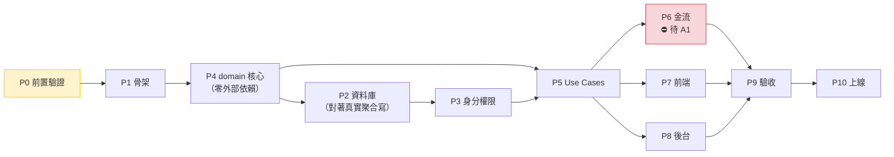

# 02 - 實施計畫

> 產出階段：第三階段（實施計畫）
> 前置文件：`docs/00-現狀分析.md`、`docs/01-目標架構.md`
> 產出日期：2026-10-15
> 分支：`refactor/hexagonal`（baseline：`main` @ `a747010`）
> **本文件只做計畫。尚未修改任何業務代碼、未建立雲函數、未動資料庫。**

---

## 0. 總覽

### 0.1 階段總表

> **⚠️ 執行順序已於 2026-10-16 調整為 P1 → P4 → P2 → P3 → P5**（見 §0.6）。
> 表格依**執行序**排列，階段編號保留原命名以維持引用穩定。

| 執行序 | 階段 | 名稱 | 性質 | 阻斷依賴 | **外部阻斷** | 產出 |
|:---:|---|---|---|---|---|---|
| 1 | **P0** | 前置驗證（Spike） | 🔬 驗證 | 無 | **無** | 驗證報告、測試框架 |
| 2 | **P1** | 基礎骨架與共享代碼 | 🏗️ 新建 | P0 | **無** | `packages/` 六套件、entrypoint 骨架 |
| 3 | **P4** | **domain 核心** | 🏗️ 新建 | P1 | **無** | 聚合、狀態機、策略物件、`domain/access/` |
| 4 | **P2** | 資料庫與 Repository | 🏗️ 新建 | P1、**P4** | **無** | 集合、索引、權限、Repository + fake |
| 5 | **P3** | 身分與權限 | 🏗️ 新建 | P2、P4 | **無** | 三層校驗、登入、SoD |
| 6 | **P5** | application Use Cases | 🏗️ 新建 | P3、P4 | **無** | 訂單／派單／接單／完工／退款流程（用 fake 結算） |
| 7 | **P6** | 支付、分帳、退款 | ⛔ **外部阻斷** | A1 | 🔴 **商戶號＋分帳權限** | 真實 adapter、回調、定時任務 |
| 8 | **P7a** | 前端：純 UI／路由 | 🔧 改造＋新建 | **P4**（用 in-memory fake） | 無 | tabBar、頁面骨架、路由分發、師傅端／客服端 UI |
| 8 | **P7b** | 前端：接線 | 🔌 接線 | **P5** | 部分（見 §0.5） | 接上 Use Case、真實 `wx.requestPayment` |
| 9 | **P8** | 後台 Web API | 🏗️ 新建 | **P5** | **無** | `admin-api`（**前端由你做**） |
| 10 | **P9** | 整合測試與驗收 | ✅ 貫穿 | **P7b + P8 + P6** | 部分（見 §0.5） | 測試報告 |
| 11 | **P10** | 上線 | 🚀 | P9 | 🔴 **商戶號** | 生產部署 |

### 0.2 🔓 外部依賴與階段解鎖（你的階段調整）

**現況：你尚未取得服務商商戶號與分帳權限。**

| 階段 | 是否依賴支付？ | 可否現在做 |
|---|---|---|
| **P1** | ❌ 完全不依賴 | ✅ **全速推進** |
| **P2** | ❌ 完全不依賴 | ✅ **全速推進** |
| **P3** | ❌ 完全不依賴 | ✅ **全速推進** |
| **P4** | ❌ 完全不依賴 | ✅ **全速推進** |
| **P5** | ❌ 不依賴 —— **用 `InMemorySettlementAdapter` 跑測試** | ✅ **全速推進** |
| **P6** | ✅ 完全依賴 | ⛔ **等商戶號與分帳權限** |
| **P7** | 🟡 大部分不依賴（見 §0.5） | ✅ 可推進 |
| **P8** | ❌ 不依賴 | ✅ 可推進 |
| **P9** | 🟡 部分驗收需 P6（見 §0.5） | 🟡 可做非金流部分 |
| **P10** | ✅ 上線必須有真實金流 | ⛔ 等 P6 |

**結論：P1 → P5 合計五個階段，零外部依賴，可以現在全部做完。** 這是本計畫最重要的排程結論——**不要因為等商戶號而閒置**。

**做法**：`SettlementGateway` **介面在 P1 定義**（純介面，符合 P1「零業務邏輯」的界線），`InMemorySettlementAdapter` **也在 P1 建立**（測試替身）。P5 的所有金流相關 Use Case 都用它測試。P6 只需新增真實 adapter + 改 composition root 一行。

> 這正是六角形架構在此專案的實際回報：**最大的外部不確定性，被壓縮成一個可替換的 adapter**，讓五個階段的工作完全不受它阻塞。

### 0.7 階段依賴（使用者於 2026-10-16 修正）

```
P0 → P1 → P4 → P2 → P3 → P5 → P7b → P9 → P10
                              ↘ P8 ↗
                P4 → P7a ────↗
```

| 階段 | 依賴 | 說明 |
|---|---|---|
| **P7a**（純 UI／路由） | **P4** | 只做介面骨架與路由分發，資料用 **in-memory fake**。可在 P5 之前完成 |
| **P7b**（接線） | **P5** | 接上真實 Use Case 與 `wx.requestPayment` |
| **P8**（後台 API） | **P5** | `admin-api` 是**純 JSON API**，與小程序前端無關，故**不依賴 P7** |
| **P9** | P7b + P8 + P6 | 整合測試需前端接線、後台 API、以及金流 |

**關鍵路徑**：`P0 → P1 → P4 → P2 → P3 → P5 → P7b → P9 → P10`
**可並行**：`P7a`（P4 後即可開始）與 `P8`（P5 後即可開始）都不在關鍵路徑上。

### 0.3 里程碑



**關鍵路徑**：`P0 → P1 → P4 → P2 → P3 → P5 → P7 → P9 → P10`
**P6（金流）不在關鍵路徑上**——因為 A1 未定。這是刻意的：**先完成所有不依賴商戶號的部分**。

### 0.6 為何調整為 P1 → P4 → P2 → P3 → P5

**原順序（P2 在 P4 之前）有一個結構性缺陷：Repository 契約依賴聚合形狀，但聚合要到 P4 才定義。**

P0 的 `OrderRepository` 是為了驗證管線而寫的**佔位形狀**（`statusValue` 數字、`serviceFeeCents` 數字）。
P4 會定義真正的 `Order` 聚合（`status` 是 `OrderStatus` 值物件、`amounts` 是 `Money`、含 `items[]` 與 `timeline[]`）。

| 面向 | 原順序 | 調整後 |
|---|---|---|
| `CloudDBOrderRepository` | 對著佔位形狀寫 → P4/P5 **必然重寫** | 一次做對 |
| `OrderQueryPort`（角色化脫敏，§4.7.7） | 完全依賴聚合形狀 → 無法先寫 | 可直接實作 |
| 契約測試 | 寫了要重寫 | 一次做對 |
| P4 的成本 | — | **零外部依賴、可離線測試**，提前做幾乎無成本 |

**依賴檢查**：P4→P1 ✓｜P2→P1,P4 ✓｜P3→P2,P4 ✓｜P5→P3,P4 ✓

**同時併入 `packages/domain/access/` 到 P4**（原列於 P3）：它是領域策略，且 P3 的 SoD 規則需要它。
P3 因此聚焦在「身分的 wiring」（Repository、登入、中介層），不再承擔領域邏輯。

### 0.4 通則（適用所有階段）

**提交紀律（決定回滾能力）**

| 規則 | 理由 |
|---|---|
| **新增檔案與修改既有檔案，不放在同一個 commit** | 讓「只回滾改動、保留新增」成為可能 |
| 每個任務一個 commit，訊息含階段編號（如 `P2: 建立 orders 索引`） | 可精準 revert |
| 每階段結束打 tag（如 `p2-done`） | 階段級回滾點 |
| 修改既有前端頁面前，先 `git tag pre-p7-<page>` | 前端改造是唯一有回歸風險的部分 |

**回滾層級**

| 層級 | 指令 | 適用 |
|---|---|---|
| 單一任務 | `git revert <sha>` | 某個任務有問題 |
| 單一階段 | `git reset --hard p2-done` | 整階段重做 |
| 全新重來 | `git checkout main` | 全部放棄，回到 baseline |

**驗收標準一律包含**：`npm run sync:check` 通過、`npm run lint` 通過、`npm test` 通過。

**Pin 住 AI 的範圍**：每個階段開頭我會先提出「計畫與影響範圍」等你確認，才動手（依你的工作方式要求）。

---

### 0.5 🔴 P6 解鎖後才能完成的驗收項目（明確清單）

> 這是 §0.2 的另一面：**哪些事現在做不完**。避免日後誤以為「都做完了」。

#### 你原始驗收標準中，需等 P6 的項目

| # | 你的驗收標準 | 需 P6？ | 說明 |
|---|---|---|---|
| 1 | 四種角色權限正確隔離 | ❌ 不需 | P3 即可完成 |
| 2 | **下單→付款→派單→接單→完成→分帳→退款→分帳回退 全流程可測試** | ✅ **需 P6** | 付款、分帳、退款、回退四段都要真實金流 |
| 3 | **退款可選只退服務費／只退材料費／全額，且原路返回** | ✅ **需 P6** | 「原路返回」只有真實退款能驗證 |
| 4 | 商品與服務可後台修改，歷史訂單價格不變 | ❌ 不需 | P8 即可（快照是純邏輯） |
| 5 | 師傅只看自己的訂單與報酬，看不到完整敏感資料 | ❌ 不需 | P3／P5 即可 |
| 6 | 後台有統計看板與管理功能 | ❌ 不需 | P8 即可 |
| 7 | 代碼符合六角形架構，domain 不依賴微信雲 API | ❌ 不需 | P1 起持續驗證 |
| 8 | 不可跳過支付、退款、分帳測試 | ✅ **需 P6** | 這是本清單存在的原因 |

#### 各階段中需等 P6 的具體任務

| 階段 | 任務 | 為何需 P6 |
|---|---|---|
| **P5** | 金流 Use Case **可完成並測試**（用 `InMemorySettlementAdapter`） | ✅ 不需 P6。**但「測試」只是邏輯正確性，不是真實金流正確性** |
| **P7** | P7-6 支付接真實 `wx.requestPayment` | 需 P6 提供預支付參數（`timeStamp`/`nonceStr`/`paySign`） |
| **P7** | P7-7 退款申請頁的「退款進度」查詢 | 需 P6 的退款查詢介面 |
| **P7** | 其餘全部（tabBar、服務、預約、師傅端、客服端、工單） | ❌ 不需 P6 |
| **P9** | 端到端金流測試（真實商戶號） | ✅ 需 P6 |
| **P9** | 對帳（DB vs 微信帳單） | ✅ 需 P6 |
| **P9** | 分帳非同步情境（處理中／失敗／回退失敗） | ✅ 需 P6 |
| **P9** | 分帳回退金額不得超過原分帳（真實情境） | ✅ 需 P6 |
| **P9** | 其餘測試分層（單元／契約／整合／安全） | ❌ 不需 P6 |
| **P10** | 全部上線作業 | ✅ 需 P6 |

#### 重要澄清

**「P5 可完成金流 Use Case」不等於「金流已驗證」。**

P5 用 `InMemorySettlementAdapter` 測的是**邏輯正確性**：狀態機對不對、金額算得對不對、退款前有沒有先做分帳回退、回調冪等有沒有做好。

**它驗不了的是**：真實 API 的參數格式、簽章、非同步時序、微信端的錯誤碼、限額與次數限制。

**這兩件事不能互相取代。** 我不會在 P5 結束時宣稱「金流已測試」。這也是為什麼 P6 必須是獨立階段，而不是「P5 的一部分」。

---

## 1. P0 — 前置驗證（Spike）

> **這一階段不寫任何業務代碼。** 目的是在投入大量工作前，先驗證三個會影響全部設計的技術假設。**若驗證失敗，架構需要修改**——所以必須先做。

### 1.1 任務

| # | 任務 | 要驗證的假設 | 為何關鍵 |
|---|---|---|---|
| P0-1 | 建一個最小雲函數 `spike-hello`，用 `sync-shared.js` 注入一個共享包，部署到測試環境 | 「實體複製到 `node_modules/@repair/`」在微信雲函數上真的可行 | 若不可行，§5 整個共享代碼方案要換（退回每函數複製或圖層） |
| P0-2 | 測試「雲端安裝依賴」是否能解析 `file:./node_modules/...` | 部署模式選擇 | 決定必須用「上傳所有檔案」還是可用雲端安裝 |
| P0-3 | 量測共享碼注入後的程式碼包大小 | 是否觸及雲函數包大小上限 | 若過大，需拆分或精簡 |
| P0-4 | 建立測試框架（建議 **Vitest**）並跑通一個 domain 單元測試 | domain 可離線測試 | 你的禁令要求金流測試不可跳過；沒有框架就無從談起 |
| P0-5 | 建立 husky hook：`pre-commit` 跑 `sync:check` + `lint` | 共享碼不會忘記同步 | §5.3.1 的強制點之一 |
| P0-6 | 確認雲開發環境（建議 `repair-test` / `repair-prod` 兩個） | 金流測試隔離 | **金流測試絕不能在生產環境跑** |
| P0-7 | 查閱微信支付官方文檔，確認 §9.1 的 5 項前提與 API 細節 | A1 | **需人工核對**，我不會憑記憶寫死參數 |

### 1.2 影響檔案

**新增**：`cloudfunctions/spike-hello/**`（**保留**，見下方註記）、`packages/shared-kernel/**`（最小版）、`scripts/sync-shared.js`、`vitest.config.js`、`.husky/pre-commit`

**修改**：`project.config.json`（加 `cloudfunctionRoot`）、`package.json`（scripts、devDependencies）、`.gitignore`

### 1.3 驗收標準

- [ ] `spike-hello` 能部署並回傳共享包內定義的字串
- [ ] 故意讓 `packages/` 與 `package.json` 的雜湊不符 → 雲函數**拒絕啟動並回報明確錯誤**
- [ ] `npm run sync:check` 在未同步時回傳非零退出碼
- [ ] `npm test` 能跑一個 domain 純函式測試，且**不啟動任何雲函數**
- [ ] 記錄「雲端安裝依賴 vs 上傳所有檔案」的實測結論

### 1.4 回滾方案

`git checkout main` —— P0 的產物**全部是新增**，且 `cloudfunctions/spike-hello` **保留**（長期健康檢查端點）。`project.config.json` 的改動是唯一要留意的既有檔案修改，單獨 commit 以便 revert。

### 1.5 ⚠️ 本階段的失敗模式

| 若 P0-1 失敗 | 對策 |
|---|---|
| `node_modules/@repair/` 上傳後不存在 | 改為「把 `packages/` 直接複製進每個雲函數目錄的子路徑（如 `./_shared/`），用相對路徑 require」。需重寫 §5 |
| `file:` 依賴不被接受 | package.json 中**不宣告** `@repair/*` 為 dependency，改用相對路徑 require（`require('./node_modules/@repair/domain')` 或直接 `./_shared/domain`） |
| 程式碼包過大 | 只注入被該函數實際使用的套件，而非全部 5 個 |

> 這三種對策都會改變 §5 的細節，但**不會改變分層本身**。這就是為什麼 P0 必須先做。

---

## 2. P1 — 基礎骨架與共享代碼

### 2.1 任務

| # | 任務 |
|---|---|
> **⚠️ 本節已依 P0 實際結果修訂。** 原計畫的 6 項任務有 3 項在 P0 已完成。
> **詳細計畫見 `docs/P1-計畫.md`（已含 Q1–Q5 決策），以該文件為準。**

| # | 任務 | 狀態 |
|---|---|---|
| P1-1 | 建立 `packages/` 套件與 `package.json` | ✅ **P0 已完成** |
| P1-2 | 完成 `scripts/sync-shared.js` | ✅ **P0 已完成**（含雜湊雙寫、開發連結、`--check`） |
| P1-3 | `packages/shared-kernel` 錯誤型別（`Money`／`Result` P0 已完成） | 🟡 補 `Errors.js` |
| P1-4 | **新增 `@repair/entrypoint-kit` 套件**（Q1 決策）：`authenticate`、`validate`、`toResponse`、`createHandler` | ⬜ |
| P1-5 | 建立 **4 個**雲函數骨架（依 A8：`customer-api`／`technician-api`／`payment-callback`／`scheduled-jobs`），只有健康檢查 | ⬜ |
| P1-6 | **`SettlementGateway` 介面 + `InMemorySettlementAdapter`**（§0.2：讓 P5 能用 fake 測試金流） | ⬜ |
| P1-7 | 拆出 `config/areaData.js`（Q3／Q6），`config/index.js` 改為 re-export | ⬜ |
| P1-8 | `docs/03-開發規範.md`：分層規則、命名、commit 規範、部署 SOP | ⬜ |
| P1-9 | 擴充 `check-layering.js`：新增套件的 `ALLOWED_DEPS` + **新規則「adapters 內出現角色判斷即違規」**（`docs/01` §4.7.0，正則 `/\.role\s*[!=]==?/`） | ⬜ |
| P1-10 | 修正 `package.json` 的 `lint` script（指向不存在的設定檔，執行必然失敗）→ 改為 no-op 或移除 | ⬜ |
| P1-11 | ~~刪除 `cloudfunctions/spike-hello/`~~ | ✅ **已決議保留**（3 檔無害，且為長期健康檢查端點；P2 起擴充為「共享碼版本 + 資料庫連通」雙重檢查） |

### 2.2 影響檔案

**新增**：`packages/entrypoint-kit/**`、`packages/shared-kernel/Errors.js`、`packages/ports/SettlementGateway.js`、`packages/adapters/inmemory/InMemorySettlementAdapter.js`、`cloudfunctions/{customer-api,technician-api,payment-callback,scheduled-jobs}/**`、`config/areaData.js`、`docs/03-開發規範.md`、`tests/unit/entrypoint-kit/**`

**修改**：`scripts/sync-shared.js`（`ORDER` 加 `entrypoint-kit`）、`scripts/check-layering.js`（`ALLOWED_DEPS` + adapters 角色判斷規則）、`package.json`（`lint` script 修正）、`config/index.js`（拆分，**唯一有回歸風險者**）

**刪除**：無（`spike-hello` 保留）

> **Q2 決策：不建 ESLint 設定。** 架構規則由 `check-layering.js` 機械化保證（已涵蓋 domain 禁止清單、ports 禁止型別、各層依賴方向、組裝點唯一性）。
> 升級 ESLint 應是**獨立任務**，不混進 P1——尤其 baseline 的 `npm run lint` 本來就因缺設定檔而失敗，補一套 2019 年的 ESLint 6 設定收益低、風險高。

### 2.3 驗收標準

- [ ] 4 個雲函數皆可部署，健康檢查回應含 `sharedBuildHash`
- [ ] `npm run verify` 全綠；測試數 ≥ 80
- [ ] `packages/domain` 中故意 `require('wx-server-sdk')` → `check-layering` **擋下**
- [ ] 每個雲函數的 `bootstrap.js` 都在**模組載入時**執行 `assertSharedBuild()`
- [ ] `config/index.js` 從 20,437 行降到 < 20 行，且地址編輯頁仍正常
- [ ] **負向測試**：故意違反每條新規則，確認被擋（沿用 P0 做法）

### 2.4 回滾方案

全為新增 → `git reset --hard p0-done`。

---

## 3. P2 — 資料庫與 Repository

### 3.0 🔴 啟動前必須核實：微信雲開發的事務能力（阻斷級）

> 依 `docs/01` §4.7.8。**這是 P2 的阻斷級前置條件，不核實不能開工。**

**要核實的問題**：微信雲開發資料庫是否支援「讀-改-寫同一文件」的原子性？

**為什麼是阻斷級**：`dailyRefundBudget` 是每次批准退款都要遞增的計數器。若無原子性，兩個客服同時批准會都讀到 `usedCents: 0` → **配額被繞過，「螞蟻搬家」防護失效**。這不是效能問題，是**風控漏洞**。

**核實方法**：寫一支最小雲函數，併發呼叫 10 次，每次 `讀 usedCents → +1000 → 寫回`。若最終值為 10000 → 原子；若小於 10000 → 有競態。

**依結果選路**（優先序由高到低）：

| # | 核實結果 | 對策 | 影響 |
|---|---|---|---|
| 1 | 支援 `db.startTransaction` 且可讀-改-寫 | 事務包裹三步 | 最乾淨，`CloudDBUnitOfWork` 直接可用 |
| 2 | 不支援事務，但支援條件更新 | 樂觀鎖：`version` + `where version = N`，衝突重試 | 需在 `cs_agents` 加 `version` |
| 3 | 皆不可行 | 配額檢查串行化（獨立雲函數／心跳鎖） | **架構需調整**，成本最高 |

> **第 3 種結果會影響 §5 的雲函數拆分方案**（需多一支配額服務）。這就是為什麼它必須在 P2 開工前核實，而不是做到一半才發現。

**無論哪一種結果**：`AmountConstraint` 在**讀不到配額時一律拒絕**（fail-closed），這個行為不變。

**核實結果請寫回本節**（我會在 P2 開始時回報）。

### 3.1 任務

| # | 任務 |
|---|---|
| P2-1 | 建立 §7.1 的 18 個集合 |
| P2-2 | 建立 §7.1 的所有索引 |
| P2-3 | ⚠️ **將所有集合的資料庫權限設為「僅管理端可讀寫」**（§7.3） |
| P2-4 | 實作 `packages/ports/**Repository.js`（11 個儲存 Port 介面） |
| P2-5 | 實作 `packages/adapters/clouddb/**Repository.js` |
| P2-6 | 實作 `packages/adapters/inmemory/**Repository.js`（**測試替身，與 P2-5 同等重要**） |
| P2-7 | 實作 `CloudDBUnitOfWork`（交易） |
| P2-8 | 寫 Repository 契約測試（同一套測試跑真實 DB 與 in-memory 兩份實作） |

> **P2-8 的價值**：契約測試確保 in-memory fake 與真實 DB 行為一致。否則 P5 用 fake 測過的邏輯，上線後在真實 DB 上會壞。

### 3.2 影響檔案

**新增**：`packages/ports/repositories/**`、`packages/adapters/clouddb/**`、`packages/adapters/inmemory/**`、`packages/ports/UnitOfWork.js`、`tests/contract/**`

**修改**：無

**⚠️ 動到資料庫**：本階段會建立集合。**這是第一個真正動到雲端資源的階段**，需你確認後才執行。

### 3.3 驗收標準

- [ ] 18 個集合與索引建立完成
- [ ] **所有集合權限為「僅管理端可讀寫」**（逐一截圖或指令驗證）
- [ ] 契約測試對兩份實作皆通過
- [ ] 交易能正確回滾（故意製造失敗，確認資料無殘留）

### 3.4 回滾方案

**集合刪除不可逆** → 對策：**本階段只建立空的集合與索引，不匯入任何資料**。回滾＝手動刪除集合（無資料損失）。
Repository 代碼為新增 → `git reset --hard p1-done`。

---

## 4. P3 — 身分與權限

### 4.1 任務

| # | 任務 |
|---|---|
| P3-1 | **`packages/domain/access/` 存取控制模型**（`docs/01` §4.7）：`Permission`、`RolePermissionMatrix`、`AccessPolicy`、`Decision`、四個 constraints |
| P3-2 | `users` / `customers` / `cs_agents` / `technicians` 的 Repository 實作（P2 已完成，此處補業務方法） |
| P3-3 | 登入 Use Case：`wxContext.OPENID` 直取（依 P0 結論）→ 建立／更新 `users` |
| P3-4 | 實作三層校驗中介層（§8.2）：身分 → 角色（`AccessPolicy`）→ 資源歸屬 |
| P3-5 | ⚠️ **角色化 Port 查詢方法**（§4.7.7）：`findByIdForCustomer/CsAgent/Technician/Admin` + 對應的 in-memory fake。**use case 不得自行過濾欄位** |
| P3-6 | 實作 `AddressDisclosurePolicy` + `ContactMaskingPolicy`（§6.3），並由 P3-5 的 adapter 呼叫 |
| P3-7 | `dailyRefundBudget` 的讀寫與交易保護（§4.7.8），供 `AmountConstraint` 使用 |
| P3-8 | 師傅入駐申請流程（`technicians.status`: `PENDING → APPROVED/REJECTED`，依 A5） |
| P3-9 | ⚠️ **移除師傅端可及的撥號能力**（`docs/00` §5.4 的既有 `customer-service` 元件隔離任務） |

### 4.2 影響檔案

**新增**：
- `packages/domain/access/**`（含 `constraints/`）
- `packages/application/identity/**`
- `packages/ports/OrderQueryPort.js`
- `packages/adapters/inmemory/**QueryAdapter.js`
- `cloudfunctions/*/middleware/**`
- `tests/unit/domain/access/**`、`tests/security/**`

**修改**：
- ⚠️ `pages/order/components/customer-service/index.js`（撥號隔離，**有回歸風險**）
- `scripts/check-layering.js`（新增規則：adapters 不得出現角色判斷，見 `docs/01` §4.7.0）

### 4.3 驗收標準（**越權測試是重點**）

- [ ] 師傅 A 無法讀取師傅 B 的訂單（`NOT_ASSIGNED_TECHNICIAN`）
- [ ] 師傅無法呼叫任何客服／管理員 Use Case（`ROLE_NOT_PERMITTED`）
- [ ] 客戶無法讀取他人訂單（`NOT_OWNER`）
- [ ] 客服無法審批 > 200 元的退款（`EXCEEDS_SINGLE_LIMIT`）
- [ ] 客服當日累計超配額後無法再批（`EXCEEDS_DAILY_QUOTA`）—— **「螞蟻搬家」防護**
- [ ] 任何角色都無法讓退款超過已付金額（`EXCEEDS_PAID_AMOUNT`，**含 admin**）
- [ ] 讀不到每日配額時**保守拒絕**（`DAILY_BUDGET_UNAVAILABLE`），不是放行
- [ ] 停用帳號（`status != active`）一律 401
- [ ] **師傅端任何回應都不含完整手機號、完整地址、平台抽成**
- [ ] 未登入狀態呼叫任何 API 皆被拒
- [ ] `AccessPolicy` 的測試**全部離線執行**，不啟動雲函數、不連資料庫

> **最後一項的實作方式**：遍歷所有師傅端 Use Case × 所有訂單狀態，斷言回傳 JSON 不含**手機號形狀**的字串。
>
> ⚠️ **正則必須是手機號形狀，不能用 `/\d{11}/`** —— 13 位時間戳（`1700000000000`）含有 11 位數字子字串，會產生偽陽性。**一個會誤報的安全測試，最後一定會被註解掉**（P0 已實際踩過這個坑，見 `docs/P0-驗證報告.md` §5.4）。
>
> 正確寫法：`/(?<!\d)1[3-9]\d{9}(?!\d)/`

### 4.4 回滾方案

新增為主 → `git reset --hard p2-done`。
唯一既有檔案改動是 `customer-service` 元件 → 單獨 commit，可 `git revert`。

---

## 5. P4 — domain 核心

> **這是整個專案最關鍵、也最應該先做對的一層。** 它沒有任何外部依賴，所以可以 100% 離線測試。

### 5.1 任務

| # | 任務 |
|---|---|
| P4-1 | 值物件：`Money`、`OrderNo`、`FeeType`、`CommissionRate`、`MaskedPhone`、`AddressView`、`RefundScope` |
| P4-2 | `ProfitSharingTerms`（§3.6）+ 快照機制 |
| P4-3 | `Order` 聚合 + `OrderItem` 實體 |
| P4-4 | `OrderStateMachine`（§3.3 全部狀態與轉移，含 `DISPUTED`、`EXPIRED_*`） |
| P4-5 | `PricingService`（服務費／材料費／總額） |
| P4-6 | `AddressDisclosurePolicy`、`ContactMaskingPolicy`、`ContactChannelPolicy`（§6.3、§6.4） |
| P4-7 | `ProfitSharingPolicy`（基數參數化，§3.6） |
| P4-8 | `RefundPolicy`（按明細項計算、累計上限校驗，A6 建議） |
| P4-9 | `SettlementOrchestrator`（退款前必須先分帳回退的 Saga 規則） |
| P4-10 | 分帳與退款的狀態機（§3.3 後兩張圖） |

### 5.2 影響檔案

**新增**：`packages/domain/**`、`tests/unit/domain/**`

**修改**：無

### 5.3 驗收標準

- [ ] `packages/domain` 零外部依賴（ESLint 強制 + 手動檢視）
- [ ] **狀態機測試覆蓋所有合法轉移與所有非法轉移**（後者更重要）
- [ ] 金額測試：無浮點誤差；`Money` 的加減乘除、比例、取整皆有邊界測試
- [ ] `DISPUTED` 狀態下呼叫分帳計算 → 被拒
- [ ] `RefundPolicy`：累計退款達上限後再退 → 被拒
- [ ] `AddressDisclosurePolicy`：對每個揭露階段的邊界時間（08:00 前後、N 天前後）皆有測試
- [ ] 測試**不啟動任何雲端資源**，執行時間 < 1 秒

### 5.4 回滾方案

全為新增 → `git reset --hard p3-done`。**domain 沒有任何外部副作用，回滾零成本。**

---

## 6. P5 — application Use Cases（非金流）

### 6.1 任務

| # | 任務 |
|---|---|
| P5-1 | 客戶端 Use Cases（§4.1，除 `RequestRefund` 外的全部） |
| P5-2 | 客服端 Use Cases（§4.2，除 `ReviewRefund` 外） |
| P5-3 | 師傅端 Use Cases（§4.3） |
| P5-4 | 工單系統 Use Cases（`work_order_tickets` / `messages`） |
| P5-5 | 稽核日誌：`withAudit()` 中介層自動寫入 `audit_logs` |
| P5-6 | 各雲函數的 entrypoint 串接 |
| P5-7 | Composition Root（每個雲函數的 `bootstrap.js` 組裝依賴） |

### 6.2 影響檔案

**新增**：`packages/application/**`、`cloudfunctions/*/handlers/**`、`tests/integration/**`

**修改**：`cloudfunctions/*/bootstrap.js`

### 6.3 驗收標準

- [ ] 訂單生命週期可完整走通（用 in-memory fake）：下單 → 派單 → 接單 → 到場 → 完工 → 驗收
- [ ] 每個 Use Case 都有：成功路徑、權限不足、資源不屬於自己、前置條件不滿足 四類測試
- [ ] `audit_logs` 對所有寫操作皆有紀錄，且 `before`/`after` 完整
- [ ] 所有逾時情境可用 `FixedClockAdapter` 模擬並驗證
- [ ] **師傅端 DTO 掃描測試通過**（同 P3-3 的斷言）

### 6.4 回滾方案

新增為主 → `git reset --hard p4-done`。

---

## 7. P6 — 支付、分帳、退款 ⛔ 外部依賴阻斷

> **本階段在你取得服務商商戶號與分帳權限之前不啟動。** 依 `docs/01` §9.0 的界線：
> 只實作 interface 與 domain 邏輯（P1 完成介面、P4 完成邏輯），**不實作任何真實 adapter**。
>
> **這不阻塞任何其他階段**：P1–P5 用 `InMemorySettlementAdapter` 全速推進（§0.2）。

### 7.1 啟動條件（全部滿足才開始）

| # | 條件 | 來源 | 狀態 |
|---|---|---|---|
| 1 | **服務商商戶號** | 你 | 🔴 **尚未取得** |
| 2 | **分帳（profit_sharing）產品權限開通** | 你 | 🔴 **尚未取得** |
| 3 | 師傅進件方式確認（特約商戶／個人接收方） | 你 | 🔴 未確認 |
| 4 | 師傅「同意分帳回退」已開啟 | 你 | 🔴 未確認 |
| 5 | ~~A12 材料費模式~~ | — | ✅ 已定：模式 (a)，無墊付流程 |
| 6 | 二清合規風險已諮詢（**僅在需要走備案時**） | 你 | 🟡 待備案觸發 |
| 7 | 微信支付 API 細節查閱官方文檔 | 我（P0-7） | 🟡 **已同意延後到本階段前執行** |
| 8 | 測試環境商戶號可用 | 你 | 🔴 尚未取得 |

> **第 1–4 項全是你的商戶帳號狀態，不是文檔問題。** 文檔只能告訴我「需要什麼」，不能告訴我「你有沒有」。這正是 P0-7 延後的理由。

### 7.2 任務

| # | 任務 |
|---|---|
| P6-1 | `WeChatPayApiV3Adapter`（預支付、查單、關單） |
| P6-2 | `RefundGateway` 實作（退款、查退款） |
| P6-3 | `ProfitSharingGateway` 實作（添加接收方、請求分帳、查分帳、分帳回退、查回退） |
| P6-4 | `SettlementGateway` 統一介面 + 主方案 adapter |
| P6-5 | `payment-callback` 雲函數：支付／分帳／退款回調處理（**含簽章驗證與冪等**） |
| P6-6 | `scheduled-jobs`：`RecoverStuckSettlements`、逾時任務、對帳 |
| P6-7 | 支付相關 Use Cases：`HandlePaymentCallback`、`ExecuteProfitSharing`、`ExecuteProfitSharingReturn`、`ExecuteRefund` |
| P6-8 | `RequestRefund`（客戶／客服發起）與 `ApproveRefund`（**管理員專屬**，依 A13 職責分離），含 A6 的按明細項退款 |

### 7.3 影響檔案

**新增**：`packages/adapters/wechatpay/**`、`cloudfunctions/payment-callback/**`、`cloudfunctions/scheduled-jobs/**`、`tests/e2e/payment/**`

**修改**：`cloudfunctions/*/bootstrap.js`（換上真實 adapter）

**⛔ 絕不出現**：任何密鑰、商戶號、API v3 key 進入 repo。全部存於雲函數**環境變數**。

### 7.4 驗收標準（**最嚴格的一個階段**）

- [ ] 測試環境完成：下單 → 付款 → 派單 → 接單 → 完工 → 分帳 → 退款前分帳回退 → 退款 全流程
- [ ] 退款的四種類型皆驗證：只退服務費／只退材料費／全額／按明細項部分退款
- [ ] **分帳非同步情境**：模擬分帳處理中、分帳失敗、回退失敗，確認 `RecoverStuckSettlements` 能收斂
- [ ] **回調冪等**：同一回調重放 10 次 → 資料與金額只變一次
- [ ] **回調簽章驗證**：偽造簽章 → 被拒
- [ ] 分帳回退金額不得超過原分帳金額（有測試）
- [ ] 退款累計不得超過已付金額（有測試）
- [ ] 對帳：DB 中所有金額與微信帳單一致

### 7.5 回滾方案

- **代碼**：`git reset --hard p5-done` + 重新部署（adapter 退回 fake）
- **⚠️ 資金**：**代碼可回滾，已發生的交易不可回滾。** 因此：
  - 本階段全程在 `repair-test` 環境
  - 上生產前，先在測試環境跑完整對帳
  - 保留所有 `*_records` 作為事實來源，任何人工修正都走 `RetryFailedSettlement` 並留 `audit_logs`

---

## 8. P7 — 前端改造

> 依 Q13：保留商品／訂單／地址／訂單詳情／支付骨架；下線購物車／優惠券／拼團／發票／物流；tabBar 改為「首頁／服務／訂單／我的」；新增服務詳情、預約時間、師傅端、客服端。

### 8.1 任務

| # | 任務 | 性質 |
|---|---|---|
| P7-1 | `custom-tab-bar/data.js` 改為依角色回傳（首頁／服務／訂單／我的） | 🔧 改動 |
| P7-2 | 首頁改造為服務入口 | 🔧 改動 |
| P7-3 | **服務詳情頁**（新建，對應 `services` 集合） | 🆕 新增 |
| P7-4 | 訂單確認頁：加入**預約時間選擇**、服務＋材料混合明細、費用拆分顯示 | 🔧 改動 |
| P7-5 | 訂單詳情／列表：狀態機對接、退款入口、工單入口 | 🔧 改動 |
| P7-6 | 支付接通真實 `wx.requestPayment`（`pay.js` 解開註解） | 🔧 改動 |
| P7-7 | 退款申請頁（選退款範圍） | 🆕 新增 |
| P7-8 | 工單聊天頁（客戶↔客服） | 🆕 新增 |
| P7-9 | **師傅端**分包 `pages/technician/**`：訂單列表、接單、到場、完工、報酬、工單 | 🆕 新增 |
| P7-10 | **客服端**分包 `pages/cs/**`：派單工作台、訂單管理、退款審核、工單 | 🆕 新增 |
| P7-11 | 下線：移除購物車／優惠券／拼團／發票／物流的**所有入口**（tabBar、按鈕、跳轉），檔案加 `@deprecated` | 🔧 改動 |
| P7-12 | `services/**` 全面改接雲函數（取代 `resolve('real api')`） | 🔧 改動 |
| P7-13 | 前端**不做**任何權限判斷，只做「顯示或不顯示」 | 紀律 |

### 8.2 影響檔案

**新增**：`pages/service/**`、`pages/technician/**`、`pages/cs/**`、`services/technician/**`、`services/cs/**`

**修改（有回歸風險，需逐頁 tag）**：
`custom-tab-bar/data.js`、`pages/home/**`、`pages/order/order-confirm/**`、`pages/order/order-list/**`、`pages/order/order-detail/**`、`pages/order/apply-service/**`、`pages/order/order-confirm/pay.js`、`pages/usercenter/**`、`app.json`、`services/order/**`

### 8.3 建議的過渡機制：Feature Flag

前端改造是**唯一會影響現有可用功能**的階段。建議在 `config/index.js` 加入：

```js
export const config = {
  useMock: false,
  /** 改造過渡開關：true = 維修模式，false = 原零售模式 */
  repairMode: true,
};
```

理由：任何一頁改壞了，可以**單獨把該頁切回舊行為**，而不是整包回滾。這在 P7 這種大範圍改動中價值很高。

**✅ 已定案：採用，但限定「頁面層級」。**

| 允許 | 禁止 |
|---|---|
| 在**頁面的** `onLoad`／渲染入口判斷 `config.repairMode`，決定載入新版或舊版邏輯 | 在 `components/`、`services/`、`utils/` 內散佈 `if (repairMode)` |
| 每個改造的頁面最多 **1 處** flag 判斷 | 巢狀或多次判斷 |

**理由（你的）**：避免前端布滿 `if (flag)`。這與「不要一次重寫整個專案」的要求一致。

> **實作約束**：這條規則可加入 §1.6.6 的 `check-layering.js` 擴充——限制 `repairMode` 只出現在 `pages/**/index.js` 的最外層。列為 P7 的 CI 項。

### 8.4 驗收標準

- [ ] 四種角色登入後看到的 tabBar 與頁面正確
- [ ] 客戶可完成：瀏覽服務 → 下單（含預約時間）→ 付款 → 查看進度 → 申請退款 → 與客服對話
- [ ] 師傅可完成：查看指派 → 接單 → 到場 → 完工 → 查看報酬
- [ ] 師傅端**看不到**完整手機號、完整地址（服務當日前）、平台抽成
- [ ] 購物車／優惠券／拼團／發票／物流**無任何入口可達**
- [ ] ⚠️ **前端不得出現任何 `role_type` 的權限判斷邏輯**（只允許用於顯示切換）
- [ ] 支付為真實 `wx.requestPayment`

### 8.5 回滾方案

- 逐頁 `git checkout main -- pages/<page>` 還原單頁
- 或 `git reset --hard p6-done` 整階段回滾
- 或把 `config.repairMode` 設為 `false`（若採 Feature Flag）

---

## 9. P8 — 後台 Web API

> **你已明示：前端由你做（微搭或 React Admin），我不做前端。** 本階段只交付純 JSON API。

### 9.1 任務

| # | 任務 |
|---|---|
| P8-1 | `admin-api` 雲函數（獨立於小程序的認證方式，需與你確認） |
| P8-2 | 商品／服務管理 Use Cases（§4.4） |
| P8-3 | 師傅管理（審核、技能標籤、分帳開通狀態） |
| P8-4 | 訂單管理、改派、狀態流轉、備註 |
| P8-5 | 退款審核 |
| P8-6 | 統計看板 Use Case（§4.4 `QueryDashboard`） |
| P8-7 | 稽核日誌查詢 |
| P8-8 | API 文件（供你接前端） |

### 9.2 影響檔案

**新增**：`cloudfunctions/admin-api/**`、`packages/application/admin/**`、`docs/05-admin-api.md`

### 9.3 驗收標準

- [ ] 商品／服務可新增、修改、上下架、改價、分類
- [ ] **改價後，歷史訂單金額不變**（快照驗證，對應你的業務規則 4）
- [ ] 統計數據與 DB 實際資料一致
- [ ] 非 `admin` 角色呼叫一律 403

### 9.4 認證方式（已定案）

**帳號密碼 + JWT。不使用微信掃碼，不使用微搭內建認證。**

| 面向 | 決策 |
|---|---|
| 憑證儲存 | 新增集合 `admin_credentials`（`user_id`、`password_hash`、`salt`、`failed_attempts`、`locked_until`） |
| 雜湊演算法 | **需人工核對**：建議 `scrypt` 或 `bcrypt`（雲函數環境可用的實作需實測） |
| Token | JWT，存於 `HttpOnly` Cookie 或 `Authorization` header（**待 P8 開始前定**） |
| 有效期 | access token 短效（建議 2 小時）+ refresh token |
| 失敗鎖定 | 連續失敗 N 次鎖定 M 分鐘（防暴力破解） |
| 與 `users` 的關係 | `admin_credentials.user_id` 指向 `users`，角色仍由 `users.role_type` 決定 |

**安全要求**：
- 密碼**絕不**以明文或可逆加密儲存
- JWT secret 存於雲函數環境變數，**不入 repo**
- 所有登入成功／失敗寫入 `audit_logs`

> 選帳密 + JWT 的附帶好處：`admin-api` 完全不依賴微信生態，日後要換成 React Admin 或任何前端都零改動——這與你「日後可換 React Admin」的理由一致。

### 9.5 回滾方案

新增 → `git reset --hard p7-done`。

---

## 10. P9 — 整合測試與驗收

### 10.1 測試分層

| 層級 | 範圍 | 依賴 | 執行時機 |
|---|---|---|---|
| 單元 | `packages/domain` | 無 | 每次 commit |
| 契約 | Repository 兩份實作 | in-memory / 測試 DB | 每次 commit |
| 整合 | `packages/application` | in-memory fakes | 每次 commit |
| 安全 | 越權、DTO 洩漏掃描 | in-memory fakes | 每次 commit |
| 端到端 | 真實雲函數 + 測試商戶號 | 雲端 | 每次部署到測試環境 |
| 對帳 | DB vs 微信帳單 | 雲端 | 上線前 |

### 10.2 對應你的驗收標準

| 你的驗收標準 | 驗證方式 | 階段 |
|---|---|---|
| 四種角色權限正確隔離 | P3-3 安全測試 | P3 |
| 下單→付款→派單→接單→完成→分帳→退款→分帳回退 全流程可測試 | P6-4 端到端 | P6 |
| 退款可選只退服務費／只退材料費／全額，原路返回 | P6-4 四類型測試 | P6 |
| 商品與服務可後台修改，歷史訂單價格不變 | P8-3 快照測試 | P8 |
| 師傅只看自己的訂單與報酬，看不到完整敏感資料 | P3-3 DTO 掃描斷言 | P3 |
| 後台有統計看板與管理功能 | P8 | P8 |
| 代碼符合六角形架構，domain 不依賴微信雲 API | ESLint `no-restricted-imports` + 檢視 | P1 |
| 不可跳過支付、退款、分帳測試 | P6 為獨立階段，有明確 blocking 條件 | P6 |

### 10.3 ⚠️ 誠實的限制

**在 A1 確認與測試商戶號可用之前，「支付、退款、分帳的測試」在物理上不可能完成。** 這不是排程問題，是外部依賴問題。

本計畫的應對是：把金流隔離成獨立的 P6，讓**其餘所有階段都不被它阻塞**。但若 A1 最終無法通過且備案也不可行，**整個分帳設計需要重來**——這是本案最大的單一風險。

---

## 11. P10 — 上線

### 11.1 任務

| # | 任務 |
|---|---|
| P10-1 | 生產環境建立與設定（環境變數、密鑰） |
| P10-2 | 雲函數部署（生產） |
| P10-3 | 資料庫權限複查（所有集合「僅管理端可讀寫」） |
| P10-4 | 灰度：先開內部帳號，再小範圍真實使用者 |
| P10-5 | 監控與告警（結算失敗、逾時未派單、爭議積壓） |
| P10-6 | 對帳機制上線（每日比對 DB 與微信帳單） |
| P10-7 | 回滾預案演練（部署回滾、資料庫還原） |

### 11.2 上線前檢查清單

- [ ] 所有密鑰存於雲函數環境變數，**repo 中零密鑰**（`git grep` 驗證）
- [ ] `docs/04-環境設定.md` 已建立（**不含密鑰**）
- [ ] 資料庫權限全部為「僅管理端可讀寫」
- [ ] 對帳腳本可執行且結果為零差異
- [ ] 回滾演練通過
- [ ] 分帳／退款的人工介入 SOP 已文件化（`RecoverStuckSettlements` 之外的情況）

### 11.3 回滾方案

| 情境 | 動作 |
|---|---|
| 前端問題 | 重新部署上一版（微信有版本回退） |
| 雲函數問題 | 部署上一版代碼 |
| 資料問題 | **最危險**——雲開發資料庫無自動時間點還原，需事前建立**每日備份匯出**機制（列入 P10-6） |

---

## 12. 風險清單

### 12.1 阻斷級

| # | 風險 | 影響 | 對策 |
|---|---|---|---|
| R1 | **A1 分帳前提未定** | P6 無法啟動；最壞情況整個分帳設計要重來 | §9.0 以檔案為單位隔離；P6 獨立成階段 |
| R2 | **A12 材料費模式未定** | 資料模型與 Use Case 數量 | 與 A1 一併確認 |
| R3 | **P0-1 共享代碼驗證可能失敗** | §5 方案需改 | P0 先做；三種備選對策已備（§1.5） |
| R4 | **二清合規風險** | 備案可能根本不可行 | 你諮詢法務；我不寫代碼 |
| R5 | **無測試框架**（現狀 R2） | 無法滿足「不可跳過金流測試」 | P0-4 建立 |
| R6 | ~~`admin-api` 認證方式未定~~ | ✅ **已定**：帳號密碼 + JWT | 見 §9.4 |

### 12.2 結構級

| # | 風險 | 影響 | 對策 |
|---|---|---|---|
| R7 | 雲開發資料庫**無自動時間點還原** | 資料損壞不可逆 | P10-6 每日備份匯出 |
| R8 | 無 TypeScript | 介面契約靠自律 | ESLint `no-restricted-imports` + 契約測試 |
| R9 | 雲函數冷啟動 | 使用者體驗 | 接受；不做過度優化 |
| R10 | `config/index.js` 455 KB（99% 靜態資料） | 干擾搜尋與工具；`AddressDisclosurePolicy` 無法單獨測試 | ✅ **已同意拆分**：抽出 `config/areaData.js`（列為 P1 附帶任務） |
| R11 | 前端改造回歸風險（R7 是唯一改動既有功能處） | 弄壞現有可用頁面 | Feature Flag + 逐頁 tag + 逐頁回滾 |

### 12.3 流程級

| # | 風險 | 影響 | 對策 |
|---|---|---|---|
| R12 | ~~遠端已存在已推送的 commit~~ | ✅ 已處理：備份分支 `backup-origin-main`／`backup-origin-refactor` 已建立，遠端無 tag 無 PR，已 force-push | 見 §13 |
| R13 | 共享碼忘記同步 | 舊版規則處理金流 | 三處強制點（§5.3.1） |
| **R15** | **微信雲開發事務能力未知** | 若無原子性，「每日退款配額」防護失效 → **風控漏洞** | 🔴 **P2 阻斷級**，見 §3.0。三種結果對應三種對策，最壞情況需調整雲函數拆分 |
| **R16** | **無 TypeScript** | 介面契約靠自律；P0 已實際踩到 `OrderStatus.fromValue` 呼叫錯誤 | `check-layering.js` + 契約測試 + JSDoc。**`// @ts-check` + `tsc --noEmit` 列為 P1 後的獨立任務** |
| R17 | `package.json` 的 `lint` script 指向不存在的設定檔 | 執行必然失敗，可能誤導後續開發者 | ✅ P1 順手修正為 no-op 或移除，並在 `docs/03` 註明「ESLint 升級為獨立任務」 |
| R14 | 階段跨度大，容易失焦 | 品質下降 | 每階段先提計畫與影響範圍，等你確認 |

---

## 13. 問題狀態

### 13.1 已定案

| # | 問題 | 決議 |
|---|---|---|
| Q1 | `admin-api` 認證 | **帳號密碼 + JWT**（不用微信掃碼、不用微搭內建）。見 §9.4 |
| Q2 | 遠端分歧處理 | **force-push**。前置：建備份分支 ✅、確認無 tag／PR ✅。已執行 |
| Q3 | 前端 Feature Flag | **採用，但限頁面層級**，禁止散佈到元件／服務層。見 §8.3 |
| Q5 | A12 材料費模式 | **平台統一定價、隨單收**。墊付報銷流程整段刪除 |
| Q6 | 拆 `config/areaData` | **同意**。列為 P1 附帶任務 |
| — | A13 客服權限 | **職責分離**：客服派單／溝通／查看／申請退款；管理員改價／改分潤／審批退款／改師傅權限 |
| Q7 | 執行 P0 | **同意**。本地部分已完成，雲端驗證待回報 |
| A5 | 角色指派 | 雙軌制：師傅＝申請審核制；客服／管理員＝管理員直接指派 |
| A6 | 部分退款粒度 | 按明細項勾選，不開放任意金額 |
| A8 | 雲函數數量 | 維持 6 個，第一期先建 4 個；`technician-api`／`payment-callback` 永不合併 |
| A9 | 逾時規則 | 分「告警」與「自動處置」兩段；唯一自動退款的是「平台明確無法履約」 |
| A11 | 地址降級天數 | 7 天（與待驗收 7 天對齊） |
| — | 客服分潤讀取權 | **修正 1**：`cs_agent` 對 `profit_sharing_terms` 改為**只讀**（可答客戶疑問，不可改）；`admin` = CRUD |
| — | 管理員不在線 | **修正 2**：改採**金額門檻**方案，見 §13.3 |
| P0-7 | 微信支付文檔 | **延後至 P6 前執行** |

### 13.2 🔴 唯一未解項目：A10 雲開發環境 ID

**你回覆的內容是佔位符 `<你的环境ID>`，不是實際的環境 ID。** 我不會編造一個。

| 需要它的地方 | 用途 |
|---|---|
| `P0-1`／`P0-6` | 部署 `spike-hello` 驗證共享碼；建立 `docs/04-環境設定.md` |
| `P1` 起 | 所有雲函數的 `cloud.init({ env })` |
| 環境隔離 | 建議 **2 個**：`repair-test`（開發／測試）與 `repair-prod`（生產）。**金流測試絕不能在生產環境跑** |

**在取得實際 ID 前**：
- P0 的雲端驗證可由你在開發者工具以「目前選取的環境」執行（devtools 會自動帶入），因此**不一定需要你貼 ID 給我**；
- 但 P1 之後的部署腳本與 `docs/04` 需要它。

> 若你偏好不把環境 ID 寫進 repo（它並非密鑰，但屬環境資訊），我可以改為**只寫在 `.env.local`（gitignored）**，或由你手動填入而不經我。請告知偏好。

### 13.3 退款審批：金額門檻方案（✅ 已定案）

**問題**：依 A13 的職責分離，「退款審批只有管理員能做」會有個致命後果——
**管理員不在線時，退款會卡住，客戶的錢拿不回來。**

**決議：採金額門檻分流。**

| 單筆退款金額 | 審批者 | Use Case |
|---|---|---|
| **≤ 門檻值** | **客服** | `ApproveRefundUnderThreshold` |
| **> 門檻值** | **管理員專屬** | `ApproveRefund` |

| 項目 | 設計 |
|---|---|
| 門檻值 | **預設 200 元（20000 分）**，存 `system_configs`，**可隨時調整**，不硬編碼 |
| 判定基準 | **單筆退款金額**（非累計、非訂單金額）。累計仍受 `RefundPolicy` 的「累計 ≤ 已付」約束 |
| 緊急通道 | 客服可 `EscalateRefund` **標記緊急並通知管理員** |
| ⚠️ 緊急通道**不改變審批權** | 它只是加速通知，**不會**讓客服取得超門檻的審批權。這點是刻意的——否則門檻形同虛設 |

**為什麼用「單筆金額」而非「累計金額」作為門檻基準**：

若用累計，客服可以連續批准多筆小額退款繞過門檻（螞蟻搬家）。但單筆門檻也有對應的防線：**累計上限由 `RefundPolicy` 把關**（累計不得超過已付金額），且所有退款都寫 `audit_logs`，可事後稽核。

> **這是一個有意識的取捨，不是疏漏。** 若你的風控要求更嚴（例如「同一訂單累計超過 200 元即需管理員」），請告知，我改為「單筆或累計任一超標即需管理員」——實作成本很低，只是在 `ApproveRefundUnderThreshold` 多一個累計查詢。

**已同步修正**：`docs/01` §4.2（新增 `ApproveRefundUnderThreshold`、`EscalateRefund`）、§4.4（`ApproveRefund` 標明為 > 門檻專屬）、§4.6 △16。

---

## 14. 下一步

**本計畫的最終目標：在你的授權下，依序執行 P0 → P10。**

在你明確說「**開始修改**」之前，我不會動任何業務代碼、不建立雲函數、不動資料庫。

建議的啟動順序：
1. 你回覆 §13 的 Q1、Q2、Q3（阻斷級）
2. 我提出 **P0 的詳細計畫與影響範圍**（依你的工作方式要求）
3. 你確認
4. 執行 P0，產出驗證報告
5. 依 P0 結果調整 §5 的共享代碼方案，再進入 P1

---

**⏸ 第三階段結束。等待你的回覆。**
