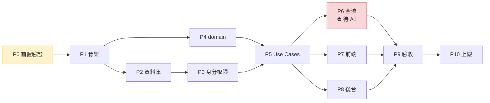

# 02 - 實施計畫

> 產出階段：第三階段（實施計畫）
> 前置文件：`docs/00-現狀分析.md`、`docs/01-目標架構.md`
> 產出日期：2026-10-15
> 分支：`refactor/hexagonal`（baseline：`main` @ `a747010`）
> **本文件只做計畫。尚未修改任何業務代碼、未建立雲函數、未動資料庫。**

---

## 0. 總覽

### 0.1 階段總表

| 階段 | 名稱 | 性質 | 阻斷依賴 | 產出 |
|---|---|---|---|---|
| **P0** | 前置驗證（Spike） | 🔬 驗證 | 無 | 驗證報告、測試框架、環境 |
| **P1** | 基礎骨架與共享代碼 | 🏗️ 新建 | P0 | `packages/`、`sync-shared.js`、entrypoint 骨架 |
| **P2** | 資料庫與 Repository | 🏗️ 新建 | P1 | 集合、索引、權限、Repository + fake |
| **P3** | 身分與權限 | 🏗️ 新建 | P2 | 三層校驗、DTO 過濾、登入 |
| **P4** | domain 核心 | 🏗️ 新建 | P1 | 聚合、狀態機、5 個策略物件 |
| **P5** | application Use Cases（非金流） | 🏗️ 新建 | P3、P4 | 訂單／派單／接單／完工 |
| **P6** | 支付、分帳、退款 | ⛔ **待 A1** | A1、A12 | adapter、回調、定時任務 |
| **P7** | 前端改造（客戶＋師傅＋客服） | 🔧 改造＋新建 | P5 | tabBar、服務、預約、師傅端、客服端 |
| **P8** | 後台 Web API | 🏗️ 新建 | P5 | `admin-api`（**前端由你做**） |
| **P9** | 整合測試與驗收 | ✅ 貫穿 | 各階段 | 測試報告 |
| **P10** | 上線 | 🚀 | P9 | 生產部署 |

### 0.2 里程碑



**關鍵路徑**：`P0 → P1 → P4 → P5 → P7 → P9 → P10`
**P6（金流）不在關鍵路徑上**——因為 A1 未定。這是刻意的：**先完成所有不依賴商戶號的部分**。

### 0.3 通則（適用所有階段）

**提交紀律（決定回滾能力）**

| 規則 | 理由 |
|---|---|
| **新增檔案與修改既有檔案，不放在同一個 commit** | 讓「只回滾改動、保留新增」成為可能 |
| 每個任務一個 commit，訊息含階段編號（如 `P2: 建立 orders 索引`） | 可精準 revert |
| 每階段結束打 tag（如 `p2-done`） | 階段級回滾點 |
| 修改既有前端頁面前，先 `git tag pre-p7-<page>` | 前端改造是唯一有回歸風險的部分 |

**回滾層級**

| 層級 | 指令 | 適用 |
|---|---|---|
| 單一任務 | `git revert <sha>` | 某個任務有問題 |
| 單一階段 | `git reset --hard p2-done` | 整階段重做 |
| 全新重來 | `git checkout main` | 全部放棄，回到 baseline |

**驗收標準一律包含**：`npm run sync:check` 通過、`npm run lint` 通過、`npm test` 通過。

**Pin 住 AI 的範圍**：每個階段開頭我會先提出「計畫與影響範圍」等你確認，才動手（依你的工作方式要求）。

---

## 1. P0 — 前置驗證（Spike）

> **這一階段不寫任何業務代碼。** 目的是在投入大量工作前，先驗證三個會影響全部設計的技術假設。**若驗證失敗，架構需要修改**——所以必須先做。

### 1.1 任務

| # | 任務 | 要驗證的假設 | 為何關鍵 |
|---|---|---|---|
| P0-1 | 建一個最小雲函數 `spike-hello`，用 `sync-shared.js` 注入一個共享包，部署到測試環境 | 「實體複製到 `node_modules/@repair/`」在微信雲函數上真的可行 | 若不可行，§5 整個共享代碼方案要換（退回每函數複製或圖層） |
| P0-2 | 測試「雲端安裝依賴」是否能解析 `file:./node_modules/...` | 部署模式選擇 | 決定必須用「上傳所有檔案」還是可用雲端安裝 |
| P0-3 | 量測共享碼注入後的程式碼包大小 | 是否觸及雲函數包大小上限 | 若過大，需拆分或精簡 |
| P0-4 | 建立測試框架（建議 **Vitest**）並跑通一個 domain 單元測試 | domain 可離線測試 | 你的禁令要求金流測試不可跳過；沒有框架就無從談起 |
| P0-5 | 建立 husky hook：`pre-commit` 跑 `sync:check` + `lint` | 共享碼不會忘記同步 | §5.3.1 的強制點之一 |
| P0-6 | 確認雲開發環境（建議 `repair-test` / `repair-prod` 兩個） | 金流測試隔離 | **金流測試絕不能在生產環境跑** |
| P0-7 | 查閱微信支付官方文檔，確認 §9.1 的 5 項前提與 API 細節 | A1 | **需人工核對**，我不會憑記憶寫死參數 |

### 1.2 影響檔案

**新增**：`cloudfunctions/spike-hello/**`（驗證後刪除）、`packages/shared-kernel/**`（最小版）、`scripts/sync-shared.js`、`vitest.config.js`、`.husky/pre-commit`

**修改**：`project.config.json`（加 `cloudfunctionRoot`）、`package.json`（scripts、devDependencies）、`.gitignore`

### 1.3 驗收標準

- [ ] `spike-hello` 能部署並回傳共享包內定義的字串
- [ ] 故意讓 `packages/` 與 `package.json` 的雜湊不符 → 雲函數**拒絕啟動並回報明確錯誤**
- [ ] `npm run sync:check` 在未同步時回傳非零退出碼
- [ ] `npm test` 能跑一個 domain 純函式測試，且**不啟動任何雲函數**
- [ ] 記錄「雲端安裝依賴 vs 上傳所有檔案」的實測結論

### 1.4 回滾方案

`git checkout main` —— P0 的產物**全部是新增**，且 `cloudfunctions/spike-hello` 驗證後刪除。`project.config.json` 的改動是唯一要留意的既有檔案修改，單獨 commit 以便 revert。

### 1.5 ⚠️ 本階段的失敗模式

| 若 P0-1 失敗 | 對策 |
|---|---|
| `node_modules/@repair/` 上傳後不存在 | 改為「把 `packages/` 直接複製進每個雲函數目錄的子路徑（如 `./_shared/`），用相對路徑 require」。需重寫 §5 |
| `file:` 依賴不被接受 | package.json 中**不宣告** `@repair/*` 為 dependency，改用相對路徑 require（`require('./node_modules/@repair/domain')` 或直接 `./_shared/domain`） |
| 程式碼包過大 | 只注入被該函數實際使用的套件，而非全部 5 個 |

> 這三種對策都會改變 §5 的細節，但**不會改變分層本身**。這就是為什麼 P0 必須先做。

---

## 2. P1 — 基礎骨架與共享代碼

### 2.1 任務

| # | 任務 |
|---|---|
| P1-1 | 建立 `packages/` 五個套件的目錄與 `package.json`（依 §5.3 的 `ORDER`） |
| P1-2 | 完成 `scripts/sync-shared.js`（依 §5.3.1 的實作方案） |
| P1-3 | 建立 `packages/shared-kernel`：`Result`、`Money`、`ClockPort`、`IdGeneratorPort`、`LoggerPort`、錯誤型別 |
| P1-4 | 建立 6 個雲函數目錄骨架（`index.js` + `bootstrap.js` + `package.json`），**只有健康檢查**，無業務 |
| P1-5 | 建立 entrypoint 共用中介層：`withAuth()`、`withValidation()`、`withErrorHandling()`、`withAudit()` |
| P1-6 | 建立 `docs/03-開發規範.md`：分層規則、命名、commit 規範、禁止事項 |

### 2.2 影響檔案

**新增**：`packages/**`、`cloudfunctions/**`、`docs/03-開發規範.md`、`.eslintrc` 分層規則（禁止 domain import 外部套件）

> **值得一提**：ESLint 可用 `no-restricted-imports` 強制「`packages/domain` 不得 import `wx-server-sdk`／`ports`／`adapters`」。這是把架構規則**機械化**，而不是靠 review 記得。這正好補足 §8.3 提到的「無 TypeScript、缺型別強制」問題。

### 2.3 驗收標準

- [ ] 6 個雲函數皆可部署，健康檢查可回應
- [ ] `packages/domain` 中故意 `require('wx-server-sdk')` → **lint 失敗**
- [ ] `npm run sync && npm run sync:check` 通過
- [ ] 每個雲函數的 `bootstrap.js` 都有 `assertSharedBuild()`

### 2.4 回滾方案

全為新增 → `git reset --hard p0-done`。

---

## 3. P2 — 資料庫與 Repository

### 3.1 任務

| # | 任務 |
|---|---|
| P2-1 | 建立 §7.1 的 18 個集合 |
| P2-2 | 建立 §7.1 的所有索引 |
| P2-3 | ⚠️ **將所有集合的資料庫權限設為「僅管理端可讀寫」**（§7.3） |
| P2-4 | 實作 `packages/ports/**Repository.js`（11 個儲存 Port 介面） |
| P2-5 | 實作 `packages/adapters/clouddb/**Repository.js` |
| P2-6 | 實作 `packages/adapters/inmemory/**Repository.js`（**測試替身，與 P2-5 同等重要**） |
| P2-7 | 實作 `CloudDBUnitOfWork`（交易） |
| P2-8 | 寫 Repository 契約測試（同一套測試跑真實 DB 與 in-memory 兩份實作） |

> **P2-8 的價值**：契約測試確保 in-memory fake 與真實 DB 行為一致。否則 P5 用 fake 測過的邏輯，上線後在真實 DB 上會壞。

### 3.2 影響檔案

**新增**：`packages/ports/repositories/**`、`packages/adapters/clouddb/**`、`packages/adapters/inmemory/**`、`packages/ports/UnitOfWork.js`、`tests/contract/**`

**修改**：無

**⚠️ 動到資料庫**：本階段會建立集合。**這是第一個真正動到雲端資源的階段**，需你確認後才執行。

### 3.3 驗收標準

- [ ] 18 個集合與索引建立完成
- [ ] **所有集合權限為「僅管理端可讀寫」**（逐一截圖或指令驗證）
- [ ] 契約測試對兩份實作皆通過
- [ ] 交易能正確回滾（故意製造失敗，確認資料無殘留）

### 3.4 回滾方案

**集合刪除不可逆** → 對策：**本階段只建立空的集合與索引，不匯入任何資料**。回滾＝手動刪除集合（無資料損失）。
Repository 代碼為新增 → `git reset --hard p1-done`。

---

## 4. P3 — 身分與權限

### 4.1 任務

| # | 任務 |
|---|---|
| P3-1 | `users` / `customers` / `cs_agents` / `technicians` 的 Repository 實作（P2 已完成，此處補業務方法） |
| P3-2 | 登入 Use Case：`wx.login` → `code2session`（**或雲開發的 `wxContext.OPENID` 直取**，依 P0 結論）→ 建立／更新 `users` |
| P3-3 | 實作三層校驗中介層（§8.2）：身分 → 角色 → **資源歸屬** |
| P3-4 | 實作角色化 DTO 組裝器（§8.3 的欄位過濾表） |
| P3-5 | 實作 `AddressDisclosurePolicy` + `ContactMaskingPolicy`（§6.3） |
| P3-6 | 師傅入駐申請流程（`technicians.status`: `PENDING → APPROVED/REJECTED`，依 A5 建議） |
| P3-7 | ⚠️ **移除師傅端可及的撥號能力**（§5.4 的既有 `customer-service` 元件隔離任務） |

### 4.2 影響檔案

**新增**：`packages/application/identity/**`、`packages/application/policies/**`（組裝器）、`cloudfunctions/*/middleware/**`、`tests/security/**`

**修改**：
- ⚠️ `pages/order/components/customer-service/index.js`（撥號隔離，**有回歸風險**）

### 4.3 驗收標準（**越權測試是重點**）

- [ ] 師傅 A 無法讀取師傅 B 的訂單
- [ ] 師傅無法呼叫任何客服／管理員 Use Case
- [ ] 客戶無法讀取他人訂單
- [ ] 停用帳號（`status != active`）一律 401
- [ ] **師傅端任何回應都不含完整手機號、完整地址、平台抽成**（以自動化測試掃描所有 DTO 欄位）
- [ ] 未登入狀態呼叫任何 API 皆被拒

> **最後一項的實作方式**：寫一個測試遍歷所有師傅端 Use Case × 所有訂單狀態，斷言回傳 JSON 中不存在符合 `/\d{11}/`（完整手機號）或含 `detailAddress` 的路徑。這是把 §6.3 的策略**變成可執行的斷言**。

### 4.4 回滾方案

新增為主 → `git reset --hard p2-done`。
唯一既有檔案改動是 `customer-service` 元件 → 單獨 commit，可 `git revert`。

---

## 5. P4 — domain 核心

> **這是整個專案最關鍵、也最應該先做對的一層。** 它沒有任何外部依賴，所以可以 100% 離線測試。

### 5.1 任務

| # | 任務 |
|---|---|
| P4-1 | 值物件：`Money`、`OrderNo`、`FeeType`、`CommissionRate`、`MaskedPhone`、`AddressView`、`RefundScope` |
| P4-2 | `ProfitSharingTerms`（§3.6）+ 快照機制 |
| P4-3 | `Order` 聚合 + `OrderItem` 實體 |
| P4-4 | `OrderStateMachine`（§3.3 全部狀態與轉移，含 `DISPUTED`、`EXPIRED_*`） |
| P4-5 | `PricingService`（服務費／材料費／總額） |
| P4-6 | `AddressDisclosurePolicy`、`ContactMaskingPolicy`、`ContactChannelPolicy`（§6.3、§6.4） |
| P4-7 | `ProfitSharingPolicy`（基數參數化，§3.6） |
| P4-8 | `RefundPolicy`（按明細項計算、累計上限校驗，A6 建議） |
| P4-9 | `SettlementOrchestrator`（退款前必須先分帳回退的 Saga 規則） |
| P4-10 | 分帳與退款的狀態機（§3.3 後兩張圖） |

### 5.2 影響檔案

**新增**：`packages/domain/**`、`tests/unit/domain/**`

**修改**：無

### 5.3 驗收標準

- [ ] `packages/domain` 零外部依賴（ESLint 強制 + 手動檢視）
- [ ] **狀態機測試覆蓋所有合法轉移與所有非法轉移**（後者更重要）
- [ ] 金額測試：無浮點誤差；`Money` 的加減乘除、比例、取整皆有邊界測試
- [ ] `DISPUTED` 狀態下呼叫分帳計算 → 被拒
- [ ] `RefundPolicy`：累計退款達上限後再退 → 被拒
- [ ] `AddressDisclosurePolicy`：對每個揭露階段的邊界時間（08:00 前後、N 天前後）皆有測試
- [ ] 測試**不啟動任何雲端資源**，執行時間 < 1 秒

### 5.4 回滾方案

全為新增 → `git reset --hard p3-done`。**domain 沒有任何外部副作用，回滾零成本。**

---

## 6. P5 — application Use Cases（非金流）

### 6.1 任務

| # | 任務 |
|---|---|
| P5-1 | 客戶端 Use Cases（§4.1，除 `RequestRefund` 外的全部） |
| P5-2 | 客服端 Use Cases（§4.2，除 `ReviewRefund` 外） |
| P5-3 | 師傅端 Use Cases（§4.3） |
| P5-4 | 工單系統 Use Cases（`work_order_tickets` / `messages`） |
| P5-5 | 稽核日誌：`withAudit()` 中介層自動寫入 `audit_logs` |
| P5-6 | 各雲函數的 entrypoint 串接 |
| P5-7 | Composition Root（每個雲函數的 `bootstrap.js` 組裝依賴） |

### 6.2 影響檔案

**新增**：`packages/application/**`、`cloudfunctions/*/handlers/**`、`tests/integration/**`

**修改**：`cloudfunctions/*/bootstrap.js`

### 6.3 驗收標準

- [ ] 訂單生命週期可完整走通（用 in-memory fake）：下單 → 派單 → 接單 → 到場 → 完工 → 驗收
- [ ] 每個 Use Case 都有：成功路徑、權限不足、資源不屬於自己、前置條件不滿足 四類測試
- [ ] `audit_logs` 對所有寫操作皆有紀錄，且 `before`/`after` 完整
- [ ] 所有逾時情境可用 `FixedClockAdapter` 模擬並驗證
- [ ] **師傅端 DTO 掃描測試通過**（同 P3-3 的斷言）

### 6.4 回滾方案

新增為主 → `git reset --hard p4-done`。

---

## 7. P6 — 支付、分帳、退款 ⛔ 待 A1

> **本階段在 A1 確認前不啟動。** 依 §9.0 的界線：只實作 interface 與 domain 邏輯（P4 已完成），**不實作任何 adapter**。

### 7.1 啟動條件（全部滿足才開始）

| # | 條件 | 來源 |
|---|---|---|
| 1 | A1：分帳 5 項前提確認 | 你 |
| 2 | A12：材料費模式確認 | 你 |
| 3 | 二清合規風險已諮詢（若走備案） | 你 |
| 4 | 微信支付 API 細節已查閱官方文檔 | 我（P0-7） |
| 5 | 測試環境商戶號可用 | 你 |

### 7.2 任務

| # | 任務 |
|---|---|
| P6-1 | `WeChatPayApiV3Adapter`（預支付、查單、關單） |
| P6-2 | `RefundGateway` 實作（退款、查退款） |
| P6-3 | `ProfitSharingGateway` 實作（添加接收方、請求分帳、查分帳、分帳回退、查回退） |
| P6-4 | `SettlementGateway` 統一介面 + 主方案 adapter |
| P6-5 | `payment-callback` 雲函數：支付／分帳／退款回調處理（**含簽章驗證與冪等**） |
| P6-6 | `scheduled-jobs`：`RecoverStuckSettlements`、逾時任務、對帳 |
| P6-7 | 支付相關 Use Cases：`HandlePaymentCallback`、`ExecuteProfitSharing`、`ExecuteProfitSharingReturn`、`ExecuteRefund` |
| P6-8 | `RequestRefund` / `ApproveRefund`（含 A6 的按明細項退款） |
| P6-9 | 材料墊付報銷（僅在 A12 = (b)/(c) 時） |

### 7.3 影響檔案

**新增**：`packages/adapters/wechatpay/**`、`cloudfunctions/payment-callback/**`、`cloudfunctions/scheduled-jobs/**`、`tests/e2e/payment/**`

**修改**：`cloudfunctions/*/bootstrap.js`（換上真實 adapter）

**⛔ 絕不出現**：任何密鑰、商戶號、API v3 key 進入 repo。全部存於雲函數**環境變數**。

### 7.4 驗收標準（**最嚴格的一個階段**）

- [ ] 測試環境完成：下單 → 付款 → 派單 → 接單 → 完工 → 分帳 → 退款前分帳回退 → 退款 全流程
- [ ] 退款的四種類型皆驗證：只退服務費／只退材料費／全額／按明細項部分退款
- [ ] **分帳非同步情境**：模擬分帳處理中、分帳失敗、回退失敗，確認 `RecoverStuckSettlements` 能收斂
- [ ] **回調冪等**：同一回調重放 10 次 → 資料與金額只變一次
- [ ] **回調簽章驗證**：偽造簽章 → 被拒
- [ ] 分帳回退金額不得超過原分帳金額（有測試）
- [ ] 退款累計不得超過已付金額（有測試）
- [ ] 對帳：DB 中所有金額與微信帳單一致

### 7.5 回滾方案

- **代碼**：`git reset --hard p5-done` + 重新部署（adapter 退回 fake）
- **⚠️ 資金**：**代碼可回滾，已發生的交易不可回滾。** 因此：
  - 本階段全程在 `repair-test` 環境
  - 上生產前，先在測試環境跑完整對帳
  - 保留所有 `*_records` 作為事實來源，任何人工修正都走 `RetryFailedSettlement` 並留 `audit_logs`

---

## 8. P7 — 前端改造

> 依 Q13：保留商品／訂單／地址／訂單詳情／支付骨架；下線購物車／優惠券／拼團／發票／物流；tabBar 改為「首頁／服務／訂單／我的」；新增服務詳情、預約時間、師傅端、客服端。

### 8.1 任務

| # | 任務 | 性質 |
|---|---|---|
| P7-1 | `custom-tab-bar/data.js` 改為依角色回傳（首頁／服務／訂單／我的） | 🔧 改動 |
| P7-2 | 首頁改造為服務入口 | 🔧 改動 |
| P7-3 | **服務詳情頁**（新建，對應 `services` 集合） | 🆕 新增 |
| P7-4 | 訂單確認頁：加入**預約時間選擇**、服務＋材料混合明細、費用拆分顯示 | 🔧 改動 |
| P7-5 | 訂單詳情／列表：狀態機對接、退款入口、工單入口 | 🔧 改動 |
| P7-6 | 支付接通真實 `wx.requestPayment`（`pay.js` 解開註解） | 🔧 改動 |
| P7-7 | 退款申請頁（選退款範圍） | 🆕 新增 |
| P7-8 | 工單聊天頁（客戶↔客服） | 🆕 新增 |
| P7-9 | **師傅端**分包 `pages/technician/**`：訂單列表、接單、到場、完工、報酬、工單 | 🆕 新增 |
| P7-10 | **客服端**分包 `pages/cs/**`：派單工作台、訂單管理、退款審核、工單 | 🆕 新增 |
| P7-11 | 下線：移除購物車／優惠券／拼團／發票／物流的**所有入口**（tabBar、按鈕、跳轉），檔案加 `@deprecated` | 🔧 改動 |
| P7-12 | `services/**` 全面改接雲函數（取代 `resolve('real api')`） | 🔧 改動 |
| P7-13 | 前端**不做**任何權限判斷，只做「顯示或不顯示」 | 紀律 |

### 8.2 影響檔案

**新增**：`pages/service/**`、`pages/technician/**`、`pages/cs/**`、`services/technician/**`、`services/cs/**`

**修改（有回歸風險，需逐頁 tag）**：
`custom-tab-bar/data.js`、`pages/home/**`、`pages/order/order-confirm/**`、`pages/order/order-list/**`、`pages/order/order-detail/**`、`pages/order/apply-service/**`、`pages/order/order-confirm/pay.js`、`pages/usercenter/**`、`app.json`、`services/order/**`

### 8.3 建議的過渡機制：Feature Flag

前端改造是**唯一會影響現有可用功能**的階段。建議在 `config/index.js` 加入：

```js
export const config = {
  useMock: false,
  /** 改造過渡開關：true = 維修模式，false = 原零售模式 */
  repairMode: true,
};
```

理由：任何一頁改壞了，可以**單獨把該頁切回舊行為**，而不是整包回滾。這在 P7 這種大範圍改動中價值很高。
**代價**：需要在改造的頁面裡保留兩條分支。這與「不要一次重寫整個專案」的要求一致。
**待你確認**：是否採用（見 §12 Q3）。

### 8.4 驗收標準

- [ ] 四種角色登入後看到的 tabBar 與頁面正確
- [ ] 客戶可完成：瀏覽服務 → 下單（含預約時間）→ 付款 → 查看進度 → 申請退款 → 與客服對話
- [ ] 師傅可完成：查看指派 → 接單 → 到場 → 完工 → 查看報酬
- [ ] 師傅端**看不到**完整手機號、完整地址（服務當日前）、平台抽成
- [ ] 購物車／優惠券／拼團／發票／物流**無任何入口可達**
- [ ] ⚠️ **前端不得出現任何 `role_type` 的權限判斷邏輯**（只允許用於顯示切換）
- [ ] 支付為真實 `wx.requestPayment`

### 8.5 回滾方案

- 逐頁 `git checkout main -- pages/<page>` 還原單頁
- 或 `git reset --hard p6-done` 整階段回滾
- 或把 `config.repairMode` 設為 `false`（若採 Feature Flag）

---

## 9. P8 — 後台 Web API

> **你已明示：前端由你做（微搭或 React Admin），我不做前端。** 本階段只交付純 JSON API。

### 9.1 任務

| # | 任務 |
|---|---|
| P8-1 | `admin-api` 雲函數（獨立於小程序的認證方式，需與你確認） |
| P8-2 | 商品／服務管理 Use Cases（§4.4） |
| P8-3 | 師傅管理（審核、技能標籤、分帳開通狀態） |
| P8-4 | 訂單管理、改派、狀態流轉、備註 |
| P8-5 | 退款審核 |
| P8-6 | 統計看板 Use Case（§4.4 `QueryDashboard`） |
| P8-7 | 稽核日誌查詢 |
| P8-8 | API 文件（供你接前端） |

### 9.2 影響檔案

**新增**：`cloudfunctions/admin-api/**`、`packages/application/admin/**`、`docs/05-admin-api.md`

### 9.3 驗收標準

- [ ] 商品／服務可新增、修改、上下架、改價、分類
- [ ] **改價後，歷史訂單金額不變**（快照驗證，對應你的業務規則 4）
- [ ] 統計數據與 DB 實際資料一致
- [ ] 非 `admin` 角色呼叫一律 403

### 9.4 ⚠️ 需你確認

**`admin-api` 的認證方式**：Web 後台不走小程序，沒有 `wxContext.OPENID`。需選：
- (a) 微信掃碼登入（Web 端拿 code → 雲函數換 openid）
- (b) 帳號密碼 + JWT
- (c) 微搭內建的使用者體系

**我無法替你決定，這影響 `admin-api` 的全部認證代碼。** 見 §12 Q1。

### 9.5 回滾方案

新增 → `git reset --hard p7-done`。

---

## 10. P9 — 整合測試與驗收

### 10.1 測試分層

| 層級 | 範圍 | 依賴 | 執行時機 |
|---|---|---|---|
| 單元 | `packages/domain` | 無 | 每次 commit |
| 契約 | Repository 兩份實作 | in-memory / 測試 DB | 每次 commit |
| 整合 | `packages/application` | in-memory fakes | 每次 commit |
| 安全 | 越權、DTO 洩漏掃描 | in-memory fakes | 每次 commit |
| 端到端 | 真實雲函數 + 測試商戶號 | 雲端 | 每次部署到測試環境 |
| 對帳 | DB vs 微信帳單 | 雲端 | 上線前 |

### 10.2 對應你的驗收標準

| 你的驗收標準 | 驗證方式 | 階段 |
|---|---|---|
| 四種角色權限正確隔離 | P3-3 安全測試 | P3 |
| 下單→付款→派單→接單→完成→分帳→退款→分帳回退 全流程可測試 | P6-4 端到端 | P6 |
| 退款可選只退服務費／只退材料費／全額，原路返回 | P6-4 四類型測試 | P6 |
| 商品與服務可後台修改，歷史訂單價格不變 | P8-3 快照測試 | P8 |
| 師傅只看自己的訂單與報酬，看不到完整敏感資料 | P3-3 DTO 掃描斷言 | P3 |
| 後台有統計看板與管理功能 | P8 | P8 |
| 代碼符合六角形架構，domain 不依賴微信雲 API | ESLint `no-restricted-imports` + 檢視 | P1 |
| 不可跳過支付、退款、分帳測試 | P6 為獨立階段，有明確 blocking 條件 | P6 |

### 10.3 ⚠️ 誠實的限制

**在 A1 確認與測試商戶號可用之前，「支付、退款、分帳的測試」在物理上不可能完成。** 這不是排程問題，是外部依賴問題。

本計畫的應對是：把金流隔離成獨立的 P6，讓**其餘所有階段都不被它阻塞**。但若 A1 最終無法通過且備案也不可行，**整個分帳設計需要重來**——這是本案最大的單一風險。

---

## 11. P10 — 上線

### 11.1 任務

| # | 任務 |
|---|---|
| P10-1 | 生產環境建立與設定（環境變數、密鑰） |
| P10-2 | 雲函數部署（生產） |
| P10-3 | 資料庫權限複查（所有集合「僅管理端可讀寫」） |
| P10-4 | 灰度：先開內部帳號，再小範圍真實使用者 |
| P10-5 | 監控與告警（結算失敗、逾時未派單、爭議積壓） |
| P10-6 | 對帳機制上線（每日比對 DB 與微信帳單） |
| P10-7 | 回滾預案演練（部署回滾、資料庫還原） |

### 11.2 上線前檢查清單

- [ ] 所有密鑰存於雲函數環境變數，**repo 中零密鑰**（`git grep` 驗證）
- [ ] `docs/04-環境設定.md` 已建立（**不含密鑰**）
- [ ] 資料庫權限全部為「僅管理端可讀寫」
- [ ] 對帳腳本可執行且結果為零差異
- [ ] 回滾演練通過
- [ ] 分帳／退款的人工介入 SOP 已文件化（`RecoverStuckSettlements` 之外的情況）

### 11.3 回滾方案

| 情境 | 動作 |
|---|---|
| 前端問題 | 重新部署上一版（微信有版本回退） |
| 雲函數問題 | 部署上一版代碼 |
| 資料問題 | **最危險**——雲開發資料庫無自動時間點還原，需事前建立**每日備份匯出**機制（列入 P10-6） |

---

## 12. 風險清單

### 12.1 阻斷級

| # | 風險 | 影響 | 對策 |
|---|---|---|---|
| R1 | **A1 分帳前提未定** | P6 無法啟動；最壞情況整個分帳設計要重來 | §9.0 以檔案為單位隔離；P6 獨立成階段 |
| R2 | **A12 材料費模式未定** | 資料模型與 Use Case 數量 | 與 A1 一併確認 |
| R3 | **P0-1 共享代碼驗證可能失敗** | §5 方案需改 | P0 先做；三種備選對策已備（§1.5） |
| R4 | **二清合規風險** | 備案可能根本不可行 | 你諮詢法務；我不寫代碼 |
| R5 | **無測試框架**（現狀 R2） | 無法滿足「不可跳過金流測試」 | P0-4 建立 |
| R6 | **`admin-api` 認證方式未定** | P8 全部認證代碼 | §12 Q1 |

### 12.2 結構級

| # | 風險 | 影響 | 對策 |
|---|---|---|---|
| R7 | 雲開發資料庫**無自動時間點還原** | 資料損壞不可逆 | P10-6 每日備份匯出 |
| R8 | 無 TypeScript | 介面契約靠自律 | ESLint `no-restricted-imports` + 契約測試 |
| R9 | 雲函數冷啟動 | 使用者體驗 | 接受；不做過度優化 |
| R10 | `config/index.js` 455 KB（99% 靜態資料） | 干擾搜尋與工具 | 建議拆出 `config/areaData.js`（**獨立任務，需你同意**） |
| R11 | 前端改造回歸風險（R7 是唯一改動既有功能處） | 弄壞現有可用頁面 | Feature Flag + 逐頁 tag + 逐頁回滾 |

### 12.3 流程級

| # | 風險 | 影響 | 對策 |
|---|---|---|---|
| R12 | **遠端已存在已推送的 commit** | force-push 會改寫遠端歷史 | ⚠️ 見 §12 Q2；**我未執行任何 push** |
| R13 | 共享碼忘記同步 | 舊版規則處理金流 | 三處強制點（§5.3.1） |
| R14 | 階段跨度大，容易失焦 | 品質下降 | 每階段先提計畫與影響範圍，等你確認 |

---

## 13. 需要你確認的問題

### 🔴 阻斷級

**Q1. `admin-api` 的認證方式**（P8 啟動前必須定）
Web 後台不走小程序，沒有 `wxContext.OPENID`：
- (a) 微信掃碼登入（Web 拿 code → 雲函數換 openid）
- (b) 帳號密碼 + JWT（需自建 `admin_credentials` 集合與密碼雜湊）
- (c) 微搭內建使用者體系
- (d) 其他

**Q2. 已推送到 GitHub 的 commit 如何處理？**
我發現 `origin/main`（`1f38b93`）與 `origin/refactor/hexagonal`（`9b645c6`）**已存在於 `git@github.com:nctgitedIvan/repair_svc_app_wb.git`**，而本地的 amend 已改寫了這兩個 commit（新 hash `a747010` / `2128038` / `6ced308`）。

目前狀態：本地與遠端**已分歧**。

| 選項 | 動作 | 後果 |
|---|---|---|
| (a) **force-push** | `git push --force-with-lease` | 遠端歷史被改寫；若他人已拉取會造成困擾 |
| (b) **保留分歧，之後合併** | 不做任何事 | 歷史較亂，但零風險 |
| (c) **接受舊作者，回復原狀** | 把本地 reset 回舊 commit | 放棄 amend |

**我沒有、也不會在未經你明確同意的情況下執行任何 push。** 請告訴我選哪個。
（若該 repo 是**公開**的，也請告知——這會影響是否適合放入架構文件。）

**Q3. 是否採用前端 Feature Flag**（§8.3）
`config.repairMode` 可在改造期間逐頁切回舊行為。代價是改造頁面需保留兩條分支。

### 🟡 非阻斷（可稍後回覆）

**Q4.** §11.2 已給出 A5／A6／A8／A9／A10／A11／A13 的建議——**請確認是否照此執行**，或指出要改的項目。
**Q5.** A12（材料費模式：平台統一定價 / 師傅代購報銷 / 混合）——這是阻斷級，但可在 P6 前回覆。
**Q6.** 是否同意把 `config/areaData` 拆出獨立檔案（R10）？這是既有檔案改動，需你同意。
**Q7.** 是否現在就執行 P0？P0 需要修改 `project.config.json` 與 `package.json`（既有檔案），並會建立測試用雲函數。

---

## 14. 下一步

**本計畫的最終目標：在你的授權下，依序執行 P0 → P10。**

在你明確說「**開始修改**」之前，我不會動任何業務代碼、不建立雲函數、不動資料庫。

建議的啟動順序：
1. 你回覆 §13 的 Q1、Q2、Q3（阻斷級）
2. 我提出 **P0 的詳細計畫與影響範圍**（依你的工作方式要求）
3. 你確認
4. 執行 P0，產出驗證報告
5. 依 P0 結果調整 §5 的共享代碼方案，再進入 P1

---

**⏸ 第三階段結束。等待你的回覆。**
