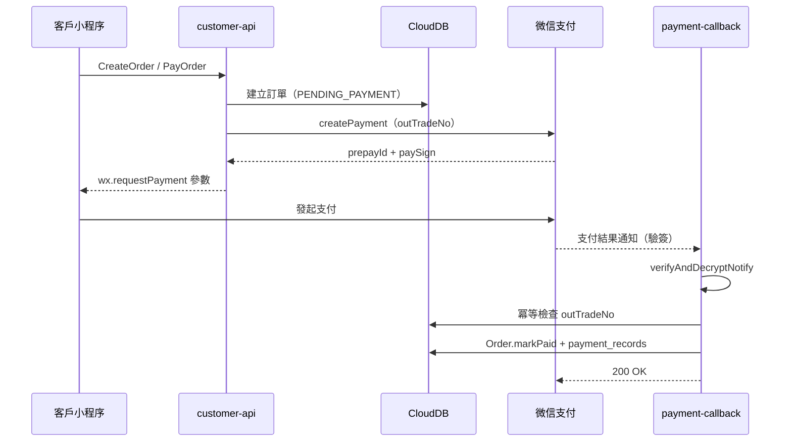
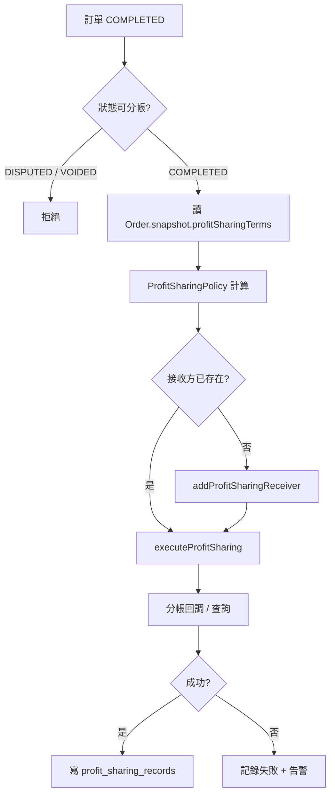
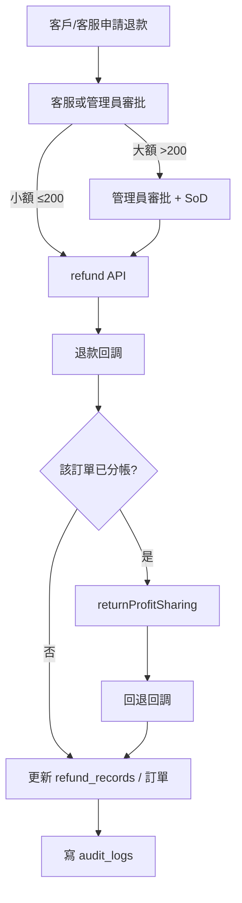

# 06 · P6 微信支付與服務商分帳預案

> 產出日期：2026-10-17
> **狀態：預案，未實作。** P5 目前使用 `MockPaymentGateway`；本文件描述 A1（商戶號與分帳權限）到位後要做什麼。
> 依據：`docs/01` §3.7／§9、`docs/P4-計畫.md`、`docs/P5` 實作結果。

---

## 0. 先講三個前提

1. **平台走「服務商」模式**：平台是微信支付服務商，師傅是特約／二級商戶；
   客戶付款後，平台不能把錢留在自己帳上（避免「二清」）。
2. **分帳必須在支付成功後、訂單完成且未凍結時執行**；`DISPUTED`／`VOIDED` 一律拒絕。
3. **A1 未到位前不得實作任何真實支付 adapter**。P5 的 `MockPaymentGateway` 只用於測試。

---

## 1. 需要的商戶能力

| 能力 | 用途 | 備註 |
|---|---|---|
| 服務商商戶號（`sp_mchid`） | 平台主體 | 需開通服務商 |
| 特約商戶／二級商戶（`sub_mchid`） | 每位師傅 | 進件、實名、結算帳戶 |
| JSAPI 支付 | 小程序內支付 | 需綁定 AppID 與支付授權目錄 |
| **分帳** | 平台抽成、師傅報酬 | 需在服務商與子商戶都開通 |
| **分帳回退** | 退款／爭議時的錢退回 | 需確認支援 |
| 退款 | 原路退回 | 需 API v3 憑證 |
| 回調通知 | 支付／退款／分帳結果 | 必須 HTTPS、可公開訪問 |

> ⚠️ 分帳權限與費率由微信支付審核，**不是程式碼能解決的**。A1 未通過前，
> 所有 `WeChatPay*Adapter` 都不得出現在生產 bootstrap。

---

## 2. 服務商分帳模型

```
客戶（OPENID）
   │  JSAPI 支付
   ▼
微信支付
   │  收款 → 服務商商戶號（sp_mchid）
   │  分帳指令：receivers = [師傅 sub_mchid, 平台 sp_mchid]
   ▼
特約商戶（師傅）       服務商（平台）
   │ 80% 服務費            │ 20% 服務費
   └──────────┬────────────┘
              ▼
        結算／提現（各自）
```

| 角色 | 說明 |
|---|---|
| **平台（服務商）** | 建立訂單、發起支付、發起分帳、退款、對帳 |
| **師傅（特約商戶）** | 收款方；不直接接觸客戶支付 |
| **客戶** | 只與平台交易，不感知分帳 |

**金額規則（P5 已定）**：分潤基數 = **服務費**，材料費不參與分潤；
比例讀 `Order.snapshot.profitSharingTerms`（下單快照），不讀當前配置。

---

## 3. Port／Adapter 設計

### 3.1 現有 Port

`packages/ports/PaymentGateway.js` 目前只有：

```js
createPayment({ orderId, orderNo, amountCents, currency, outTradeNo })
refund({ orderId, orderNo, outRefundNo, amountCents, reason })
executeProfitSharing({ orderId, orderNo, outOrderNo, receiverId, amountCents })
```

### 3.2 P6 建議擴充

> 保持 `PaymentGateway` 為 **application 依賴的穩定介面**；
> 微信支付細節放在 `WeChatPayApiV3Adapter`（adapter 層），
> 不得讓 Use Case 直接呼叫 HTTP 或 SDK。

| 方法 | 輸入 | 輸出 | 用途 |
|---|---|---|---|
| `createPayment` | `openid`, `outTradeNo`, `amountCents`, `description`, `notifyUrl` | `{ prepayId, paySign, nonceStr, timeStamp, signType }` | JSAPI 預支付 |
| `queryPayment` | `outTradeNo` | `{ status, transactionId, paidAt }` | 主動查單（回調遺失時） |
| `closePayment` | `outTradeNo` | `{ status }` | 關單 |
| `refund` | `outRefundNo`, `outTradeNo`, `amountCents`, `reason`, `notifyUrl` | `{ status, refundId }` | 退款 |
| `queryRefund` | `outRefundNo` | `{ status, processedAt }` | 查退款 |
| `addProfitSharingReceiver` | `{ type, account, name, relationType }` | `{ receiverId }` | 添加分帳接收方（冪等） |
| `executeProfitSharing` | `{ transactionId, outOrderNo, receivers[], description }` | `{ status, orderId }` | 請求分帳 |
| `queryProfitSharing` | `outOrderNo` | `{ status, receivers }` | 查分帳 |
| `returnProfitSharing` | `{ outReturnNo, outOrderNo, returnAccount, amountCents, description }` | `{ status }` | 分帳回退 |
| `queryProfitSharingReturn` | `outReturnNo` | `{ status }` | 查回退 |
| `verifyAndDecryptNotify` | `{ headers, rawBody }` | `{ eventType, resource }` | 回調驗簽＋解密 |

### 3.3 實作位置

| 層 | 檔案 | 職責 |
|---|---|---|
| Port | `packages/ports/PaymentGateway.js` | 介面（application 只依賴它） |
| Adapter | `packages/adapters/wechatpay/WeChatPayApiV3Adapter.js` | HTTP、簽章、加解密 |
| Adapter | `packages/adapters/wechatpay/WeChatPayProfitSharingAdapter.js` | 分帳／回退 |
| Adapter | `packages/adapters/wechatpay/WeChatPayNotifyVerifier.js` | 回調驗簽／解密 |
| Mock | `packages/adapters/inmemory/MockPaymentGateway.js` | P5 測試（已完成） |

**Composition Root**：只在各雲函數 `bootstrap.js` 決定注入 Mock 或真實 adapter；
`application` 與 `domain` 不得 import `wechatpay` 或任何 HTTP client。

---

## 4. 流程圖

### 4.1 支付



### 4.2 分帳



### 4.3 退款與分帳回退



> **順序很重要**：先退款成功，再處理分帳回退；若回退失敗，退款仍成立，
> 但必須產生告警與人工處理工單（錢已退給客戶，平台需向師傅追回）。

---

## 5. 安全注意事項

### 5.1 密鑰與憑證

| 項目 | 管理方式 |
|---|---|
| API v3 密鑰 | **雲函數環境變數**／密鑰管理；**不得進 repo、不得寫死** |
| 商戶 API 憑證（private key） | 同上；只掛在 `payment-callback`／`customer-api` 需要它的函數 |
| 平台證書（public key） | 放在雲函數可讀的密鑰設定；定期更新 |
| 商戶號／sub_mchid | 可設定在 `system_configs`，但**密鑰不可** |
| 前端 | **不得持有任何密鑰**；只拿 `prepayId`／簽名參數 |

### 5.2 回調驗簽

1. 讀取 `Wechatpay-Timestamp`、`Wechatpay-Nonce`、`Wechatpay-Signature`、`Wechatpay-Serial`。
2. 用平台證書驗簽 **原始 raw body**（不是重新序列化的 JSON）。
3. 檢查時間戳在 **5 分鐘**內（防重放）。
4. `resource` 用 **AES-256-GCM** 解密；校驗 `associated_data`／`nonce`。
5. 驗證 `mchid`／`appid` 與本方一致。
6. **驗簽失敗回 4xx，不處理業務**。

### 5.3 冪等

| 鍵 | 唯一索引 | 行為 |
|---|---|---|
| `out_trade_no` | `payment_records` | 重複回調直接回既有結果 |
| `out_order_no` | `profit_sharing_records` | 重複分帳請求回既有結果 |
| `out_refund_no` | `refund_records` | 重複退款請求回既有結果 |
| `out_return_no` | `profit_sharing_return_records` | 重複回退回既有結果 |

- 回調可能**重複送達**；先查唯一鍵，再執行 Use Case。
- 回調必須 **200 OK** 才停止重試；業務失敗要記錄並回 200（避免微信無限重試），
  再由定時任務補償。
- 分帳／退款請採用「先寫本地 `pending`，再呼叫 API，回調更新」的狀態機。

### 5.4 金額與狀態

- 金額一律由後端重算，**不信任前端**。
- 退款不得超過「已付未退」；`AmountConstraint` 已在 domain 實作。
- 分帳只能在 `COMPLETED` 且未凍結時執行（`canExecuteProfitSharing`）。
- 凍結（對帳差異 >1000 元）必須真的拒絕 `ExecuteProfitSharing`，不能只告警。

### 5.5 稽核

- 每次支付、退款、分帳、回退都寫 `audit_logs`（哈希鏈）。
- 金額變更必帶 `reasonCode`（`REFUND_*`／`REVERSAL` 等）。
- 回調的 `trace_id`／`transaction_id` 寫入記錄，方便對帳。
- 密鑰操作（輪換）也要留痕。

---

## 6. 與 P5 Use Cases 的對接

| Use Case | P5 現況 | P6 要改 |
|---|---|---|
| `PayOrder` | `MockPaymentGateway.createPayment` 直接成功 | 改回傳 `wx.requestPayment` 參數；`markPaid` 移到回調 |
| `ApproveRefund` | `MockPaymentGateway.refund` | 呼叫真實退款；回調更新狀態 |
| `ExecuteProfitSharing` | `MockPaymentGateway.executeProfitSharing` | 先加接收方、再請求分帳；回調／查詢更新 |

> ⚠️ **`PayOrder` 不能在呼叫支付 API 後就直接 `markPaid`**。
> 真實流程是：建立預支付 → 前端 `wx.requestPayment` → **回調**才 `markPaid`。
> P5 的 mock 成功路徑要保留給測試，但正式 adapter 必須分離「預支付」與「支付成功」。

---

## 7. 測試計畫

| # | 測試 | 方式 |
|---|---|---|
| 1 | 預支付成功 | `repair-test` 商戶，0.01 元 |
| 2 | 回調驗簽 | 正確簽名通過；錯誤簽名 4xx |
| 3 | 回調重複 | 同一 `out_trade_no` 送 3 次，只記一筆 |
| 4 | 支付逾時 | 關單／查單補償 |
| 5 | 退款成功 | 0.01 元退款 |
| 6 | 退款超過已付 | 拒絕（domain 已測） |
| 7 | 分帳成功 | 添加接收方＋請求分帳 |
| 8 | 重複分帳 | `out_order_no` 唯一，回既有結果 |
| 9 | 分帳回退 | 退款後回退成功 |
| 10 | 凍結分帳 | `DISPUTED`／對帳凍結 → 拒絕 |
| 11 | 回調亂序 | 先收到退款回調、後收到支付回調 → 狀態機拒絕，記錄告警 |
| 12 | 密鑰輪換 | 舊憑證過期後回調仍可驗（雙憑證期） |

---

## 8. 上線順序

1. A1：服務商商戶號、分帳權限、特約商戶進件。
2. `repair-test` 環境小額實測（0.01 元）。
3. 對帳：每日比對微信帳單與 `payment_records`／`refund_records`。
4. 灰度：先開放小比例客戶，觀察回調成功率與分帳失敗率。
5. 生產：密鑰輪換、監控告警、人工補償 SOP。

---

## 9. 風險與待決策

| # | 風險／問題 | 建議 |
|---|---|---|
| R1 | 二清風險 | 服務商模式，錢直接進師傅子商戶；平台只收分帳抽成 |
| R2 | 分帳權限未開通 | P6 阻斷；不得用「平台代收再轉帳」繞過 |
| R3 | 分帳回退不支援 | 先確認；若不支援，退款後需人工向師傅追回 |
| R4 | 回調遺失 | 定時 `queryPayment`／`queryRefund` 補償 |
| R5 | 稅務／發票 | 平台與師傅各自的開票責任需法務確認 |
| R6 | 密鑰洩漏 | 環境變數＋最小權限＋輪換 SOP；洩漏時立即停用 |

---

## 10. 實作檢查清單（P6 開工時）

- [ ] A1 商戶號與分帳權限已到位
- [ ] `WeChatPayApiV3Adapter`／`ProfitSharingAdapter` 實作
- [ ] `PaymentGateway` Port 擴充並更新 Mock
- [ ] 回調驗簽／解密／冪等
- [ ] `PayOrder` 改為「預支付 → 回調 markPaid」
- [ ] 退款／分帳／回退接真實 API
- [ ] 0.01 元實測與重複回調測試
- [ ] 對帳與告警
- [ ] 密鑰管理與輪換 SOP
